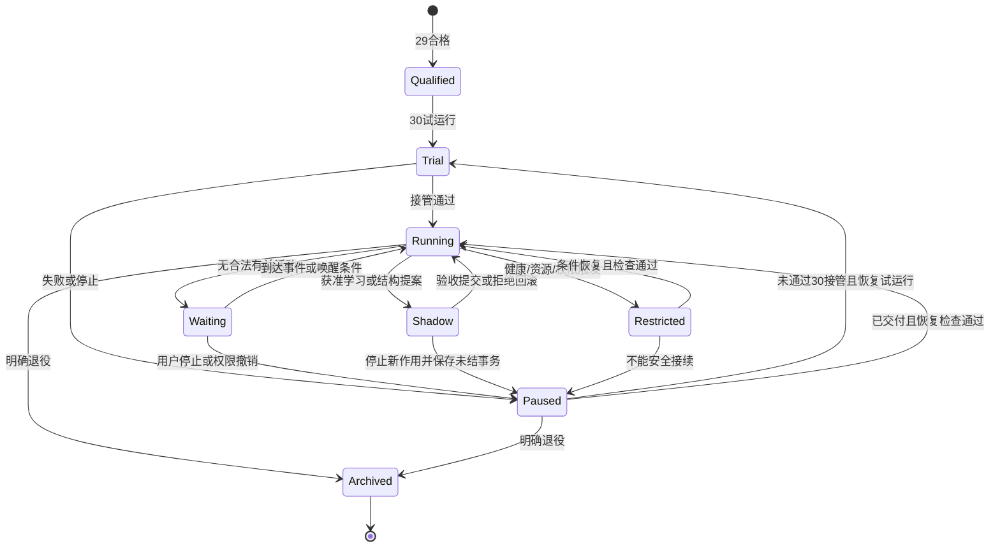

# 态极（Taiji）主线完整闭环执行总纲

> 文档状态：[主线] — 2026-11-19（短期 `22.5.1 S0–S5` ＋ 收官 `22.5.2–22.8` ＋ 长期 `23–30 → §15–§16` 完整闭环）。本页是**唯一主线**执行总纲：无论当下推进哪个工作包，只认同一可恢复主体谱系与本页顺序队列。只读逐轮状态归档见 [MAINLINE_STATUS_HISTORY_20261119.md](MAINLINE_STATUS_HISTORY_20261119.md)（其历史“唯一后继”语句只对其时点成立，不得据此执行），审批与证据流水见 [03_CURRENT_EXECUTION.md](active/roadmap/03_CURRENT_EXECUTION.md) 与 [MASTER-PLAN.md](MASTER-PLAN.md)。

## 0. 全局定位、一页状态与根目标九轴矩阵

[统一目标与验收](active/TAIJI_CORE_REQUIREMENTS.md#21-统一目标与验收)要求发展以有身份、持续活动状态、可塑连接与可继承生命周期的神经单位为基础的原生认知主体：由自身认知机制承担自然中文连续任务、多模态物理因果理解、跨会话经验积累与纠错保持、自主活动/递归改进及继承式规模生长；最终经 `29` 模型级联合确认、以 `30` 交付用户可独立启动并接管的持续运行包。Seed 仅承担调度、权限、时钟、I/O 与原子事务外壳，不替模型做认知决定。

### 0.1 全项目当前状态总览（只列已签与未签）

| 范围 | 当前状态 | 关键已签/实证读数与预算事实 | 权威依据 |
|---|---|---|---|
| `22.1–22.3` 数学 / 参考图 / 恢复工程 | **已结案** | 局部代数与参考图工程核验完成；small 原始链、重编码、6 次实际更新/2 次故障及 12 类 schema 恢复交付 | [22.2 核验](reference/VALIDATION-TAIJI-U2_22_2_20261110.md) / [22.3 结案](reference/VALIDATION-TAIJI-U2_22_3_CLOSEOUT_20261111.md) |
| `22.4` 世界 / 分区 / 七分项定价 | **已结案**（仅工程父） | `1,280 world`（`train 768 / fit 192 / check 192 / final 128` 预留）；工程父 `accepted_parent`（`authorized=false`、能力资格空） | [工程父清单](manifests/taiji_u2_22_4_accepted_parent_20261117.json) / [22.4.1 结案](reference/VALIDATION-TAIJI-U2_22_4_1_CLOSEOUT_20261112.md) |
| `22.5.0` A 父门（first-A） | **已挣得 `a_parent_earned`** | 3 seed check `171 / 78 / 174 ÷ 192`，中位 **`0.8906 >= 0.80`**（判据乙）；FLOPs 配平基线仅 `0.370 / 0.365 / 0.297`；check① `2/2` 用尽 | [A 父结果卡](reference/RESULT-TAIJI_U2_22_5_0_A_PARENT_PACKAGE_20261119.md) / [A 挣得清单](manifests/taiji_u2_22_5_0_a_parent_earned_20261119.json) |
| `22.5.1 / E5.10r3` 相关性路由 | **已挣得 `relevance_gate_earned`** | 逐字匹配滤波使器官内化相关性路由：A `32/32`、B `24/24`、D `22/24`、父代逐位不变，实耗 `45.7 CPU <= 帽 80` | [E5.10r3 结果卡](reference/RESULT-TAIJI_U2_22_5_1_RELEVANCE_R3_20261119.md) |
| **`22.5.1` 联合门整体（纠正＋保持）** | **fit 面联合门判 `joint_gate_fit_face_pass`（D-20261119-13）；严格 D 口径参考反转（D-20261119-14）；按常设授权采用 A 案 `fit_face_only` 工作路径（D-20261119-21），22.6 以 22.6.0 零训练合同开卡（C 任务 fixture 已 `fixture_controls_pass`）；正式 check②/B 父资格/架构门仍未签，owner 可回溯改选 B 案** | **工程 6/6**：读出身份隔离 v1/v2（含 `delta_head` v1 布局补充修正）、E5.1 摘要化、E5 冻结路由兼容层、S0 出生确定性、静态/回归门、提交冻结；**已接受 v1 A 父 strict load 3/3 且记录 fit 逐值复现（`30/14/31`）**。**第 4 项三 seed 复核负面**：seed `20261111` 全过（A `31/32`、B/D `24/24` 两界、恢复 exact），seed `20261110`（A `32/32`，D `15/24`／`8/24`）与 seed `20261112`（A `22/32`，D `19/24`，未见 B `1/24`）未过 ⇒ 单 seed 声称不具 seed 稳健性，S1–S5 不启动。**D 面定位包已执行（88.19≤帽 154.7）判 `operating_point_insufficient`**：δ 九点读数逐项相同（路由 logit 饱和）⇒ H1 阈值假设被证伪，失败在未见模板窗口选择（表示/训练限制）；D 决策级两 seed 两面 `22/24`。**owner 2026-11-20 三裁定**：定位包按帽授权、父身份＝v1 强 seed 单主候选＋相对父代 D 判据、阶段账照旧。**D 面按范围上限收束**（不再开第 4 次修订）；联合门 D 判据＝相对父代单侧 95% 上界 ≤0.02；主候选＝v1 seed `20261112`（记录 check `174/192`、fit `31/32`，预声明规则），3 seed 统计＝同一父 bundle × 3 训练子种子，禁拼 seed | [S0 结果卡](reference/RESULT-TAIJI_U2_S0_ARCH_REPAIR_20261119.md) / [定位包结果卡](reference/RESULT-TAIJI_U2_S0_D_LOCALIZATION_20261119.md) / [联合门 fit 面结果卡](reference/RESULT-TAIJI_U2_22_5_1_JOINT_GATE_20261120.md) / [正式 check② 提案](reference/DESIGN-TAIJI_U2_22_5_1_FORMAL_CHECK_GATE_20261120.md) / [严格 D 回执](../../reports/taiji_u2_22_5_1_strict_d_20261120.json) / [身份谱系备忘](reference/MEMO-TAIJI_U2_22_5_1_IDENTITY_LINEAGE_20261120.md) / [未见模板备忘](reference/MEMO-TAIJI_U2_22_5_1_UNSEEN_TEMPLATE_20261120.md) / [跨会话探针备忘](reference/MEMO-TAIJI_U2_22_5_1_CROSS_SESSION_20261120.md) / D-11／D-13／D-14／D-16／D-18／D-19 |
| `22.6 / 22.7 / 22.8`（包 22 余项） | **22.6.0 C 任务合同冻结并判 `c_task_ready`（D-22）；池级准入已解决「池子太易」（D-20261119-24：32 world 开发池、最强固定 0.83、wait_value +0.1833、头空间 0.17），22.6.1 预测器 **`predictor_gain_pass`**（D-20261119-26）；22.6.2 策略对照 **`policy_gain_absent`** 已收束（D-27）；22.6.3 因可教授面全饱和记 **`constructibility_blocked_ceiling`** 暂缓（D-28）；22.7.0 预研 **`lifecycle_pass`**＋扩展 **`lifecycle_ext_pass`**（D-29/30：身份/中性出生/可逆休眠/唤醒逐位还原/退役/引用清理/状态生长/跨进程恢复/胶囊持久化，13/13＋11/11，零训练 0.05 CPU）；任务收益/旧能力门/七臂配平/连接信用未签；22.7.0 正式卡前置设计草稿已出（D-20261119-31）；α 接口探针 r1–r4：v1–v3 早期 `adapter_insufficient` 根因＝像素 x 轴误用＋统计特征抹空间；适配器 v3 修正后线性探针 fit 0.9062、r4 单位图 **`adapter_ready`**（D-20261119-34：fit 1.0×3、44.27 CPU、跨进程重载 3/3）；七臂合同骨架已冻结＋smoke（D-35）；硬度校准两轮未命中中间带（r2 12 单元 0.39→16 单元 1.0；r3 100 步 0.47→200 步 0.95），按预设出口结案 **`growth_not_needed_in_scope`**（D-20261119-36，未训练）；22.7 结构/生命周期证据仍成立（仅结构）、增长收益记 uncovered；噪声感知族否决生长用途（D-38/39）；**joint24 容量受限任务族可行**（D-20261119-40：16/32 单位中间带、32→64 头空间 +0.1875），22.7b 执行 `retention_breach`（D-42）；根因已定位并修复（D-20261119-44：训练环漏 `project_parameters_()`；每步投影后 3/3 seed 出生前后 logits 逐位一致 `birth_neutral_with_projection`），22.7c 已执行 `growth_gain_absent`（D-20261119-45：双零初始化使新生儿为死单元，增益必为 0）；活入口出生已实现并测（D-20261119-46：p 通路活、`engineering_failure` 因单步 r 梯度门过严，改 N=5 步后 22.7e 重测）；22.8/23–30 锁定** | 严格按 `22.5.1 -> 22.6 -> 22.7 -> 22.8` 凭前卡同一谱系接受父与冻结实价逐项解锁；22.6 候选 C 任务与 fixture 三控制见[开卡备忘](reference/BRIEF-TAIJI_U2_22_6_OPENING_20261120.md)／[C 任务草稿卡](reference/DESIGN-TAIJI_U2_22_6_0_C_TASK_20261120.md)（`fixture_controls_pass`，D-20261119-20） | 本文 `§3` / [包 22 详卡](reference/PLAN-TAIJI-CLOSED_LOOP_DEVELOPMENT_20261110.md) |
| `23–30 → §15–§16` 长期闭环 | **已立长期设计，未准入** | 24 正式锚定体内记忆 `22.5.Y`（D-20261117-40）；29 冻结 `R0` 确认，30 交付接管包后进入运营状态机 | 本文 `§4` / [N 长期路线](reference/PLAN-TAIJI-N_LONG_HORIZON_20261111.md) |
| 阶段财务账（22.5） | **超支永久记事故（D-20261119-04/06/15）** | 诚实位置 `≈32,040 + E5.10 三卡 189.3 + 本轮 S0–S4 实测 ≈3,209 = ≈35,250`，对重冻阶段帽 `24,000` 超 `≈11,250（46.9%）`，不追溯改帽；后续每卡单列报价＋硬帽 | [03 台账](active/roadmap/03_CURRENT_EXECUTION.md) / D-15 |

**当前明确不能签署**：`22.5.1` 联合门正式合同（`S0` 能力复核负面，S1 未启动）、`22.6+` 解锁、非 first-A 对外任务能力、`C/D/J` 任务已会、正式 `check② / final` 通过、模型级成型或可独立接管交付。

### 0.2 根目标九轴资格向量（同主体单一谱系记账）

每份接受清单保存同一可追溯主体谱系在 `engineering / task / learning / retention / autonomous_choice / mature_growth / recursive_development / physical_transfer / lifetime` 九轴的 `verified / negative / uncovered`、生效范围、证据路径与源码/参数摘要；**严禁拼装不同 seed 或不同候选取最优凑成“全绿主体”**：

| 资格轴 | 包 22 首次承接与判门 | 长期扩展（23–28）与交付确认（29–30） |
|---|---|---|
| `engineering`（恢复/事务/有限/权限） | `22.3 / 22.4`（已过），`22.5–22.8` 全程预检与非空 moment 恢复 | `24.3` 分段迁移 / `25.4` 引用审计 / `28.5` 5 边界崩溃恢复 / `30.3` 故障演练 |
| `task`（自然中文＋多模态全分母） | `22.5.0` first-A（已过）、`22.5.1` B/D/A 联合、`22.8` J 片段 | `23` 组合关系＋`>=3` 旧技能（`>=0.80`）/ `29.1` 联合 `Q>=0.95`（各族 `>=0.90`） |
| `learning`（合法反馈净益＋负责信用＋纠错） | `22.5.1` 联合门（相对冻结更新 `>=0.05`、95% 下界 `>0`） | `24` 10 会话 `F/W` 巩固＋四类纠错撤销 / `29.2` 合法纠错 `>=0.90` 并保持 `>=2` 会话 |
| `retention`（仍有效旧技能损伤上界） | `22.5.1` 可失败保持门（`<=0.02`＋无保护对照） | `24 / 25 / 26 / 27 / 28 / 29 / 30` 全程单侧 95% 损伤上界 `<=0.02`（同时报最坏技能） |
| `autonomous_choice`（无提示继续/求证/等待） | `22.6` C 任务（5 策略对照、净效用 `>=0.05`） | `26.2` 策略 / `28.2` 连续无提示活动 / `29.3 / 30.2` 唤醒与自主交互 |
| `mature_growth`（中性出生/成熟/休眠/删除） | `22.7` 两代成长（`G0–G6`，删除移除 `>=50%` 增益且 `>=0.02`） | `25` 连续 `>=3` 代成熟谱系（单元/连接/群/通信/M-K 择一，无压力不硬生） |
| `recursive_development`（后果预测＋相依干预） | `22.6.3`（`>=2` 次相依改进＋固定父反事实） | `26` 后果模型＋`>=3` 次相依干预＋结果屏蔽/置换对照净益 `>=0.02` |
| `physical_transfer`（感知-动作-回执因果迁移） | `22.4.2` / `22.8` 物理动作片段 | `27` 三动力学族（推阻/碰撞/遮挡声响；模拟/回放/真机分签）/ `29.4` |
| `lifetime`（长跨度连续存活与低人工接管） | `22.8` `>=3` session × 32 轮 J 轨迹 | `28`（100 会话或 10,000 事件＋24h 现场）/ `30.4`（非计划救援 `<=1/100` 轮） |

**2026-11-20 当前九轴状态**（同一父 seed `20261112` 谱系、只读汇总，见 [阶段收口账](reference/MEMO-TAIJI_PACKAGE22_CLOSE_20261120.md)）：`engineering=verified`；`task=verified(fit_face_only)`；`learning=verified(路由技能)/uncovered(内容积累)`；`retention=verified(严格 D 口径 breach 已披露)`；`autonomous_choice=negative`（22.6.2）；`mature_growth=结构 verified/收益 growth_not_needed_in_scope`；`recursive_development=uncovered`；`physical_transfer=uncovered`；`lifetime=verified(有界)/uncovered(长跨度)`。

---

## 1. 执行铁律、七项准入合同与八种标准出口

### 1.1 八条不可越界执行铁律

1. **单步队列推进**：每次只执行 `§2` 唯一序列的当前一步；步间通过只看明文硬判据，不拿过程日志或历史旧文代签。
2. **先冻代码后取 Pin**：严格遵循 **冻结源码并提交 → 计算 `source_pins` → 落盘冻结合同 → 申请 owner 授权 → 启动训练**。先 pin 后改 `taiji/` 会触发 `source_pin_mismatch` fail-closed 拒载。
3. **单卡独立定价与明示授权**：阶段帽已无余量，每张执行卡须依据批量实测单价（含子进程评估与恢复开销，按实测留 `>=1.25x` 余裕）报价，并取得 owner 对**该卡**的 `training_authority` 与单卡 CPU/wall 帽。
4. **判据读前冻结**：指标分子/分母、3 seed 聚合方式（逐 seed 还是中位，按 D-20261119-04 先例须事前明文写入合同）、bootstrap 独立单位与统计分辨率，读前哈希锁定为 `criteria_sha256`；读后改口径作废。
5. **分区与封存隔离（`R-SEAL-1`）**：研发与结构修补严格限定在 `train (768) / fit (192)`（出生诊断再拆为 `birth-fit 128 / birth-check 64`）；`check① (2/2)` 已在 A 线用完；`22.5.1` 仅可用 `check②`（曝光上限 `<=2`，固定 worker 只释放聚合计数）；`final (128)` 不得提前生成或读取。
6. **标准命令与运行环境**：在 `E:\Seed` 根目录使用系统 Python 3.12 执行 `python -m pytest ...`（裸 `pytest` 会报 `No module named 'scripts'`；`.venv` 缺少 pytest），与 `ruff check`、`python -m mypy` 同过才准入。
7. **有限修订与三探针止损**：同一能力范围最多 **2 次架构修订**＋**1 个局部定位包（`<=10%` 窗口预算）**；`E5.10` 相关性门已消耗 owner 特批第 3 次例外，**`22.5.1` 联合门及后续阶段严禁再援引第 3 次例外**。任意连续 **3 次额外局部探针未改变六轴能力账**，立即触发全局收束。
8. **同信息与等算力配平**：架构比较须冻结**等 FLOPs** 或**等 CPU/wall 时间**（二选一、实测端点偏差 `<=10%`），**严禁只按参数量配平**（22.4.4 已证常规基线与 U2 CPU 差两个数量级）；控制臂与主臂接收完全一致的合法信息与在线反馈权利。

### 1.2 通用七项准入合同（适用于 `22.5.1–30.x` 每张卡）

| 合同项 | 必须绑定内容与核验方法 | 缺失后果 |
|---|---|---|
| `1. 输入父与资格` | 上卡接受 `bundle`、`accepted_parent` ID、源码/参数/schema/optimizer/RNG 摘要、9 轴当前资格向量 | `not_admitted / parent_missing` |
| `2. 核心假说与实现` | 单一可证伪命题、负责参数/模块及维度边界；非中性结构调整先交迁移误差界与出生中性证明 | `not_admitted / spec_ambiguous` |
| `3. 数据/分区与反馈权利` | 不可拆 world/流 `partition_digest`、模型可见传感、授权 `support` 时点、`query` 真值隔离矩阵 | `not_admitted / data_invalid` |
| `4. 对照与因果干预` | 冻结更新、反馈置换、模块切断（如 `"record_organ"`）与等算力强基线（同数据顺序与暴露） | `not_admitted / control_missing` |
| `5. 数值门与统计分辨率` | 主终点、`retention <= 0.02`、3 fixed seeds (`20261110/11/12`)、world/流配对 `10,000` 次 bootstrap 95% 区间与事前分辨率模拟 | `not_admitted / statistical_resolution_unavailable` |
| `6. 实测定价与硬帽` | 批量重复计时（消除 Windows `15.6ms` 粒度）测单步/评测/恢复价，验明 `C_all <= B` 后冻结步数与帽 | `not_admitted / pricing_over_budget` |
| `7. 保存恢复与唯一出口` | 初始＋首个非空 moment `export_bundle / U2Runtime` 跨进程逐位/容差复算验证，绑定下方 8 种规范出口 | `not_admitted` 或 `engineering_failure` |

### 1.3 统一八种标准出口与项目终态

每张卡统一产出 `status + reason + evidence + last_accepted_parent + actual_cost + successor_eligibility`：
- `pass`：预注册任务、机制、保持、工程与成本门全部过关，原子提交并发布新资格，进入允许后继。
- `negative`：数据与工程合法且对照组完整，主门未获支持；保留原父与失败子版本，关闭本窗并保留定位。
- `inconclusive`：预注册灰区、保持区间跨 `0.02`、或统计分辨率/算力配平不足；不发资格，禁止微调重试。
- `engineering_failure`：前向/实现偏离合同、非有限值、保存恢复或事务归属错；立即停写并回滚原父（全包限 1 次定位修）。
- `budget_stop`：CPU / wall / 内存 / 存储 / 调用或 check 曝光触发硬帽；保留最近耐久父与已耗账，禁止降门续跑。
- `not_admitted`：父资格、唯一规格、反馈权利、实测定价或分辨率缺失，未耗正式训练预算即停。
- `retention_breach`：仍有效旧技能损伤由硬门或区间下界证实超 `0.02`（或可失败保持门失效）；拒绝子版本并恢复父代。
- `data_invalid`：泄漏、跨区、矛盾标签或评分真值进入可见输入；隔离受污染结果并审计影响，禁换口径挽救。

全项目终态只允许三类：`delivered_in_scope`（29/30 及声明边界全过并转入 `§15` 运营）、`not_delivered`（列明缺口结束当前窗口）、`retired`（完成授权退役归档）。

---

## 2. 近期执行计划：22.5.1 联合门（S0–S5）与 S0 架构修复实证

**核心目标**：以同一 `22.5.0` A 父为基础，在同一可微主体上联合达成 **新反馈纠正（Task B）＋多记录/版本覆盖竞争＋无关记录保持父代真值（Task D）＋可失败旧能力保持（Task A）＋跨进程恢复**。

**22.5.1 正式门限**（源自 [包 22 详卡 §2.5](reference/PLAN-TAIJI-CLOSED_LOOP_DEVELOPMENT_20261110.md#25-卡225-同一主体的学习父与新能力)）：
1. **纠正与多记录**：未见 query 下 Task B 全应答轮成功率 `>= 0.80`、纠正率 `>= 0.80`（覆盖新版压旧版与多记录竞争）。
2. **反馈学习净益**：相对同主体“冻结在线更新”控制，增益 `>= 0.05`、world 配对 95% 下界 `> 0` 且 3 seed 同向。
3. **可失败保持门**：仍有效 A 旧能力下降单侧 95% 上界 `<= 0.02`，且同包包含“无保护覆盖写入”对照以证明保持门确可失败。
4. **因果与恢复**：冻结父、冻结更新、反馈置换、`record_organ` 及 `F/H/E` 因果切断、读取/表达参数冻结副本；保存→独立进程重载同条件评测逐位/容差内一致。使用 `check②`（曝光上限 `<= 2`）。

### 2.1 S0–S5 顺序执行工作卡

| 步 | 执行内容 | 通过判据 | 失败处置与出口 | 授权 | 预计成本 |
|---|---|---|---|---|---|
| **S0** | 读出身份隔离（`pixel-salience-v2`）＋D 面与联合架构修复（**核心已完成并验证**）＋E5.10r3 3 步冒烟＋E5.1 合同测试整理＋3 seed S0 复核＋全套测试/lint/mypy/审计提交 | `§2.3` 收口 6 项全绿、`D >= 20/24`（已见/未见）且 `B=24/24, 多记录>=22/24, 覆盖=24/24`、`git status` 干净，冻结 `taiji/` | **未全绿**：工程 5 项完成；第 4 项三 seed 复核**负面**（seed `20261110/20261112` 未过 D/未见 B），停在 S0 定位，不耗 check②、不进 S1；见 [S0 结果卡](reference/RESULT-TAIJI_U2_S0_ARCH_REPAIR_20261119.md) | 无需 | 零训练探针 `~1 CPU`；诊断复训原估 `~160 CPU/seed`，实测诊断合计 `≈1,484 CPU`（定价遗漏已记事故） |
| **S1** | `R-REBUILD-1`：验证旧 A 父能否按冻结生成链在现代码精确/等价重建（先跑主候选 seed `20261112`） | 重建后 `fit >= 31/32`（`check` 零读取）或出具 `regenerable_equivalent` 及容差证据 | **已豁免（owner 2026-11-20，D-20261119-12）**：已接受父 strict load 3/3＋记录 fit 逐值复现；父身份证据改由 S2 合同绑定 bundle sha256＋参数树/键集合摘要＋fit 复现回执；残留风险「生成链未重跑验证」显式登记；S2 预检失败即重开 S1 | owner（已裁） | 0（豁免，省约 `1,400 CPU`） |
| **S2** | 零训练设计＋实测定价：fit 面 B/相对-D/可失败保持面、同一父×3 训练子种子、因果/覆盖/恢复腿 | **已完成**：设计卡＋冻结合同＋smoke 全过（`22.12 CPU`、`0` 优化器步）；包价 `1,102.71`、帽 `1,378.38 CPU` | — | 无需 | 实测约 `35 CPU` |
| **S3** | 呈报 owner 正式授权（含单卡 CPU/wall 帽及 `check②` 曝光声明） | **已完成**：合同记录常设授权 `owner:standing-authorization:2026-11-20#recommendation-default`；`guards("run")` 通过；`check②` 仍 `2/2` 用尽、不读 | — | 常设授权 | `0` |
| **S4** | `--run` → `--verify` 执行 3 子种子全臂，冻结复算并出判词 | **已完成**：`joint_gate_fit_face_pass`（fit 面；实耗 `1,359.22 ≤ 1,400 CPU`；verify-only 修订 A 行空判，`54.42 CPU`）；恢复 3/3 exact、父代逐位不变 | 负出口按合同顺序；本卡无 | — | 实测 `1,413.64 CPU` |
| **S5** | 生成结果卡与机器回执，同步 `03_CURRENT_EXECUTION.md`、`MASTER-PLAN.md` 与本文 `§0`，收口或解锁 `22.6` | **结果卡与台账已同步**；但 **22.6 未解锁**（正式 check②/B 父资格/架构门未签，fit 面证据待 owner 回溯裁定；A/B 提案见 [正式 check② 提案](reference/DESIGN-TAIJI_U2_22_5_1_FORMAL_CHECK_GATE_20261120.md)，B 帽 540 CPU） | 若 `22.5.1` 用满 `2` 次架构修订仍负 ⇒ 停窗复审；本卡为正但边界受限 | 无需 | `0` |

### 2.2 本轮已落地的配套算法与架构升级（S0 核心源码重构）

| 模块 | 解决的核心算法/架构缺陷与具体实现 | 对应不变量与验证依据 |
|---|---|---|
| [`taiji/u2_pixel_read.py`](../taiji/u2_pixel_read.py) | **S0 升级版注册为新身份 `pixel-salience-v2`，v1（`pixel-salience`）逐字节冻结**：v2＝4 头查询条件显著性读出＋正弦位置基＋可学查询门＋LayerNorm 文本池化；8 通道中心-环绕亮度/色度特征＋`pixel_prior`；可学 `null`/`null_bias` 与 10×4 空间/SNR 特征 RMS 归一（`feat_scale`）；零初始化 `out` 投影；v1 保持原 `PixelSalienceReadout` 参数名/形状/初始化流，两身份无共享 checkpoint | `test_u2_pixel_readout.py` 双身份全绿并断言 v1 布局逐名逐形状冻结；v2 在 seed `20261111` 600 更新达 `31/32`（单 seed 声称 `30/32`，三 seed 面见 §2.3） |
| [`taiji/u2_record_organ.py`](../taiji/u2_record_organ.py) | **根治近义干扰坍缩与模板重叠误触发**：① seed `20261119` 固定单位范数 `match_basis` 构成锚定向量 `match_char_vectors`，防止共享 `byte` 表将颜色字（红/绿/黄/紫）拉坍缩；② `_query_salience` 用锚定 `q_match + pos` 学习每字符显著性 `w_sal`，对 4-gram 对角匹配 `diag_min` 施加出生恒 `1.0`、有界窗口门控 `win_gate`；③ `[s_diag4, s_pool4, s_diag4^3, mu_sal*s_diag4]`＋锐化 `route_gate`＋多记录 softmax 哨兵＋近因打破平局；④ 2 层 Conv1d 可微 span 抽取器＋出生中性 `organ_mix=0`（`tanh(2*\|mix\|)` 消除零点梯度死区）；⑤ **冻结 E5 接口兼容层**：实例级 `organ.route` 补丁经 `plan()/emit()` 的 `legacy_hard` 分支继续生效；⑥ organ 构造移入身份种子 `fork_rng`（旧实现构造在 fork 之外，消耗未播种全局 RNG，导致 3 步冒烟跨进程非确定） | 出生匹配 `1.0`，近义干扰 `<0.30`；单 seed 声称已见 `23/24`、未见 `21/24`，**三 seed 复核仅 seed `20261111` 复现**（见 §2.3）；`test_u2_record_organ.py` 含兼容层回归 |
| [`taiji/u2_subject.py`](../taiji/u2_subject.py) | 移除 `delta_head[2]` 偏置修复双零鞍点；新增 `record_organ_candidate()`；`record_read()` 增加零记录快路径并用 `organ_active` 将无关干扰时旧记录读取平滑让渡至 `null_out`；抽取 `_pixel_delta()`；`begin_utterance()` 缓存 `organ_plan` 并在 EOS 时由 `accept_byte()` 清理防跨轮泄漏；`output()` 以 `lam*(1-active)` 与 `gamma+(1-gamma)*active` 协调 `_apply_record_organ` 与旧复制门；`optional_state_keys` 纳入 `organ_plan` | 出生 `finite_delta==0.0`（逐位中性）；`"record_organ"` 切断 0/24 精确回落父代；`from_bundle` 逐位恢复 |
| [`taiji/u2_22_5_pipeline.py`](../taiji/u2_22_5_pipeline.py) | 落地 A 门＋器官两阶段联动流水线（冻结父对数概率预缓存加速 ~50×）、`BOrganTrainConfig` 50/50 均衡正负混合采样（单记录 B / 单干扰 D / 多记录竞争 / 版本覆盖 / 双干扰 D），并修复 `evaluate_22_5_1_suite` 中干扰项 `(idx+1)%n_b` 偶发抽到同实体的评估缺陷；新增 `with_task_a/with_controls/with_recovery` 开关与「一次 D 解码双用」以压低诊断成本 | `test_u2_record_organ.py`、`test_u2_22_5_pipeline.py` 全绿；`ruff` 与 `mypy` 0 错；三 seed 诊断回执见 §2.3 |

### 2.3 S0 收口执行记录（2026-11-19 夜，已执行：工程 5/6 绿，第 4 项负面）

> 以下读数严格运行于 `train / fit` 分区（**0 check / 0 final**），仅作 S0 架构修复实证，不作为 `22.5.1` 冻结合同读数。机器回执见 [S0 结果卡](reference/RESULT-TAIJI_U2_S0_ARCH_REPAIR_20261119.md)、[三 seed 回执](../../reports/taiji_u2_s0_diagnostic_3seed_20261119.json) 与 [A 段配置探针](../../reports/taiji_u2_s0_a_segment_config_probe_20261119.json)。

**原单 seed 声称（seed `20261111`，`600u` A＋`300s` Organ；原表未记录 `train_count`，故不可直接复现）**：

| 验证阶段 | 原声称指标 | 三 seed 复核结论 |
|---|---|---|
| A 段（`600` 更新，`batch=4`，`147.17 CPU`） | `fit 30/32 (0.9375)`；曲线 `150:0.25 → 300:0.2812 → 450:0.6562 → 600:0.9375` | 配置恢复后 seed `20261111` 复现 **`31/32`**；seed `20261110` **`32/32`**、seed `20261112` **`22/32`** ⇒ 单 seed 声称不具种子稳健性 |
| B/D 器官段（`300` 步，`11.08 CPU`） | `parent_bit_identical=true`, `organ_mix=1.2706`, `recovery_exact=true` | 三 seed 全部复现（父代逐位不变、恢复 exact） |
| 已见模板全套（`train_templates` 仅 2 模板） | `A_retention_drop=0.0`，`B=24/24`，`D=23/24`，多记录 `24/24`，版本覆盖 `24/24` | seed `20261111` 全复现（D `24/24`）；seed `20261110` D **`15/24`**、seed `20261112` D **`19/24`** |
| 零样本未见模板（第 3 模板倒装句式） | `B=24/24`，`D=21/24`，多记录 `24/24`，版本覆盖 `24/24` | seed `20261111` 全复现（D `24/24`）；seed `20261110` D **`8/24`**；seed `20261112` B **`1/24`**、多记录 **`1/24`** |
| 因果负对照（同套 eval） | `frozen_parent_b=0/24`、`organ_cut_b=0/24`、`permuted_feedback_b=0/24` | 三 seed：冻结父 `0/1/1`、切除与冻结父**逐值相等**、置换 `0/0/1`（≤ chance）⇒ 结构因果干净；**精确 0 不是可复现门**（父代可偶然命中答对字） |

**6 项收口状态**：

1. **读出身份隔离**：✅ 完成（v1/v2 双身份、v1 布局冻结、双身份测试）。
2. **HEAD `source_pin` 债务清理**：✅ 完成（E5.1 闭卡后只校合同摘要，测试模块 docstring 补台账说明，不重跑退役合同）。
3. **E5.10 r3 兼容冒烟**：✅ 完成（含发现）。现码确定性读数 **A `32/32`、B `15/24`、D `22/24`、父代不变、9.7 CPU**，三次重复逐项相同；旧回执的 `B=16` 是**旧身份非确定性出生**的单次抽样（HEAD 重复读 B `20/2/16/13/18`、D `22/22/20`），根因＝E5.9 器官构造在 `fork_rng` 之外；S0 已改为种子内构造。判据修正为「脚本可运行＋A `32/32`＋D≥22＋父代不变＋读数落在旧身份观测带（B 2–20）」并以兼容层保证旧 `route` 补丁仍生效。
4. **3 seed 诊断复核**：❌ **负面（具名 `s0_diagnostic_failed`）**。配置恢复：`train_count=256` 复现 A 声称档（探针回执），据此冻结并跑三 seed：seed `20261111` **全过**（A `31/32`、B/D/multi 两界全 `24/24`、恢复 exact）；seed `20261110`（A `32/32` 但 D `15/24`／`8/24`）与 seed `20261112`（A `22/32`、D `19/24`、未见 B `1/24`）**未过**。归因：① D 门结构上受父代 A 精度约束；② 更强父代（seed 10 A 满分）下 D 仍低 ⇒ 器官路由在无关记录上误触发，机制不具 seed 稳健；③ seed 12 未见模板路由整体塌陷（同 r1/r2「操作点移动而非 ROC 提升」同族）；④ A 段 600 更新仍是种子×配置级敏感（v2 修好 `20261111`，`20261112` 反弱）。D 侧架构修订已用满 2 次＋1 次特批（r1/r2/r3），**不得再开第 4 次同范围修订**。
5. **仓库静态与回归门**：✅ 完成（pytest 子集 46 项、`ruff check taiji tests/taiji_native` 0、`mypy` 4 文件 0、`audit_plan_single_mainline.py --json` rc 0、新报告均走 `write_report()` 并记 `threads`）。
6. **提交并冻结 Pin**：✅ 完成（提交集见结果卡 §6；`taiji/` 冻结以供 S1/S2）。

**成本与事故**：S0 诊断合计 **≈1,484 CPU**（r3 兼容 121＋配置探针 279＋误配复跑 570.55＋正式复核 574.86＋冒烟），对工作卡原估（`~160/seed`）超支 **≈1,004 CPU**；成因＝工作卡未记 `train_count` 致一次误配复跑与一次配置探针。按 E5.1／A.5 纪律**如实记定价遗漏事故、不改帽、不追溯改判据**。

**结论与后继**：`22.5.1` S0 未全绿；**S1–S5 不启动**。唯一后继＝owner 在 D-20261119-09 §7 的三决策点中裁定（见 [S0 结果卡 §5](reference/RESULT-TAIJI_U2_S0_ARCH_REPAIR_20261119.md#5-标准出口与签署边界)）。**决策支持包已出（D-20261119-10）**：① 身份隔离补充修正 `delta_head` v1 布局，已接受 v1 A 父三 seed **strict load 3/3 且记录 fit 逐值复现（`30/14/31`）**（[回执](../../reports/taiji_u2_s0_accepted_parent_load_20261119.json)）；② D 面定位包[设计卡](reference/DESIGN-TAIJI_U2_S0_D_LOCALIZATION_20261119.md)与实测定价：**`123.76 CPU`／帽 `154.7 CPU／20 min`**（600 步器官训练、δ 闭包补丁、0 check、预注册 `operating_point_only`／`operating_point_insufficient` 两出口）；③ 选项② v2 重挣 A 父 **`5,271.24 CPU`／帽 `6,589.05`**（需新 A 门合同＋新 check 曝光裁定）；④ 选项③ 零训练（需 owner 修订单主候选与相对父代 D 判据）。[定价回执](../../reports/taiji_u2_s0_decision_options_price_20261119.json)。

### 2.4 已知卡点与避坑速查（11 类工程与算法陷阱）

| # | 现象 | 根因 | 唯一正确处理 |
|---|---|---|---|
| 1 | `source_pin_mismatch:*` 或旧 checkpoint 拒绝加载 | `taiji/` 代码改动导致源码摘要与冻结清单/胶囊不一致 | 代码先冻结提交，再取 `source_pins`；已结案合同补注不清跑；旧父重建走 S1 `R-REBUILD-1` |
| 2 | `missing_training_authority` 拒跑 | 合同 `training_authority` 字段为 `null` | 正常保护；呈报单卡实价预算等 owner 明示授权写入 |
| 3 | `No module named 'scripts'` / `No module named pytest` | 用了裸 `pytest` 或缺少 pytest 的 `.venv` | 仓库根目录用系统 Python 3.12 运行：`python -m pytest ...` |
| 4 | 训练过慢 | Windows 多线程对小序列前向无加速（`0.07–0.13s/例`） | A 段用进程并行 runner；器官段开启父 logp 缓存（提速 ~50×，300 步 ~11s） |
| 5 | `20261111` 种子在 A 门表现波动 | 种子×初始化配置级不稳定（原 A check 仅 `78/192`） | S0 多头读出与特征归一已大幅改善（`30/32`）；22.5.1 合同仍须读前写明**中位 vs 逐 seed**（建议沿 D-20261119-04 用中位） |
| 6 | 保持门恒 0 损伤造成假绿 | 写入门未启用或读写参数未产生真实对抗 | `22.5.1` 必设无保护覆盖对照组，证实保持门确实会失败 |
| 7 | `RecordOrgan` 在近义干扰（`绿色圆片` vs `紫色圆片`）误触发 | (a) 请求与记录共享 6 字符模板 `"色圆片现在在"` 致无权重 `s_diag4=1.0`；(b) `byte` 表共训坍缩；(c) 早期 span 未学好时 `seq_loss` 把 `route_head` 推负；(d) 评估偶发同实体作干扰 | 已在 S0 用锚定 `match_basis`＋显著性窗口门控 `win_gate`＋50/50 均衡采样＋去重配对彻底修复 |
| 8 | 出生中性 `organ_mix=0` 无梯度 | `clamp(0,1)` 在 `0` 处导数为 0 | 已改为光滑偶对称 `tanh(2*\|mix\|)`，兼顾零点精确中性与首步非零梯度 |
| 9 | `set_records` 拒收或静默丢弃构造记录 | 校验 `observed_at <= world_time` 且 `source=="sensor"`, `scope=="world"` | 构造记录固定 `observed_at=0.0, source="sensor", scope="world"` |
| 10 | 阶段账估计偏低超帽 | 漏计子进程评测、序列化与 I/O 段开销 | 按实测（含子进程与 `>=8` 块均值）报价并留 `>=1.25x` 余量；超帽即 `budget_stop` |
| 11 | 3 步兼容冒烟跨进程读数漂移（`B` 在 `2–20` 间变） | E5.9 时代 `RecordOrgan` 在 `fork_rng` 之外构造，消耗未播种全局 RNG，器官初值每个进程不同；单次回执的 `B=16` 不是稳定读数 | 任何候选的**全部**新张量必须在身份种子 `fork_rng` 内构造（S0 已修）；历史单次读数只作观测、不作门；门用多进程重复的逐项一致或区间 |

---

## 3. 中期执行计划：收官执行包 22（`22.5.2 → 22.6 → 22.7 → 22.8`）

包 22 余项以各前卡同一谱系 `accepted_parent` 解锁（总预算口径见 [包 22 §2.9](reference/PLAN-TAIJI-CLOSED_LOOP_DEVELOPMENT_20261110.md#29-横切执行合同)，包 22 合计规划帽 `54,000 CPU / 108,000 wall`）：

### 3.1 `22.5.2` 架构比较与单位原生核心接力
- **预算（并入 `22.5`）**：计划 16,000＋余量 3,200＝**19,200 CPU** / 38,400 wall，check② `<=2`。
- **内容与门限**：按等 FLOPs 或等时间（`<=10%`）配平对比 U2 与最强常规序列基线；按 [路径备案](reference/DECISION-TAIJI_NEURAL_CORE_PATH_20261114.md) 在 `taiji/u2_neural_units.py` 明确路线 A（兼容 `H` 嵌入）与路线 B（器官直接查询单位状态）的唯一前向与迁移差集。若学习门通过而架构优越性（`>=0.05`, 95% 下界 `>0`）未过，仍交付学习父进 `22.6`，架构结论单记 `negative/inconclusive`。

### 3.2 `22.6` 自驱与递归发展选择（`22.6.0–22.6.5`）
- **预算**：计划 8,000＋余量 1,600＝**9,600 CPU** / 19,200 wall；全局 `check <= 2`。
- **子卡落地**：
  - `22.6.0`：冻结有期限、行动成本、无新提示时段与合理等待的 C 任务（`>=3` session × `16` 决策机会，含帮助撤除测试；若 `WAIT` 空转最优即 `fixture_invalid`）。
  - `22.6.1`：在 `development-fit` 真实干预后果上训练 `gain/risk/cost` 预测器，归一 Huber 损失低于 fit 常数基线 **`>=10%`**（90% 经验残差带 check 覆盖 `>=0.80` 且平均宽度不大于常数基线）。
  - `22.6.2–22.6.3`：保持神经规模、释放边界巩固 `Θ` 与选择策略 `Ψ`，同父对比 **5 控制臂**（固定日程 / 反应 `ν` / 随机合法策略 / 等待 / 固定父及结果屏蔽反事实），完成 **至少 2 次相依改进决策**（后次读真已改变的主体）。
  - `22.6.4–22.6.5`：check① 准入、check② 冻结选择父；主终点（冻结效用＝任务收益－归一成本－旧损伤）相对最强固定/反应策略 **`>=0.05`**、95% 下界 `>0`、3 seed 同向、A 损伤 `<=0.02`；仅省算力记 `cost_saving_only`。

### 3.3 `22.7` 神经生长、整合与成熟（`22.7.0–22.7.2`）
- **预算**：计划 12,000＋余量 2,400＝**14,400 CPU** / 28,800 wall；全局 `check <= 3`。
- **子卡落地**：
  - `22.7.0` 提案：`fit (192)` 拆 `birth-fit / birth-check (96/96)`；检验历史资格信用 `Σgδe^T`、数值秩 `max(1e-8, 1e-5*σmax, τnoise)`（128 次置换最大奇异值 `0.99` 分位标定）、方向余弦 `>=0.25`、每群每代新增 `<=3` 且 `<=25%`、最多 `4` 支路/`2` 代、`<=4,096` 提案或 `2s`（超停 `proposal_budget_stop`）。
  - `22.7.1` **七臂对照**：`G0` 信用覆盖条件出生 / `G1` 随机盲门 / `G2` 置换门 / `G3` GradMax+固定日程 / `G4` 仅重放 / `G5` 固定强优化 / `G6` 同终容预分配（未用容量同计资源）。
  - `22.7.2` 成熟、休眠与两代交接：check① 裁第 1 代、check② 裁由已受 1 代继续生出的第 2 代；至少 1 轮 **出生→成熟→可逆休眠→唤醒恢复**；出生中性 `FP64<=1e-10 / FP32<=1e-5`；相对最强匹配控制净益 **`>=0.05`**、**成熟删除移除 `>=50%` 增益且绝对下降 `>=0.02`**、旧保持 `<=0.02`；无真实生长需要可结 `growth_not_needed_in_scope`。

### 3.4 `22.8` 同主体联合生命片段与全局收束（`22.8.0–22.8.4`）
- **预算**：计划 4,000＋余量 800＝**4,800 CPU** / 9,600 wall；`check 1`＋独立 `final` 当次授权。
- **子卡落地**：`22.8.0` 冻结最终候选摘要 → `22.8.1` 3 seed × `>=3` session × `32` 轮 J 联合片段（中文任务/物理行动/反馈纠错/恢复/无提示活动同轨迹运行，分外观/动力学/遮挡/冲突/反事实分账） → `22.8.2` 最后 1 次 check rehearsal → `22.8.3` 仅在当次 `R-SEAL-1` 明确授权后开启 `final 128 world` → `22.8.4` **无条件全局收束**（禁止续加 22.9，输出包 23 立项依据与 9 轴资格表）。

---

## 4. 长期完整闭环计划：执行包 23–30 与交付后运营状态机（§15–§16）

承接 [N 长期实施方案](reference/PLAN-TAIJI-N_LONG_HORIZON_20261111.md)，包 23–30 按先决条件严格推进。**23–27** 首窗规划帽均为 **`<= 48,000 CPU / 96,000 wall`**（建议配比 准备 10% / 学习发展 60% / 评价 15% / 恢复故障 5% / 定位收束 10%）；每包 `.0` 按实价与样本分辨率（10,000 次固定种子 bootstrap + 3 seed 同向）冻结合同，check 最多 2 次、final 最多 1 次、全包最多 2 个具名候选与每卡 1 个定位包。

### 4.1 包 23–30 阶段总图与关键规划裁决

- **关键记忆锚点裁决（D-20261117-40）**：`22.5.Y` 体内情景/联想记忆（[Y 结构卡](reference/DESIGN-TAIJI_U2_Y_IN_VIVO_PLASTIC_MEMORY_20261117.md)：共享单位池稀疏协作＋快速场 `F` 在线 `Write`＋慢连接 `W` 事务巩固＋撤线索 `Recall`）**正式锚定于包 24**；22.x 仅备恢复/活动/接口前置，23 备齐组合任务与 `>=3` 类已核验旧技能，24 执行完整情景记忆闭环并证明 `W` 巩固净益后，25 再判结构生长压力。
- **规划默认数值门（23–28，29 提升为交付门）**：全分母任务 `Q >= 0.80`；反馈/巩固/成长/因果增益 `>= 0.05`（95% 下界 `> 0`、3 seed 同向）；仍有效旧技能损伤单侧 95% 上界 `<= 0.02`；同架构优势对比必须等 CPU 或等 FLOPs（`<= 10%`）。

### 4.2 包 23–28 研究实施阶梯（逐卡方法、代码落点与硬退出）

| 包与标题 | `.0` 输入与分区合同 | 核心实施子卡（`.1–.5/.6`）与模块落点 | 主门限与专属负出口 |
|---|---|---|---|
| **23** 中文与多世界组合泛化 | `22.8` 同一任务/恢复父；每世界 `train 512 / fit 128 / check 128 / final 128`（2,688 world），按措辞/关系方向/2 步组合交叉留出 | `taiji/u2_evidence_read.py`、`u2_joint_tokens.py`＋拟 `taiji/native_composition.py`；`23.1` 可辨性（全历史 oracle `>=0.95`）；`23.2` 固定最多 **2 跳**关系读取并查跨单位/直接查询消融；`23.3` 原生中文内容/来源/时间联合生成（评估摘训练辅助头）；`23.4–23.5` 同父反馈置换与等算力强基线（GRU/TF）对照 | `Q>=0.80`、增益 `>=0.05`、保持 `<=0.02`、交付 `>=3` 类旧技能；无来源依据或只背模板记 `negative / language_scope_insufficient` |
| **24** **跨会话经验学习与可支付维护（锚定 `22.5.Y`）** | `23.5` 任务/保持父（含 `>=3` 旧技能）；每流 `10 会话 × 32 轮`连续世界流（会话 1–2 建验、3–8 交错新旧＋会话 4/7 修订、9–10 延迟保持），不重置快状态 | 复用 `u2_history_store.py` / `u2_learning_transaction.py`＋拟 `taiji/native_experience_stream.py / native_consolidation.py`；`24.1` 追加事件＋共享池稀疏激活＋单一 `F/W`（禁止 `F` 随事件复制）；`24.2` 优先级重放 vs 随机/近期/仅快记/冻结慢，验撤线索 `Recall` 与 `W_new+0` 单独巩固贡献；`24.3` `1/2/4/8/10` 会话前缀维护与全重建基准曲线；`24.4` 过时/授权误导/矛盾/来源撤销四类纠错；`24.5` `skill × session` 总账 | 新反馈及巩固净益 `>=0.05` 且持续 `>=2` 后续会话；纠错在 2 次有效交互内恢复并持续 `>=2` 会话；前缀成本爆炸 `budget_stop`；慢更新伪收益记 `negative` |
| **25** 继承式结构生长、整合与回收 | `24.5` 可塑保持父＋**可区分于信息/优化不足的结构压力证据**；首窗只选 1 类压力（单位数 / 连接重塑 / 群或通信 / M-K 槽容）；每块 64 world × 4 难度 × 3 代（每代最多 8 提案），保持集需 `>=149` world/项 | `u2_group_structure.py / u2_operators.py`＋拟 `taiji/u2_structure_lifecycle.py`；`25.1` 逐群扩容与循环复制分化；`25.2` P3.9 直接读取扩容；`25.3` 内容/目标/不确定性条件路由（梯度直达负责单元）；`25.4` 可逆休眠/唤醒与无未结引用才物理回收（ID 永不复用）；`25.5–25.6` **同谱系 `>=3` 代连续成长**＋`G0–G6` 七臂结案 | 每代净益 `>=0.05`、删除成熟结构移除 `>=50%` 增益且 `>=0.02`、稀疏旧技能 `<=0.02`；第 2 代停步仅记 1 代，禁拿同父独立 fork 3 次充数 |
| **26** 可学习的递归发展 | `25.6` 含 `>=1` 成熟结构父；3 类压力（信息缺口 / 学习保持冲突 / 容量压力）各 32/16/16/16 条轨迹；每轨迹 `<=6` 机会、`>=3` 相依、`>=1/4` 等待最优 | 复用 `u2_subject.py` 策略接口＋拟 `taiji/u2_development_model.py / credit.py`；`26.1` 预测任务分/最坏损伤/CPU/接受率；`26.2` 在等待/求证/重放/巩固/已验结构间择优（每次最多 4 候选 2 实试）；`26.3` 学重放权/LR 乘子(`[0.25,2]`)/可塑门(`[0,1]`)三选一；`26.4` **至少 3 次相依干预**（读取真改后主体）；`26.5` 最强固定控制结案 | 净效用相对固定日程 `>=0.05`、MAE `<=0.05`、Brier `<=0.20`、排序 `>=0.70`、风险漏报上界 `<=0.05`（`>=59` 风险轨迹）、结果回流相对屏蔽控制 `>=0.02` |
| **27** 多环境物理因果与迁移 | `26` 父（或冻结策略作有限物理窗）；三族动力学（1 推阻辨识、2 碰撞恢复连锁、3 遮挡＋声音反作用）各 256/64/128/128（共 1,728 world）＋三类 0 训练校验 | `u2_task_physics.py / sensors.py / world.py / executor.py`；版本化 5 接口（感官包/动作前冻结预测/唯一 `command_id` 回执/事实样本/迁移结果）；`27.1` 缺模与时延；`27.2` 动作前冻结预测→真执后学；`27.3` 主动探测信息价值；`27.4` 新动力学/身体迁移；`27.5` 先离线回放再真机（无真机记 `scope_deferred`） | 每族 `Q>=0.80`、归一化预测误差降 `>=10%`、因果方向与中文解释 `>=0.80`、主动探测效用 `>=0.05`；外观捷径直接判 `data_invalid / shortcut_leakage` |
| **28** 长跨度持续联合运行 | 27 唯一合格谱系；首窗择一停止轴：**100 会话或 10,000 合格外部事件**＋十区段连续流（稳定→新事实→冲突→新技能→稀有技能→压力→动力学变→降级→5 边界中断→复核） | 复用 `u2_task_session.py / events.py / history_store.py / task_executor.py`；持久化 4 记录（`LifeEvent / ActivityDecision / DevelopmentReceipt / DurableBoundary`）；内存/存储 `80%` 压缩休眠、`95%` 停新提案；**`28.4` 合成过关后立 24h 现场持续窗**（活跃 CPU 与等待 wall 分账），7d/30d 另冻结合同 | 全历程初/中/末 `Q>=0.80`、可避免超期 `<=0.05`、无谓求助 `<=0.10`、5 边界恢复 `0` 重复外执/事实倒退、6 轴无拼凑总账 |

### 4.3 包 29 模型级联合确认（判定主体是否成型：`29.0–29.6`）

- **唯一发布候选 `R0` 铁律**：在读取 `29` `final` 前基于 `fit` 预先选定单一固定 seed 并冻结完整 bundle 为 **`R0`**（含权重、状态、结构、optimizer、经验摘要）。确认阶段各生命片段从 `R0` 独立 fork 允许合同内在线适应，但其子版本仅作评估证据、**严禁挑选最优 seed 或把测试后演化子本合并为 30 发布包**。首窗帽 48,000 CPU / 96,000 wall（每 seed `>=100` 未公开生涯片段 × `>=32` 事件）。
- **逐卡顺序**：`29.0` 映射根需求→场景/分母→冻结权限 → `29.1` 中文连续生成（非固定模板） → `29.2` 合法学习纠错与 `>=2` 会话保持 → `29.3` 重放/求证/容量/等待四压力自主发展选择 → `29.4` 视觉＋本体/音频/触觉冲突遮挡物理行动 → `29.5` **同一完整轨迹串接全部环节并在 5 边界崩溃恢复** → `29.6` 不参与选优的独立复算审计出具 **`model_qualified`**。
- **成型硬门（高于研发线）**：联合全分母 **`Q >= 0.95`**、每个必需任务族 **`>= 0.90`**、合法纠错 **`>= 0.90`**（保持 `>= 2` 会话）、旧技能损伤上界 `<= 0.02`、关键神经单位切断使预注册终点下降 **`>= 0.02`**（下界 `>0`）；禁止外挂大模型或硬规则代答核心认知。

### 4.4 包 30 持续主体交付与用户实际接管（`30.0–30.6`）

- **七项必交运行资产**（缺任一即 `engineering_failure / package_incomplete`）：① 锁定依赖与源码身份的可重建运行包；② 可脚本化 CLI/API 生命周期入口（`create / restore` 身份分离＋`start / status / goal / input / pause / resume / save / export / shutdown`，关 UI 不清认知状态）；③ 独立学习/成长开关与预算配额；④ 内部目标/未结事项/版本/资源实账可观测面板；⑤ 原子备份/恢复/升级与回滚器（禁覆盖最后接受父）；⑥ 中文边界与故障操作手册；⑦ `29` 唯一 `R0` 溯源与全账。
- **接管演练与终局门限**：`30.0` 清单冻结 → `30.1` 干净声明机无研究者干预安装恢复 → `30.2` 开关客户端连续交互/自主唤醒 → `30.3` 崩溃/磁盘满/断传感/撤权/未结动作 5 类故障演练 → `30.4` **24 小时独立试运行**（先 24h 后按实价立 7d/30d） → `30.5` 影子升级＋失败回滚演练 → `30.6` 操作者独立签收 **`delivered_in_scope`**。
- **接管硬指标**：试运行 **`Q >= 0.95`**（各族 `>= 0.90`）、保持上界 `<= 0.02`、同声明环境 **`RTO <= 5 min`**、已提交外部事实 **`RPO = 0`**、非计划人工救援 **`<= 1 / 100` 应答轮**（合法求证不计救援）、`0` 未授权写入/重复外执/未登记状态。

### 4.5 交付后运营、影子升级状态机（`§15`）与有界归因（`§11.5`）

`30` 签收交付后停止无限追加研究包，主体由如下有界运行协议与**日常影子升级六步闭环**维护：

- **日常影子升级六步（`§15.2`）**：① 运行发现需求（发展模型预估收益/损伤/成本/成功率） → ② 构造隔离影子（绑接受父、权利、预算） → ③ 执行与验收（负责信用＋保持 `<=0.02`＋新结构启动/成熟删除） → ④ 单写者原子提交或回滚父（已执行外部作用绝不伪回滚） → ⑤ 后果样本再校准（成功/失败均反馈预测器；奖励/准入/确认三账隔离） → ⑥ 选择下一动作（无益即 `Waiting` 静默省算）。
- **三层变更升级分流**：纯运维代码且证明零语义改变走工程回归；既定合同内参数/出生/退役走日常 `Shadow`（预算耗尽、两版无益或破保持即停窗）；**改写读取函数类、学习目标、动力学/成长规则、模态或权利边界**，按影响矩阵重开对应 `23–28` 研究卡并重过受影响 `29/30` 门。
- **停机、检查与退役（`§15.3`）**：每会话/提交核对权限与有限性；用户停机/撤权或预算触顶即停发新动作并保存未结回执；退役须交接/结算未结事务、导出允许保存包并验证归档可读后撤除运行权利（`Archived`）。
- **有界归因速查（`§11.5`）**：全臂近常量先查合法全历史 oracle → 损失降任务不涨查内容/动作拆解＋一次性具名信用修订 → 生长无改善查接口消费支持而非堆单元 → 自驱空转查效用尺度与机会定义 → 任何故障超 1 个定位包/1 条备选即按 `§1.3` 规范出口结案。

### 4.6 每次阶段收束七件套（`§16`）

`22.8` 及 `23–30` 每包终卡固定交付：① 范围/父/9 轴资格；② 完整源码/参数/状态/结构/数据身份；③ 原始任务、对照与负责机制读数；④ 旧技能保持、纠错与恢复；⑤ 全口径训练/搜索/失败/维护成本；⑥ 负结果与未覆盖范围；⑦ 唯一允许后继及其准入条件。

收束顺序固定：**冻结新写入 → 独立复核原始证据 → 确认最后接受父与边界 → 登记负结果与余量 → 同步 `MAINLINE / MASTER-PLAN / LONG_HORIZON` 及能力/命题/决策台账 → 清理无消费者草稿 → 作用域提交**。

---

## 旧锚点（兼容入口与结构索引，正文以上文为唯一现行口径）

### 1. 长期目标与当前主计算图

长期目标以 [active/TAIJI_CORE_REQUIREMENTS.md](active/TAIJI_CORE_REQUIREMENTS.md#21-统一目标与验收) 及本文 `§0–§4` 为准；参考图与生命周期规范见 [SPEC-TAIJI-CLOSED_LOOP_U2_20261110.md](reference/SPEC-TAIJI-CLOSED_LOOP_U2_20261110.md)、[SPEC-TAIJI_U2_NEURAL_UNIT_LIFECYCLE_20261113.md](reference/SPEC-TAIJI_U2_NEURAL_UNIT_LIFECYCLE_20261113.md) 与 [DECISION-TAIJI_NEURAL_CORE_PATH_20261114.md](reference/DECISION-TAIJI_NEURAL_CORE_PATH_20261114.md)。

### 3. 唯一执行队列

**唯一执行队列**顺位：**`22.5.1 (S0→S5)`（当前队首） → `22.5.2` → `22.6` → `22.7` → `22.8` → `23` → `24`（含体内记忆 `22.5.Y`） → `25` → `26` → `27` → `28` → `29` → `30` → `§15 运营状态机`**；历史标识 **R3b** 原合同见 [R3 隔离实现](reference/SPEC-NATIVE-CONTENT-CORE_R3_ISOLATED_IMPLEMENTATION_20261030.md)（仅保留基线合同身份）。

### 4. 顺序执行工作卡

近期详卡见本文 `§2`，收官与长期详卡见本文 `§3–§4`、[包 22 详卡](reference/PLAN-TAIJI-CLOSED_LOOP_DEVELOPMENT_20261110.md) 与 [N 长期路线](reference/PLAN-TAIJI-N_LONG_HORIZON_20261111.md)。

### 5. 统一验收失败回流与停止

同一范围最多 2 次架构修订，连续 3 次局部探针未改变六轴账即触发全局收束；连续内核历史设计保留于 [连续发展历史设计](active/architecture/TAIJI_CONTINUAL_DEVELOPMENT_V2.md)。

### 执行位置

当前执行位置：**`22.5.1` 联合门 `S0` 收口＋D 面定位包均已收官——S0 工程 6/6（含 `delta_head` v1 身份修正、已接受父 strict load 3/3＋记录 fit 复现），三 seed 复核负面 `s0_diagnostic_failed`；定位包按帽执行（88.19≤154.7 CPU）判 `operating_point_insufficient`（δ 平台，阈值非主因）。owner 三裁定已落（D-20261119-11）：**D 面按范围上限收束、联合门 D 判据改相对父代、主候选固定 v1 seed `20261112`**、3 seed 统计改为同一父×3 训练子种子。owner 已裁 **豁免 S1**（D-20261119-12）。**S2–S5 已按常设授权执行**：S2 设计/定价/smoke 完成；S3 记录常设授权；S4 联合门 fit 面执行判 **`joint_gate_fit_face_pass`**（实耗 `1,359.22 ≤ 1,400 CPU`；B/纠正 `24/24`、净益 `1.0`、A 保持上界 `0.0`、D 相对父代 `22/24` 对 `9/24`、恢复 3/3 exact；A 行空判经 verify-only 修订 `54.42 CPU` 重算）；S5 结果卡与台账已同步。**正式 check② 裁决、B 父资格、架构门未签，22.6 未解锁**。严格 D 口径已零训练复核（D-20261119-14）：同条件参考 pass、父代 A 真值参考 breach（参考反转），正式 check 前须先冻 D 参考；正式 check② 提案已备：A＝`fit_face_only` 豁免（0 CPU，推荐）、B＝新增 1 次 check 曝光（打包 430／帽 540 CPU，192 seeds、聚合单次、0 训练）。停在 owner 回溯裁定（A／B／暂缓）。状态登记同步见 [MASTER-PLAN.md](MASTER-PLAN.md) 与 [03_CURRENT_EXECUTION.md](active/roadmap/03_CURRENT_EXECUTION.md)；参考台账见 [能力卡](reference/CAPABILITY-CARD_20261103.md)、[命题账本](reference/INVARIANT-LEDGER_20261103.md)、[决策台账](reference/DECISION-LEDGER_20261109.md) 与 [早期全文归档](archive/20261104_plan_consolidation/MAINLINE_FULL_HISTORY_20261104.md)。
