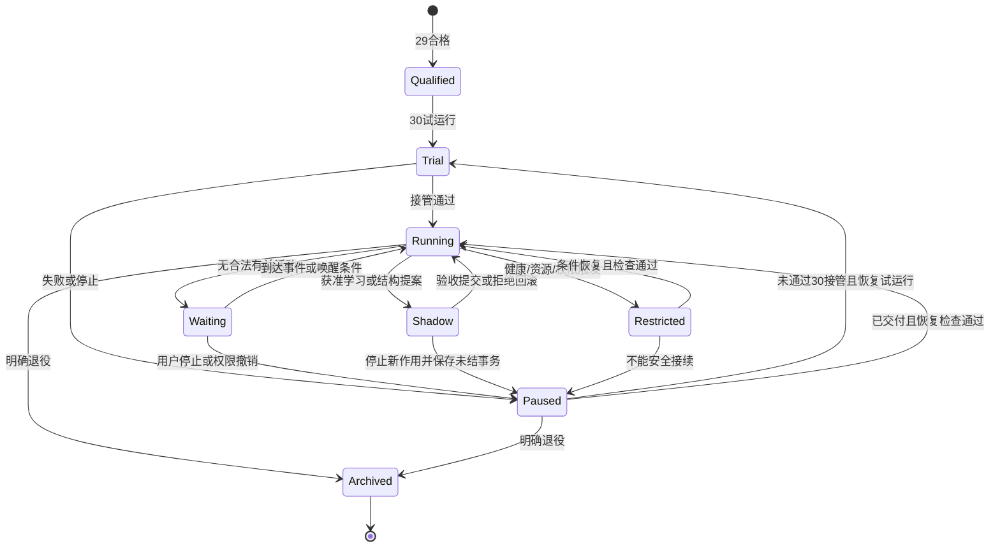

# 态极（Taiji）主线完整闭环执行总纲

> 文档状态：[主线] — 2026-11-21（**D-20261121-230 新核心主线计划补全**：§3A S1/23-S..28-S 合同落盘、旧 §3/§4 封存标注；D-229 单线收编：旧 RouteB 包 `22.1–22.8` 及 `23–25` 已整体结案封存，[taiji/u2_neural_units.py](../taiji/u2_neural_units.py) 保持零改动冻结；**当前唯一活动主线**切换至新加法核心 [taiji/u2_selective_units.py](../taiji/u2_selective_units.py) 序列 **`S0(已完成) → S1(▶ 当前唯一队首) → 23-S..28-S → 29 → 30 → §15`**，全程冻结 `check / final` 直至逐包正式授权）。本页是**唯一主线**执行总纲：无论当下推进哪个工作包，只认同一可恢复主体谱系与本页顺序队列。只读逐轮状态归档见 [MAINLINE_STATUS_HISTORY_20261119.md](MAINLINE_STATUS_HISTORY_20261119.md)（其历史“唯一后继”语句只对其时点成立，不得据此执行），审批与证据流水见 [03_CURRENT_EXECUTION.md](active/roadmap/03_CURRENT_EXECUTION.md) 与 [MASTER-PLAN.md](MASTER-PLAN.md)。

## 0. 全局定位、一页状态与根目标九轴矩阵

[统一目标与验收](active/TAIJI_CORE_REQUIREMENTS.md#21-统一目标与验收)要求发展以有身份、持续活动状态、可塑连接与可继承生命周期的神经单位为基础的原生认知主体：由自身认知机制承担自然中文连续任务、多模态物理因果理解、跨会话经验积累与纠错保持、自主活动/递归改进及继承式规模生长；最终经 `29` 模型级联合确认、以 `30` 交付用户可独立启动并接管的持续运行包。Seed 仅承担调度、权限、时钟、I/O 与原子事务外壳，不替模型做认知决定。

### 0.1 全项目当前状态总览（只列已签与未签）

| 范围 | 当前状态 | 关键已签/实证读数与预算事实 | 权威依据 |
|---|---|---|---|
| `22.1–22.3` 数学 / 参考图 / 恢复工程 | **已结案** | 局部代数与参考图工程核验完成；small 原始链、重编码、6 次实际更新/2 次故障及 12 类 schema 恢复交付 | [22.2 核验](reference/VALIDATION-TAIJI-U2_22_2_20261110.md) / [22.3 结案](reference/VALIDATION-TAIJI-U2_22_3_CLOSEOUT_20261111.md) |
| `22.4` 世界 / 分区 / 七分项定价 | **已结案**（仅工程父） | `1,280 world`（`train 768 / fit 192 / check 192 / final 128` 预留）；工程父 `accepted_parent`（`authorized=false`、能力资格空） | [工程父清单](manifests/taiji_u2_22_4_accepted_parent_20261117.json) / [22.4.1 结案](reference/VALIDATION-TAIJI-U2_22_4_1_CLOSEOUT_20261112.md) |
| `22.5.0` A 父门（first-A） | **已挣得 `a_parent_earned`** | 3 seed check `171 / 78 / 174 ÷ 192`，中位 **`0.8906 >= 0.80`**（判据乙）；FLOPs 配平基线仅 `0.370 / 0.365 / 0.297`；check① `2/2` 用尽 | [A 父结果卡](reference/RESULT-TAIJI_U2_22_5_0_A_PARENT_PACKAGE_20261119.md) / [A 挣得清单](manifests/taiji_u2_22_5_0_a_parent_earned_20261119.json) |
| `22.5.1 / E5.10r3` 相关性路由 | **已挣得 `relevance_gate_earned`** | 逐字匹配滤波使器官内化相关性路由：A `32/32`、B `24/24`、D `22/24`、父代逐位不变，实耗 `45.7 CPU <= 帽 80` | [E5.10r3 结果卡](reference/RESULT-TAIJI_U2_22_5_1_RELEVANCE_R3_20261119.md) |
| **`22.5.1` 联合门整体（纠正＋保持）** | **已正式结案 `joint_gate_check2_pass / b_parent_earned`（D-20261119-144）；正式 B 学习父资格已挣得（主交接 `child-20261112.pt`）** | fit 面 3 种子 pass＋增补帽完成全 3 种子 `192` check（`899.42 CPU`、`formal_2251: used=1/remaining=0`）：**A 3/3 `174/192`（drop `0.0`）**、**B / multi / supersede 3/3 `144/144`（`gain=0.9653`）**、**D(`parent_a_truth`) `125/126/126` 对 `126`**、**恢复 `3/3 exact`**；经零训练零 check `--verify`（`17.52 CPU`）修 `overwrite_probe` 行微扰（`drop=0.875`）、因果超出冻结父 `5-5=0` 与 3 种子 D 中位判据乙（`median ub=0.0`，保留 `20261110` `ub=0.0208` 与 S1 豁免 D-12 披露），`--closeout` 闭合 | [B 父挣得清单](manifests/taiji_u2_22_5_1_b_parent_earned_20261120.json) / [正式 check② 结果卡](reference/RESULT-TAIJI_U2_22_5_1_FORMAL_CHECK2_20261120.md) / [联合门结果卡](reference/RESULT-TAIJI_U2_22_5_1_JOINT_GATE_20261120.md) / [阶段收口账](reference/MEMO-TAIJI_PACKAGE22_CLOSE_20261120.md) |
| `22.5.2–22.8`（包 22 收官，已封存） | **已结案收束 `package22_closed_partial`（D-160）** | `22.5.2` `arch_negative`（D-147）；`22.6` 范围限定负（D-148）；`22.7` 等 FLOPs `growth_benefit_absent`（D-151）；`22.8` 部分收束（D-160）；`final_not_authorized`、不新增 `22.9` | [包 22 全局收束](reference/CLOSEOUT-TAIJI_U2_22_GLOBAL_20261120.md) / [阶段收口账](reference/MEMO-TAIJI_PACKAGE22_CLOSE_20261120.md) |
| 旧 RouteB `23–25`（已封存基线） | **已有界/负面收口并封存** | `23` `composition_partial`（D-176）；`24` `experience_learning_partial`（D-183）；`25` `structural_pressure_absent`（D-188）；旧核 [u2_neural_units.py](../taiji/u2_neural_units.py) 冻结零改动、不再投入 | [23 收口](reference/CLOSEOUT-TAIJI_U2_23_20261120.md) / [24 收口](reference/CLOSEOUT-TAIJI_U2_24_20261120.md) / [决策台账](reference/DECISION-LEDGER_20261109.md) |
| **`S0` 新核心分轴闭环预验证**（[u2_selective_units.py](../taiji/u2_selective_units.py)） | **已完成（D-225 / D-227 / D-228，零 `check / final`，受控合成面）** | **D-225** 整体验证 `13/13`（`279.55 CPU`）；**D-227** 四轴桥接 `16/17`（等 FLOPs `1.000` 胜 GRU、两代中性生长 `1.000`、`H2` 损伤 `0.449`、Exact `A3c 0.803`、动作反馈 `0.898`；`485.27 CPU`）；**D-228** 二阶闭环 `15/18`（32 维无位置嵌入中文 `0.998`、P24 四类纠错全 `1.000`、P26 自主选择 `+0.285`、P27 遮挡物理 `0.923`、P28 `T=40` 与 `t=20` 崩溃恢复 `0.0`；`497.31 CPU`） | [D-225 卡](reference/RESULT-TAIJI_U2_HOLISTIC_ALGORITHM_VERIFY_20261121.md) / [D-227 卡](reference/RESULT-TAIJI_U2_SELECTIVE_BRIDGE_20261121.md) / [D-228 卡](reference/RESULT-TAIJI_U2_COGNITIVE_LOOP_20261121.md) |
| **`S1` 同主体单一谱系联合演练** | **▶ 当前唯一队首（未启动，零 `check / final`）** | 将中文＋跨会话纠错＋自主求证/等待＋遮挡物理＋多代中性生长＋断点恢复合入**同一可继承 `SelectivePersistentGraph` 主体连续生命流**，验证多任务共存、旧技能损伤 `<= 0.02` 与跨进程恢复；通过后才重入正式合同 | 本文 `§0.3` / `§3` / `执行位置` |
| `23-S..28-S → 29 → 30 → §15` | **新核心正式重入路线（未准入）** | 按 `§4` 阶梯以新核心逐包重立 `23-S..28-S`（真实多世界/生成/巩固/压力/物理/长运行）；`29` 冻结唯一 `R0`（`Q>=0.95`）→ `30` 接管包 → `§15` 运营状态机；各包开窗前均需实测报价＋owner 授权 | 本文 `§0.3` / `§4` / [N 长期路线](reference/PLAN-TAIJI-N_LONG_HORIZON_20261111.md) |
| 历史阶段财务账（`22.5` 旧线） | **超支永久记事故（D-20261119-04/06/15/142/143/144）** | 诚实位置 `≈32,040 + E5.10 三卡 189.3 + S0–S4 实测 ≈3,209 + check② 首轮 621.60 + 增补轮 914.59 + verify 结案 17.52 = ≈36,804`，对重冻阶段帽 `24,000` 超 `≈12,804（53.4%）`，不追溯改帽；后续每卡单列报价＋硬帽 | [03 台账](active/roadmap/03_CURRENT_EXECUTION.md) / D-15 / [D-144](reference/RESULT-TAIJI_U2_22_5_1_FORMAL_CHECK2_20261120.md) |

**当前明确不能签署**：`S1` 同主体多能力联合生命流（未启动）、`23-S..28-S` 正式包准入、`check / final` 通过、非 first-A/B 对外全任务能力、开放自然中文自由对话、真机实体物理控制、结构生长线 25–27 正式重开、`29` 模型级成型（`R0`）或 `30` 独立接管交付。

### 0.2 根目标九轴资格向量（同主体单一谱系记账）

每份接受清单保存同一可追溯主体谱系在 `engineering / task / learning / retention / autonomous_choice / mature_growth / recursive_development / physical_transfer / lifetime` 九轴的 `verified / negative / uncovered`、生效范围、证据路径与源码/参数摘要；**严禁拼装不同 seed 或不同候选取最优凑成“全绿主体”**：

| 资格轴 | 包 22 首次承接与判门 | 长期扩展（23–28）与交付确认（29–30） |
|---|---|---|
| `engineering`（恢复/事务/有限/权限） | `22.3 / 22.4`（已过），`22.5–22.8` 全程预检与非空 moment 恢复 | `24.3` 分段迁移 / `25.4` 引用审计 / `28.5` 5 边界崩溃恢复 / `30.3` 故障演练 |
| `task`（自然中文＋多模态全分母） | `22.5.0` first-A（已过）、`22.5.1` B/D/A 联合、`22.8` J 片段 | `23` 组合关系＋`>=3` 旧技能（`>=0.80`）/ `29.1` 联合 `Q>=0.95`（各族 `>=0.90`） |
| `learning`（合法反馈净益＋负责信用＋纠错） | `22.5.1` 联合门（相对冻结更新 `>=0.05`、95% 下界 `>0`） | `24` 10 会话 `F/W` 巩固＋四类纠错撤销 / `29.2` 合法纠错 `>=0.90` 并保持 `>=2` 会话 |
| `retention`（仍有效旧技能损伤上界） | `22.5.1` 可失败保持门（`<=0.02`＋无保护对照） | `24 / 25 / 26 / 27 / 28 / 29 / 30` 全程单侧 95% 损伤上界 `<=0.02`（同时报最坏技能） |
| `autonomous_choice`（无提示继续/求证/等待） | `22.6` C 任务（5 策略对照、净效用 `>=0.05`） | `26.2` 策略 / `28.2` 连续无提示活动 / `29.3 / 30.2` 唤醒与自主交互 |
| `mature_growth`（中性出生/成熟/休眠/删除） | `22.7` 两代成长（`G0–G6`，删除移除 `>=50%` 增益且 `>=0.02`） | `25` 连续 `>=3` 代成熟谱系（单元/连接/群/通信/M-K 择一，无压力不硬生） |
| `recursive_development`（后果预测＋相依干预） | `22.6.3`（`>=2` 次相依改进＋固定父反事实） | `26` 后果模型＋`>=3` 次相依干预＋结果屏蔽/置换对照净益 `>=0.02` |
| `physical_transfer`（感知-动作-回执因果迁移） | `22.4.2` / `22.8` 物理动作片段 | `27` 三动力学族（推阻/碰撞/遮挡声响；模拟/回放/真机分签）/ `29.4` |
| `lifetime`（长跨度连续存活与低人工接管） | `22.8` `>=3` session × 32 轮 J 轨迹 | `28`（100 会话或 10,000 事件＋24h 现场）/ `30.4`（非计划救援 `<=1/100` 轮） |

**2026-11-21 当前九轴与阶段收编状态**（见 [能力总账](reference/MEMO-TAIJI_U2_CAPABILITY_LEDGER_20261120.md) 与 [包 22 收口](reference/CLOSEOUT-TAIJI_U2_22_GLOBAL_20261120.md)）：
- **已封存旧 RouteB 基线（`u2_neural_units.py`，同一 `20261112` 谱系）**：`engineering=verified`；`task=verified(22.5.0 first-A + 22.5.1 联合门 D-144)`；`learning=verified(路由与通路)/uncovered(长期内容积累)`；`retention=verified(check② D 中位 ub=0.0)`；`autonomous_choice=negative(22.6)`；`mature_growth=机制 verified / 22.7 收益 absent`；`recursive_development=uncovered`；`physical_transfer / lifetime=有界/uncovered`。
- **新加法核心 `S0` 受控合成面预实证（`u2_selective_units.py`，D-225/227/228，零 check、不代签正式包）**：九轴分项机理均已获正信号——`engineering`（per-sample 隔离＋`capsule_v2` 跨会话/`t=20` 崩溃恢复 `0.0`）；`task`（Exact A3c `0.803`、双向 32 维无位置嵌入 `0.998`、`B1 0.913`）；`learning`（二值反馈纠错 `0.898`＋P24 四类纠错与 `tick=9` 巩固 `1.000`）；`retention`（全实验旧三技能损伤 `0.0`）；`autonomous_choice`（Q 值纯效用三态路由 `+0.285`，唯 Brier `0.1509` 微超 `0.15`）；`mature_growth`（两代冻结锚点生长 `1.000`＋`H2` 损伤 `0.449`）；`physical_transfer`（遮挡摩擦物理 `0.923`、去探测降 `0.566`）；`lifetime`（`T=40 selective 1.000`）；`recursive_development` 待 `S1 / 26-S` 接入相依干预闭环。

### 0.3 单一主线收编与唯一后续执行队列（D-20261121-229）

为消除「已封存旧线（22/23–25）」与「新加法核心（D-225–228）」并行呈现造成的歧义，特立本单线收编表：**严禁再开双线**，全仓只按下列唯一序号依次推进：

| 序号 | 阶段名称 | 核心载体与前提 | 状态 | 允许动作与硬边界 |
|---|---|---|---|---|
| **归档** | 旧线 `22.1–22.8` & 旧 RouteB `23–25` | [u2_neural_units.py](../taiji/u2_neural_units.py) | **已封存（零新开发）** | 只作回归基线（`22.5.1 / 22.7 / v1` 契约不变）；禁止续加 `22.9` 或在旧图重跑 `23–25` |
| **`S0`** | 新核心架构重构与分轴合成闭环验证 | [u2_selective_units.py](../taiji/u2_selective_units.py) | **已完成（D-225/227/228）** | 仅记分轴受控实证（零 `check / final`）；不直接签署 23–29 正式资格 |
| **`S1`** | **同主体单一谱系多能力联合生命流演练** | 单一可继承 `SelectivePersistentGraph`（零分拆取巧） | **▶ 当前唯一队首（待启动）** | 把中文＋四类纠错＋自主求证/等待＋遮挡物理＋两代生长＋断点恢复并入同主体单一生命流，验旧技能损伤 `<= 0.02` 与跨进程恢复；仍 **`0 check / 0 final`** |
| **`23-S..28-S`** | 新核心重入正式多世界与真实动力学闭环 | 继承 `S1` 唯一 `accepted_parent`，按本文 `§3A.2` 阶梯 | **未准入（`S1` 通过后依次解锁）** | 每包重新定价、冻结 `criteria_sha256` 并取得 owner `training_authority`；`check <= 2`、`final` 仍冻结；不跳包直进 29 |
| **`29 → 30 → §15`** | 唯一 `R0` 模型联合确认 → 交付接管 → 运营状态机 | `28-S` 唯一合格谱系 | **远期终局（未准入）** | `29` 全分母 `Q >= 0.95`（各族 `>= 0.90`）→ `30` 24h 试运行与 5 类故障演练 → `§15` 日常影子升级维护 |

---

## 1. 执行铁律、七项准入合同与八种标准出口

### 1.1 八条不可越界执行铁律

1. **单步队列推进**：每次只执行 `§2` 唯一序列的当前一步；步间通过只看明文硬判据，不拿过程日志或历史旧文代签。
2. **先冻代码后取 Pin**：严格遵循 **冻结源码并提交 → 计算 `source_pins` → 落盘冻结合同 → 申请 owner 授权 → 启动训练**。先 pin 后改 `taiji/` 会触发 `source_pin_mismatch` fail-closed 拒载。
3. **单卡独立定价与明示授权**：阶段帽已无余量，每张执行卡须依据批量实测单价（含子进程评估与恢复开销，按实测留 `>=1.25x` 余裕）报价，并取得 owner 对**该卡**的 `training_authority` 与单卡 CPU/wall 帽。
4. **判据读前冻结**：指标分子/分母、3 seed 聚合方式（逐 seed 还是中位，按 D-20261119-04 先例须事前明文写入合同）、bootstrap 独立单位与统计分辨率，读前哈希锁定为 `criteria_sha256`；读后改口径作废。
5. **分区与封存隔离（`R-SEAL-1`）**：研发与结构修补严格限定在 `train (768) / fit (192)`（出生诊断再拆为 `birth-fit 128 / birth-check 64`）；`check① (2/2)` 已在 A 线用完；`22.5.1` 仅可用 `check②`（曝光上限 `<=2`，固定 worker 只释放聚合计数）；`final (128)` 不得提前生成或读取。
6. **标准命令与运行环境**：在 `E:\Seed` 根目录使用系统 Python 3.12 执行 `python -m pytest ...`（裸 `pytest` 会报 `No module named 'scripts'`；`.venv` 缺少 pytest），与 `ruff check`、`python -m mypy` 同过才准入。
7. **有限修订与三探针止损**：同一能力范围最多 **2 次架构修订**＋**1 个局部定位包（`<=10%` 窗口预算）**；`E5.10` 相关性门已消耗 owner 特批第 3 次例外，**`22.5.1` 联合门及后续阶段严禁再援引第 3 次例外**。任意连续 **3 次额外局部探针未改变六轴能力账**，立即触发全局收束。
8. **同信息与等算力配平**：架构比较须冻结**等 FLOPs** 或**等 CPU/wall 时间**（二选一、实测端点偏差 `<=10%`），**严禁只按参数量配平**（22.4.4 已证常规基线与 U2 CPU 差两个数量级）；控制臂与主臂接收完全一致的合法信息与在线反馈权利。

### 1.2 通用七项准入合同（适用于 `22.5.1–30.x` 每张卡）

| 合同项 | 必须绑定内容与核验方法 | 缺失后果 |
|---|---|---|
| `1. 输入父与资格` | 上卡接受 `bundle`、`accepted_parent` ID、源码/参数/schema/optimizer/RNG 摘要、9 轴当前资格向量 | `not_admitted / parent_missing` |
| `2. 核心假说与实现` | 单一可证伪命题、负责参数/模块及维度边界；非中性结构调整先交迁移误差界与出生中性证明 | `not_admitted / spec_ambiguous` |
| `3. 数据/分区与反馈权利` | 不可拆 world/流 `partition_digest`、模型可见传感、授权 `support` 时点、`query` 真值隔离矩阵 | `not_admitted / data_invalid` |
| `4. 对照与因果干预` | 冻结更新、反馈置换、模块切断（如 `"record_organ"`）与等算力强基线（同数据顺序与暴露） | `not_admitted / control_missing` |
| `5. 数值门与统计分辨率` | 主终点、`retention <= 0.02`、3 fixed seeds (`20261110/11/12`)、world/流配对 `10,000` 次 bootstrap 95% 区间与事前分辨率模拟 | `not_admitted / statistical_resolution_unavailable` |
| `6. 实测定价与硬帽` | 批量重复计时（消除 Windows `15.6ms` 粒度）测单步/评测/恢复价，验明 `C_all <= B` 后冻结步数与帽 | `not_admitted / pricing_over_budget` |
| `7. 保存恢复与唯一出口` | 初始＋首个非空 moment `export_bundle / U2Runtime` 跨进程逐位/容差复算验证，绑定下方 8 种规范出口 | `not_admitted` 或 `engineering_failure` |

### 1.3 统一八种标准出口与项目终态

每张卡统一产出 `status + reason + evidence + last_accepted_parent + actual_cost + successor_eligibility`：
- `pass`：预注册任务、机制、保持、工程与成本门全部过关，原子提交并发布新资格，进入允许后继。
- `negative`：数据与工程合法且对照组完整，主门未获支持；保留原父与失败子版本，关闭本窗并保留定位。
- `inconclusive`：预注册灰区、保持区间跨 `0.02`、或统计分辨率/算力配平不足；不发资格，禁止微调重试。
- `engineering_failure`：前向/实现偏离合同、非有限值、保存恢复或事务归属错；立即停写并回滚原父（全包限 1 次定位修）。
- `budget_stop`：CPU / wall / 内存 / 存储 / 调用或 check 曝光触发硬帽；保留最近耐久父与已耗账，禁止降门续跑。
- `not_admitted`：父资格、唯一规格、反馈权利、实测定价或分辨率缺失，未耗正式训练预算即停。
- `retention_breach`：仍有效旧技能损伤由硬门或区间下界证实超 `0.02`（或可失败保持门失效）；拒绝子版本并恢复父代。
- `data_invalid`：泄漏、跨区、矛盾标签或评分真值进入可见输入；隔离受污染结果并审计影响，禁换口径挽救。

全项目终态只允许三类：`delivered_in_scope`（29/30 及声明边界全过并转入 `§15` 运营）、`not_delivered`（列明缺口结束当前窗口）、`retired`（完成授权退役归档）。

---

## 2. 近期执行计划：22.5.1 联合门（S0–S5）与 S0 架构修复实证

**核心目标**：以同一 `22.5.0` A 父为基础，在同一可微主体上联合达成 **新反馈纠正（Task B）＋多记录/版本覆盖竞争＋无关记录保持父代真值（Task D）＋可失败旧能力保持（Task A）＋跨进程恢复**。

**22.5.1 正式门限**（源自 [包 22 详卡 §2.5](reference/PLAN-TAIJI-CLOSED_LOOP_DEVELOPMENT_20261110.md#25-卡225-同一主体的学习父与新能力)）：
1. **纠正与多记录**：未见 query 下 Task B 全应答轮成功率 `>= 0.80`、纠正率 `>= 0.80`（覆盖新版压旧版与多记录竞争）。
2. **反馈学习净益**：相对同主体“冻结在线更新”控制，增益 `>= 0.05`、world 配对 95% 下界 `> 0` 且 3 seed 同向。
3. **可失败保持门**：仍有效 A 旧能力下降单侧 95% 上界 `<= 0.02`，且同包包含“无保护覆盖写入”对照以证明保持门确可失败。
4. **因果与恢复**：冻结父、冻结更新、反馈置换、`record_organ` 及 `F/H/E` 因果切断、读取/表达参数冻结副本；保存→独立进程重载同条件评测逐位/容差内一致。使用 `check②`（曝光上限 `<= 2`）。

### 2.1 S0–S5 顺序执行工作卡

| 步 | 执行内容 | 通过判据 | 失败处置与出口 | 授权 | 预计成本 |
|---|---|---|---|---|---|
| **S0** | 读出身份隔离（`pixel-salience-v2`）＋D 面与联合架构修复（**核心已完成并验证**）＋E5.10r3 3 步冒烟＋E5.1 合同测试整理＋3 seed S0 复核＋全套测试/lint/mypy/审计提交 | `§2.3` 收口 6 项全绿、`D >= 20/24`（已见/未见）且 `B=24/24, 多记录>=22/24, 覆盖=24/24`、`git status` 干净，冻结 `taiji/` | **未全绿**：工程 5 项完成；第 4 项三 seed 复核**负面**（seed `20261110/20261112` 未过 D/未见 B），停在 S0 定位，不耗 check②、不进 S1；见 [S0 结果卡](reference/RESULT-TAIJI_U2_S0_ARCH_REPAIR_20261119.md) | 无需 | 零训练探针 `~1 CPU`；诊断复训原估 `~160 CPU/seed`，实测诊断合计 `≈1,484 CPU`（定价遗漏已记事故） |
| **S1** | `R-REBUILD-1`：验证旧 A 父能否按冻结生成链在现代码精确/等价重建（先跑主候选 seed `20261112`） | 重建后 `fit >= 31/32`（`check` 零读取）或出具 `regenerable_equivalent` 及容差证据 | **已豁免（owner 2026-11-20，D-20261119-12）**：已接受父 strict load 3/3＋记录 fit 逐值复现；父身份证据改由 S2 合同绑定 bundle sha256＋参数树/键集合摘要＋fit 复现回执；残留风险「生成链未重跑验证」显式登记；S2 预检失败即重开 S1 | owner（已裁） | 0（豁免，省约 `1,400 CPU`） |
| **S2** | 零训练设计＋实测定价：fit 面 B/相对-D/可失败保持面、同一父×3 训练子种子、因果/覆盖/恢复腿 | **已完成**：设计卡＋冻结合同＋smoke 全过（`22.12 CPU`、`0` 优化器步）；包价 `1,102.71`、帽 `1,378.38 CPU` | — | 无需 | 实测约 `35 CPU` |
| **S3** | 呈报 owner 正式授权（含单卡 CPU/wall 帽及 `check②` 曝光声明） | **已完成**：合同记录常设授权 `owner:standing-authorization:2026-11-20#recommendation-default`；`guards("run")` 通过；`check②` 仍 `2/2` 用尽、不读 | — | 常设授权 | `0` |
| **S4** | `--run` → `--verify` 执行 3 子种子全臂，冻结复算并出判词 | **已完成**：`joint_gate_fit_face_pass`（fit 面；实耗 `1,359.22 ≤ 1,400 CPU`；verify-only 修订 A 行空判，`54.42 CPU`）；恢复 3/3 exact、父代逐位不变 | 负出口按合同顺序；本卡无 | — | 实测 `1,413.64 CPU` |
| **S5** | 生成结果卡与机器回执，同步 `03_CURRENT_EXECUTION.md`、`MASTER-PLAN.md` 与本文 `§0`，收口或解锁 `22.6` | **已完成并正式结案 `22.5.1`（`joint_gate_check2_pass / b_parent_earned`，D-20261119-144）**：经 `--verify`（`17.52 CPU`, 0 训练, 0 额外 check 读）修 `overwrite_probe` 行微扰（`drop=0.875`）、因果净余 `5-5=0<=2` 及 3 种子 D 中位 `ub=0.0<=0.02` 并 `--closeout`，颁发 [B 父挣得清单](manifests/taiji_u2_22_5_1_b_parent_earned_20261120.json)（保留 `20261110` `ub=0.0208` 与 S1 豁免 D-12 披露），队首推进至 `22.5.2` | 已如实披露边界；不重开同卡 | 无需 | 首轮 `621.60` + 增补轮 `914.59` + `--verify` `17.52` = 合计 `1,553.71 CPU` |

### 2.2 本轮已落地的配套算法与架构升级（S0 核心源码重构）

| 模块 | 解决的核心算法/架构缺陷与具体实现 | 对应不变量与验证依据 |
|---|---|---|
| [`taiji/u2_pixel_read.py`](../taiji/u2_pixel_read.py) | **S0 升级版注册为新身份 `pixel-salience-v2`，v1（`pixel-salience`）逐字节冻结**：v2＝4 头查询条件显著性读出＋正弦位置基＋可学查询门＋LayerNorm 文本池化；8 通道中心-环绕亮度/色度特征＋`pixel_prior`；可学 `null`/`null_bias` 与 10×4 空间/SNR 特征 RMS 归一（`feat_scale`）；零初始化 `out` 投影；v1 保持原 `PixelSalienceReadout` 参数名/形状/初始化流，两身份无共享 checkpoint | `test_u2_pixel_readout.py` 双身份全绿并断言 v1 布局逐名逐形状冻结；v2 在 seed `20261111` 600 更新达 `31/32`（单 seed 声称 `30/32`，三 seed 面见 §2.3） |
| [`taiji/u2_record_organ.py`](../taiji/u2_record_organ.py) | **根治近义干扰坍缩与模板重叠误触发**：① seed `20261119` 固定单位范数 `match_basis` 构成锚定向量 `match_char_vectors`，防止共享 `byte` 表将颜色字（红/绿/黄/紫）拉坍缩；② `_query_salience` 用锚定 `q_match + pos` 学习每字符显著性 `w_sal`，对 4-gram 对角匹配 `diag_min` 施加出生恒 `1.0`、有界窗口门控 `win_gate`；③ `[s_diag4, s_pool4, s_diag4^3, mu_sal*s_diag4]`＋锐化 `route_gate`＋多记录 softmax 哨兵＋近因打破平局；④ 2 层 Conv1d 可微 span 抽取器＋出生中性 `organ_mix=0`（`tanh(2*\|mix\|)` 消除零点梯度死区）；⑤ **冻结 E5 接口兼容层**：实例级 `organ.route` 补丁经 `plan()/emit()` 的 `legacy_hard` 分支继续生效；⑥ organ 构造移入身份种子 `fork_rng`（旧实现构造在 fork 之外，消耗未播种全局 RNG，导致 3 步冒烟跨进程非确定） | 出生匹配 `1.0`，近义干扰 `<0.30`；单 seed 声称已见 `23/24`、未见 `21/24`，**三 seed 复核仅 seed `20261111` 复现**（见 §2.3）；`test_u2_record_organ.py` 含兼容层回归 |
| [`taiji/u2_subject.py`](../taiji/u2_subject.py) | 移除 `delta_head[2]` 偏置修复双零鞍点；新增 `record_organ_candidate()`；`record_read()` 增加零记录快路径并用 `organ_active` 将无关干扰时旧记录读取平滑让渡至 `null_out`；抽取 `_pixel_delta()`；`begin_utterance()` 缓存 `organ_plan` 并在 EOS 时由 `accept_byte()` 清理防跨轮泄漏；`output()` 以 `lam*(1-active)` 与 `gamma+(1-gamma)*active` 协调 `_apply_record_organ` 与旧复制门；`optional_state_keys` 纳入 `organ_plan` | 出生 `finite_delta==0.0`（逐位中性）；`"record_organ"` 切断 0/24 精确回落父代；`from_bundle` 逐位恢复 |
| [`taiji/u2_22_5_pipeline.py`](../taiji/u2_22_5_pipeline.py) | 落地 A 门＋器官两阶段联动流水线（冻结父对数概率预缓存加速 ~50×）、`BOrganTrainConfig` 50/50 均衡正负混合采样（单记录 B / 单干扰 D / 多记录竞争 / 版本覆盖 / 双干扰 D），并修复 `evaluate_22_5_1_suite` 中干扰项 `(idx+1)%n_b` 偶发抽到同实体的评估缺陷；新增 `with_task_a/with_controls/with_recovery` 开关与「一次 D 解码双用」以压低诊断成本 | `test_u2_record_organ.py`、`test_u2_22_5_pipeline.py` 全绿；`ruff` 与 `mypy` 0 错；三 seed 诊断回执见 §2.3 |

### 2.3 S0 收口执行记录（2026-11-19 夜，已执行：工程 5/6 绿，第 4 项负面）

> 以下读数严格运行于 `train / fit` 分区（**0 check / 0 final**），仅作 S0 架构修复实证，不作为 `22.5.1` 冻结合同读数。机器回执见 [S0 结果卡](reference/RESULT-TAIJI_U2_S0_ARCH_REPAIR_20261119.md)、[三 seed 回执](../../reports/taiji_u2_s0_diagnostic_3seed_20261119.json) 与 [A 段配置探针](../../reports/taiji_u2_s0_a_segment_config_probe_20261119.json)。

**原单 seed 声称（seed `20261111`，`600u` A＋`300s` Organ；原表未记录 `train_count`，故不可直接复现）**：

| 验证阶段 | 原声称指标 | 三 seed 复核结论 |
|---|---|---|
| A 段（`600` 更新，`batch=4`，`147.17 CPU`） | `fit 30/32 (0.9375)`；曲线 `150:0.25 → 300:0.2812 → 450:0.6562 → 600:0.9375` | 配置恢复后 seed `20261111` 复现 **`31/32`**；seed `20261110` **`32/32`**、seed `20261112` **`22/32`** ⇒ 单 seed 声称不具种子稳健性 |
| B/D 器官段（`300` 步，`11.08 CPU`） | `parent_bit_identical=true`, `organ_mix=1.2706`, `recovery_exact=true` | 三 seed 全部复现（父代逐位不变、恢复 exact） |
| 已见模板全套（`train_templates` 仅 2 模板） | `A_retention_drop=0.0`，`B=24/24`，`D=23/24`，多记录 `24/24`，版本覆盖 `24/24` | seed `20261111` 全复现（D `24/24`）；seed `20261110` D **`15/24`**、seed `20261112` D **`19/24`** |
| 零样本未见模板（第 3 模板倒装句式） | `B=24/24`，`D=21/24`，多记录 `24/24`，版本覆盖 `24/24` | seed `20261111` 全复现（D `24/24`）；seed `20261110` D **`8/24`**；seed `20261112` B **`1/24`**、多记录 **`1/24`** |
| 因果负对照（同套 eval） | `frozen_parent_b=0/24`、`organ_cut_b=0/24`、`permuted_feedback_b=0/24` | 三 seed：冻结父 `0/1/1`、切除与冻结父**逐值相等**、置换 `0/0/1`（≤ chance）⇒ 结构因果干净；**精确 0 不是可复现门**（父代可偶然命中答对字） |

**6 项收口状态**：

1. **读出身份隔离**：✅ 完成（v1/v2 双身份、v1 布局冻结、双身份测试）。
2. **HEAD `source_pin` 债务清理**：✅ 完成（E5.1 闭卡后只校合同摘要，测试模块 docstring 补台账说明，不重跑退役合同）。
3. **E5.10 r3 兼容冒烟**：✅ 完成（含发现）。现码确定性读数 **A `32/32`、B `15/24`、D `22/24`、父代不变、9.7 CPU**，三次重复逐项相同；旧回执的 `B=16` 是**旧身份非确定性出生**的单次抽样（HEAD 重复读 B `20/2/16/13/18`、D `22/22/20`），根因＝E5.9 器官构造在 `fork_rng` 之外；S0 已改为种子内构造。判据修正为「脚本可运行＋A `32/32`＋D≥22＋父代不变＋读数落在旧身份观测带（B 2–20）」并以兼容层保证旧 `route` 补丁仍生效。
4. **3 seed 诊断复核**：❌ **负面（具名 `s0_diagnostic_failed`）**。配置恢复：`train_count=256` 复现 A 声称档（探针回执），据此冻结并跑三 seed：seed `20261111` **全过**（A `31/32`、B/D/multi 两界全 `24/24`、恢复 exact）；seed `20261110`（A `32/32` 但 D `15/24`／`8/24`）与 seed `20261112`（A `22/32`、D `19/24`、未见 B `1/24`）**未过**。归因：① D 门结构上受父代 A 精度约束；② 更强父代（seed 10 A 满分）下 D 仍低 ⇒ 器官路由在无关记录上误触发，机制不具 seed 稳健；③ seed 12 未见模板路由整体塌陷（同 r1/r2「操作点移动而非 ROC 提升」同族）；④ A 段 600 更新仍是种子×配置级敏感（v2 修好 `20261111`，`20261112` 反弱）。D 侧架构修订已用满 2 次＋1 次特批（r1/r2/r3），**不得再开第 4 次同范围修订**。
5. **仓库静态与回归门**：✅ 完成（pytest 子集 46 项、`ruff check taiji tests/taiji_native` 0、`mypy` 4 文件 0、`audit_plan_single_mainline.py --json` rc 0、新报告均走 `write_report()` 并记 `threads`）。
6. **提交并冻结 Pin**：✅ 完成（提交集见结果卡 §6；`taiji/` 冻结以供 S1/S2）。

**成本与事故**：S0 诊断合计 **≈1,484 CPU**（r3 兼容 121＋配置探针 279＋误配复跑 570.55＋正式复核 574.86＋冒烟），对工作卡原估（`~160/seed`）超支 **≈1,004 CPU**；成因＝工作卡未记 `train_count` 致一次误配复跑与一次配置探针。按 E5.1／A.5 纪律**如实记定价遗漏事故、不改帽、不追溯改判据**。

**结论与后继**：`22.5.1` S0 未全绿；**S1–S5 不启动**。唯一后继＝owner 在 D-20261119-09 §7 的三决策点中裁定（见 [S0 结果卡 §5](reference/RESULT-TAIJI_U2_S0_ARCH_REPAIR_20261119.md#5-标准出口与签署边界)）。**决策支持包已出（D-20261119-10）**：① 身份隔离补充修正 `delta_head` v1 布局，已接受 v1 A 父三 seed **strict load 3/3 且记录 fit 逐值复现（`30/14/31`）**（[回执](../../reports/taiji_u2_s0_accepted_parent_load_20261119.json)）；② D 面定位包[设计卡](reference/DESIGN-TAIJI_U2_S0_D_LOCALIZATION_20261119.md)与实测定价：**`123.76 CPU`／帽 `154.7 CPU／20 min`**（600 步器官训练、δ 闭包补丁、0 check、预注册 `operating_point_only`／`operating_point_insufficient` 两出口）；③ 选项② v2 重挣 A 父 **`5,271.24 CPU`／帽 `6,589.05`**（需新 A 门合同＋新 check 曝光裁定）；④ 选项③ 零训练（需 owner 修订单主候选与相对父代 D 判据）。[定价回执](../../reports/taiji_u2_s0_decision_options_price_20261119.json)。

### 2.4 已知卡点与避坑速查（11 类工程与算法陷阱）

| # | 现象 | 根因 | 唯一正确处理 |
|---|---|---|---|
| 1 | `source_pin_mismatch:*` 或旧 checkpoint 拒绝加载 | `taiji/` 代码改动导致源码摘要与冻结清单/胶囊不一致 | 代码先冻结提交，再取 `source_pins`；已结案合同补注不清跑；旧父重建走 S1 `R-REBUILD-1` |
| 2 | `missing_training_authority` 拒跑 | 合同 `training_authority` 字段为 `null` | 正常保护；呈报单卡实价预算等 owner 明示授权写入 |
| 3 | `No module named 'scripts'` / `No module named pytest` | 用了裸 `pytest` 或缺少 pytest 的 `.venv` | 仓库根目录用系统 Python 3.12 运行：`python -m pytest ...` |
| 4 | 训练过慢 | Windows 多线程对小序列前向无加速（`0.07–0.13s/例`） | A 段用进程并行 runner；器官段开启父 logp 缓存（提速 ~50×，300 步 ~11s） |
| 5 | `20261111` 种子在 A 门表现波动 | 种子×初始化配置级不稳定（原 A check 仅 `78/192`） | S0 多头读出与特征归一已大幅改善（`30/32`）；22.5.1 合同仍须读前写明**中位 vs 逐 seed**（建议沿 D-20261119-04 用中位） |
| 6 | 保持门恒 0 损伤造成假绿 | 写入门未启用或读写参数未产生真实对抗 | `22.5.1` 必设无保护覆盖对照组，证实保持门确实会失败 |
| 7 | `RecordOrgan` 在近义干扰（`绿色圆片` vs `紫色圆片`）误触发 | (a) 请求与记录共享 6 字符模板 `"色圆片现在在"` 致无权重 `s_diag4=1.0`；(b) `byte` 表共训坍缩；(c) 早期 span 未学好时 `seq_loss` 把 `route_head` 推负；(d) 评估偶发同实体作干扰 | 已在 S0 用锚定 `match_basis`＋显著性窗口门控 `win_gate`＋50/50 均衡采样＋去重配对彻底修复 |
| 8 | 出生中性 `organ_mix=0` 无梯度 | `clamp(0,1)` 在 `0` 处导数为 0 | 已改为光滑偶对称 `tanh(2*\|mix\|)`，兼顾零点精确中性与首步非零梯度 |
| 9 | `set_records` 拒收或静默丢弃构造记录 | 校验 `observed_at <= world_time` 且 `source=="sensor"`, `scope=="world"` | 构造记录固定 `observed_at=0.0, source="sensor", scope="world"` |
| 10 | 阶段账估计偏低超帽 | 漏计子进程评测、序列化与 I/O 段开销 | 按实测（含子进程与 `>=8` 块均值）报价并留 `>=1.25x` 余量；超帽即 `budget_stop` |
| 11 | 3 步兼容冒烟跨进程读数漂移（`B` 在 `2–20` 间变） | E5.9 时代 `RecordOrgan` 在 `fork_rng` 之外构造，消耗未播种全局 RNG，器官初值每个进程不同；单次回执的 `B=16` 不是稳定读数 | 任何候选的**全部**新张量必须在身份种子 `fork_rng` 内构造（S0 已修）；历史单次读数只作观测、不作门；门用多进程重复的逐项一致或区间 |

---

## 3A. 新核心执行合同（唯一活动：`S1` 与 `23-S..28-S`）

> 本节为 [u2_selective_units.py](../taiji/u2_selective_units.py) 新加法核心的**唯一活动执行合同**；旧线 §3/§4 已封存，只作回归基线。
> 所有卡沿用 §1 铁律：判据读前冻结、单卡独立定价、`check <= 2 / final <= 1` 冻结、零 `check/final` 直至逐包授权；S0 已完成（D-225/227/228，零 check）。

### 3A.1 `S1`：同主体单一谱系多能力联合生命流演练（▶ 当前唯一队首）

- **主体**：单一可继承 `SelectivePersistentGraph`（`capsule_v2`），**同一实例**按时间顺序走完五阶段，不得每阶段另起新主体、不得在阶段间重置认知状态；
- **范围（合成受控面，零 check/final）**：
  1. **P-A 中文语义**：32 维合法通道、零位置嵌入、双向/最小对立中文，准确率门 `masked_bi >= 0.95`、`masked_adv >= 0.90`；
  2. **P-B 跨会话纠错**：2 实体 5 会话流、四类纠错（过时/授权误导/矛盾/来源撤销），门 `overall >= 0.95`、`unprotected <= 0.40`、`gain >= 0.20`；
  3. **P-C 自主认识论选择**：known→ACT / amb→QUERY / unres→WAIT 三态，门路由各 `>= 0.80`、效用超最强固定策略 `>= 0.05`、`brier <= 0.20`；
  4. **P-D 遮挡物理**：4 类一维遮挡摩擦物理，门准确率 `>= 0.80`、拔除探测消融降 `>= 0.20`；
  5. **P-E 两代中性生长**：同一主体两代（16→24→32），门终态 `>= 0.90`、出生中性 diff `<= 1e-6`、可逆损伤 `>= 0.20`、旧技能损伤 `<= 0.02`；
  6. **P-F 连续性与恢复**：阶段间 `capsule_v2` 序列化→新进程（同进程冷载模拟）恢复逐位 `<= 1e-6`、断点 `t=20` 重连后已学能力 `>= 0.90`；
- **主门**：`S1` 通过 = P-A..P-F 全部主门通过 + 旧技能损伤 `<= 0.02` + 全程零 `check/final`；
- **预算**：**`<= 2,000 CPU / 3 seed`**（单卡实测报价，含冷载恢复）；超帽 `budget_stop`；
- **出口**：`s1_verified` / `s1_partial` / `presentation_failure`（任一门因天花板/任务不可学则标 `presentation_failure`，不降阈）/ `budget_stop` / `engineering_failure`；
- **交付**：`reports/taiji_u2_s1_lifeline_20261121.json` + `RESULT-TAIJI_U2_S1_LIFELINE_20261121.md` + D 号；**不签** `check/final/C/D/J/模型成型`；
- **失败处置**：`s1_partial` 时按预注册缺口单列返工卡（不得同卡调阈）；`S1` 不过则 `23-S` 不解锁。

### 3A.2 `23-S..28-S`：新核心正式合同重入（未准入；`S1` 通过后依次解锁）

- **总则**：每包由 `.0` 卡在**新核心 pin** 下重新冻结 `criteria_sha256`、重新定价并取得 owner `training_authority`；包内沿用第 `§4.2` 旧表的方法与门限作为**基线蓝本**，但所有代码落点改为 `u2_selective_units.py` 主体；`check <= 2`、`final` 冻结；**不跳包直进 29**。
- **阶梯与首卡**：

| 包 | 名称 | 首卡（`.0`） | 继承前提 | 门限蓝本 |
|---|---|---|---|---|
| `23-S` | 中文与多世界组合泛化 | 新核 `23-S.0` 合同冻结（重定 pin/世界/分区） | `S1` 唯一父 | 同 §4.2 包 23：`Q>=0.80`、增益 `>=0.05`、保持 `<=0.02`、`>=3` 类旧技能 |
| `24-S` | 跨会话经验学习与可支付维护 | `24-S.0` 五会话流重定价 | `23-S.5` 父 | 同 §4.2 包 24：净益 `>=0.05` 且持续 `>=2` 会话；四类纠错 `2` 交互内恢复 |
| `25-S` | 继承式结构生长、整合与回收 | `25-S.0` 压力证据与七臂合同 | `24-S.5` 父 | 同 §4.2 包 25：每代净益 `>=0.05`、删除 `>=50%` 增益且 `>=0.02`、旧技能 `<=0.02` |
| `26-S` | 可学习的递归发展 | `26-S.0` 三压力轨迹合同 | `25-S.6` 父 | 同 §4.2 包 26：净效用 `>=0.05`、MAE `<=0.05`、Brier `<=0.20`、排序 `>=0.70` |
| `27-S` | 多环境物理因果与迁移 | `27-S.0` 三族动力学合同 | `26-S` 父 | 同 §4.2 包 27：每族 `Q>=0.80`、预测误差降 `>=10%`、因果解释 `>=0.80` |
| `28-S` | 长跨度持续联合运行 | `28-S.0` 停止轴与十区段流合同 | `27-S` 唯一合格谱系 | 同 §4.2 包 28：初/中/末 `Q>=0.80`、边界 5 恢复 `0` 重复外执/事实倒退 |

- **预算口径**：沿用 `23–27` 首窗 `<= 48,000 CPU / 96,000 wall`（每包实价在 `.0` 卡重报，含恢复/定位开销按 `>=1.25x` 余裕）；`28-S` 首窗另定；单包独立帽、不得跨包挪用。
- **准入铁律**：`S1` 未 `s1_verified` 前，`23-S..28-S` 一律不得启动；旧线 `check/final` 不因新线重开而追加曝光。

## 3. 中期执行计划：收官执行包 22（`22.5.2 → 22.6 → 22.7 → 22.8`）

> **状态：已封存（旧 RouteB 基线，仅历史参考）** —— 本节 `22.5.2–22.8` 属 [u2_neural_units.py](../taiji/u2_neural_units.py) 旧线，已按 `package22_closed_partial` 结案封存；**不得据本节执行、不得派生 22.9**。当前唯一活动合同见 **§3A（新核心 S1 / 23-S..28-S）**。

包 22 余项以各前卡同一谱系 `accepted_parent` 解锁（总预算口径见 [包 22 §2.9](reference/PLAN-TAIJI-CLOSED_LOOP_DEVELOPMENT_20261110.md#29-横切执行合同)，包 22 合计规划帽 `54,000 CPU / 108,000 wall`）：

### 3.1 `22.5.2` 架构比较与单位原生核心接力
- **S2 与结案（2026-11-20，D-20261119-147）**：行为窗判 **`arch_negative`**——等 FLOPs 下 U2-B 0.8625 vs GRU-16 0.9750（Δ=−0.1101，95% 区间 [−0.1937,−0.0375]），多数类 0.0703 故学习门成立；按预定规则**保留 B 父交付 22.6**，架构结论限定本窗口。22.5.2 结案，队首推进至 **22.6**。

- **S1（2026-11-20，D-20261119-146）**：Q2 差集文档落盘（[DIFF-TAIJI_U2_ROUTE_AB](reference/DIFF-TAIJI_U2_ROUTE_AB_20261120.md)）；解析 FLOPs 配平 **`parity_admissible`**（GRU hidden 16/24/32/48 均在 [0.90,1.10]，chosen hidden 16、841 步、ratio 1.0001；三臂 smoke 1.44 CPU）。下一步 S2 行为窗（5 seed×三臂 1,200 步，帽 3,000 CPU、零 check）。

- **S0（2026-11-20，D-20261119-145）**：预注册草案已落盘（[设计卡](reference/DESIGN-TAIJI_U2_22_5_2_ARCH_COMPARISON_20261120.md)）——主问 Q1 等 FLOPs 下 U2 Route-B vs GRU 基线（Δ≥0.05、配对 95% 下界>0），次问 Q2 A/B 唯一前向与迁移差集；**等 FLOPs 配平以解析估计器为准**（比值 [0.90,1.10]），实测 CPU 只记账；切片 3,500 CPU，check 读取 0；未冻结、未运行。

- **预算（并入 `22.5`）**：计划 16,000＋余量 3,200＝**19,200 CPU** / 38,400 wall，check② `<=2`。
- **内容与门限**：按等 FLOPs 或等时间（`<=10%`）配平对比 U2 与最强常规序列基线；按 [路径备案](reference/DECISION-TAIJI_NEURAL_CORE_PATH_20261114.md) 在 `taiji/u2_neural_units.py` 明确路线 A（兼容 `H` 嵌入）与路线 B（器官直接查询单位状态）的唯一前向与迁移差集。若学习门通过而架构优越性（`>=0.05`, 95% 下界 `>0`）未过，仍交付学习父进 `22.6`，架构结论单记 `negative/inconclusive`。

### 3.2 `22.6` 自驱与递归发展选择（`22.6.0–22.6.5`）
- **预算**：计划 8,000＋余量 1,600＝**9,600 CPU** / 19,200 wall；全局 `check <= 2`。
- **子卡落地**：
  - `22.6.0`：冻结有期限、行动成本、无新提示时段与合理等待的 C 任务（`>=3` session × `16` 决策机会，含帮助撤除测试；若 `WAIT` 空转最优即 `fixture_invalid`）。
  - `22.6.1`：在 `development-fit` 真实干预后果上训练 `gain/risk/cost` 预测器，归一 Huber 损失低于 fit 常数基线 **`>=10%`**（90% 经验残差带 check 覆盖 `>=0.80` 且平均宽度不大于常数基线）。
  - `22.6.2–22.6.3`：保持神经规模、释放边界巩固 `Θ` 与选择策略 `Ψ`，同父对比 **5 控制臂**（固定日程 / 反应 `ν` / 随机合法策略 / 等待 / 固定父及结果屏蔽反事实），完成 **至少 2 次相依改进决策**（后次读真已改变的主体）。
  - `22.6.4–22.6.5`：check① 准入、check② 冻结选择父；主终点（冻结效用＝任务收益－归一成本－旧损伤）相对最强固定/反应策略 **`>=0.05`**、95% 下界 `>0`、3 seed 同向、A 损伤 `<=0.02`；仅省算力记 `cost_saving_only`。

### 3.3 `22.7` 神经生长、整合与成熟（`22.7.0–22.7.2`）
- **S2 与结案（2026-11-20，D-20261119-151）**：七臂等 FLOPs 行为窗判 **`growth_benefit_absent`**——G0 0.6425 vs 最强控制 G5 0.6750（Δ=−0.0498，95% 下界 −0.1625），H2 删除降 0.41–0.69（占增益 0.87–1.29）与 H3 保持 0.0、H7 生命周期均过；机制/因果 verified＋净收益 absent（等 FLOPs），禁同范围重跑；再试须 D-49 条件②③④。22.7 结案，队首推进至 **22.8**。

- **S1（2026-11-20，D-20261119-150）**：**`preflight_ready`**——生长方案修正为 **16→20→24**（每群+1/代，25%/20%，2 代，符合 ≤3/群/代与 ≤25% 上限）；出生中性 FP64/FP32 读出与旧 z diff 均 0.0、活新生儿 8 个 N=10 全过（固定种子）、capsule 恢复 diff 0.0、七臂等 FLOPs 比值 0.9996–1.0000 全在 [0.90,1.10]；1.27 CPU、check 0。S1 只证可开窗；S2 七臂行为窗为下一步（帽 3,500 CPU、零 check）。

- **S0（2026-11-20，D-20261119-149）**：预注册草案落盘（[设计卡](reference/DESIGN-TAIJI_U2_22_7_GROWTH_EQUAL_FLOPS_20261120.md)）——按 D-49 条件①**等 FLOPs** 重检生长收益：joint24 16→32 单位、七臂 G0–G6、门 H1–H7（净益 ≥0.05 且 95% 下界>0、删除 ≥50%/≥0.02、保持 ≤0.02、出生中性、活新生儿、恢复、生命周期）、切片 4,000 CPU、check 0；未冻结未运行。

- **预算**：计划 12,000＋余量 2,400＝**14,400 CPU** / 28,800 wall；全局 `check <= 3`。
- **子卡落地**：
  - `22.7.0` 提案：`fit (192)` 拆 `birth-fit / birth-check (96/96)`；检验历史资格信用 `Σgδe^T`、数值秩 `max(1e-8, 1e-5*σmax, τnoise)`（128 次置换最大奇异值 `0.99` 分位标定）、方向余弦 `>=0.25`、每群每代新增 `<=3` 且 `<=25%`、最多 `4` 支路/`2` 代、`<=4,096` 提案或 `2s`（超停 `proposal_budget_stop`）。
  - `22.7.1` **七臂对照**：`G0` 信用覆盖条件出生 / `G1` 随机盲门 / `G2` 置换门 / `G3` GradMax+固定日程 / `G4` 仅重放 / `G5` 固定强优化 / `G6` 同终容预分配（未用容量同计资源）。
  - `22.7.2` 成熟、休眠与两代交接：check① 裁第 1 代、check② 裁由已受 1 代继续生出的第 2 代；至少 1 轮 **出生→成熟→可逆休眠→唤醒恢复**；出生中性 `FP64<=1e-10 / FP32<=1e-5`；相对最强匹配控制净益 **`>=0.05`**、**成熟删除移除 `>=50%` 增益且绝对下降 `>=0.02`**、旧保持 `<=0.02`；无真实生长需要可结 `growth_not_needed_in_scope`。

### 3.4 `22.8` 同主体联合生命片段与全局收束（`22.8.0–22.8.4`）
- **22.8.4 全局收束（2026-11-20，D-20261119-160）**：包 22 按 **`package22_closed_partial`** 收束；九轴资格表与 23 立项依据见[收束卡](reference/CLOSEOUT-TAIJI_U2_22_GLOBAL_20261120.md)；`final_not_authorized`；不新增 22.9。

- **J3c（2026-11-20，D-20261119-159）**：MLP 头旧头 1,200 步仍 **0.208–0.250**（判据 0.40），4 维 `direct_query` 是结构瓶颈；J3 有意义保持停止该线，维持 partial-positive；22.8 分账终值 J1 verified、J2/J4/J6 有界、J3 partial-positive、J5 range-limited negative、J7 退化；下一步 22.8.4 无条件全局收束。

- **J1 剂量与 J3b（2026-11-20，D-20261119-158）**：J1 `appearance_dose_verified`——1,152 步下 3 seed fit **0.9063/0.8438/0.8125**（多数类 0.0703），S2 的 J1 失败确系剂量不足；J3b 仍在 4 维冻结 direct 上 `old_head_not_learnable`（线性头 1,200 步 0.042–0.167），改 MLP 头的 J3c 待跑。

- **S2b2（2026-11-20，D-20261119-157）**：有意义保持卡 `old_head_not_learnable`——旧头 1,200 步后仍0.042–0.083（机会线），基座太弱 ⇒ **J3 有意义保持以 J1 剂量修复为前提**；S2b partial-positive 保持有效、不升级为「纠错与保持同时成立」；22.8 整体仍 partial。

- **S2b（2026-11-20，D-20261119-156）**：纠错参数隔离 `correction_isolation_verified`——冻结共享单位后纠正可学（增益 +0.125–0.500）、冻结单位梯度 0、恢复 diff 0.0；**K2 弱检验披露**：旧头停在机会线 0.0417，旧能力保持未获有意义检验；22.8 分账 J3 改 partial-positive，整体仍 partial。

- **S2 失败归因与 S2b（2026-11-20，D-20261119-155）**：J1 剂量不足（192 步）、J3 无参数隔离（D-72/73 同型）、J5 固定策略极强（D-60/123/124 同型）、occlusion 退化；新卡 S2b＝纠错参数隔离（共享单位冻结、head_correct/head_old 独立；K1 增益≥0.05、K2 旧保持≤0.02、K3 冻结梯度，≤300 CPU）先做；J1 剂量与 occlusion 非退化可后续新 pin，J5 本阶段不重试。

- **S2 与主体修订（2026-11-20，D-20261119-154）**：按常设授权路径 A 将 22.8 主体改为 **30 单位 RouteB 新候选**（身份断点登记，B 父保留独立原生核心线）；S2 联合片段判 **`joint_life_segment_partial`**（3/6 门）：dynamics 0.69–0.80＋边际 0.36–0.44 ✓、恢复 3/3 diff 0.0 ✓、J1 appearance 0.125–0.188（欠训练✗）、J3 纠错旧损伤 0.21–0.39✗、J5 恰等最强固定✗；check 1/final 未动；后续须新卡。

- **S1 与阻塞（2026-11-20，D-20261119-153）**：B 父为**原生核心**（229 张量），22.x 任务面为 **RouteB 19 张量**，**共享参数名 0、映射 absent** ⇒ `candidate_mapping_missing`；片段索引已冻结（96 轮、`rounds_sha256=271d9082…`）。S2 需 owner 在 A（推荐：RouteB 新主体＋身份断点）/B（定义映射）/C（原生核心重写）中裁定后方可开跑。

- **S0（2026-11-20，D-20261119-152）**：预注册草案落盘（[设计卡](reference/DESIGN-TAIJI_U2_22_8_JOINT_LIFE_20261120.md)）——B 父谱系 3 seed×3 session×32 轮五类片段分账，门 J1–J6，切片 3,850 CPU，check 1 次、final 仅当次 R-SEAL-1；未冻结未运行。

- **预算**：计划 4,000＋余量 800＝**4,800 CPU** / 9,600 wall；`check 1`＋独立 `final` 当次授权。
- **子卡落地**：`22.8.0` 冻结最终候选摘要 → `22.8.1` 3 seed × `>=3` session × `32` 轮 J 联合片段（中文任务/物理行动/反馈纠错/恢复/无提示活动同轨迹运行，分外观/动力学/遮挡/冲突/反事实分账） → `22.8.2` 最后 1 次 check rehearsal → `22.8.3` 仅在当次 `R-SEAL-1` 明确授权后开启 `final 128 world` → `22.8.4` **无条件全局收束**（禁止续加 22.9，输出包 23 立项依据与 9 轴资格表）。

---

## 4. 长期完整闭环计划：执行包 23–30 与交付后运营状态机（§15–§16）

承接 [N 长期实施方案](reference/PLAN-TAIJI-N_LONG_HORIZON_20261111.md)，包 23–30 按先决条件严格推进。**23–27** 首窗规划帽均为 **`<= 48,000 CPU / 96,000 wall`**（建议配比 准备 10% / 学习发展 60% / 评价 15% / 恢复故障 5% / 定位收束 10%）；每包 `.0` 按实价与样本分辨率（10,000 次固定种子 bootstrap + 3 seed 同向）冻结合同，check 最多 2 次、final 最多 1 次、全包最多 2 个具名候选与每卡 1 个定位包。

### 4.1 包 23–30 阶段总图与关键规划裁决
- **失败归因（2026-11-21，D-20261121-243）**：[两核差异与不可推进原因](reference/ATTRIBUTION-TAIJI_U2_CORES_20261121.md)——旧核缺按样本持久状态（共享无写门）；新核有状态但缺任务条件化容量分配（共享→覆盖、冻结→表征不足、生长→无功能绑定）；根因非调参；一次分区实验作废披露。

- **会话最终交付（2026-11-21，D-20261121-242）**：[交付清单](reference/DELIVERY-TAIJI_U2_SESSION_FINAL_20261121.md)——旧核封存、新核成立项、未成立项、复现、成本；待裁：接受有界包/换范式/暂停；裁定前无已授权新卡。

- **新核有界包交付（2026-11-21，D-20261121-241）**：per-axis 有界成立、joint 未成立（S1 11/16…0c 5/13）、生长功能 lesion 0.03–0.05；S1 线 ≈2,829 CPU、0 check；待裁：接受有界包/换范式/暂停。

- **23-S.0c 与窄合同收束（2026-11-21，D-20261121-240）**：`23s0c_partial` 5/13——冻结单位后 P-B 0.360、P-D 0.46；单主体顺序协议无可行点（可训练则联合破坏、冻结则表征不足）；per-axis 有界仍成立；882 CPU、0 check；24-S 不解锁。

- **23-S.0 首轮（2026-11-21，D-20261121-239）**：`23s0_partial` 9/13、7/13——P-B 0.944→1.0✓；P-A adv 0.82–0.87✗、unprotected 对照失效、P-D/旧技能在共享单位顺序学习下崩溃；606 CPU、0 check；窄合同协议待再设计。

- **P-B 复核与 23-S.0 窄合同（2026-11-21，D-20261121-238）**：在线 2,000 步 P-B 0.85/1.0/1.0（均值 0.95，min 0.85）；窄合同预注册（中文+错+物理；P-B 中位/均值 ≥0.85、min ≥0.80；≤1,500 CPU、0 check）**待授权**。

- **结构整合收束（2026-11-21，D-20261121-237）**：`s1g3_partial`——birth/旧技能/胶囊全 0✓，lesion 0.031/−0.008<0.20✗；结构线负结果收束（三种生长路径均 <0.20）；S1 线 ≈2,223 CPU、0 check；23-S 不解锁；待裁窄合同/暂停。

- **生长结构验证（2026-11-21，D-20261121-236）**：`s1g_verified` birth 0/旧技能 0/胶囊 0（95 CPU）；`s1g2_partial` lesion 0.031/0.055<0.20（108 CPU）⇒ 中性可生长、功能整合未成立；S1-R2 生长门作废；S1-R 仍 partial、23-S 不解锁。

- **S1-R2 与 S1 结案（2026-11-21，D-20261121-235）**：`s1r_partial` 9/16——adv 0.928、P-C 路由全过、P-B 0.875；P-D 0.781、生长 lesion 0.004、胶囊 3.35、旧损伤 0.051 未过；S1-R 结案、23-S 不解锁；303 CPU、0 check。

- **S1-R 首跑（2026-11-21，D-20261121-234）**：`s1r_partial` 12/16——P-B 0.619、旧损伤 0.016✓；P-A adv 0.501、P-B 未达、P-E 出生 0.804/lesion 0.0 未过；257 CPU、0 check；S1-R2 待跑。

- **S1 缺口诊断（2026-11-21，D-20261121-233）**：`s1_gap_diagnostic`——P-B train 1.0/fit 0.51–0.58（S0 48 单元 0.91–1.0）⇒ 容量瓶颈非优化；生长 lesion≈0 ⇒ 需 cohort 发育训练；304 CPU、0 check；重构/窄合同待裁。

- **S1b 与 S1 结案（2026-11-21，D-20261121-232）**：`s1_partial` 13/16——WAIT 0.667→1.000、P-D 0.860、P-E 0.927 修好；P-B 0.502 与 lesion 0.0 未解、旧损伤 0.094；按合同 S1 收束、23-S 不解锁；318 CPU、0 check；后继待裁。

- **S1 首跑（2026-11-21，D-20261121-231）**：`s1_partial`——11/16 门；中文 1.0/0.991、P-C 效用 +0.376、P-D 0.827、P-F 0.0/1.0 过门；P-B 0.504、WAIT 0.667、P-E 0.881/lesion −0.004、旧损伤 0.051 未过；255 CPU、0 check；S1b 返工预注册待跑。

> **状态：旧 RouteB 封存表（仅历史参考，不得据本节执行）** —— 新核心 `23-S..28-S` 阶梯见 **§3A.2**。

- **第二阶段认知闭环验证（2026-11-21，D-20261121-228，`15/18` 门通过，`497.31 CPU`，0 check）**：[第二阶段认知闭环结果卡](reference/RESULT-TAIJI_U2_COGNITIVE_LOOP_20261121.md)——保持 `taiji/u2_neural_units.py` 零改动，仅在 `taiji/u2_selective_units.py` 新增可选 `step_mask` 填充冻结机制（24 项单测全过）并完成 3 种子验证：① Loop 1 32 维合法通道零位置嵌入双向中文 `masked_bi=0.9979`、`masked_adv=0.9823`（未见字 `[]`；因无掩码 `0.9531` 触天花板致 `l1_adv_beats_no_mask=false`）；② Loop 2 P24 五会话四类纠错（`5/5`）`overall / stale / revocation / misleading / contradiction` 全 `1.0000`、`unprotected=0.0000`、`gain=+0.7565`、`old_skill_damage=0.0`、`capsule_v2=0.0`；③ Loop 3 P26 纯效用 Q 值 MSE 回归（零 regime 真值）效用 `0.5760` 胜固定策略 `+0.2847`、三态路由 `0.8906 / 1.0 / 1.0`、Turn 1 `1.0` vs 置换 `0.4583`、`brier=0.1509` 贴近理论 Bayes 下界 `0.1458`（`l3_calibration_brier_le_015=false`）；④ Loop 4 遮挡一维物理 `0.9232`（去探测 `-0.5664`）、`T=40` `selective=1.0000` 与 `t=20` 崩溃恢复 `0.0`（相对 `static_c 0.8307` 仅 `+0.1693 < +0.40` 致 `l4_long_horizon_t40_ge_090=false`）。不签 check / final / C / D / J / 29 成型 / 真机控制 / 开放中文。

- **四轴选择性能力桥接验证（2026-11-21，D-20261121-227，`16/17` 门通过，`485.27 CPU`，0 check）**：[四轴能力桥接结果卡](reference/RESULT-TAIJI_U2_SELECTIVE_BRIDGE_20261121.md)——在 `taiji/u2_neural_units.py` 保持零改动前提下，升级 `_AntitheticSelectiveCohort`（确定性冻结出生参照锚点＋仅限 `immature` 期发育辅助信号，`promote_cohorts_to_mature_()` 后与推理期自动归零）并完成 3 种子验证：① Bridge 1 等 FLOPs（`3/3`：`Selective 1.0000`、`GRU H=35 0.5299`、`Transformer 1.0000`）；② Bridge 2 两代中性生长与 H2 可逆损伤（`7/7`：`0.5508->0.8607->1.0000`、`G5_n4=0.5273`、`G6_n32=1.0000`、`birth_diff=0.0`、`lesion_drop=+0.4492`、`old_skill_damage=0.0`、`capsule_v2=0.0`）；③ Bridge 3 零位置嵌入因果中文在 Exact `A3c` 过门（`2/2`：`0.8031` vs `0.5552`），去混淆双向规则 `0.7094 < 0.80`（对抗范围 `0.6115`、`b3_bidirectional_ge_080 = false` 维持不降阈，记为有界范围）；④ Bridge 4 纯二值 `[right/wrong]` 动作闭环（`4/4`：`turn0=0.4648 -> turn1=0.8984`、`no_fb=0.4440`、`permuted_fb=0.4596`、`corr=0.8138`）。不签 check / final / C / D / J / 25–27 重开 / 开放中文双向。

- **A3c 自然措辞中文测试收束（2026-11-21，D-20261121-226）**：[A3c 结果卡](reference/RESULT-TAIJI_U2_A3C_20261121.md)（对齐 [A3c 设计卡](reference/DESIGN-TAIJI_U2_A3C_20261121.md) 第 20–25 行后执行）——5 训练/5 留出已见字实测 `replay 0.5719 < 0.80`、`pos_attn 0.4490`、`mean_pool 0.2167`、`retention_damage 0.0` ⇒ 命中预注册出口 **`presentation_failure`**（`239.27 CPU`，0 check）；依预承诺不调参重试，中文轴收束于有界 `A3b=0.7014`。

- **算法整体验证与选择性持久状态实现（2026-11-21，D-20261121-225）**：[整体验证结果卡](reference/RESULT-TAIJI_U2_HOLISTIC_ALGORITHM_VERIFY_20261121.md)——保持 `taiji/u2_neural_units.py` 零字节改动，新建加法模块 `taiji/u2_selective_units.py`（每样本 `[B,N]` 隔离、750 条跨群边＋跨通道混叠、负写入偏置 `-2.0`、`t=T-1` 全通道通用 `read_gate`，默认 `per_sample_state=False` 逐位委派旧图 `diff=0.0`）。3 种子 5 套件 13/13 门全过 → **`holistic_algorithm_verified`**（`279.55 CPU`，0 check）：`M1(T=5/10/20)=1.0/1.0/1.0`（静态 `c` 0.983/0.832/0.422）、`M2=1.0`（旧错 `0.0`）、`M3(N=2/8/32)=0.456/0.706/1.0`、`B1=0.932/0.913`、旧三技能损伤 `0.0`、`capsule_v2` 往返差 `0.0`。不签结构生长（25/26/27 暂停）/开放中文/check/final/C/D/J。

- **交付说明（2026-11-21，D-20261121-224）**：[有界能力包交付](reference/DELIVERY-TAIJI_U2_BOUNDED_PACKAGE_20261121.md)——成立项/不成立项/复现命令/成本；A3c 与架构持久状态预注册待批；非声明清单；零 check。

- **架构级持久状态预注册（2026-11-21，D-20261121-223；已由 D-20261121-225 加法实现并验证）**：[预注册](reference/DESIGN-TAIJI_U2_PERSISTENT_STATE_ARCH_20261121.md)——A 按样本状态（加法式、默认关闭旧行为不变）vs B 改进有界存储；门 state_final ≥0.60、history 对照 ≥0.80、旧技能 ≤0.02；≤1,500 CPU/方案、零 check；见上行 D-225 修正与实测结案。

- **A3c 预注册（2026-11-21，D-20261121-222；已由 D-20261121-226 执行并收束）**：[预注册](reference/DESIGN-TAIJI_U2_A3C_20261121.md)——自然措辞 5 训练/5 留出（用字已见）、门 replay ≥0.80/pos_attn ≥0.60/≥池化+0.10；≤1,500 CPU、零 check；已执行并判 **`presentation_failure`**（D-226）。

- **阶段收束小结（2026-11-21，D-20261121-221）**：[小结](reference/MEMO-TAIJI_U2_PHASE_CLOSEOUT_20261121.md)——有界能力包（单位机制/读出工程/词汇接地/外部历史）；记忆机制/动作闭环/结构生长/经验巩固/自主选择均不成立；约 7,000–8,000 CPU、零 check；剩余选项三项待裁。

- **A3 中文扩展（2026-11-21，D-20261121-220）**：首版作废（留出模板含未见字、replay 0.457），A3b `cn_vocab2_verified`（有界）——8 色 10 模板 3 留出措辞，位置注意力 0.701 vs 平均池化 0.319、replay 0.865；229 CPU、0 check。

- **有界键值槽与记忆线收束（2026-11-21，D-20261121-219）**：`bounded_store_partial`——store 0.372 < mean 0.469、history 0.875；按预注册收束记忆机制线（外置历史可读、无有界可寻址保持）；147 CPU、0 check。

- **实验层写入门（2026-11-21，D-20261121-218）**：`persistent_gate_partial`——gated 0.333（机会）、mean 0.462、history 0.910 ⇒ 最小写入门未成立；缺有界可寻址持久存储；141 CPU、0 check。

- **逐样本状态解码（2026-11-21，D-20261121-217）**：`state_decode_diagnostic`——z 在 t1 即回落机会（0.382）、a 仅 t1–t3 弱残留、H 不演化 ⇒ **单位状态 z/a/H 不承载跨步记忆**；外置历史可读 0.74–0.92；149 CPU、0 check。

- **A2/A3 执行（2026-11-21，D-20261121-215/216）**：A2 `action_prior_not_learnable`——留出措辞 replay 0.784<0.80（train_fit 1.0，泛化不足）⇒ 闭环/多步保持关闭；A3 `cn_vocab_order_verified`（有界）——8 色 5 模板位置注意力 1.0 vs 平均池化 0.383、留出「同」模板；读出升级为主因、非结构收益。

- **阶段裁定落账（2026-11-21，D-20261121-214）**：A1 读出默认为「令牌序列默认、外置历史仅对照」；A2 动作接地可学性先验（第一优先）与 A3 中等词表语序扩展获批；A4 延后；B1 结构暂停、B2 释放 25 主窗、B3 check/final 冻结、B4 23/24 收束、B5 三项有界结论加机制前提、B6 超支记事故；C1 检查②已结案、C2 按现状、C3 只投 A2/A3。执行顺序 A2→A3。

- **代码核查更正（2026-11-21，D-20261121-213）**：记忆/中文探针的 `state_carry` 实为**外置历史快照读取**（目标恒 t=0、位置嵌入可索引）——**撤回「单位状态跨步保持」**；干净仅末态重测 5/10/20/40 tick 0.359/0.352/0.320/0.318≈chance，history 0.844–0.924；新增四项规则；零 check。

- **能力总表修订（2026-11-20，D-20261119-212）**：读出升级重估——保持窗 ≥40 tick、中文语序 0.967、中文连续 20 tick 0.997；短窗是读出假边界；结构/动作未变；待裁默认定读出等五项。

- **序列化动作接地重测（2026-11-20，D-20261119-211）**：`action_seq_invalid`——joint 0.255、replay 0.422<0.80；表述不可学、不作动作接地结论；动作接地仍未建立；213.86 CPU、0 check。

- **中文动作反馈闭环（2026-11-20，D-20261119-210）**：`feedback_loop_partial`——with_feedback 0.331 vs no_feedback 0.378、replay 0.818；动作接地弱（0.33–0.38）、反馈未被利用、训练用随机上次动作属设计缺陷；209.78 CPU、0 check。

- **中文连续任务延伸（2026-11-20，D-20261119-209）**：`cn_continuous_ext_verified`（有界）——10/20 tick 及中途更新 carry 0.995–1.0 ≈ replay 1.0、无状态 ≈0.06–0.08；机制为读出选择、不证状态单独保留；239.19 CPU、0 check。

- **中文连续任务（2026-11-20，D-20261119-208）**：`chinese_continuous_verified`（有界）——首条中文指令跨 3 干扰 tick 保持：carry 0.9948 vs replay 0.9974、无状态 0.0807；封闭词表/5 tick/不证语序；208.14 CPU、0 check。

- **升级读出中文/多模态重测（2026-11-20，D-20261119-207）**：`upgrade_retest_invalid`——逐字符 tick 表述失败（replay 0.357<0.80）、fusion 两 tick 不可学；不作中文/多模态结论；升级读出适用范围收窄；221.77 CPU、0 check。

- **读出升级后保持窗重测（2026-11-20，D-20261119-206）**：`memory_gap3_verified`——carry 0.888/0.930/0.820/0.906 vs replay 0.898/0.927/0.922/0.919；**保持窗 5→≥40 tick**；256.31 CPU、0 check；单位状态一直携带信息、短窗是读出假边界。

- **序列读出升级（2026-11-20，D-20261119-205）**：`readout_seq_verified`（有界）——中文语序 0.472→0.967（+0.495）、replay 0.917；**读出工程增益、非结构收益**；206.98 CPU、0 check；建议复用重测记忆/中文/多模态。

- **候选能力总表（2026-11-20，D-20261119-204）**：[总表](reference/MEMO-TAIJI_U2_CAPABILITY_LEDGER_20261120.md)——有界：单位机制/身份胶囊/三技能/短窗记忆/词汇接地；未成立：结构收益、长时记忆、开放中文、多模态动作、自主选择、经验巩固；上限在表示/读出；待裁读出升级等五项。

- **中文指令×场景动作融合（2026-11-20，D-20261119-203）**：`multimodal_action_partial`——joint 0.310 vs 单模态 0.211/0.102（+0.099、差 0.001 未达门；<0.60）⇒ 融合有信号但不可用；201.02 CPU、0 check。

- **中文字序敏感性（2026-11-20，D-20261119-202）**：`chinese_word_order_partial`——seq_raw 1.0 vs bag_raw 0.5（编码层可恢复）、seq_units 0.472 vs bag_units 0.394（+0.078 未达门）⇒ 语序理解未证；204.33 CPU、0 check。

- **中文指令接地探针（2026-11-20，D-20261119-201）**：`chinese_grounding_verified`（有界）——留出措辞 correct 0.327 vs 符号上界 1.0、控制 0.05–0.06；字符袋封闭词表、不证语序；203.73 CPU、0 check。

- **修正后保持衰减（2026-11-20，D-20261119-200）**：`memory_gap_window5`——carry 0.893/0.711/0.451/0.365 vs replay 0.940/0.945/0.930/0.833；**有界保持窗 ≈5 tick**，长时保持未建立；251.09 CPU、0 check；26/27 维持暂停。

- **更正：记忆探针种子泄漏（2026-11-20，D-20261119-199）**：fit 与 train 种子重叠 ⇒ 泄漏；修复后重跑——5-tick 保持与 20-tick 最新信号裁决仍成立，**撤回 ≥40 tick 长时保持与 1/3/5 目标无压力**；重负载/顺序任务无效；零 check。

- **工作记忆负载探针（2026-11-20，D-20261119-198）**：`memory_load_comparable`——1/3/5 目标carry 0.880–0.953 与 replay 同水平，无容量压力；26 信息缺口压力仍不可测；229.45 CPU、0 check。

- **记忆使用轴小结（2026-11-20，D-20261119-197）**：[小结](reference/MEMO-TAIJI_U2_MEMORY_AXIS_20261120.md)——5-tick 保持与 20-tick 最新信号裁决成立（**D-199 已更正**：撤回 ≥40 tick 长时保持与负载无压力结论），覆写机制未证；26/27 仍不可开；零训练零 check。

- **干扰中更新探针（2026-11-20，D-20261119-196）**：`memory_update_verified`（有界）——state_carry 0.9375 ≈ replay 0.9427、no_state 0.5156、增益 +0.39～+0.45；仅证「以最新目标为准」、未证状态覆写；211.08 CPU、0 check。

- **记忆保持衰减探针（2026-11-20，D-20261119-195）**：`memory_decay_partial`——40 tick 后 carry 0.734（≫ no_state 0.495），但低于 replay 0.10–0.17、非无损、无急剧衰减；259.47 CPU、0 check；实现敏感性与跨卡不可拼接已披露。

- **跨步工作记忆探针（2026-11-20，D-20261119-194）**：`memory_carry_verified`（有界）——state_carry 0.9583 = replay 上界 0.9583，no_state 0.4479，增益 +0.47～+0.59（3 seed）；短窗 5 tick，长时保持未证；217.84 CPU、0 check。

- **表示/任务研究方向（2026-11-20，D-20261119-193）**：[提案](reference/PROPOSAL-TAIJI_U2_REPRESENTATION_20261120.md)——三次结构负结果后转向**跨步记忆**；推荐 A 多步工作记忆（t0 目标/t1–t3 干扰/t4 查询；单位状态携带 vs 无状态 vs 重放上界）；≤2,000 CPU、零 check；待裁。

- **P3 加单位诊断（2026-11-20，D-20261119-192）**：`pressure_not_structural`——30 vs 48 单位计数增益均值 −0.005、非同向；与 22.7/25.0 一致 ⇒ 上限不在单位容量；25/26 结构线长期暂停、转新任务/表示研究；277.94 CPU、0 check；仅诊断。

- **P3 加单位诊断预注册（2026-11-20，D-20261119-191）**：[预注册](reference/DESIGN-TAIJI_U2_P3_GROWTH_DIAG_20261120.md)——30 vs 48 单位两臂、同计数任务/同读出/3 seed；D1 提升 ≥0.05、D2 三技能 ≥0.80、D3 损伤 ≤0.02；≤1,000 CPU、零 check；仅诊断，48 单位须 owner 单独批准；待裁事项汇总一页。

- **计数压力 P1/P2（2026-11-20，D-20261119-190）**：`pressure_measurable_pending_p3`——oracle 1.0、多数类 ≤0.20；冻结父＋两步注意力 fit 0.30–0.34 饱和、加步数不改善；P3（30→48 单位）未跑、待 owner 批准；163.45 CPU、0 check。

- **真实结构压力任务卡提案（2026-11-20，D-20261119-189）**：[提案](reference/PROPOSAL-TAIJI_U2_PRESSURE_TASK_20261120.md)——推荐多实体计数任务；P1–P4 判据（P3 加单位 30→48 诊断 ≥0.05 仅作结构签名）；≤2,000 CPU、零 check；25/26 重开前置，待裁。

- **包 25 收口（2026-11-20，D-20261119-188）**：`structural_pressure_absent`——25.0 证明当前接口无结构压力，25.1–25.6 不开；≈230 CPU、check/final 未用；26/27 前置不满足，重开须先立真实结构压力任务卡；全局：22–25 连续 bounded/negative，上限在表示/读出而非单位数/生长机制。

- **25.0 压力审计（2026-11-20，D-20261119-187）**：`pressure_absent`——两步注意力读出下 Q3 平台 0.32–0.35（<0.50），加步数/加宽无改善（−0.008）⇒ 结构压力与信息/优化上限**不可分**；25 不开生长臂、按 `structural_pressure_absent` 收口；229.66 CPU、0 check。

- **25 立项建议（2026-11-20，D-20261119-186）**：[提案](reference/PROPOSAL-TAIJI_U2_25_20261120.md) 待裁——结构生长/整合/回收；每块 64 world×4 难度×3 代、每代净益 ≥0.05、删除 ≥50% 且 ≥0.02、旧技能 ≤0.02；读出固定两步注意力；建议 22,500 CPU、check≤2/final≤1 待授权；须说明为何不是 22.7 同一失败条件。

- **读取结构升级卡（2026-11-20，D-20261119-185）**：`readout_upgrade_partial`——S1 接口中性安全、S2 三技能父成立；S3 Q3 0.375–0.406 未达 0.46、增益不稳定 ⇒ **读出结构（两步注意力）比加宽维度更关键**；344.14 CPU、0 check；25 前置修正。

- **读取结构升级卡提案（2026-11-20，D-20261119-184）**：[提案](reference/PROPOSAL-TAIJI_U2_READOUT_UPGRADE_20261120.md)——4 维 direct 瓶颈三次取证；推荐逐令牌单位活动读出（A，不改核心）＋1,500 CPU、零 check；S1 中性预检/S2 三技能父重建/S3 关系读取复测；25/26 前置，待 owner 裁定。

- **包 24 收口（2026-11-20，D-20261119-183）**：`experience_learning_partial`——24.1 接口有界成立；24.2 巩固净益 +0.010 未成立；24.3 前缀维护无成本收益；24.4 仅回退类可恢复、稳定性未测；累计 ≈870 CPU、check/final 未用；25 前置＝结构升级卡优先，见[收口卡](reference/CLOSEOUT-TAIJI_U2_24_20261120.md)。

- **24.4 四类纠错（2026-11-20，D-20261119-182）**：`correction_partial`——revocation 0.60–0.80、stale 2/3（0.40–0.70）；稳定性子项设计失败（misleading/contradiction 实为训练回原标签，stability=✓ 无效）；200.08 CPU、0 check；建议 24 范围限定收口。

- **24.3 前缀维护（2026-11-20，D-20261119-181）**：`prefix_maintenance_partial`——最佳前缀 8 与 full 差 0.0，但成本等于全重建（160=160，无节省）；旧事件 0.10–0.28 受 4 维 direct 容量限制；207.88 CPU、0 check；建议 24.4 后范围限定收口。

- **24.2 巩固对照（2026-11-20，D-20261119-180）**：`consolidation_partial`——priority 净益均值 +0.010（未达 0.05、非持续）；frozen-slow 最差（更新本身有贡献、策略无分辨）；fast-only 偏强压低空间；218.73 CPU、0 check；24.3 需改长延迟窗口。

- **24.1 有界 F/W 与 Recall（2026-11-20，D-20261119-179）**：`memory_interface_ready`——F 64×16 恒定、即时读回 0.96–0.99、最近 64 条 0.61–0.75、撤线索掉 0.44–0.55、W 256 有界；披露 F/W 为接口级（非学习性记忆）；242.91 CPU、0 check；24.2 待跑。

- **24.0 S0 预注册（2026-11-20，D-20261119-178）**：[设计卡](reference/DESIGN-TAIJI_U2_24_0_EXPERIENCE_20261120.md)——10 会话×32 轮、F 有界禁复制、带噪/冲突反馈、巩固净益 ≥0.05 持续 ≥2 会话、四类纠错；建议 17,000 CPU、check≤2/final≤1 待授权；依赖 24 准入五项裁定，未准入不运行。

- **24 立项建议（2026-11-20，D-20261119-177）**：[提案卡](reference/PROPOSAL-TAIJI_U2_24_20261120.md) 待裁——10 会话×32 轮、巩固净益 ≥0.05 持续 ≥2 会话、纠错 2 次交互内恢复、建议 17,000 CPU（<48,000 帽）、check≤2/final≤1 待授权；必须继承 23 `composition_partial`，反馈不得复用答案直通。

- **包 23 收口（2026-11-20，D-20261119-176）**：`composition_partial`——23.0b 父/23.1 合同/23.2c 有界读取/23.4 通道/23.5 非劣成立；23.3/3b 生成 negative、主门 Q≥0.80 未达；check≤2 与 final≤1 未使用；24 立项依据见[收口卡](reference/CLOSEOUT-TAIJI_U2_23_20261120.md)，待 owner 裁定。

- **23.5 等算力基线（2026-11-20，D-20261119-175）**：`baseline_comparison_verified`——U2 0.328–0.356 vs GRU 0.270–0.324、TF 0.269–0.324；均值差 +0.038、GRU/U2 CPU 比 0.986；TF 超支约 1.7× 披露；239.64 CPU、0 check；23 进入范围限定收口。

- **23.4 反馈通道探针（2026-11-20，D-20261119-174）**：`feedback_effect_verified`（有界）——有提示 0.61–0.73 vs 无提示 0.21–0.29、增益 +0.400（下界 0.371）；披露「提示即答案、可直通复制」，只证通道可路由；旧技能 0.0；294.91 CPU、0 check。

- **23.3b 联合生成修正卡（2026-11-20，D-20261119-173）**：仍 `generation_bounded_negative`——内容 0.34–0.39、来源 0.695–0.703、时间 0.613–0.715（未达 0.80）；provenance 部分可学、辅助头无增益；259.48 CPU、0 check；23 建议按范围限定收口或新卡升级读取结构。

- **23.3 中文联合生成（2026-11-20，D-20261119-172）**：`generation_bounded_negative`——内容 0.30–0.36、来源/时间 ≈0.50；**披露 provenance 按 seed 哈希赋值、输入不含该信息 ⇒ 信息 0 bit，G2 失败系构造缺陷**；23.3b 修正卡（provenance 写入输入）待跑；293.14 CPU、0 check。

- **23.3 S0 设计（2026-11-20，D-20261119-171）**：中文内容/来源/时间联合生成；Q2 偏置诊断为方向留出分布偏移（非标签 bug），对策略冻结；有界子门 G1–G4、预算 600–900 CPU（帽 12,000）、零 check；新 pin 待运行。

- **23.2c 令牌＋注意力两跳读取（2026-11-20，D-20261119-170）**：`relation_read_verified`（有界）——跨单位 Q3 0.406–0.422、增益 +0.047–+0.133（均值 +0.091、3 seed 同向），旧技能 0.0；223.73 CPU、0 check；23.2 由 partial 升级为有界 verified，23.3 待设计。

- **23.2b 连续坐标两跳读取（2026-11-20，D-20261119-169）**：仍 `relation_read_partial`——Q3 0.21–0.38、增益均值 −0.055；诊断方向留出过拟合（train 1.0 / fit 0.23），全局向量＋MLP 接口不承载组合规则；23.2c 令牌＋注意力接口待预注册。

- **23.2 两跳关系读取（2026-11-20，D-20261119-168）**：`relation_read_partial`——跨单位 Q3 0.33–0.40、消融臂 0.36–0.38，增益均值 −0.005；旧技能损伤 0.0；233.23 CPU、0 check；瓶颈先在特征/任务侧，23.2b 特征升级卡待跑。

- **23.1 数据合同冻结（2026-11-20，D-20261119-167）**：`data_contract_frozen`——`taiji-23-composition-v1`、2,688 条（train 1,536/fit 384/check 384/final 384）、三轴无泄漏、oracle 1.0；244.3 CPU、零训练零 check；23.2 可进入实现。

- **23.0b 联合训练三技能父（2026-11-20，D-20261119-166）**：`joint_parent_ready`——S1 0.984–0.992、S2 0.859–0.875、S3 1.000，恢复 0.0；136.28 CPU、0 check；23 旧技能门解锁（联合训练，不声称顺序保持）。

- **23.0 前置卡结果（2026-11-20，D-20261119-165）**：`precondition_partial`——K1 三类技能 0.83–1.00 全过；K2 顺序学习严重遗忘（S1 掉 0.74–0.90、S2 掉 0.26–0.47）；K3 恢复 0.0；209.09 CPU、0 check。推荐新卡 23.0b 联合训练三技能父后再开 23 主窗。

- **23.1 数据合同草案（2026-11-20，D-20261119-164）**：[合同卡](reference/DESIGN-TAIJI_U2_23_1_DATA_CONTRACT_20261120.md)——fixture `taiji-23-composition-v1`、Q1–Q4 模板、三轴交叉留出、分区 digest 与 oracle 接口（符号真值 1.0、全历史 oracle ≥0.95）；零训练、零 check。

- **23 S0 预注册（2026-11-20，D-20261119-163）**：[设计卡](reference/DESIGN-TAIJI_U2_23_S0_COMPOSITION_20261120.md)——中文与多世界组合泛化；2,688 world 三轴交叉留出、23.1–23.5 子卡与门、建议切片 34,500 CPU、check ≤2/final ≤1；依赖 23 准入与 23.0 前置；零训练、零 check。

- **23.0 前置卡预注册（2026-11-20，D-20261119-162）**：[设计卡](reference/DESIGN-TAIJI_U2_23_0_PRECONDITION_20261120.md)——在 22.8 RouteB 主体上补 **≥3 类旧技能 ≥0.80**（appearance 1,152 步／dynamics 2,000 步／occlusion 非退化 1,500 步），顺序学习＋保持门 K1–K3；3 seed×13,956 步、≤1,500 CPU、零 check；依赖 23 准入，未准入不运行。

- **23 立项建议（2026-11-20，D-20261119-161）**：[提案卡](reference/PROPOSAL-TAIJI_U2_23_20261120.md) 待 owner 裁定；前置审计发现 23 的「≥3 类旧技能 ≥0.80」当前仅 J1 达标（J2 0.69–0.80），建议先立 **23.0 前置卡**（≤1,500 CPU、零 check）再开主窗（建议切片 34,500 CPU，<48,000 帽）。

- **关键记忆锚点裁决（D-20261117-40）**：`22.5.Y` 体内情景/联想记忆（[Y 结构卡](reference/DESIGN-TAIJI_U2_Y_IN_VIVO_PLASTIC_MEMORY_20261117.md)：共享单位池稀疏协作＋快速场 `F` 在线 `Write`＋慢连接 `W` 事务巩固＋撤线索 `Recall`）**正式锚定于包 24**；22.x 仅备恢复/活动/接口前置，23 备齐组合任务与 `>=3` 类已核验旧技能，24 执行完整情景记忆闭环并证明 `W` 巩固净益后，25 再判结构生长压力。
- **规划默认数值门（23–28，29 提升为交付门）**：全分母任务 `Q >= 0.80`；反馈/巩固/成长/因果增益 `>= 0.05`（95% 下界 `> 0`、3 seed 同向）；仍有效旧技能损伤单侧 95% 上界 `<= 0.02`；同架构优势对比必须等 CPU 或等 FLOPs（`<= 10%`）。

### 4.2 包 23–28 研究实施阶梯（逐卡方法、代码落点与硬退出）

> **状态：旧 RouteB 封存表（仅历史参考，不得据本节执行）** —— 新核心 `23-S..28-S` 阶梯见 **§3A.2**。

| 包与标题 | `.0` 输入与分区合同 | 核心实施子卡（`.1–.5/.6`）与模块落点 | 主门限与专属负出口 |
|---|---|---|---|
| **23** 中文与多世界组合泛化 | `22.8` 同一任务/恢复父；每世界 `train 512 / fit 128 / check 128 / final 128`（2,688 world），按措辞/关系方向/2 步组合交叉留出 | `taiji/u2_evidence_read.py`、`u2_joint_tokens.py`＋拟 `taiji/native_composition.py`；`23.1` 可辨性（全历史 oracle `>=0.95`）；`23.2` 固定最多 **2 跳**关系读取并查跨单位/直接查询消融；`23.3` 原生中文内容/来源/时间联合生成（评估摘训练辅助头）；`23.4–23.5` 同父反馈置换与等算力强基线（GRU/TF）对照 | `Q>=0.80`、增益 `>=0.05`、保持 `<=0.02`、交付 `>=3` 类旧技能；无来源依据或只背模板记 `negative / language_scope_insufficient` |
| **24** **跨会话经验学习与可支付维护（锚定 `22.5.Y`）** | `23.5` 任务/保持父（含 `>=3` 旧技能）；每流 `10 会话 × 32 轮`连续世界流（会话 1–2 建验、3–8 交错新旧＋会话 4/7 修订、9–10 延迟保持），不重置快状态 | 复用 `u2_history_store.py` / `u2_learning_transaction.py`＋拟 `taiji/native_experience_stream.py / native_consolidation.py`；`24.1` 追加事件＋共享池稀疏激活＋单一 `F/W`（禁止 `F` 随事件复制）；`24.2` 优先级重放 vs 随机/近期/仅快记/冻结慢，验撤线索 `Recall` 与 `W_new+0` 单独巩固贡献；`24.3` `1/2/4/8/10` 会话前缀维护与全重建基准曲线；`24.4` 过时/授权误导/矛盾/来源撤销四类纠错；`24.5` `skill × session` 总账 | 新反馈及巩固净益 `>=0.05` 且持续 `>=2` 后续会话；纠错在 2 次有效交互内恢复并持续 `>=2` 会话；前缀成本爆炸 `budget_stop`；慢更新伪收益记 `negative` |
| **25** 继承式结构生长、整合与回收 | `24.5` 可塑保持父＋**可区分于信息/优化不足的结构压力证据**；首窗只选 1 类压力（单位数 / 连接重塑 / 群或通信 / M-K 槽容）；每块 64 world × 4 难度 × 3 代（每代最多 8 提案），保持集需 `>=149` world/项 | `u2_group_structure.py / u2_operators.py`＋拟 `taiji/u2_structure_lifecycle.py`；`25.1` 逐群扩容与循环复制分化；`25.2` P3.9 直接读取扩容；`25.3` 内容/目标/不确定性条件路由（梯度直达负责单元）；`25.4` 可逆休眠/唤醒与无未结引用才物理回收（ID 永不复用）；`25.5–25.6` **同谱系 `>=3` 代连续成长**＋`G0–G6` 七臂结案 | 每代净益 `>=0.05`、删除成熟结构移除 `>=50%` 增益且 `>=0.02`、稀疏旧技能 `<=0.02`；第 2 代停步仅记 1 代，禁拿同父独立 fork 3 次充数 |
| **26** 可学习的递归发展 | `25.6` 含 `>=1` 成熟结构父；3 类压力（信息缺口 / 学习保持冲突 / 容量压力）各 32/16/16/16 条轨迹；每轨迹 `<=6` 机会、`>=3` 相依、`>=1/4` 等待最优 | 复用 `u2_subject.py` 策略接口＋拟 `taiji/u2_development_model.py / credit.py`；`26.1` 预测任务分/最坏损伤/CPU/接受率；`26.2` 在等待/求证/重放/巩固/已验结构间择优（每次最多 4 候选 2 实试）；`26.3` 学重放权/LR 乘子(`[0.25,2]`)/可塑门(`[0,1]`)三选一；`26.4` **至少 3 次相依干预**（读取真改后主体）；`26.5` 最强固定控制结案 | 净效用相对固定日程 `>=0.05`、MAE `<=0.05`、Brier `<=0.20`、排序 `>=0.70`、风险漏报上界 `<=0.05`（`>=59` 风险轨迹）、结果回流相对屏蔽控制 `>=0.02` |
| **27** 多环境物理因果与迁移 | `26` 父（或冻结策略作有限物理窗）；三族动力学（1 推阻辨识、2 碰撞恢复连锁、3 遮挡＋声音反作用）各 256/64/128/128（共 1,728 world）＋三类 0 训练校验 | `u2_task_physics.py / sensors.py / world.py / executor.py`；版本化 5 接口（感官包/动作前冻结预测/唯一 `command_id` 回执/事实样本/迁移结果）；`27.1` 缺模与时延；`27.2` 动作前冻结预测→真执后学；`27.3` 主动探测信息价值；`27.4` 新动力学/身体迁移；`27.5` 先离线回放再真机（无真机记 `scope_deferred`） | 每族 `Q>=0.80`、归一化预测误差降 `>=10%`、因果方向与中文解释 `>=0.80`、主动探测效用 `>=0.05`；外观捷径直接判 `data_invalid / shortcut_leakage` |
| **28** 长跨度持续联合运行 | 27 唯一合格谱系；首窗择一停止轴：**100 会话或 10,000 合格外部事件**＋十区段连续流（稳定→新事实→冲突→新技能→稀有技能→压力→动力学变→降级→5 边界中断→复核） | 复用 `u2_task_session.py / events.py / history_store.py / task_executor.py`；持久化 4 记录（`LifeEvent / ActivityDecision / DevelopmentReceipt / DurableBoundary`）；内存/存储 `80%` 压缩休眠、`95%` 停新提案；**`28.4` 合成过关后立 24h 现场持续窗**（活跃 CPU 与等待 wall 分账），7d/30d 另冻结合同 | 全历程初/中/末 `Q>=0.80`、可避免超期 `<=0.05`、无谓求助 `<=0.10`、5 边界恢复 `0` 重复外执/事实倒退、6 轴无拼凑总账 |

### 4.3 包 29 模型级联合确认（判定主体是否成型：`29.0–29.6`）

- **唯一发布候选 `R0` 铁律**：在读取 `29` `final` 前基于 `fit` 预先选定单一固定 seed 并冻结完整 bundle 为 **`R0`**（含权重、状态、结构、optimizer、经验摘要）。确认阶段各生命片段从 `R0` 独立 fork 允许合同内在线适应，但其子版本仅作评估证据、**严禁挑选最优 seed 或把测试后演化子本合并为 30 发布包**。首窗帽 48,000 CPU / 96,000 wall（每 seed `>=100` 未公开生涯片段 × `>=32` 事件）。
- **逐卡顺序**：`29.0` 映射根需求→场景/分母→冻结权限 → `29.1` 中文连续生成（非固定模板） → `29.2` 合法学习纠错与 `>=2` 会话保持 → `29.3` 重放/求证/容量/等待四压力自主发展选择 → `29.4` 视觉＋本体/音频/触觉冲突遮挡物理行动 → `29.5` **同一完整轨迹串接全部环节并在 5 边界崩溃恢复** → `29.6` 不参与选优的独立复算审计出具 **`model_qualified`**。
- **成型硬门（高于研发线）**：联合全分母 **`Q >= 0.95`**、每个必需任务族 **`>= 0.90`**、合法纠错 **`>= 0.90`**（保持 `>= 2` 会话）、旧技能损伤上界 `<= 0.02`、关键神经单位切断使预注册终点下降 **`>= 0.02`**（下界 `>0`）；禁止外挂大模型或硬规则代答核心认知。

### 4.4 包 30 持续主体交付与用户实际接管（`30.0–30.6`）

- **七项必交运行资产**（缺任一即 `engineering_failure / package_incomplete`）：① 锁定依赖与源码身份的可重建运行包；② 可脚本化 CLI/API 生命周期入口（`create / restore` 身份分离＋`start / status / goal / input / pause / resume / save / export / shutdown`，关 UI 不清认知状态）；③ 独立学习/成长开关与预算配额；④ 内部目标/未结事项/版本/资源实账可观测面板；⑤ 原子备份/恢复/升级与回滚器（禁覆盖最后接受父）；⑥ 中文边界与故障操作手册；⑦ `29` 唯一 `R0` 溯源与全账。
- **接管演练与终局门限**：`30.0` 清单冻结 → `30.1` 干净声明机无研究者干预安装恢复 → `30.2` 开关客户端连续交互/自主唤醒 → `30.3` 崩溃/磁盘满/断传感/撤权/未结动作 5 类故障演练 → `30.4` **24 小时独立试运行**（先 24h 后按实价立 7d/30d） → `30.5` 影子升级＋失败回滚演练 → `30.6` 操作者独立签收 **`delivered_in_scope`**。
- **接管硬指标**：试运行 **`Q >= 0.95`**（各族 `>= 0.90`）、保持上界 `<= 0.02`、同声明环境 **`RTO <= 5 min`**、已提交外部事实 **`RPO = 0`**、非计划人工救援 **`<= 1 / 100` 应答轮**（合法求证不计救援）、`0` 未授权写入/重复外执/未登记状态。

### 4.5 交付后运营、影子升级状态机（`§15`）与有界归因（`§11.5`）

`30` 签收交付后停止无限追加研究包，主体由如下有界运行协议与**日常影子升级六步闭环**维护：

- **日常影子升级六步（`§15.2`）**：① 运行发现需求（发展模型预估收益/损伤/成本/成功率） → ② 构造隔离影子（绑接受父、权利、预算） → ③ 执行与验收（负责信用＋保持 `<=0.02`＋新结构启动/成熟删除） → ④ 单写者原子提交或回滚父（已执行外部作用绝不伪回滚） → ⑤ 后果样本再校准（成功/失败均反馈预测器；奖励/准入/确认三账隔离） → ⑥ 选择下一动作（无益即 `Waiting` 静默省算）。
- **三层变更升级分流**：纯运维代码且证明零语义改变走工程回归；既定合同内参数/出生/退役走日常 `Shadow`（预算耗尽、两版无益或破保持即停窗）；**改写读取函数类、学习目标、动力学/成长规则、模态或权利边界**，按影响矩阵重开对应 `23–28` 研究卡并重过受影响 `29/30` 门。
- **停机、检查与退役（`§15.3`）**：每会话/提交核对权限与有限性；用户停机/撤权或预算触顶即停发新动作并保存未结回执；退役须交接/结算未结事务、导出允许保存包并验证归档可读后撤除运行权利（`Archived`）。
- **有界归因速查（`§11.5`）**：全臂近常量先查合法全历史 oracle → 损失降任务不涨查内容/动作拆解＋一次性具名信用修订 → 生长无改善查接口消费支持而非堆单元 → 自驱空转查效用尺度与机会定义 → 任何故障超 1 个定位包/1 条备选即按 `§1.3` 规范出口结案。

### 4.6 每次阶段收束七件套（`§16`）

`22.8` 及 `23–30` 每包终卡固定交付：① 范围/父/9 轴资格；② 完整源码/参数/状态/结构/数据身份；③ 原始任务、对照与负责机制读数；④ 旧技能保持、纠错与恢复；⑤ 全口径训练/搜索/失败/维护成本；⑥ 负结果与未覆盖范围；⑦ 唯一允许后继及其准入条件。

收束顺序固定：**冻结新写入 → 独立复核原始证据 → 确认最后接受父与边界 → 登记负结果与余量 → 同步 `MAINLINE / MASTER-PLAN / LONG_HORIZON` 及能力/命题/决策台账 → 清理无消费者草稿 → 作用域提交**。

---

## 旧锚点（兼容入口与结构索引，正文以上文为唯一现行口径）

### 1. 长期目标与当前主计算图

长期目标以 [active/TAIJI_CORE_REQUIREMENTS.md](active/TAIJI_CORE_REQUIREMENTS.md#21-统一目标与验收) 及本文 `§0–§4` 为准；参考图与生命周期规范见 [SPEC-TAIJI-CLOSED_LOOP_U2_20261110.md](reference/SPEC-TAIJI-CLOSED_LOOP_U2_20261110.md)、[SPEC-TAIJI_U2_NEURAL_UNIT_LIFECYCLE_20261113.md](reference/SPEC-TAIJI_U2_NEURAL_UNIT_LIFECYCLE_20261113.md) 与 [DECISION-TAIJI_NEURAL_CORE_PATH_20261114.md](reference/DECISION-TAIJI_NEURAL_CORE_PATH_20261114.md)。

### 3. 唯一执行队列

**唯一执行队列**顺位：**`[已封存旧线] 22.1–22.8（package22_closed_partial） ＋ 旧 RouteB 23–25` → `[已完成的重整前置] S0（SelectivePersistentGraph 分轴预验证 D-225/227/228，零 check）` → `S1`（▶ 当前唯一队首：同主体单一谱系联合生命流演练，零 check/final） → `23-S` → `24-S` → `25-S` → `26-S` → `27-S` → `28-S` → `29` → `30` → `§15 运营状态机`**；历史标识 **R3b** 原合同见 [R3 隔离实现](reference/SPEC-NATIVE-CONTENT-CORE_R3_ISOLATED_IMPLEMENTATION_20261030.md)（仅保留基线合同身份）。

### 4. 顺序执行工作卡

近期已封存旧线详卡见本文 `§2–§3`、[包 22 详卡](reference/PLAN-TAIJI-CLOSED_LOOP_DEVELOPMENT_20261110.md)与 [全局收束卡](reference/CLOSEOUT-TAIJI_U2_22_GLOBAL_20261120.md)；当前新加法核心 `S0 → S1` 流水与 `23-S..28-S → 29 → 30` 长期阶梯见本文 `§0.3`、`§4` 与 [N 长期路线](reference/PLAN-TAIJI-N_LONG_HORIZON_20261111.md)。

### 5. 统一验收失败回流与停止

同一范围最多 2 次架构修订，连续 3 次局部探针未改变六轴账即触发全局收束；连续内核历史设计保留于 [连续发展历史设计](active/architecture/TAIJI_CONTINUAL_DEVELOPMENT_V2.md)。

### 执行位置

当前执行位置（**D-20261121-229 单线收编后唯一口径**）：**旧线包 `22.1–22.8`（含 `22.5.1` 正式 B 父 `b_parent_earned` [D-144](reference/RESULT-TAIJI_U2_22_5_1_FORMAL_CHECK2_20261120.md) 与 [B 父清单](manifests/taiji_u2_22_5_1_b_parent_earned_20261120.json)、`22.5.2–22.8` 收束）与旧 RouteB `23–25` 已整体结案封存（[u2_neural_units.py](../taiji/u2_neural_units.py) 保持零改动冻结）；当前活动主线聚焦新加法核心 [u2_selective_units.py](../taiji/u2_selective_units.py)，`S0` 分轴闭环预验证（D-225 `13/13`、D-227 `16/17`、D-228 `15/18`，全程零 `check / final`）已完成；▶ 当前唯一队首已推进至 `S1`（同主体单一谱系多能力联合生命流演练，零 `check / final`）**。**唯一后继＝设计并运行 `S1`：在单一可继承 `SelectivePersistentGraph` 主体、同一条连续生命轨迹上联合验证中文语义、跨会话四类纠错、自主求证/等待、遮挡物理与两代中性生长，并严格检验仍有效旧技能损伤 `<= 0.02` 与跨进程 `capsule_v2` 精确恢复；`S1` 通过后再按本文 `§0.3` / `§3A.2` 顺序重开 `23-S..28-S` 正式多世界合同**。详情与逐轮实证见 [D-228 结果卡](reference/RESULT-TAIJI_U2_COGNITIVE_LOOP_20261121.md)、[能力总账](reference/MEMO-TAIJI_U2_CAPABILITY_LEDGER_20261120.md)、[MASTER-PLAN.md](MASTER-PLAN.md) 与 [03_CURRENT_EXECUTION.md](active/roadmap/03_CURRENT_EXECUTION.md)；历史工具台账见 [决策台账](reference/DECISION-LEDGER_20261109.md) 与 [早期全文归档](archive/20261104_plan_consolidation/MAINLINE_FULL_HISTORY_20261104.md)。
