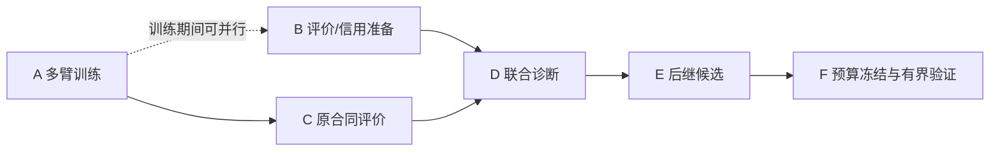

# 态极持续能力执行与主线接力计划

更新：2026-10-29，Asia/Shanghai。当前主实验、并行准备和有效权限由[03](03_CURRENT_EXECUTION.md)维护；本页负责依赖、交付物、出口和决策点。[09](09_NEXT_MAINLINE_PLAN.md)保留机制身份，[N177](../../reference/PLAN-N1-177_joint_cognition_slice_20261026.md)保留实施合同，[07](07_MINI_MODEL_DELIVERY.md)负责能力采用。此次将讨论收敛为推进顺序，不改冻结SPEC、不启动训练。

## 1. 目标、现状与继承

目标仍是：同一可学习、可恢复的态极候选，逐阶段在自然中文连续任务、跨会话经验、合法反馈学习、旧能力保持及有边界主动选择上举证。高上限方案由任务瓶颈和证据选择，不以实现容易或模块数量决定。

| 资产 | 当前证据 | 继承方式 |
|---|---|---|
| N175 | R为0/3；S仅6/312已判、306未知 | [原交接](../../reference/PLAN-N1-175_evaluation_handoff_20261026.md)保留，不代判、不重生成、不当新候选训练材料 |
| N176 | 原1360份固定生成及消费登记已完成，F2未解析 | 沿[原结案](../../../reports/taiji_n1_plan176_sealed_closeout_20261028.json)保留本地hash输出，不重复生成 |
| N177.1–177.5 | 状态、来源消费、结构化T2/T3、责任规格、T1 producer、cache和zero恢复已有有限工程证据 | 复用已有资产，不按编号重跑，不补发自然理解/规划或学习通过 |
| N177.6 | 15臂与数值评价完成，D已发布；恢复及B部分证据待补 | 现进入E设计，复核范围与勘误见03/E决策，不重跑旧题调门 |

## 2. 保留的研究结论与工程前提

### 2.1 所有者需要裁决的三类未解命题（2026-10-28复核）

三类张力分别是：具体方法能否取得未见任务净收益及何时停止投入；工程接通能否转为联合任务学习；观测是否覆盖当前同一候选并能持续裁决。三者分别管理，不能全部归约为梯度问题。

| 已确认事实 | 对推进的实际约束 |
|---|---|
| 原N177.6 trainer允许producer更新时，其任务信号只有slot/act辅助CE；回答loss没有到producer的autograd连接 | 这是已确定的优化约束，无需行为实验确认。实验只判断任务代价与替代收益；仅移除no-grad装饰器不能跨过detach、离散解析和float重建边界 |
| 已补合成逐loss×参数组与五模式分支回归；真实输入/更新隔离仍未齐 | 保留slot归零/误接负对照，余项转E0；合成logit夹具不代证语义能力，不把边界级交付写成B全覆盖 |
| 48→256为独立workspace行的prefix-zero-extension，附source/evidence引用，已有逐值回归 | 不重新立项“共享维段冲突”；语义有用性仍按实际任务验证 |
| TSK单bank局部更新不能招募缺失直连；wake默认不重连 | 保留支持限制，但完整慢巩固支持、条件重连及GRU/raw-byte路径存在，不能外推全架构被随机种子锁死 |
| 默认场共享读出192→48，线性核空间144维；归一化分支另丢尺度 | 共享原始头不能恢复已折叠区别。动作已有local/cue-selective/dual旁路；context相同不必令confidence、完整状态或未来行为相同。实际任务碰撞与干扰另验 |
| A/F/H已有仪器和历史阈值；当前候选覆盖、自动判门、CAP H06及长期跨度仍有缺口 | 复用仪器，不借用别的设备/链路/checkpoint阈值。N177恢复不能代签CAP H06，短期健康不代证长期稳定 |

依据：[producer](../../../taiji/joint_input_producer.py)、[trainer](../../../taiji/joint_t1_trainer.py)、[稀疏/fabric](../../../taiji/fabric.py)、[记忆读出](../../../taiji/memory.py)、[受体](../../../taiji/organs.py)、[既有测试](../../../tests/taiji_native/test_n1_plan177_input_producer.py)、[H冻结](../../reference/M5_CAP_H_THRESHOLD_FREEZE_20260920.md)。历史[M1-40](../../../reports/taiji_m1_40_binding_substrate_20260902.json)替代负结果保留，不因重排重新执行。

撤出执行依据的推论：默认写多自灭、byte是原生公理、A/F/H完全无仪器、W5b仍是未来战役、合同或已知题全绿、已证明更抗遗忘、共享头必然竞争、重连速度必然跟不上语义、三种重构是突破的穷尽必要条件。原生性是认知所有权，不是禁止成熟算法。正负性能预期均须同候选/任务/资源证据。

### 2.2 结案必须同时回答的信息与信用问题

每个新包先声明任务必需区别，列生产者→实际状态值/持久化→选择/消费者→原始输出，以及slot/act/answer/outcome目标→可更新状态/参数组。区分前向可达、正确使用、参数更新、未见收益、旧保持与恢复；固定结构约束直接登记，任务代价另判。

结案沿用`architecture_verdict`、`task_scope`、`suspected_mechanism`、`information_path`、`credit_path`、`causal_evidence_refs`、`competing_causes`、`next_action`。结构缺陷已确认、架构瓶颈有因果支持、嫌疑未证实及其他原因分别表述，不能用工程绿或loss下降代替能力。

### 2.3 并行准备：本轮信息与逐损失信用基准

| 准备产物 | 验收与停止线 |
|---|---|
| 当前T1实际必经信息图 | 标明raw bytes/Percept、producer、离散parse、CognitiveState、workspace行/来源、V4回答路径；相关/无关差异是否进入消费者；明确哪些TSK/共享场路径没有被本任务调用，不凭旧文件名认定瓶颈 |
| loss×参数组矩阵 | 用合成fixture独立反传slot、act、answer目标；覆盖slot head、act head、共享encoder和V4组。现候选answer→producer记未连接，允许unused时为None；按任务断言应有梯度可达/finite/非零及禁止路径，不强迫合法冻结/离散分支有梯度 |
| 自动回归与判别力 | 覆盖实际Trainer调用和五种权限模式，分清原始梯度与策略mask后的有效接收者；故意断开slot任务信用或误接answer信用时用例必须失败。不得只复制现总norm检查；以CI收集配置与同提交运行结果分账 |
| 状态与来源隔离 | 参数、optimizer、游标和需保持的状态不变；不加载本机正式checkpoint/cache、不读query/holdout/sealed、不执行optimizer step。机器报告计划产出放reports，测试放tests/taiji_native，临时区用.seed_test_tmp |

此项服务当前多臂结果判读，不是新的研究队首，也不阻塞既有合同训练继续。以路径图、可复现矩阵、定向反例及受影响CI合同一并通过并提交为有限完成；不以“继续观察”无限延长。若fixture无法覆盖实际调用图，先修测量，不把测试替身当真实路径。实现不得改变N177.6绑定源码的运行语义；确需修改共享源则先隔离旧运行图。

## 3. 执行依赖与有限出口

### 3.0 本轮多臂训练到后继候选的统一阶段表

父工作包是当前N177.6主实验。A–D是同一轮的训练、准备、评价和裁决阶段；E–F属于裁决之后的后继候选。字母仅作计划工作包索引，不改变冻结实验编号、臂或种子。

| 阶段 | 状态 | 前置 | 主要产物 | 转交条件 |
|---|---|---|---|---|
| A 多臂训练 | 已完成 | 原177.5合同/恢复预检 | 15臂checkpoint及资源账 | 固定终点或原合法停止出口 |
| B 结案与信用准备 | 边界已交付，缺项转E0 | 不改A绑定源/不争用writer | 输入核对、信息图、逐loss基准 | 准备项可复现；不读取正式标签 |
| C 原合同评价 | 数值完成，恢复证据待补 | A退出、原来源/恢复/资源门 | 原评分、状态写入诊断、缺项与成本 | 按冻结分母/阈值有限结案 |
| D 联合诊断与决策 | 已发布，归因已复核 | C结果＋B基准 | 架构判决、一个主要瓶颈 | 提交可审查的唯一后继 |
| E 新候选设计/实现 | 有限实现/推理恢复已交付，训练态余项待补 | D选定方向 | 新计算图、对照、零步恢复 | 实际信用/消费/隔离通过 |
| F 新预算冻结/有界验证 | F0a已完成，F0b/F1待前置 | E工程门＋成本预检 | 跨包停止线、独立训练/评价 | 净收益/保持/成本裁决后转能力扩展 |

不再采用“先做零训练基准，再回头处理多臂训练”的串行顺序。A与B可并行，C消费A的正式端点，D把C和B合并；B暂未完成不改变A的原合法停止线，但D不能跳过必要的基准。当前不得用后继新图的假设重判原15臂。

B缺项不取消C按原合同有限结案；D必须披露缺项，必要时将对应归因记为未验证/不可判，不用无限等待或追加训练补洞。

### 3.1 A：原15臂T1训练（已完成）

目的：在同一父状态/曝光下比较正确或置换解析监督、参数责任及状态写入与联合查询表现的关系。它不检验回答误差回传producer，因为现计算图没有这条路径。

| 字段 | 设计 |
|---|---|
| 合同与输入 | SPEC-N1-177.5 v2；五模式×三seed、每臂2560步、固定train cache/顺序 |
| 运行与证据 | run_state、每臂durable checkpoint和metrics；具体快照只登记03 |
| 监控与停止 | 原CPU/wall/制品硬限、保存恢复、单实例锁；失败/重放/重叠费用全部保留 |
| 转交 | 原终点或合法partial/预算停止后交C；不追加teacher、不接入新任务信用、不自动加轮 |

各模式的状态写入权限并不相同，不能把所有跨臂差值当成单一梯度因素。状态写入诊断从Correct终点派生，是原冻结评价，不是新增训练模式。

### 3.2 B：训练期间可并行的准备

原B交付：**梯度边界可用，余项转E0补证**。新增[逐损失合成回归](../../../tests/taiji_native/test_n1_plan177_input_producer.py)：调用真实trainer的`_run_episode`及语义/回答loss，分别检查slot、act、共享encoder和语言output，验证answer对producer未连接；五种模式覆盖loss启用与状态写入，并检查语言更新遮罩，slot归零/人为误接用于验证判别。参数保持不变、零optimizer step。输入追加与episode初始化使用合成替身、解析使用固定高置信夹具，不代表任务学会；真实cache/adapter完整信息路径、producer更新后遮罩及optimizer/cursor隔离仍未覆盖，B未结案。

当前T1路径的只读定位：raw bytes与Percept形成InputTrace→producer解析→source-bound parse提交到CognitiveState/world及workspace行→V4按来源建立evidence cache→逐byte回答loss；parser辅助损失另行计算。训练读取预绑定的train trace cache，非缓存路径用`learn=False`；当前T1 query选择已有world fact，不能据此声称检索了EpisodicMemoryStore或证明任务相关信息已被正确使用。相关/无关干预与跨轮消费图仍是待交付项。

| 字段 | 设计 |
|---|---|
| 交付物 | §2.3的真实信息/逐loss矩阵、合成负对照；原评价的路径/来源/入参核对清单 |
| 可执行范围 | 文档、静态源码审计、隔离合成测试；不得写A的run root或改其冻结运行语义 |
| 验收 | slot/act/answer分别归因，五权限模式符合设计，定向断路/误接会使测试失败；参数/optimizer/游标保持 |
| 不可越过 | 不提前读取query/holdout/sealed；不运行正式scorer，不启动新训练，不为完成B中断A |

若合成检查与主实验争用资源，缩小范围或排到空闲窗口。若实现必须改A共享源，先使用隔离版本或等A退出，不改正在执行的候选。

### 3.3 C：原合同恢复、评价与有限结案

| 字段 | 设计 |
|---|---|
| 前置输入 | A实际端点、source/order/manifest、恢复与完整资源账；适用的原一次attempt规则 |
| 交付物 | span/act、world state、query回答、翻转/更正、无关保持、F0保持、state-write配对及成本分项 |
| 验收与出口 | 原family/seed汇总与固定阈值；通过、负结果、不可判、partial或消费后的工程失败分别结案 |
| 转交 | 原输出/证据交D，不追加样本/seed/训练轮次，不用总体均值掩盖缺失或崩溃 |

N176是独立已训资产，按其原SPEC有限评价或保留可复现运行图；不混入N177分母。N175的306项S待判保留，不代填或改为新监督；它不阻塞A/B，也不替N177判分。

### 3.4 D：将多臂结果与信用事实合并裁决

| 字段 | 设计 |
|---|---|
| 输入 | C同候选行为/保持/恢复/成本＋B实际信息与信用基准 |
| 判决 | 辅助监督、producer参数更新、状态写入、语言读出各有何贡献；现对照能/不能隔离什么 |
| 必交说明 | §2.2架构归因字段；已见拟合、未见组合、自由轨迹、保持分别判断，竞争解释与未知保留 |
| 出口 | 提交一个后继候选及可检验主张；必要任务信用缺失仍是结构事实，其任务代价由C限定 |

不预先认定多臂必败，也不因本轮通过就宣称answer→producer信用已存在。不能由TSK稀疏支持、共享投影或旧N175失败直接解释本轮全部行为。

### 3.5 E：资产继承与训练态余项

当前事实只见03，详细证据/失败/勘误统一见[20261029阶段收束](../../reference/PROJECT_CONSOLIDATION_20261029.md)。E0实际补证由用户执行，助手维护输入、来源、产物和验收要求。

| 子包 | 状态 | 资产/待交付 | 出口 |
|---|---|---|---|
| E1/E2a | 合同/课程完成 | 状态查询/manifest，新sealed未物化 | 沿原边界继承 |
| E2b | 有限完成 | 消费/选择/读出；rank2失败、复制下界保留 | 新encoder候选 |
| E3推理恢复 | 子门通过 | v6 gap→span排序→v11/v12严格一致 | 不代签训练态门 |
| E0 | 当前优先，待补 | 历史15臂恢复回执、B真实链/隔离 | 绑定历史源或披露漂移 |
| E2c/训练态E3 | 待补 | task-credit on/stop、禁写、optimizer/RNG/cursor往返 | F1前置 |

### 3.6 F：F0a、F0b及F1分账

[F合同](../../reference/SPEC-N1-177_F_value_encoder_20261029.md)的方向/四臂/预检规则保留；正式F1数字与总预算尚未冻完。当前收束不修改冻结文本，实际操作留用户执行。

| 子包 | 状态 | 作用 | 转交条件 |
|---|---|---|---|
| F0a | 已完成 | 仅值encoder/分类头train-side标定 | 不替代整候选成本/未见收益 |
| F0b准备 | 可并行准备 | 12-run计划、计时/恢复方案与曝光口径 | 先澄清1280步/epoch冲突 |
| F0b执行 | 未执行 | 完整producer/V4/decoder短成本/恢复标定 | 原限额内、模型工作串行或资源独占 |
| F1 | 未启动 | 四臂×三seed的独立有界验证 | E0、训练态E3、F0b闭合且预算/判据冻结 |

顺序：E0补证→训练态E3余项→独占资源的F0b→澄清判据/冻结F1→一次有界验证。CI类型修复与F0b方案可准备；不以“已有一次恢复通过”跳过缺项。F0a copy-only满分下，新判据的可判别性须在读取holdout前处理；原跨包停止线继续有效。

### 3.7 条件支路与延期项

| 方向 | 进入条件 | 当前安排 |
|---|---|---|
| 离线teacher | 标签质量/覆盖/成本成为实际瓶颈 | 保留N177 §9候选；不能代替缺失任务信用，不进入运行时 |
| 扩数据/容量 | 已确认学习/内容路径可用且剂量/容量有证据 | 不替代A的原固定终点或B/D的归因 |
| 共享读出/拓扑/时间尺度 | 必经路径丢失任务必要区别或出现真实适应瓶颈 | 同任务/保持/成本选一个替代，不全面同时重写 |
| 硬件/算子 | 实测吞吐/内存热点 | 比较实际资源和信息损失，不按名称许诺倍数 |

N177.1–177.5的状态、来源、结构化T2/T3、receipt/责任、producer及恢复资产沿[N177合同](../../reference/PLAN-N1-177_joint_cognition_slice_20261026.md)继承；已交付工程不重排为待办。跨session owner/scope、自然Goal及长期保持的未完成项，随实际扩展任务进入F后继，不用接口fixture代证。

## 4. CC身份、N/VX共用实现与能力采用

CC编号是能力职责，VX编号是工程视角，两者共用同一候选、数据权限、预算及证据；不是两条独立排队路线。

| 原工作包身份 | 当前保留责任及整合位置 | 采用/出口边界 |
|---|---|---|
| CC-1 既定配方研究 | 原R2训练、评价恢复及固定判读已结案，原失败与成本继续可追溯；N176是另一个已训固定包，依原SPEC收束 | 不重开R2，不将配方流程结束称持续Goal完成 |
| CC-2 归因与可执行合同 | 信息/信用/连续性矩阵和唯一后继规格；本轮以N177承接VX0 | 交付实际触点、接口、对照、完整资源和有限exit后结束，不停在概念讨论 |
| CC-3 原生语言/语义 | 与CC-4共用本轮A–D及后继E/F，在同一状态上发展回答 | 07的L2语言门保留；L2通过不是联合开发前置 |
| CC-4 同bundle联合能力 | 记忆/信念→行动条件预测/短规划→选择/回执→中文说明的最小任务链，取VX1/VX2/VX3必要部分 | 消融、简单策略、真实终态、未见实例、恢复及语言门分别满足后裁决L3 |
| CC-5 连续经验/纠错 | 最小来源/时间/持续态继承N177，跨会话扩面见3.6；共享VX1/VX4 | 不等全部存储类别齐备，持续经验必须被真实消费 |
| CC-6 反馈学习与保持 | 学习责任由B/D裁决、E/F验证，连续支持/查询/保持在3.6扩展；共享VX4 | 获准反馈带来的新收益、旧保持及恢复联合裁决L4；状态修正不冒充参数学习 |
| CC-7 证据驱动扩面 | 3.7按瓶颈选择高上限机制，后续才按证据扩多模态/成长/规模 | 不自动重开已停配方，不把扩容或模块变多当能力增长 |

VX2完整目标提议、VX5自主调度及完整驱力按任务需要另包；VX6生命页只跟随真实生产者，可独立完成有限只读观察，不产生额外认知结论。VX7只对声明范围做同bundle采用/迁移。它们均不成为本次N176收束或初次F0的额外前置。

07验收始终绑定同一候选、入口和checkpoint身份：原生语言、代表联合能力、学习与保持分别有独立证据。L2语言达到仍不能豁免L3联合贡献；联合行动通过也不能豁免语言门；L4需要真实多轮新收益与旧保持。首次L3不等待全部长期CR、完整自主性、成长或多模态。未集成、未测和研究原型明确记缺项，不用UI或外部表达替代模型证据。

## 5. 提交、CI、资料归属与停止规则

本轮收束基线、CI状态、保留证据、合同勘误及待执行清单统一见[20261029收束记录](../../reference/PROJECT_CONSOLIDATION_20261029.md)。旧逐轮验证原文由85e7267ef的本文件恢复，不在活动正文重复堆叠。

每包完成或到达有限停止线后，同步源码/真实报告、候选manifest、03、09、本页及相关reference计划，再提交本包改动；保留无关未提交工作。源码包做受影响合同/行为与格式检查，并记录同一提交的CI；文档包检查链接、术语、原条款身份、队首和差异，不为文档改动重跑研究训练。

机器证据放`reports/`，课程数据/checkpoint沿受控根，脚本沿`scripts/`，计划沿现有`plans/`归属。失效执行建议从活动队列清除，唯一原始报告、失败、账本和checkpoint保留；不按失败删除证据，不新建近义顶层目录或复制历史全文。

本阶段执行方式按用户最新指示：助手仅修订方案与计划并核对已有证据；代码修复、清理、模型恢复、标定、训练由用户实行。任何状态更新需有实际证据；未执行任务写待办，不能把方案存在写成已完成。
