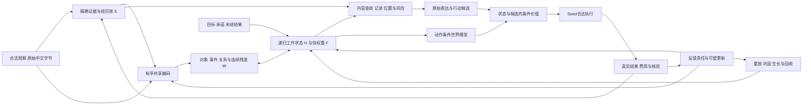

# 态极模型算法与架构的系统开发计划

> 文档状态 [系统设计细则·2026-11-05收束]。现行执行包20 rev2见[详细计划](PLAN-PACKAGE20_RULE_LEARNING_CORRECTION_20261105.md)，队首仅归MASTER-PLAN。§4的17整合及§5–§9旧卡保留交付/长期设计背景，S18–S22是能力责任轴，不发布执行包号；此前全文已[逐字节归档](../archive/history/n19_to_n20_20261105/README.md)。

## 1. 2026-11-03历史设计基线

当时选择有序内容编码、语义/证据双通道、多时间尺度学习和继承式生长作为共同架构，先闭合17正式图。以下仅解释该时点的设计来源；当前Task1资产与执行20决策见§19及MASTER-PLAN。

| 当时事实 | 当时设计含义 | 证据位置 |
|---|---|---|
| N16 A两seed完整动作0.0500/0.0167，新名字0/60；选择0.3833/0.3542，新描述选择0/60 | 当时尚无合格任务父；当前已有Task1确认参考，学习后保持仍待验 | reports/taiji_binding_select_16_1_attribution_20261103.json |
| 17已有有序头、记录级最终Q投影、ST/停信用、同状态生成门和正确target/input分离 | 复用现有selection_routing，补全覆盖与身份，避免再次另写一套平行主体 | taiji/selection_routing.py |
| 17定价启用跨度头，17.4候选不含跨度头；构造父已改为每seed N16-A终点 | 价格、参数组、父和恢复必须先对齐到一个版本，现价卡不能整卡代签统一候选 | scripts/training/price_taiji_selection_routing_17_3.py；taiji/selection_routing_checkpoint.py |
| HEAD旧T3有701/720失败；本轮工作树pointer/强制cursor修订后的新回执为720/720通过 | 两个源码版本和干预语义分开归档；最新工程可达性不代签正常位置学习或完整图信用 | scripts/training/verify_taiji_selection_routing_17_2_t3_supplement.py:234 |
| 17.4新span容器的六格参数/矩/概率恢复已通过且源码绑定更新；A/B四格m质量仍0、六格prefix_cursor仍0 | 保留位级恢复正结果，补非零复制状态、语义游标与事务恢复 | reports/taiji_selection_routing_17_4_preflight_20261103.json |
| 09有快权重、受约束更新、出生和恢复资产，成长正结果限于合成短片段 | 从现在纳入共同内核接口，真实任务生长贡献、保持和长期费用另验 | growth_credit.py；constrained_learning.py；state_migration.py |

旧T3失败不构成最终Q无法表达一点质量的证据。固定softmax锚点后再经transport与cursor混合，测量对象已经改变。工作树新实现同时控制pointer与cursor后已报告点质量通过，版本和恢复适用性需随源码变化重新绑定。源码、报告身份和本轮范围差集见[复核回执](../../reports/taiji_system_development_plan_review_20261103.json)。

## 2. 共同主体及信息分工

E负责来源与原始证据，W负责可学习绑定和关系，H负责当前活动与跨步整合，F负责有许可的快速关联。原文仍可被表达器合法回读，不能人为屏蔽E来制造W必要性。检验W贡献时比较关系交换、多跳、跨轮依赖和等容量连续状态，不以张量形状认定语义已经形成。

一个SubjectState拥有全部状态和版本。VISION的TaskCore作为职责映射到当前主体，旧TaskCoreV1、joint_task_state和LivingState需要显式迁移映射，不能各自保存互相覆盖的事实。当前事实的权威来源是E及其许可/版本账，神经信念是可修订的模型估计。

| 状态 | 首版设计与所有权 | 生命周期与恢复 |
|---|---|---|
| E 原始经历 | raw bytes、source/version、valid_time、observed_at、owner/scope、支持/反证、撤销依赖 | 合法追加与版本化撤销，原记录不被摘要覆盖；来源索引与费用一起恢复 |
| H 递归状态 | 继承当前groups=4、width=128的研究起点，沿主稿漏积分/tanh更新 | turn临时部分与session部分分域；容量是本包配置，结构扩展由22事务改变 |
| F 快关联 | 继承fast_heads=2、key/value=32的研究起点，读取F转置乘查询 | chi、许可及revision显式；chi=0冻结整个编辑，墙钟过期另有协议 |
| W 内容状态 | 18首选可扩展对象/事件工作槽与连续残差，每槽128维；初始8槽、当前包上限32为资源提案 | 身份按内容和证据匹配，允许新建/歧义/null；溢出可回读E，禁止静默覆盖 |
| G 目标与承诺 | goal_id、parent_goal、授权范围、成功谓词、状态、证据与取消原因 | turn reset不清目标；取消/作用域变化按明确规则生效 |
| D 未结动作/反馈 | intent_id、执行回执、prediction_revision、pending/settled、反馈权利 | 外部执行与模型快照不假定原子；恢复先核对回执再行动 |
| Θ/φ/优化器 | 慢知识参数、有限快速适配参数、Adam矩/资格迹与负责组 | 与拓扑、状态schema、RNG、课程游标及累计费用一起保存 |
| 结构与资源 | 单元/连接/群体ID、父子映射、激活mask、预算和实测费用 | 出生/成熟/剪枝均有版本事务，回滚不能清零费用或重复外部动作 |

## 3. 正式时步与学习责任

每次advance先验证事件/反馈身份、权限和逻辑时间，建立当前合法证据视图，按encoder revision重建必要编码，再读取H/F/W与Goal。模型生成内容/行动候选，世界模型预测后果，条件价值选择合法行为。Seed执行与核验后形成真实Outcome，才产生对应学习信用。无外部消息时，目标、未结结果、合法经历与资源变化仍可触发模型活动。

表达微步继承17的顺序。更新前H与已接受字节形成查询，模型求记录/位置分布，得到最终Q及content，仅提交一次H_next，再由该H/content求生成门与字节概率，接受字节后更新复制后验m/coverage。正常前向不消费gold记录/跨度/评分结果。探针覆盖最终Q的控制必须放在transport及cursor混合之后。

18的槽绑定采用可微竞争和共享更新作为首选实现。令E_i为128维有序证据表示，q_j=Q_W(W_j)为32维工作槽查询，K输出32维、V输出128维，a_ij=masked_softmax_j(q_j·K(E_i)/sqrt(d_k))，m_j=sum_i(a_ij V(E_i))/max(sum_i a_ij,eps)，W'_j=GRU_shared(m_j,W_j)。保留未归属连续残差、null/new分支和来源分布。新槽使用可恢复的不同种子向量破除对称，18首版迭代次数提案为3；身份匹配包含歧义与new/null，不能按评估对象ID分配参数。该公式是18候选，原17的记录级Q不被此文本静默改义。共享编码与解码查询对W、E均有合法路径，关系预测通过内容交互训练。

| 学习信号 | 目标与接收者 | 必须区分的失败 |
|---|---|---|
| 正确答案 | L_answer=mean_t[-log P(y_t正确∣x_<t输入)]，训练编码/绑定/读取/表达的声明组 | 输入前缀变化不能替换正确标签；序列NLL、实体/关系错误和自由完成率分开 |
| 选择/位置辅助 | 训练标注只进loss，回答信用继续参与负责组塑形 | 辅助损失变好而任务无增益；新头没有真实消费者；gold仅作上界 |
| 世界后果 | 已知维度的状态变化、成功/失败、反馈到达与成本 | latent自预测替代真实结果；未知补零；imagined当真值 |
| 活动价值 | 真实后继任务收益减损伤与全成本，变时长折扣 | 疲劳下降、模式次数、免费等待和重复发展探针带来的伪收益 |
| 反馈学习 | 反馈绑定原预测版本、接收参数和许可，比较更新前后的新query | 记住答案冒充规则学习；更正后的答案回算首次得分；反馈信用错组 |
| 保持/巩固 | 合格父的获准support约束及独立保持query，受约束更新后实际复查 | 零学习换保持；新能力增长但旧任务损伤；保持query进入调参 |
| 生长 | 真实任务残差C_c、信号/噪声、覆盖与后继效益决定提案 | 非零启动梯度冒充收益；随机门信用噪声；padding计成活单元 |

近期可微信用采用有界窗口BPTT，窗口8/16/32步作为定价和有效依赖长度的比较起点。窗口外保留状态值，计算图边界明确登记，较远责任通过合法原文重放、结果信用或资格迹承接。不能靠无限保留全生涯autograd图实现持续主体，也不能隐瞒截断对长程任务的影响。

读取原文是训练信用的权威入口。旧native_content_core的持久latent通过no_grad和tolist写入，训练时必须对获准原文重新编码。缓存键包含source/version、encoder revision、梯度模式和可塑组，不能把评估缓存直接送入可塑阶段。

时间采用逻辑事件时间与真实间隔双账。wait可以不运行神经前向，运行态是否按间隔衰减由明确公式和任务验证决定，禁止后台tick代签活动。χ许可关闭、H泄漏、事实过期是三个不同语义。长期目标与来源账不依赖易衰减的H单独保存。

## 4. 17 当前候选的统一与补验

> 本节标题保留历史锚点；以下是17开发时点交付要求，不发布当前调度。

本次审阅末尾工作树又新增了span注册/保存与pointer入口。最新17.4的8项源码和报告摘要已匹配当前树，可接受选择阶段恢复范围；非零m/游标语义及回答更新仍未覆盖。T3运行后的选路模块也有继续修改，冻结时需区分运行时hash与当前hash。

当前主建议使用现有RoutingCandidate，固定每seed的N16-A step300为失败研究父，保留14祖先谱系。三臂从同seed完全相同binding克隆，替换旧头为37120参数有序头，主选纳入已有消费者的258参数位置头，总参数3563859；独立选择头仍37120。start进入位置logit bias，end明确只承担辅助监督，三臂使用同样位置监督与参数。位置读核以当前软pointer候选版本化，采用17现行§15记录的方案A，训练软读、推理hard；T(u)在前100更新由1降到0.05，此后保持0.05；熵系数0.01T。软硬差距、实际消费者与新增loss须在准入前验证，原soft-transport保存为回退/比较资产。此处显式修订早期设计的14直接父约定；新候选身份称R17c，manifest在补验前冻结。

| seed | 固定研究父 | SHA-256 |
|---|---|---|
| 28031 | output/taiji_core_binding_select_16_1_compare/bundles/28031-A-locked-step300.pt | 73f19e36b159b4e0824bb24bdc7625454e4c7d63e9f308ddf28a78a3f2c8a169 |
| 28032 | output/taiji_core_binding_select_16_1_compare/bundles/28032-A-locked-step300.pt | 3d55bff6d51e7c3d7079e068caf70f1b131ce43e0be830abb1f71b5a39b556a5 |

父选择固定为A并逐seed对应，禁止择优换父。这里继承的是参数与谱系，现有逐例reset不能签跨session状态连续。父预训练及旧失败费用进入累计研究账，retention_not_admissible继续成立。

| 工作卡 | 具体交付与验收 | 故障与处置 |
|---|---|---|
| 17.1R 身份对齐 | 父/祖先、arm ID、参数清单、可塑组、loss、dtype、数据摘要与schema唯一化；复用A_route_lock/B_stop_lock/C_unlocked ID，建立与旧设计别名映射 | price/span候选与恢复候选不能共用一个通过标签；旧价格保留为历史分项 |
| 17.2a 精确诊断控制 | 绑定最新pointer/强制cursor控制或等价post-Q override；q_null=gamma=0时目标源字节P≥1−1e-12(f64)/1−1e-6(f32)，补错字节/错来源/空源负对照 | 旧701/720与工作树720/720分别留版本；新通过仅限该控制与dtype范围，失败先查干预位置/字节映射 |
| 17.2b 真实计算图 | 所有声明可学组信用、实际delta/ULP；ST规定VJP与B停信用；正确目标/错误前缀；完整正常入口白名单 | 三个参数单元素FD不代签全部图；稀弱信用单列未分辨 |
| 17.2c 状态语义 | living.step按正式事件推进、prefix_cursor按已接受输出推进，gate index不以%4掩盖游标；记录并列/null、低质量eta回退、全mask与空输入合同 | 相同的错误游标恢复不算语义正确；分别验推理与训练重放 |
| 17.2d 精度与事务 | 完整f32/f64主体路径，替换硬编码f64分配；临时文件写盘/校验/原子替换；保存费用、阶段、课程曝光和参数revision | reader.float()不能代签完整f32；失败写盘保留上个完整bundle |
| 17.4R 非零状态恢复 | A/B实际sum(abs(m))>ε、coverage非零；对象→地点→null切换、EOS、权限过滤和非零cursor；独立进程下一步/下一更新逐位一致 | 保留六格已证的值/矩恢复；不足部分补验，不能更名当全部通过 |
| 17.3R 一致图重定价 | 含258位置头且显式传入loss/generate、同可塑组、同正确标签、同三臂；包含课程额外前向、日志、恢复、失败费用 | 未变分项可以引用，改变的图必须重测，13,092.25旧整包价不直接沿用 |
| 17.5–17.7 | 正式runner尚待交付；固定三臂/两seed/300更新提案，原始bytes+EOS先存后评分，条件确认与有限收束 | 主任务失败按期关账；不以工程通过或新schema替代任务增益 |

R17c的阶段损失包括L_answer/L_selection、0.5L_span和所选位置熵项−0.01T·H，L_span来自训练原始标注的起止位置，两类实体分别归一。按现行方案A，位置辅助各阶段开启；阶段1仅选择/位置头更新，共享底座冻结；阶段2更新继承可塑组和位置头；阶段3联合，A/B/C使用相同目标/辅助/温度与熵系数。选择头在阶段2冻结，具体所有权在manifest一次列全。end没有直接回答路径时登记为辅助信用，不伪造NLL信用。旧无span容器3563601及直接eta监督留为有条件备选。

读核、pointer_temperature/hard、span启用、可塑组、dtype与状态字段进入配置和schema。旧bundle在旧读核语义下复现，迁移child明确列出变化；缺模块/参数禁止静默随机回退。语义改变时升级schema或给出显式迁移，不能只沿同一个17-v1名称。

正常模型的记录级Q投影与隔离探针的字节级最终Q控制分开命名。诊断override只在隔离检查中消费gold。正常位置由模型预测，soft/hard读取、温度与可塑组分别冻结。只有R2a工程控制通过，才能研究R2b锚点/transport、R2c学习位置及R2d自由任务。

三臂同期保留。采用小位置头的依据是新源码已有start消费者，最新验证回执的一个start参数对回答NLL有FD分辨的信用；其学习收益仍待正式任务。三臂共同使用位置辅助，不能据A/B/C单独宣称位置头带来增益。若辅助有信用而无任务收益，备选为移除该头并直接监督已有eta，需单独版本化比较。

## 5. 长期能力轴S18 原文自主绑定与自然中文任务

**主要假说**是同一有序共享编码与可学习绑定能从原始记录建立对象/事件/关系，摆脱外供description键，并在变长表达与连续追问中保持目标条件性。

| 子卡 | 模型/架构交付 | 验收和停止 |
|---|---|---|
| S18.1 原文视图 | 输入只含原始文本、合法metadata和历史状态；description键转为训练辅助/基线；标注、角色、实体ID语义留在评分侧 | 同名字段清单和实际调用路径审计；原文/辅助键同信息边界明确 |
| S18.2 内容绑定 | 实现E/W/H双通道、槽竞争、别名/跨句/否定/多事实，保留连续残差与原文回读 | 同等容量连续状态、槽状态、辅助键上界；绑定质量与实际任务收益分别报 |
| S18.3 连续表达 | 同任务的Goal/H/F跨turn携带，变长实体与多种答案句式，所有输出由模型产生 | 去状态、错位状态、关系交换、同字换序及新名字/新描述/新模板分轴 |
| S18.4 图/迁移/价 | 参数映射、训练信用、无身份泄漏、首更新前完整保存；直接原文重编码与缓存策略实价 | 父迁移失败回滚；槽溢出/绑定歧义有明确null/回读行为 |
| S18.5 一轮行为比较 | 原文共同候选、等容量连续对照、辅助键候选；冻结训练/开发/确认world与源模板 | 提案总体≥0.80、各未见轴≥0.70，主模型相对等容量对照增益≥0.05且world配对CI下界>0 |
| S18.6 收束 | 写明原文提取、关系绑定、检索和表达各自贡献，保留真实成功范围 | 未见轴不成立时先定位信息可辨性/消费/信用，最多一次版本化结构备选后关账 |

数据起点提案为24 train world×24任务=576，12 dev world×24=288，独立12 confirm world×24=288，每任务2–4轮。分组隔离模板/别名和实体映射，未见轴每轴至少48例，精确分母在S18.1生成前冻结。中文自然度与完成终态分别记账，主分母包含解析/UTF-8/EOS失败；不再只以固定27字节模板代表中文能力。

主选先沿用当前有序编码＋对象/事件槽，工作槽初始8、按资源许可扩到32，原文读取保留。槽数量是状态容量，22的神经单元/连接/群体成长是结构容量，两种变化分别计量。若槽身份漂移而连续对照更好，保留连续实现；若有序编码在合法关系见证中信息不足，先扩大共享上下文/关系交互，再将小型attention编码作为同资源备选。每次仅比较一个明确变化。

## 6. 长期能力轴S19 跨会话经验与事实修订

**主要假说**是同一主体可以从合法原文经历累积、保留并更正内容，使后续新query受真实历史影响。此阶段先隔离记忆收益与参数学习收益。

| 子卡 | 交付 | 必须覆盖的反例 |
|---|---|---|
| S19.1 经验流与权利 | 延续12实体×3属性×4值×3版本的首世界，current/previous/unknown；每事件带valid_time/observed_at/source/version/owner/scope | 相同时间不同来源、迟到更正、未知旧值、未解析内容、冲突/撤销/过期 |
| S19.2 主体状态域 | turn临时输出、session工作状态、subject经历/目标/参数/拓扑分域 | turn reset不清承诺，跨owner隔离；取消目标不删除无关合法经历 |
| S19.3 信念修订 | E保留原始记录，W/当前视图可修订；分开来源完整性、事实可信度、使用/学习许可、指令权威 | “最近写入”不能全局压过高权来源；派生摘要继承原来源 |
| S19.4 恢复与记忆预算 | 事件/反馈幂等、store+latent revision+cursor+费用完整恢复；有限内存下保留引用与可重建内容 | 断点恢复不复活撤权；容量耗尽可等待/回读/拒收，不能静默覆盖关键事实 |
| S19.5 同信息比较 | 有经验携带、无携带、完整合法原文重放及简单最新有效证据基线 | 冻结参数，测状态/存储收益；成本计入原文/索引/备份/重编码 |
| S19.6 结案 | 读新事实、改旧认识、时间意图与冲突处理分别报 | 未解析内容保留来源状态，硬解析仅辅助，不能删掉失败轮 |

起点提案为每条流4 session，共108次事实事件和144次查询，开发12条流、确认12条新流，训练流数量按实际价冻结。每类时间意图48查询的构造需要逐项核验合法可答性。提案总体≥0.80、各时间/冲突轴≥0.75；经验组相对无携带增益≥0.10且流级CI下界>0。与完整原文重放比准确率及成本，不强求超过拥有同全部证据的科学上界。

参数先冻结，合法记忆写入保持开放。S19.1已同时定义后续反馈及发展行为的单写者事务接口。旧store原文/schema可复用，持久latent的tolist路径不能用作新训练图。更长时间窗由实际遗忘/成本曲线决定。

## 7. 长期能力轴S20 反馈塑形、保持与首次任务级可塑扩容

**主要假说**是可核验反馈能教会负责模块，使新query在同记忆条件下优于冻结参数组，并保护已经核验的父能力。表征更新、记忆新增与真正的参数学习分别统计。

| 子卡 | 交付 | 验收与问题出口 |
|---|---|---|
| S20.1 因果反馈 | 先保存prediction和revision，独立评分，再按release_at释放反馈；绑定允许接收组和撤销状态 | 重复/迟到/错版本反馈、模型自答自证、未来query标签进入support均被捕获 |
| S20.2 快/慢更新 | 即时状态更新、有限φ快适应、θ慢巩固分账；复用constrained_learning与负责组表 | 增益、保持和实际delta合取；冻结组/优化器矩不被暗改 |
| S20.3 编码迁移 | encoder revision变化后重编码；H/F/旧latent的兼容策略与费用 | 比较有限快照分段重放、延迟编码升级；近似迁移需实测任务/保持损失 |
| S20.4 配对比较 | 同记忆冻结、合法更新、反馈置换、负责模块冻结，必要时仅reader/decoder适配 | 新规则/新表达query需要迁移，不能只把答案写入store后复述 |
| S20.5 最小生长闭环 | 已有合格父和可复现残差压力后，接入09的R/P出生、同函数初始、任务信用、shadow/回滚 | 从这里首次在真实任务上允许有限结构干预；没有合格父时仍可做信用/恢复工程但不签成长收益 |
| S20.6 收束 | 学新、保持、状态迁移及费用四账 | 提案新query净增≥0.05且CI下界>0；旧任务准确率退化下界≥−0.02，安全/权限硬例不容退化 |

流起点提案沿19的4-session结构，另留未参与反馈的父任务集至少240例。合法反馈上限先取64次/流作为定价起点，确认query从新流产生。每次反馈先经过权利与可靠性检查，错误反馈要有检测/回滚/追溯指标。记忆撤销与未来检索立即执行；参数中已吸收信息的精确删除是独立问题，必要时影子版本从可恢复父重放，费用全部计入。

收益不足先看信用和函数更新，新学伴旧损伤则先收紧责任/步长或采用功能保持/replay。不能以极小步长获得零遗忘再忽略零学习。稀有旧能力、分布变化和负迁移必须单列。S20.5提前承接结构工程与真实贡献，22负责更大结构范围和发展策略的联合验收。

## 8. 长期能力轴S21 世界模型、条件价值与无新提示活动

**主要假说**是同一主体的后果预测和有成本的活动选择能改善持续任务，而不是通过空转或只选wait获得分数。

世界模型先预测可核验的环境/任务后继、目标完成概率、失败与成本，输出未知mask和不确定性。观测后校准，行动一步后重新观察。旧world头对归一H后继的误差可作表示辅助，不代签真实世界预测；加噪last_event的imagine也不能签任务想象。

条件价值采用候选×状态交互，例如v(a,s)=MLP([z_a,z_s,z_a⊙P(z_s)])。加性公共状态偏置在同候选比较中会抵消，必须以同动作/不同需求的相对价值变化做反例。操作集合起点为继续、相关求证、重放、巩固、求助、等待，出生提案只在已有工程/资源许可后加入。

| 子卡 | 交付 | 对照与判据提案 |
|---|---|---|
| S21.1 环境与回执 | 目标持续、缺证据/待回执/已完成/取消/资源不足/可学性不足等状态；模拟真实执行与未知结果 | 同输入不同目标改变最优行动；各主要操作至少在一类情况有价值 |
| S21.2 后果与风险 | 已知维度误差、成功概率/成本、整答案风险；独立校准面 | Brier/覆盖率—风险/误拒/成本；换乱预测和直接策略作控制 |
| S21.3 决策信用 | Outcome绑定intent/policy revision，SMDP以真实dt折扣；延迟回报与资格迹校验 | λ=0只作即时基线；延迟效果不能被当前probe差替代 |
| S21.4 无提示片段 | 同目标下无新提示最多16次合法选择，等待/重试/取消可恢复 | 不重复外部动作、无前台饥饿；真实资源限制与预算终止 |
| S21.5 一轮策略比较 | 学习策略、固定阈值、随机合法、直接执行/仅重放 | 提案相对最佳固定基线净收益≥0.05且流级CI下界>0；任务完成≥0.80、越权0 |
| S21.6 内部干预预测 | 预测一次replay/consolidate/birth的新收益、旧损伤与费用；真实结果校准 | 与反应式ν/阈值比较，预测器只提案，采用仍需独立能力/保持/恢复闸门 |

数据起点为训练32条、开发16条、确认16条多事件流，最多16决策/流。奖励P_R、准入P_A和确认P_C按来源/世界分组隔离，发展探针每例暴露≤4次、每包总决策预算在定价后冻结。真实结果未知时保持pending，不凭想象补正奖励。记录获得的信息量和交互机会，离线录制流评价与主动信息获取分别取证。

## 9. 长期能力轴S22 继承式规模生长与递归发展合取验收

**主要假说**是任务残差、重放/巩固和结构发展形成可重复的净收益闭环，主体能够继承自身能力并在资源边界内增添、整合和回收计算结构。

| 子卡 | 算法交付 | 关键验收 |
|---|---|---|
| S22.1 信用与压力 | C_c=sum g_c(x)δxᵀ，报告有效秩、抵消κ、信噪、覆盖和活单元；噪声标定考虑时序相关 | 低秩不等于单纯容量不足；重放不保证增秩；软门凸分区与共享支路秩限制明确 |
| S22.2 残差单元发展 | 复用R/P出生，成熟、训练后lesion、回滚，记录物理padding与有效单元 | 初始函数保持、启动信用、主路径实际消费、训练后任务贡献和旧保持合取 |
| S22.3 连接/群/H扩展 | 连接重连、群出生、状态宽度扩展分别冻结；旧路径mask/分块归一和新参数Adam映射 | groups≤4与固定width是当前实现边界，不能通过改常数冒称可成长；新softmax分母/归一化变化不得损坏旧函数 |
| S22.4 发展比较 | 信用覆盖、GradMax固定日程、随机/置换门、仅重放、不生长、同最终容量预分配 | 同父、同经历与真实资源；先比较残差出生，再一次只扩一个结构范围 |
| S22.5 预测发展 | 用21的内部干预预测器排序replay/巩固/出生/回收，用真实后继校准 | 预测/选择/采用权分开，奖励探针自适应次数和试验成本全记录 |
| S22.6 生涯片段 | 至少三个独立任务转换，持续运行/恢复/反馈/结构变化在同一主体上合拢 | 看累计错误、适应速度、父保持、成长收益/时间和存储/CPU斜率，不能只报一次出生 |
| S22.7 全局终审 | 同一候选自然中文连续任务、经验纠错、反馈保持、主动选择与结构贡献按范围合取 | 每项原始证据、未覆盖项、迁移/资源/CI及唯一下一轮核心问题齐全后收束 |

初次真实生长窗口提案为两seed、每臂最多64次合法更新，候选新生单元预算按信号与价格设上限。物理单元数、有效单元数、信息维度、活跃连接、每轮计算和存储分别计量，不能用参数增多代替能力生长。

当前growth_credit只扩R行/P列，H宽度和群数不变。扩大H/群时，新节点即便零值也可能改变softmax分母和归一化，函数中性必须重新证明。新支路应有可启动信用，不能同时零入边/零出边或门值全零导致永久死单元。分支出生采用零初始活动＋非零输出映射等可验证构造，旧归一化域先保持独立，成熟后才版本化合并。

净收益提案为共同任务上相对不生长/仅重放≥0.05、CI下界>0，父保持容差沿20继承。若同最终容量预分配更好，报告动态生长的准确率/费用/适应时间实际取舍。必须训练后lesion并保持已训练父行，区分“新单元承担收益”与“旧参数继续训练带来收益”。出现长期成本失控或贡献不足，按既定窗口关闭该生长候选。

## 10. 可能问题与备选方案的触发规则

| 观测到的问题 | 先做的归因 | 主选内修正或备选 | 进入条件与代价 |
|---|---|---|---|
| 表示换序盲/关系不可辨 | 有序表示与目标信息是否已混同 | 共享上下文/关系交互；必要时小型attention编码器 | 一次新结构对照、同信息/预算、迁移重验，不能只加末端头 |
| 长上下文代价过高 | 编码/重编码/生成/状态逐项profile | 分块/层次读、可学习chunk；选择性SSM作为后继器官备选 | 仅在长度成本成为主瓶颈后，原文映射与旧状态迁移仍需保持 |
| ST信用或软硬读取有数值信号但无收益 | 偏差、离散策略与训练—推理差距 | 软路由/软指针同推理真梯度对照；硬选择确有必要再试有基线策略估计 | 固定估计器/温度预算，测路径差异；不把代理FD当真硬目标导数 |
| 复制定位扩散 | 最终Q控制、transport、cursor、label映射分别测 | 调整已有位置分布或直接位置辅助loss | 只有R2a正确且R2c持续失败才立位置监督版本，拒绝未消费的新头 |
| 槽塌缩/身份漂移 | 容量、对称初始化、竞争/来源匹配、目标监督 | 连续残差、歧义分布、动态新槽；等容量连续状态对照 | 槽数变化要做状态/优化器迁移，不能用样本ID当对象身份 |
| 快记忆干扰/遗忘 | χ、许可、墙钟衰减和任务时距分开 | 受控写强度、分源快记忆、重放与恢复 | 需未见延迟任务、干扰及同容量控制，不能按寿命写次数削弱证据质量 |
| 新学好但旧能力坏 | 负责模块、步长、表示变化和保持覆盖 | 受约束更新、模块化适配、合法replay | 比较可学收益与保持，禁止用零更新伪造稳定 |
| 编码迁移成本爆炸 | 全史重算比例和缓存失效 | 分段快照重放、延迟编码升级、有限双revision过渡 | 同query/保持验证，允许近似范围必须声明，费用不藏到离线维护 |
| 活动全wait/全busy | 机会成本、延迟回报、动作合法性和奖励游戏 | 修正环境可判性/真实费用，再评策略容量 | 同等机会对照，噪声不奖励、已完成目标应停、待回执应等 |
| 生长无信用或无贡献 | 断图、残差抵消、低秩、噪声、成熟时间及冗余 | 重放/采样/信用修复，或停止出生；真实容量压力后才扩结构 | 同最终容量、随机/置换、trained-lesion与全成本共同裁决 |
| checkpoint一致但状态错误 | step/cursor/permission语义、非零状态与事务边界 | 补状态断言与回放图；原子bundle和单提交者 | “恢复同一个错误值”不算状态合同成立 |
| 外部结果未知/重试 | 已执行副作用和receipt真值 | 幂等动作ID、先核对回执、等待/求助 | 模型回滚不能撤销现实动作，不能自动重发 |

每个包先声明一个主假说及最小有用效应。默认一次正式比较，必要时最多一次版本化结构备选；继续失败或成本不可承受则在本周期收束，列明下一轮要区分的竞争解释。未见任务门不因结果而改，退出结论限定在候选、任务和资源范围。

## 11. 评价、数据权利与资源

工程矩阵、开发能力、在线适应和最终确认分账。每个阶段正式投入前具备实际父/源码/状态身份、数据分区与反馈权利、数值门/对照、预算/出口四件套。18–22的数量和阈值在本计划中为提案，实际候选完成工程后一次冻结。历史dev暴露继续累计，不能换编号清零。

主评分包含全部应答轮，并另报整任务终态。记录raw bytes/EOS先于解析/显示，配对键至少含candidate/seed/arm/split/world/task/turn/endpoint，源顺序与名称ID重排均有控制。任务/流/world才是统计重采样单位，相关字节不能伪装成独立样本。bootstrap默认2000次，95%区间和多轴结果完整报告。

科学上界可使用gold记录/跨度或完整可见事实，但必须明确额外信息。机制对照与合理产品基线使用同样可见数据和授权。任务可用、机制增益、保持、主动性和成长分别裁决，合理简单臂通过时保留其结果。

17沿已有详细计划的包级30000 CPU/60000 wall提案，20,000/30,000观察线。17补验不追改旧报告预算，先列旧工程消耗与新补验剩余额度。若现阶段12工程Adam已用满，17.2R必须另冻补验子预算及原因，不能把重跑排除在实际调用数之外。

18–22在每个包先给工程和定价pilot上限，再测真实图。建议工程起点≤1200 CPU/2400 wall、定价≤600 CPU/1200 wall且≤12次实际Adam；正式包初始资源提案≤30000 CPU/60000 wall，价格超过则在执行前形成具体资源/任务范围裁定，不能自动牺牲对照或能力上限。多臂默认串行单写者，线程/dtype/device/批次和数据权利写入manifest。失败尝试、重放、缓存、状态迁移、恢复、编码和评测都累计。

工程连续绿但任务无收益时，先检查主要端点是否实际被学习、对照是否可判。工程维护不能无限延长研究窗口。触发观察线保存并报告，硬上限结budget_stop；每阶段交失败资产、可恢复父和累计费用，不能丢弃不利结果。

## 12. VISION来源及采用范围

| VISION来源 | 本计划采纳 | 后续验证/适配 |
|---|---|---|
| §3.1/3.3、历史§19.2 | 学习语义状态＋精确证据、连续残差、合法回读 | 18的E/W/H，保留原文直读控制，原TaskCore命名映射到同一主体 |
| §4、VX1 | reset域、目标/承诺、pending outcome与完整恢复 | 18连续任务、19跨session，按真实调用路径验 |
| §3.4、VX4 | 状态/快/慢更新、反馈责任、保持与成本 | 20学习与迁移，旧AdamW建议不自动覆盖当前优化器 |
| §3.2、VX2 | 候选×状态交互价值 | 21，捕获公共状态偏置抵消反例 |
| VX5、§6 | 无提示目标调度、真实后继收益与资源 | 21，奖励/准入/确认面分开 |
| §8、历史§22.2–22.8 | 校准风险、信念修订、记忆预算、技能及持续评价 | 19–22按真实需要接入，技能仅在重复多步任务后立项 |
| §8/§24、历史§19.6 | shadow结构、保持/成本、伸缩与算力 | 共同接口从现在纳入，20最小任务出生，22联合成长 |
| §20/21/23 | 多模态、来源治理与单项扩域 | 治理前置；多模态在22.7后按一个缺口立新包，先保留区域/时间证据 |

当前[VISION正文](VISION_FUTURE_TECHNOLOGY.md)为设计来源。旧全文固定于c97d74d00:plans/reference/VISION_FUTURE_TECHNOLOGY.md，blob e31e16af9a83c7da7c2e106a55e01fd7474e18d3。旧256宽/16槽/64epoch、VX0–VX7和N177路径不直接作为本轮执行值。多模态、开放知识、数学/程序、社会共同学习和UI发展视图保留责任，由22.7据实际证据选择一个后继。

骨干备选参考attention与选择性状态空间的原始机制，生长对照保留梯度初始化方法。论文的性能数字不转成本项目预期。[Transformer原论文](https://arxiv.org/abs/1706.03762)、[选择性SSM原论文](https://arxiv.org/abs/2312.00752)、[GradMax原论文](https://arxiv.org/abs/2201.05125)

## 13. 实现资产、文件和CI

| 责任 | 复用资产与拟交付 |
|---|---|
| 17统一图 | 复用selection_routing.py、selection_routing_checkpoint.py、binding_copy/record_relation；各版本增量和诊断API在同一候选实现 |
| 共同状态/原文绑定 | 新文件拟用taiji/cognitive_content_state.py及cognitive_binding.py，引用LivingState/BindingState，不再创建第二套TaskCore |
| 经历与反馈 | native_content_core的schema/合法视图、journal资产；拟cognitive_experience.py/cognitive_adaptation.py承担当前候选的真实路径 |
| 世界/活动 | native_activity、activity_learning、executive/homeostasis只借适配后的机制；拟cognitive_world.py/cognitive_development.py |
| 结构与迁移 | growth_credit、constrained_learning、state_migration按当前候选桥接，先残差单元再结构范围扩展 |
| 接口与评价 | scripts/training沿阶段建verify/price/compare/closeout，tests/taiji_native只补真实回归；API/产品采用放22合取范围后 |

拟名仅代表归属，实际实施优先扩展语义兼容的已有模块。17.2前列完整import/数据依赖、Git归属和源码摘要，干净checkout可构造候选。当前record_relation_core等必要历史源码尚有未跟踪归属，不能靠本机文件存在签CI可复现，也不能为补依赖把全部无关工作混入提交。

source/测试/脚本各按既有目录，机器报告只入reports，manifest入plans/manifests。运行数据经get_external_path的data/course与data/checkpoints受控根，旧output路径仅保留兼容读。测试临时文件沿项目临时目录规则。单主线、链接、格式、正常CLI、参数所有权、目标保持、真实状态、最终Q控制和原子恢复进入CI；模型训练不能由文档CI隐式触发。

## 14. 可并行工作与决策节点

当前只沿执行包20 rev2推进夹具、统一图、数据权利、反馈/持久状态和保存协议。原Task1封存集不再重读。共享主体writer、实际优化、正式评估和确认释放按候选串行，避免多个会话覆盖同一状态。详细工作卡及错误出口只维护在包20计划与ROADMAP-NEXT。

S19经验、S20反馈保持、S21世界/主动活动、S22继承式生长是长期责任。本包20只获得所测子集；先建立反馈条件适应，再谈选择信息/学习活动的净收益，更大结构干预需有学习父与可复现残差。当前最优先工程交付是20.1，不再执行17.2R或旧抽取包20。

## 15. 本轮外部数学审查的采用边界

[数学复核](MATH-REVIEW_CORE_DYNAMICS_MEMORY_COPY_20261103.md)保留训练视界、条件遗忘、容量/串扰、误差校正及成长收益问题，纠正慢群不可训练、greedy的0.8^12帽、CE不推margin、快慢状态断链、固定方法族效率天花板等推导。现有方程未因这些推导被整体否证，也不由论文族名称保证能力。

| 数学设计工作 | 具体问题 | 既有推进位置 |
|---|---|---|
| M-COPY | 记录内条件分布对alpha缩放的职责、源/目标温度、复制责任、lambda覆盖值/logit一致性 | 17.2R先冻结算子，局部候选为归一beta或log-beta温度化 |
| M-DYN | 静态tau/输入条件tau分版、H/F雅可比与截断边界、可scan部分与反馈依赖 | 18/20时间信用与骨干比较，基线不混用元控制器tau候选 |
| M-MEM | 独立门、绑定门近端回归、显式归一梯度、论文TTT-Linear逐式/同信息/同容量/同成本 | 19/20快关联与参数学习比较 |
| M-CAP | FᵀK=V可解性、最小范数、Gram相关、冲突、投影与有效读误差 | 19记忆预算、22容量压力诊断 |
| M-GROW | 信用加曲率的局部下降、实际旧功能损伤、后继成本效益 | 20最小出生、22内部干预预测 |

这些是相应包的数学设计输入，不新增并行训练队列。2026-11-03审查时点的唯一下一步为17.2R，先将M-COPY的条件化/覆盖语义写成唯一算子定义，再完成既有完整图/状态/恢复/定价闭环；当前调度见MAINLINE。大范围GDN/TTT替换需要明确输入依赖、学习目标和迁移/成长兼容性后另立候选。

## 16. 2026-11-04 OP2算子候选及验证边界

[OP2推导与合同](SPEC-COPY_OPERATOR_OP2_MATH_20261104.md)将源位置边缘化、记录先选的续读/重启、输出混合、完整latent后验、同记录shift、log-state与梯度条件闭合。旧global核和几何池保留为有意的不同模型。只去alpha并不消除后续条件化的alpha依赖，旧记录score/metadata参数的实际消费者需随新核重新登记。

独立验证器检查常规概率/解析梯度、三步递归、隐变量枚举、舍入闭包和指定稀有事件。33个参数输入、状态/温度内点、ST局部VJP、边界前向与真模型验证分开。若OP2采纳，应让同期臂共享相同eta，重新定义record分配/硬化对照，不能把原N17-C结果混入新核。17/18窗口和19.2均已按各自身份收束；后继候选必须依执行20的单一图和费用重新签收，不复用旧核同名臂归因。

采用前还须登记记录控制/继承续读的语义取舍，记录声明续读质量与实际任务效果；OP2不自动保留global核的续读质量。门归因需要生成/复制目标似然、后验责任、梯度与更新并读，不能只看gamma均值。对应条件证明和精确算术反例见OP2 §5.1/§7.2，不借数学归一化提前签当前失败已修复。

## 17. E1–E11数学裁定与单一候选图规格

[14条意见的数学裁定](MATH-ADJUDICATION_CORE_GRAPH_20261104.md)保留计算图组织问题，撤回不成立的全域秩/注入/重复复制/KKT指控。当前默认与冻结比较不因论文类比更换，唯一执行队首仍见[MASTER-PLAN](../MASTER-PLAN.md)。

M-GRAPH-1是既有算法设计面的一个交付，不另开训练线。后续正式修订前按顺序交付以下规格。

| 顺序 | 必须交付 | 验收与停止 |
|---|---|---|
| 1 | 单一候选的E1–E11版本、输入/状态/合法控制、微步/读取跳数/效用时间、精度及来源；gamma_copy与gamma_RL分名 | 每个输出和状态只有一个候选方程入口；历史§7.2与OP2的发射对应、递推差异分别列明 |
| 2 | 寻址复合图的任务函数规格，读取查询怎样接收上次结果、保序位置/重复字节、允许的步数与缓冲规模 | 给指定范围的构造或不可能性归约；未建立归约不得借受限Transformer/C-RASP定理否决整图 |
| 3 | 父可塑集合、保持可行更新域、功能度量、出生/成熟两种切空间及gradient_kind | 自由W下承认出生一阶可由父图复现；不把G_perp直接套原始C，不以启动norm/数值秩代签成熟贡献 |
| 4 | 字节CE、option RL、可选字节RL责任表与软目标/硬约束/功能准入单位表 | 首候选若未定义字节RL，显式关闭；正则权重不冒充约束对偶变量 |
| 5 | 若采用统一在线目标，给无约束/球约束解、chi松弛、禁写冻结、输入敏感性和完整闭环的准确保证 | 径向裁剪不冒充原约束目标精确解；不宣称取消eta上界零代价或禁写记忆严格收缩；新计算成本待单独定价 |

上述五行合成一份规格后才决定是否另立算法修订候选。统一F的误差校正目标继续列比较项，不先升为唯一默认，不把多个寻址参数共享当作已证明的必要条件。这些规格现由20.1承接，不更改旧19判决或封存证据，也不构成本轮正式训练授权。

## 18. 允许误差与可纠正主体（2026-11-05讨论输入）

按[数学裁定§10](MATH-ADJUDICATION_CORE_GRAPH_20261104.md#10-允许误差与可纠正认知20261105设计讨论)，将主体可靠性写成声明范围内的误差预算及纠正能力。数学推导仍须成立，具体误差阈值到任务合同中预注册，本轮不追改已冻结门。

M-GRAPH-1及后续纠错/经验任务应补一份误差责任表，逐项写明参考对象、输入/时长范围、度量、允许预算、误差怎样到达观测面，以及超过预算后的处理。局部数值、统计不确定性、任务错误和形式不变式分开，不能由一个平均正确率相互抵消。

精确算子与有误差证书的近似算子均可作为明确版本比较，按任务误差和真实成本选择。近似不等于推导错误；必须从同一目标/可行域建立残差或目标差，再说明读取、递归与离散决策的误差传播。未证实差异有害时，不单凭“不等于精确解”否决近似方案；也不凭局部误差小签端到端行为等价。

验收需把初答表现、错误发现、合法反馈后的纠正率/延迟、后继复发/保持与累计CPU/内存/交互成本分别记录。更换回答或参数不是纠正成功的充分证据；负责模块的实际变化及独立后继读数仍须对应。信息被不可逆合并时，不能承诺纯内部自纠，需声明回读、观察或求证条件。

该原则衔接现行三层验收及持续纠正目标，不另立训练队列；实际执行位置仍归MASTER-PLAN。当前机械不变量与内容保真合同保持其已冻结口径。

## 19. 最新算法评估与执行20衔接（2026-11-05）

Task1的选择/绑定/复制结构资产独立确认188/192，开发父r2停止修复尚无新封存复核。训练贡献的消融范围为12张量46,642元素，不推广到全部继承参数。旧“缺首个能力父”的叙述失效，实际学习与保持仍未成立。

[执行20 rev2](PLAN-PACKAGE20_RULE_LEARNING_CORRECTION_20261105.md)采用公开20规则族、51应答轮/22新query首答、三会话与两语义版本。CF1首包先隔离F反馈写入，H/E共同推进，Ψ/Θ会话内冻结；外层训练负责的编码/查询/写入/表达。与独立训练的等资源B_EH比较，cutF与配对置换只作因果控制。原文/标签多重集强捷径及信息期望参考先审计，不以0.5随机或固定0.95单门替代。

这既不把Task1结构成功夸大成原生认知学习成立，也不因此前训练失败整体更换底座。M-GRAPH-1与误差/纠正原则进入20.1/20.3正式图和合同，后续证据按实际身份签收。执行20通过后才研究同任务主动求证；新生长单元要经成熟功能贡献、保持与成本共同判定。
