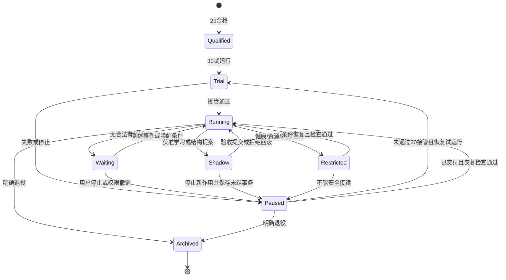

# 态极N主线长期发展路线

> 文档状态：[路线] — 2026-11-11建立，2026-11-14补齐长期实施闭环。以cc55752d7项目盘点为起点，当前设计盘点基线`208b31be9`；承接U2研究资产及执行包22，展开23–30的实施方法、故障处置、准入/退出与交接。状态及唯一调度归[MASTER-PLAN](../MASTER-PLAN.md)，包22既有冻结件继续生效。

阅读顺序：§1.1–1.3规定每卡如何落地；§4承接当前22；§5–10展开23–28研究；§11统一数值/资源/退出；§13–15定义29模型成型、30交付及后续运营终点；§16在每次结案后收束全项目。本文是一份长期实施设计，不因未来候选和实价尚未产生就提前宣称可开训。每包`.0`必须按下述方法生成实际执行合同。

## 1. 目标、规划层次和当前证据

长期目标以[根需求§2.1](../active/TAIJI_CORE_REQUIREMENTS.md#21-统一目标与验收)为准。连续内部状态、可塑性、继承式规模生长、自驱、递归改进、中文表达和物理因果理解，在同一主体谱系中发展。各包都保留语言、感知、记忆、行动与学习的联合片段。

长期核心采用有身份、持续状态、可塑连接及生命周期的神经单位。按[核心路径备案](DECISION-TAIJI_NEURAL_CORE_PATH_20261114.md)，P3.9同时明确兼容U2的单位嵌入方案与单位原生核心方案，按正式图、负责信用、恢复、任务贡献及成本裁决。后者仍为连续值可微模型，允许器官直接查询单位状态，H可保留为临时工作表示，但不强制作为全部持久认知和输出的唯一中介。兼容映射服务于迁移、控制与归因，不能成为长期函数类的边界。

当前已完成参考图、条件信用及有限窗恢复工程。S01–S11的float32/64独立进程接续已有26组证据，慢参数升级、能力学习、保持和成熟生长仍待包22完成相应验收。历史Task1与其他旧候选的成绩按原身份保留。

本路线先以780001473提交，随后22.3按[工程结案](VALIDATION-TAIJI-U2_22_3_CLOSEOUT_20261111.md)完成原始链、重编码、6次实际更新/2次故障和最终schema十二类恢复。截至P3.7已完成多轮实际学习及完整审计，Native仍无A父；P3.8已取得去头首问神经参照179/180，当前按[Native学习接口迁移](SPEC-TAIJI_U2_NATIVE_CREDIT_TRANSFER_20261113.md)核验内容反馈与受验收更新。23–30继续依赖实际父资格。

| 规划层次 | 范围 | 本次交付及生效方式 |
|---|---|---|
| 近期实施 | 22.5.P3.8.2b–22.8 | 信用迁移、两种核心组织、学习/活动/成长/联合片段；沿现行卡和§4交接 |
| 下一轮实施设计 | 23–24 | 子卡方法、源码责任、数据权利、对照、数值默认、风险处置与有限出口已展开；`.0`绑定实际父并定价 |
| 中长期实施设计 | 25–28 | 生长/回收、递归选择、物理迁移和长期联合研究；实际资格决定准入范围 |
| 目标成型与交付 | 29–30 | 同一候选模型级确认→可独立接管的持续主体运行包；30为本轮交付终点，之后进入运营/升级/回滚/退役状态机 |

本次设计保留22.8全局收束。收束后按本路线形成下一包的实际合同，登记采用、缩减、替换及其证据。包号对应研究范围，具体算法可根据结果替换。未来父SHA、价格与能力成绩由实际产物填入。

### 1.1 每张工作卡的七项合同

每个`23.x–30.x`子卡从上张卡的回执读取以下七项，输出到本卡合同；缺任一必需项即`not_admitted`，不得先跑再补。未产生的SHA/价格不填假值，`.0`按指定程序获取。已有历史合同采用原口径，本表不回写旧门。

| 合同项 | 具体获取/生成方法 | 必须留存的产物 |
|---|---|---|
| 输入父与资格 | 从接受清单加载bundle，复算源码/参数/结构/数据摘要，核对任务范围及六轴能力；无能力父可做工程，能力比较不准入 | parent_id、主体/谱系、factory/schema、参数/状态/optimizer签名及能力矩阵 |
| 核心假说与实现 | 写一个主要可失败命题和负责模块；将输入→状态→读取→行动/表达→结果信用逐边映射源码；每个新增算子写尺寸/次序/边界 | 方程—源码—参数/状态—检查矩阵，新增/继承/替换清单 |
| 数据与权利 | 冻结生成recipe、world/流/实体/措辞分区、可见字段与反馈时点；运行合法全历史oracle及部分信息控制 | partition_manifest、feedback_rights、oracle/泄漏回执；check/final曝光计数 |
| 学习与对照 | 固定参数owner、目标权重/分母、截断窗、采样、更新/拒绝语义及至少一个最强合理基线；预注册关键机制切断 | 初始化/迁移策略、seed、arm表及学习器registry；不能让控制臂少看信息 |
| 价格与边界 | 先小片段测前向、反向、重建、检查点及评估价，按§11.3计算全部臂可支付剂量与统计规模 | CPU/wall/RSS实测、预计与硬帽、实际调用上限、停止余量 |
| 验收与退出 | 读结果前冻结主要终点、最小效应、保持、恢复、置信规则、check次数及失败原因表 | 判门函数或可独立复算规则、默认值采用/变更理由、唯一下一动作 |
| 接力与回滚 | 决定是否提交候选，保留原父；把每类状态/未结事务/权限/证据的迁移方式写入清单 | accepted_parent或明确null、closeout、差异/成本总账、后继资格 |

设计完整不等于执行合同已冻结。`.0`的工作就是把本文件的生成方法和默认数值落实为真实父、实际数据清单与可支付剂量；其完成定义是七项均有值、摘要可复算且独立预检通过。

### 1.2 公共接口与代码责任

| 组件边界 | 实施职责与方法 | 现有资产/拟落点 |
|---|---|---|
| 主体核心 | A兼容/B单位核心各有factory；统一事件/查询/行动/反馈接口，禁止分臂偷偷加答案信息 | 复用`taiji/u2_subject.py`、`u2_joint_subject.py`；单位模块按P3.9实际实现，不预造文件 |
| 状态/结构 | unit/edge ID驱动形状与索引；z/a、时间尺度、门谱系、F/E/对象状态及读写许可有明确owner | `u2_group_structure.py`、`u2_history.py`、`u2_history_store.py` |
| 学习事务 | 窗内合法反馈构造目标，影子提案→目标/保持验收→事实历史迁移→原子提交；u/v时钟分离 | `u2_learning_transaction.py`及P3.8正式学习器；新图重新验证 |
| 数据/世界 | 产生原始感官、合法目标/动作回执和隔离评分；物理时间与内部tick分列 | `u2_task_world.py`、`u2_task_physics.py`、`u2_task_sensors.py`、`u2_task_contract.py` |
| 运行/恢复 | receive/query/act/observe/learn/develop/save/restore各有边界；未结行动恢复后先核对回执，不能重复执行 | `u2_task_session.py`、`u2_task_executor.py`、`u2_recovery.py`及typed runtime |
| 评分与归因 | 先保存原始输出/动作和解析状态，再由隔离评分器判分；逐world/流复算，保留机制干预与参数位移 | runner在`scripts/training/`，回归在`tests/taiji_native/`，正式机器报告在`reports/` |

拟新增模块只在对应实施卡实际需要时建立。持续运行/学习检查点走现有`get_writable_base_dir`运行根；计划和清单归`plans/reference`及`plans/manifests`；新报告归`reports`。不提前创建空模块、空报告或多套近义目录。旧资产先核对来源/适用图，不能因同名接口就复用已失效的数学证明。

### 1.3 从实现到下一阶段的固定流程

图中的定位分支不是再次无限训练的入口。采用备选时须仍在原预算/曝光/候选次数内，且在执行前形成具名版本；备选结果也只回到结案。若改变任务、信息权利、主目标或放宽门，原窗先结案，新立范围并登记决策。

训练前至少完成初始完整bundle的独立进程恢复，比较下一事件输出、合法目标/梯度和RNG；首个非空moment安全点再核验下一提案。失败停止本卡写入并保存已发生费用，不能继续到“多训一些再检查”。更新前后只改参数却不迁移派生状态的候选不准入。

## 2. 阶段总图

| 包 | 阶段目标 | 核心算法推进 | 父资格与结案产物 |
|---|---|---|---|
| 22 | 首个有界同主体学习与生命片段 | 正式图、恢复、反馈信用、单位核心路径比较、活动选择与两代成长 | 同候选能力/保持/贡献/成本总账，给出各轴真实资格 |
| 23 | 中文与多世界组合泛化 | 任务条件读取、可学习关系组合、证据条件表达及不确定性 | 在未见组合上能学习、纠正、解释来源的联合任务父 |
| 24 | 可持续的跨会话经验学习 | 分层记忆、巩固、表征迁移、纠错/撤销与可支付历史维护 | 至少10会话的同主体经验链、累计能力矩阵与资源曲线 |
| 25 | 多类型继承式结构演化 | 单元/连接/群体/通信/对象容量的出生、整合、合并与回收 | 至少3代成熟结构谱系，贡献、保持与同资源比较 |
| 26 | 可学习的递归发展机制 | 发展后果预测、活动与更新规则选择、失败后策略纠正 | 至少3次相依改进，真实结果塑形后续选择 |
| 27 | 多环境物理理解与迁移 | 共享对象/事件、动作条件世界模型、主动辨识与感知校准 | 多环境因果迁移、语言保持，实际设备范围单独签署 |
| 28 | 长跨度持续联合主体 | 统一目标、可塑性、规模演化、知识纠正与恢复的持续运行 | 长期同主体运行总账、真实人工干预率与模型级结案 |
| 29 | 模型级主体成型确认 | 同一谱系联合验证中文、学习、保持、自驱、递归、成长和物理理解，独立最终面裁决 | 唯一模型级合格候选、能力/权限边界和可复核确认；缺轴不签完整目标 |
| 30 | 持续主体交付与接管 | 可独立启动/交互/学习发展/暂停/恢复/升级回滚的运行包，实际试运行 | `delivered_in_scope`或明确`not_delivered`；成功后进入运营状态机，停止无限追加研究编号 |

23–30为依赖路线。未取得相应父资格时，后继可完成设计和定界验证，能力比较使用的父条件继续按实际结果约束。每包结案后更新整张图及剩余预算。

## 3. 跨阶段保留的算法责任

| 责任 | 当前及近期落点 | 长期扩展与验收 |
|---|---|---|
| 连续身份与因果历史 | 22.3原始链、有限信用窗、完整bundle | 24的分层保留与迁移，28的长期恢复及历史纠正 |
| 决策/表达的学习信用 | 22.2/5逐参数目标与任务干预 | 23的关系组合，26的学习规则及发展结果信用 |
| 快状态/慢知识 | 当前F/H及后继单位活动/适应状态在线推进，慢更新在声明边界迁移或重建 | 24的重放、巩固、表征升级与旧技能保护，参数化可按证据替换 |
| 真实神经规模生长 | 22.5.P3.9统一单位状态/边/身份，22.7验真实出生和成熟 | 25扩大连接/群体/通信宽度/M/K，验证复制分化、休眠、退役与回收 |
| 单位内容的认知使用 | P3.9比较经原H嵌入与器官直接查询，验证决策/表达的实际负责路径 | 23组合读取、24经验学习与25扩规模分别检查带宽和信用，不把旧d维接口固化 |
| 自主活动与递归反馈 | 22.6按持续目标和真实收益选择 | 26选择改进方式，28在无新提示时维持有价值活动及合理等待 |
| 多模态物理状态 | 包22已有RGB/audio/proprio/字节共同主体 | 23扩大组合，27扩大环境与身体，28持续验证迁移后保持 |
| 来源、可信程度和不确定性 | 22.4模型可见信息、授权反馈和评分隔离 | 23证据条件表达，24/27冲突、纠错与来源撤销 |

信息编码器、循环单元、attention及学习算子均可版本化替换。每次替换写出函数类、信息入口、目标信用及迁移影响。byte为当前文本器官的实现选择，压缩或chunk候选须提供可核验的原文字节对应、同信息基线与旧能力保持。

### 3.1 神经单位机制的22–30影响矩阵

下表是各包必须承接的设计责任，不预签能力，也不增加任何训练剂量。单位活动/适应状态、时间尺度、连接、可塑参数与生命周期共同属于主体；出生数量与有用功能分别记账。

| 包 | 本阶段必须落实的单位机制 | 对其余系统的影响及检查 | 交给后继的证据 |
|---|---|---|---|
| 22 | P3.9比较兼容嵌入与单位原生核心；正式单位图、直接查询、逐单位信用及完整恢复；22.7验两代成熟 | 事件、记忆、表达、策略与单位状态的实际读写图；中性/非中性迁移分列；无A父也可做工程，但保持须有已验旧能力 | 选中核心及冻结接口、研究父与能力父资格、未通过路径、完整状态/optimizer映射和实价 |
| 23 | 由接受的单位核心承担目标条件关系读取、组合和中文表达 | 直接读取与群摘要的贡献分开；跨单位状态/边干预、多步读取及信用到达负责单位，避免只由新增外接头完成任务 | 组合能力父、负责单位/连接与读取作用、仍未解决的通信或表示瓶颈 |
| 24 | 同主体跨会话保留单位状态、可塑连接及经验；巩固、纠错与结构变更协同 | 参数/结构升级后的状态语义、休眠唤醒、旧单位引用及未结信用迁移；全历史重建与近似迁移各自定价 | 累计技能矩阵、可支付状态/结构维护曲线、实际纠正与保持证据 |
| 25 | 在已验单位与读取机制上扩大规模、群体和通信；连接重塑、复制分化、整合及回收 | 独立方向、真实连接、通信支持与单位数量分别增长；含稀有能力和循环间接贡献的删除/休眠检查 | 至少3代成熟谱系、净收益/损伤/成本、可供发展策略选择的已验操作族 |
| 26 | 学习何时修改哪些单位、连接和时间尺度，以及何时重放、巩固、出生或等待 | 发展预测读取实际主体状态，真实干预后果修正后续选择；操作信用、搜索成本及适应性曝光分账 | 至少3次相依发展、结果回流贡献、操作边界和失败校准 |
| 27 | 多模态时空与行动结果进入共同单位图，验证跨环境/身体迁移 | 感官单位入口、单位通信/时间尺度与对象持续性的贡献；区分感知变化、物理时间及内部tick，检查旧语言/世界保持 | 有因果作用的跨模态/物理适应范围及状态/结构迁移资格 |
| 28 | 同一谱系中连续活动、可塑、成长、休眠唤醒及退役恢复共同运行 | 长期活动坍缩、低资源降级、稀有能力损伤、悬挂引用与单位/边失效；等待时长与实际运算分账 | 六轴联合总账、生命周期及恢复轨迹、长期有效范围与下一轮算法裁决 |
| 29 | 单位核心在同一完整主体轨迹实际承担认知和发展 | 独立未见中文、多模态、反馈/成长和中断接续合取检验；不同候选成绩不可拼接 | 唯一范围化模型资格及受影响接口的验收合同 |
| 30 | 真实运行包延续完整单位状态/边/谱系，支持运营学习与可恢复升级 | 用户可独立操作；宿主只承载I/O、权限和事务；不依赖研究者临时修脚本 | 可接管主体、维护/升级/回滚/退役手册及本轮交付结案 |

### 3.2 参数化选择与切换责任

结构方案A为兼容U2嵌入，结构方案B为单位原生核心；该标记与任务A/B的学习/保持分工无关。B须在P3.9明确单位输入、通信、记忆、器官查询、时间推进、目标信用及恢复接口，不能只在旧H后追加一个头便称为核心替换。任务、数据权利和必要控制按同一合同对齐，工程复杂度与迁移代价计入成本，但既有U2代码量不构成A优先的能力证据。

P3.9先裁决可实现性与工程完整性，再按准入合同比较行为。直接单位查询的必要性检查从P3.9开始，不等待25：若旧中介造成可复现的信息/信用限制，不能以继续扩单位替代接口修订；若直接查询未显示贡献或代价不可支付，保留对应负结果，按备案关闭该范围。H大小本身不证明全任务能力上限，单步秩、合法历史可辨性、任务干预和实际成本须分开举证。

每次路径切换携带参数/状态/结构/optimizer/经验/权限/未结事务影响矩阵，声明继承、重建、重置及其费用。不能精确迁移时使用显式误差与保持合同；尚无可核验旧能力时如实记录，而不凭工程映射补发保持。改变核心函数类须更新接受身份与后继父条件，原失败、预算、数据曝光和已冻结出口继续保留。本路线不因此增批训练，也不要求先把U2训练成能力父才允许实现B。

## 4. 包22剩余工作的交接要求

| 顺序 | 实施交付与接力 | 接受父携带的信息 |
|---|---|---|
| 22.3.4.1 | 已完成跨窗原始因果链、顺序/摘要/容量、窗口边界和出生后的前缀保留 | genesis或已声明来源锚点、完整prefix、缺历史出口 |
| 22.3.4.2 | 已完成固定过去行动的共享同化及零optimizer参数扰动重建 | 40字段迁移、事实/派生版本、候选与moment原子提交、实际费用 |
| 22.3.4.3/5 | 已完成6次真实更新/2次故障、8份S12和12类最终恢复 | small profile工程接受父，能力资格为空 |
| 22.4 | 有效目标/标签、合法信息可辨性、四分区、三架构单价 | 数据recipe与权限、已测成本、模型可学入口 |
| 22.5 | P3.8学习接口迁移和结案，P3.9两种单位核心路径、直接读取、恢复及比较；接受候选的任务A父、任务B反馈学习、纠正及A保持 | 工程父与能力父分列，结构路径与任务分工不混用，学习/结构净益分别裁决 |
| 22.6/7 | 活动选择与两代成长，最强匹配控制 | 决策收益、出生成熟/删除效应和保持 |
| 22.8 | 同主体联合片段与全局收束 | 六轴资格、失败、未覆盖项、全部费用及包23立项依据 |

原始日志长度和反向传播长度分别定价。原始链支持重建和追溯，知识巩固须经真实迁移/保持证据。22.3的96条/16MiB为工程夹具边界，22.4再按完整任务流冻结可支付范围。

### 4.1 当前工作到长期方案的实施接力

| 当前卡 | 具体落实顺序 | 成功/失败之后的唯一去向 |
|---|---|---|
| P3.8.2b | 绑定原Native父及内容目标→独立learner提案→u/v分离→完整历史迁移→初始/非空moment恢复；正常/故障提案沿原卡 | 工程通过才冻结P3.8.3；工程失败先具名结案，保留可恢复研究父交P3.8.4，不反复补训 |
| P3.8.3/4 | 原方法/新配方同信息有界比较，首问与实际两问分别评分；完整分母、输入必要性、更新与价格独立审计 | 所有出口均全局结案并交P3.9；未得任务A父不阻止新核心工程，也不补发学习/保持资格 |
| P3.9.1 | 先写A兼容和B单位原生两图的唯一前向；冻结单位输入、边消息、query/key/value维度、读出/表达消费、空支持集、tick与状态版本；对每个参数标目标和预期零梯度 | 图有歧义即`not_admitted/spec_ambiguous`；覆盖完成才写正式实现，不能拿局部脚本代替B |
| P3.9.2 | 逐式实现→前向/梯度→初始保存→有限真实更新→非空moment恢复→出生/复制/休眠/故障；B改变归一化时重推中性条件 | 每图分别有工程资格；仅一图通过不称两图比较完成，未通过图及费用保留 |
| P3.9.3 | 固定合法输入和学习配方，比较A/B核心及原R/P控制；机制切断从冻结同父fork，区分迁移收益与不同核心初始化效果 | 按路径备案及预注册Δ裁决。A/B都失败则关闭本窗，进入共同目标/信用解释，不重复同卡加头 |
| P3.9.4与22.5余项 | 输出选中/未选中图、实际资格、源与完整包；具备学习资格者再完成任务A/B及保持 | 无任务父时22.6/7能力比较=`not_admitted/parent_missing`；只保留工程资产与明确下一研究问题 |
| 22.6/7 | 学会选择合法活动→真实结果修正后续选择→两代成长/成熟/保持；操作可逆与预算分别验收 | 活动收益、成长收益可分别为负；22.8记缺轴，不将空转或仅省CPU计为学习/递归能力 |
| 22.8 | 同一谱系联合任务运行，复算六轴、完整恢复、总费用与旧范围 | 形成23的接受清单；不存在合格父则23.0只开展一次有界归因和新范围设计，不能顺序硬推进到能力训练 |

B最低正式接口必须回答：查询从哪些合法目标/状态形成，读取哪些单位及时间版本，如何掩码/归一化，新单位如何接入并获得信用，输出如何进入字节器官和行动选择。没有以上唯一实现，进入下一卡的条件为假。首个对照可保留传感/表达器官以隔离核心，随后必须通过它们的负责信用与必要性检查；外接头代答不能替单位核心结案。

### 4.2 接受父的资格向量

每份接受清单保存`engineering / task / learning / retention / autonomous_choice / mature_growth / recursive_development / physical_transfer / lifetime`各项的`verified / negative / uncovered`、具体范围、证据路径和有效版本。不得把不同seed/不同主体的最好单项拼成一个“同一主体全通过”。后继只能使用自己需要且仍有效的资格。

| 后继 | 最低资格 | 不足时的允许动作 |
|---|---|---|
| 23正式比较 | 22接受的可恢复任务/学习父，目标范围匹配 | 设计/接口定界和一次归因包；正式学习比较不准入 |
| 24 | 接受父已有组合任务、反馈学习及可核验旧技能 | 缺少3类技能先在已开放范围核验，不能把随机旧成绩当保持分母 |
| 25 | 接受父可学习、可恢复、可量保持，并有可识别结构压力 | 无压力可判范围内无需生长；不为得到正结果硬扩结构 |
| 26完整结构递归 | 至少一种已验成熟结构操作及学习/保持资格 | 可保留22.6的活动结果；本包完整结构递归未准入，不用仅重放代签 |
| 27 | 同主体的任务、共同世界表征、恢复/适应资格 | 26未过时只可预注册受限物理迁移范围，明确其不含递归自主声称 |
| 28联合运行研究 | 本次联合范围需要的全部六轴资格在同一可追溯父上有效 | 可做部分运行工程；不能跳过缺轴进入完整29确认 |
| 29模型级确认 | 28同一父的全部必需范围及可恢复学习/发展资格 | 只整理交付规格和缺口，不能拼接不同模型能力签主体成型 |
| 30交付接管 | 29唯一合格候选、冻结环境/权限及完整可分发资产 | 可准备工程包；29未过不签完整交付 |

表中的有限范围分支须在`.0`写明所跳过的资格、仍可检验的问题及不得声称的结果；不得将它计作上游通过。长期路线允许依据实际证据重排，调整前先结案并同步本表和MAINLINE。

## 5. 包23 中文与组合泛化

父选择取22.8总账中具备自然中文任务能力、合法反馈学习和恢复资格的同一候选。若A父未成立，23.0先处理该失败的图/接口解释，新的能力合同承接实际候选。

首版扩展为二维推动、容器/遮挡、可操作状态转换三类有界世界。语言覆盖目标指代、关系、时间版本、两步因果及缺信息求证。分割、实体真ID和正确程序保留在环境/评分器。相同表面输入、合法历史不同的成对世界继续用于经验必要性验证。

| 子卡 | 实施与具体交付 | 主检查与失败后的处置 |
|---|---|---|
| 23.0 | 整理22的参数/能力/失败/资源父，选择一个最高价值组合缺口 | 没有可核验父能力时先修目标条件表示或负责信用，再定新父 |
| 23.1 | 冻结三世界recipe、实体/关系/措辞/因果组合切分、权限及价格 | 合法全历史oracle≥0.95，无法区分的世界给未知/求证权利 |
| 23.2 | 接受的单位核心学习查询条件的多步关系读取与对象/事件组合，必要时修共享表征 | 内容和目标交换、关系逆转、位置重排产生预定效应；单位直接读取/群摘要和边贡献分别干预 |
| 23.3 | 证据条件中文表达、合适EOS、来源与置信度，反馈到达负责单位与表达路径 | 全分母内容/来源/时间联合评分，逐字copy与新组合分别报告；外接头独自拟合不代签单位贡献 |
| 23.4 | 同父学习新组合并保持已合格世界能力 | 真实反馈、置换反馈、冻结负责读取/表达与历史切断独立比较 |
| 23.5 | 同资源GRU/Transformer及机制控制比较，完整结案 | 达到任务父门但架构净益未过时分别裁决，保留全部负结果 |

数据草案每世界族train512、fit128、check128、final128，合计2,688个world。关联轨迹及版本同分区，语言说法和组合轴另审泄漏。实际生成从23.1冻结后开始，final仍遵守当次读取权限。

数值门草案沿包22口径，以全分母联合成功率≥0.80、反馈后未见任务增益≥0.05、旧有效能力损伤单侧95%上界≤0.02为父资格。架构相对最强匹配基线的增益≥0.05、配对95%下界>0且3seed同向。置信度另报Brier分数及风险—覆盖曲线，允许拒答题与应该回答题均入分母。23.1依据题面基线与价格完成冻结后生效。

首个研究窗拟采用不高于包22的48,000 CPU/96,000 wall研究帽，评估/恢复/失败均在帽内，独立于包22余量。check拟分配两次整包，最终确认一次。正式updates由实价反推，不能把上述上限直接当执行授权。

### 5.1 23.0输入父、实施边界与准入件

23.0从22.8机器结案取得接受父，不提前填写SHA、参数数目、单位数或训练剂量。核心取已裁决的结构方案，兼容嵌入与单位原生方案均须按实际接口签署，不能因文件名带U2就指定长期父。

| 准入件 | 23.0必须生成的内容 | 缺失时的动作 |
|---|---|---|
| 父身份 | 源码/参数/完整状态摘要、结构方案、单位/边registry、optimizer、RNG、经验来源、许可证与执行环境 | `not_admitted`，reason=`parent_identity_missing`；只完成盘点和设计 |
| 能力资格 | 至少一项有界中文任务、合法反馈实际改善、仍有效旧能力保持及完整恢复的原回执 | `not_admitted`，reason=`qualified_parent_missing`；返回22结案指定的核心缺口，不启动23训练 |
| 失败边界 | 原已排除变量、未覆盖模态/时间跨度、已用check与final、当前不可主张事项 | 先补证据目录，不能将旧失败改写为新起点通过 |
| 图/接口差集 | 单位输入/通信/状态、目标读取、记忆和表达的逐参数责任；继承/重建/重置字段 | 非中性改动先给迁移误差和恢复合同，工程通过不补发能力 |
| 资源和分区 | 三世界recipe、分区权利、全部比较臂、3seed、单价、次数、总帽及每臂停止规则 | 必要对照不可支付则`not_admitted`，不先跑主臂再删控制 |

复用已存在的`taiji/u2_task_world.py`、`u2_task_physics.py`、`u2_task_sensors.py`和`u2_task_contract.py`的世界、感官、权限及全分母评分资产；具体执行图按接受核心适配，不继承历史字段形状为硬约束。
关系读取资产来自`taiji/u2_evidence_read.py`和`u2_joint_tokens.py`，只继承经核验的计算与证据，旧任务失败不因代码复用获得新资格。
拟新增`taiji/native_composition.py`、`scripts/training/run_native_composition_23.py`及对应`tests/taiji_native/test_native_composition_23.py`，在23.0批准文件职责后才创建；评分器与模型模块保持隔离。

23.0输出一份四件套：接受父、数据与反馈权利、数值门、逐臂预算/出口。该件未冻结时，以下实现细节与数值均为草案；当前主线队首仍为P3.8.2b。

### 5.2 23.1–23.5可实施方法与交付顺序

| 子卡 | 具体实施方法 | 必交检查与后继 |
|---|---|---|
| 23.1 世界及语言合同 | 三世界分别生成实体属性/关系图/动作轨迹；按世界种子、关联历史和版本组成不可拆分组，再交叉划定措辞、关系方向、两步组合的未见轴 | 模型仅见感官、合法事件、自然中文及授权反馈；实体真ID、分割和程序只入评分器。冻结分区摘要后进入23.2 |
| 23.1 可辨性与价格 | 用完整合法历史oracle、部分历史oracle、题面先验审每种问法；测最短/最长轨迹和所有臂的编码、更新、恢复、评估成本 | 完整合法信息oracle草案≥0.95；真正不可辨题明确未知/求证答案。标签矛盾或非法泄漏出口`data_invalid` |
| 23.2 组合读取 | 以当前目标查询单位/对象/证据，首窗固定最多2次关系读取；各跳显式保留查询、选中内容、位置/版本和输出信用，再输入后续读取及表达 | 逐跳目标交换、关系逆转、内容置换和历史切断；责任由回答/后果损失到读取及单位参数的实际更新证明 |
| 23.2 必要性比较 | 在同一候选上分别禁用跨单位消息、单位历史、直接查询或群摘要，保留其它输入权利；置换操作只在同类型合法支持内进行 | 比较任务损失与生成行为，不能仅以注意力图或总梯度签贡献；消融改变CPU时同时报告且不冒称资源完全匹配 |
| 23.3 中文输出 | 由接受表达器生成原生文本，来源/时间/置信输出同时来自可查询内容；首窗训练可用答案字节内容辅助项，但评估移除训练辅助头 | 所有应答轮入分母，乱码、超长、解析失败和错误EOS计错；内容正确、来源正确、时间正确及联合正确分别报告 |
| 23.4 反馈与保持 | 同父复制出真实反馈、置换反馈、冻结负责读取/表达、切断授权历史各臂；配对同world/seed及同反馈暴露，更新后测未见query和累计旧技能 | 反馈需作用到负责单位/读取/表达；新内容重复复述与未见组合收益分开，旧技能保护只覆盖仍有效事实 |
| 23.5 基线及结案 | 比较接受核心、最强合格GRU/Transformer和前述必要控制；冻结信息、样本暴露与资源口径，按CPU可支付更新数执行 | 任务父资格、机制贡献、架构相对净益、保持、成本分别裁决；无强基线配平资格记`inconclusive`而非架构胜出 |

读取2跳、草案最长轨迹、生成字节上限和截断窗在23.1共同冻结，不能由评估成绩再选择。若2跳无法覆盖已声明任务，先修任务/图合同再准入，不能在评分时偷用oracle程序。
现有读取器的128-token限制是当前实现边界，23.1必须测最长合法证据是否越界。需要改变支持集时更新形状/内存/信用与恢复检查，不能静默截断关键证据。
单位原生方案的直接查询应保持任务内容可达；兼容方案若只在固定中介后换头，必须登记其未解决接口限制，不能用更大外接头代签单位核心贡献。
同一训练父的各干预臂从完整快照分叉，保存独立身份；干预后的状态、反馈或答案不得再混入其它臂。

### 5.3 数据权利、统计、保存及数值草案

| 项目 | 默认草案与冻结方法 |
|---|---|
| 数据量 | 每世界train512、fit128、check128、final128，共2,688个world；一条轨迹/同源变体/版本不得跨区，seed不产生新的独立世界身份 |
| 训练及选择 | 全局参数只消费train授权标签；fit用于方案、早停与校准选择，不回填主父梯度。若评估反馈学习，冻结规则只在每条流独立的同父影子内消费support，query无更新 |
| 评估反馈 | fit/check/final内的合法support、更新次数、可写状态和反馈时点逐项冻结；影子学习轨迹可审计，但不能反向训练主父或为其它评估流提供经验 |
| 主任务 | 全分母联合成功率≥0.80；反馈后未见任务增益≥0.05、配对95%下界>0，3seed增益同向；各世界和困难轴另报，避免总分掩盖全失效子域 |
| 架构收益 | 对最强合格匹配基线净增益≥0.05、配对95%下界>0且3seed同向；只过任务门时可签任务父，不签架构胜出 |
| 保持 | 所有已验且仍有效技能的损伤单侧95%上界≤0.02；对多个技能使用预注册的同时上界或最坏技能统计，不能挑最好技能 |
| 统计单位 | 先在world内聚合多轮，再按同world/seed配对；默认10,000次固定种子的分层bootstrap并分列3seed。共享父/轨迹的回答不当成独立样本 |
| 曝光与版本 | check整包最多2次、final确认最多1次；全包最多2个具名候选版本，每卡最多1个定位包和1条预注册备选，均计费用/曝光 |
| 资源 | 草案≤48,000 CPU/96,000 wall；23.0定价后拆分训练、对照、checkpoint、恢复、诊断及最终审计，预留不足则不准入 |

23.1先依据train/fit和模拟统计评估0.02保持上界所需精度；样本不足时在查看check前调整合同/定价，冻结后CI跨门即`inconclusive`，不降低置信度或扩大容差。
训练前使用完整候选保存初始checkpoint，在独立进程重建下一输入、概率、损失和逐参数梯度；旧字段、新单位状态、边映射和待结算事项必须齐全。
第一笔计费工程更新产生非空moment后再次独立恢复，核对下一提案、实际位移及接纳/拒绝决定；通过才允许批量训练。工程更新属于冻结总剂量，不能藏在“自检”外。
实际训练按预注册安全边界保存，保存间隔由容许丢失的计费工作量及单价决定；中断只从持久快照续接，快照之后的指标不能冒充已恢复更新。
新结构和表达器的摘要、全部计数器、环境事实、学习器时钟及资源账一起保存；恢复时禁止重发已完成外部动作。

### 5.4 风险处置、明确退出与24接力

| 风险/观测 | 一次定位包 | 唯一有限修复或备选 | 出口与后继 |
|---|---|---|---|
| 缺少合格父 | 核对22结案和原资格范围 | 补齐缺失证据或按22指定缺口重立合同 | `not_admitted`；23能力学习关闭，仅保留设计 |
| 世界/语言捷径或不可辨 | 题面先验、配对世界及权限审计 | 一次重新分组/修recipe，原版本隔离并记录曝光 | `data_invalid`；新合同重准入，不沿用旧成绩 |
| 关系解析好而联合回答不变 | 分解读取、单位、表达的信用和内容交换效应 | 预注册的一次查询交互/单位直读接口修订，保留原核心作控制 | 修订后仍无收益则`negative`，reason=`composition_credit_not_effective`；关闭该假说 |
| 长输出漂移或无来源依据 | 内容正确率、EOS、来源干预及长度分层 | 一次证据条件输出/覆盖约束修订，不能靠硬答案模板 | 行为门未过为`negative`；不进入24学习父 |
| 新技能改善但旧技能损伤 | 最坏技能和对应单位/状态干预 | 回滚父后用预注册受约束更新或重放备选重做一次 | 越0.02保持门为`retention_breach`，不得推广该子版本 |
| 更新/恢复不一致 | 源摘要、RNG、moment和单位/边映射检查 | 一次工程修复；冻结数据和训练合同不变 | 未消除则`engineering_failure`，能力结果无效 |
| 差值/保持CI不能裁决 | 核对独立样本量及配对聚合 | 只使用合同事先分配的剩余评估样本，不追加曝光 | `inconclusive`；保留父，不按弱趋势开24 |
| 任一预算或曝光帽耗尽 | 核对已用/持久化/未完成项 | 保存并审计当前状态，不再补训练剂量 | `budget_stop`；23.5按未完成范围结案 |

23.5必须输出源码/父/数据/参数/完整状态/计量摘要、每个world原始回执、干预效应、累计保持、恢复结果、失败清单及统一出口；模型卡分别记录工程、任务、反馈、结构和架构优势资格。
仅当任务、合法反馈、保持与恢复均通过，才将训练区选定且经最终确认的同一候选作为24.0父。架构优势未过时如实保留这一限制，不能将普通任务父宣传为优于基线。
`negative`、`inconclusive`、`retention_breach`、`data_invalid`、`engineering_failure`、`budget_stop`和`not_admitted`均完成23.5总账，不自动升包；唯一后继是按失败原因修订一次下一合同或在全局收束中停止该范围。
`pass`后24承接该父及有效旧技能目录；23的最终确认数据继续封存，不作为24训练素材。24的设计可提前完成，运行须等父资格和新预算。

## 6. 包24 跨会话学习与可支付知识维护

父为23接受的同主体任务父。目标同时覆盖新经验吸收、错误认识纠正、有效旧能力保持和成本，保留来源版本及原始事实追溯。

| 子卡 | 实施与具体交付 | 主检查与备选 |
|---|---|---|
| 24.0 | 10会话×32轮的经验流、至少3类已核验旧技能和两次事实修订 | 各旧技能有更新前父成绩，已过时事实进入纠正账 |
| 24.1 | 原始证据、情景索引、单位活动/适应状态、可塑连接与慢知识的版本关联 | 缺失/冲突/撤销时可回溯；单位/边及休眠状态归属明确，记录与主体状态扩大分别计成本 |
| 24.2 | 从任务误差和旧能力风险学习重放选择与巩固 | 与随机重放、仅近期重放、仅快记忆、冻结慢更新比较 |
| 24.3 | 参数与结构升级后的分段重建、单位引用迁移及可验证唤醒 | 以全历史重建为参考，比较兼容编码或局部迁移的误差/保持/成本；未结信用与退役ID不得静默丢失 |
| 24.4 | 学习事实纠正及来源降权，支持撤销影响范围核验 | 错误但获授权反馈、互相矛盾来源、过时但曾正确事实均有对照 |
| 24.5 | 新经验后未见任务、累计技能矩阵及资源曲线结案 | 无新增任务收益时按信用/巩固/信息归因，迁移超价则保留已接受父 |

每个skill×session登记新/旧任务成绩、负责参数/状态干预、纠正率、学习延迟、保存/恢复和CPU/内存/日志增长。拟沿用新任务反馈净增益≥0.05与旧能力损伤上界≤0.02，并要求改善至少持续到两次后继会话。巩固的独立收益与快记忆贡献分别比较。

长历史代价测量取1/2/4/8/10会话前缀，报告重建时间、峰值内存与完整性。近似迁移以全重建同父为参考，冻结状态误差及任务损伤容差。原始证据压缩、归档、语义摘要或技能提取均登记来源可恢复性和功能影响，再决定准入。

24.0按实价提出单独研究帽，首窗预算草案同样≤48,000 CPU/96,000 wall。若必要对照和最低课程不在帽内可支付，则先裁决课程/算法/资源取舍。长运行等待与活跃计算分账，训练与在线反馈权利沿整个流保持一致。

### 6.1 24.0经验流、父资格与写入权利

24.0只接收23.5已签任务、反馈、保持及恢复的同一候选；完整bundle和资格缺一即`not_admitted`。至少3类旧技能必须有更新前可复核成绩，不能把尚未学会的项目作为“保持成功”。
接受父SHA、schema、单位/边数、optimizer、来源链及单价由24.0从机器产物填写，既不捏造未来身份，也不默认延用U2固定形状。

| 冻结项 | 可实施定义 | 权限/停止边界 |
|---|---|---|
| 寿命流 | 每流10会话×32应答轮，连续世界与同一主体，不在会话间重置参数/单位/快状态 | 主体复制仅用于匹配对照；跨流独立起点，不混入其它流经验 |
| 课程 | 会话1–2建立可核验经验，3–8交错新技能和旧技能，9–10测延迟保持；至少两次事实修订草案安排在4/7 | 每次修订先在评分器签有效时间/来源/可见反馈，模型只得合法事件 |
| 分区 | train/fit/check/final按完整主体世界流及关联版本分组；各区流数由24.0按3seed、CI精度和实价计算 | 流数不足不能把同流320轮当320独立样本；无法满足精度/预算时不准入 |
| 反馈 | 每轮分support和query权利；support可在已授权时点更新，query结果仅计分；错反馈、冲突来源和撤销分别标注 | 授权可写不等于事实正确；模型自答、想象和评分器真值不能变成外部证据 |
| 评估适应 | 各评估流从冻结父独立恢复，按冻结规则在流内学习并继承经验 | 评估后的参数/状态不得回流全局训练父或其它流；final规则事先冻结 |
| 可塑范围 | 先沿用父已验单位/读取/表达和慢更新；新增结构只启用已验操作，不在本包附带新生长算法 | 操作数量、参数组、可写快状态、原始记录删除权在manifest逐项明确 |

源码复用`taiji/u2_history.py`、`u2_history_store.py`、`u2_learning_transaction.py`、`u2_recovery.py`的原始因果链、重建和事务资产；按实际核心迁移，不能把U2专有字段验证当作新核心已恢复。
`taiji/continual_evaluation.py`提供课程/父基线/保持账接口；先核查它的统计与新任务定义一致，再复用，不能混合不同域分数作一个“能力总值”。
拟新增`taiji/native_experience_stream.py`、`taiji/native_consolidation.py`及`scripts/training/run_native_continual_24.py`，只在24.0冻结职责后创建，测试放`tests/taiji_native/`对应模块。

### 6.2 24.1–24.5经验学习与知识维护方法

| 子卡 | 实施方法与明确产物 | 检查及流转 |
|---|---|---|
| 24.1 来源化经验 | 原始事件采用追加记录，建立来源/发生时间/获知时间/有效版本/授权/撤销状态；派生索引、单位快状态和慢知识登记依赖版本 | 同一证据重复投递幂等；撤销影响可追溯，想象和自输出不能取得事实写权；通过后进入重放 |
| 24.1 容量治理 | 逐会话测原始链、索引、单位/边、optimizer和快状态字节；达到限额先可支付归档/索引淘汰，不静默丢失必要原始链 | 现有PagedCausalHistory上限不是10会话已可支付的证明；历史完整性不足按具名出口停止 |
| 24.2 重放选择 | 从合法经验中以任务残差、旧能力风险、来源有效性及多样性构造可学习优先级；训练目标使用后续任务真实改善，默认每个新反馈最多回放1条旧经验 | 与等次数随机/仅近期重放及零重放控制；检索、打分、失败样本和回放全部计CPU与暴露 |
| 24.2 巩固更新 | 同父影子中更新负责单位/读取/表达的允许参数，继承已验受验收提案；用train内独立保持锚约束，慢更新后恢复快状态 | 对照仅快记忆与冻结慢更新；“记录可检索”与“慢机制学会”以断开相应路径的干预区分 |
| 24.3 状态迁移 | 全历史固定事实/过去行动重建作为参考；候选只选一种预注册的兼容编码或分段重建方案，声明误差与状态来源 | 参数、单位/边、moment、未结信用及休眠唤醒一起迁移，重放不重新执行外部动作 |
| 24.3 维护曲线 | 在1/2/4/8/10会话前缀分别保存/独立恢复、测全重建和候选迁移的CPU/内存/误差 | 量出成本随历史增长而非只报最后一次；不能用不完整历史的快恢复冒称优化 |
| 24.4 纠错与撤销 | 旧事实标失效而保留“曾有效”身份，新事实附来源；来源置信只由可核验回执校准，冲突时保留不确定性与求证选择 | 至少覆盖过时但曾正确、授权但错误、矛盾来源、撤销四种；纠正收益与破坏仍有效知识分账 |
| 24.5 联合结案 | 汇总每会话、每技能、每来源类型的反馈改善、保持、纠正延迟、单位/记忆贡献、完整恢复及资源 | 经验链、机制净益和成本各自裁决；通过才把实际父交25，失败按6.4关闭本窗 |

慢学习默认仅在会话安全边界提交一次事务，在线快状态按事件推进；是否增加边界频率须在24.0定价和冻结，不能在失稳后临时多更新。
重放1:1为首窗价格草案，并非长期算法上限；train/fit选择替代比例只允许一条预注册备选，不能根据check效果挑比例。
所需“来源撤销”先定义模型未来消费权与派生影响处理，不宣称可以从参数中精确删去一条经验；近似影响清除须报告残余错误及误伤。
结构方案A/B各自保存实际持续状态；旧H、单位z/a或后继状态都按其语义处理，不能只迁移权重而把状态跳变藏进会话重置。

### 6.3 数值、统计、checkpoint与资源合同

| 项目 | 默认草案及24.0冻结责任 |
|---|---|
| 主任务 | 全分母联合成功率≥0.80；合法反馈后未见任务较同记忆冻结慢更新组增益≥0.05、配对95%下界>0且3seed同向；效果须延续至少两次后继会话 |
| 巩固净益 | 相同历史、输入与计算权利下，相对最强合格维护控制的增益≥0.05、配对95%下界>0且3seed同向；不满足时不签巩固机制优势 |
| 保持 | 各已验且仍有效技能损伤的同时单侧95%上界≤0.02；每次事实修订产生新的有效知识清单，旧错误答案不受保持保护 |
| 纠正 | 草案要求明确授权纠正后2次合法相关交互内恢复正确，且两次后继会话仍成立；错误反馈条件下另测拒绝/求证与误写，不混入同一均值 |
| 迁移 | 精确路径要求声明环境内逐值复现；近似路径先报告逐字段误差，行为损伤同样受0.02上界约束。状态数值容差由24.0按尺度/精度冻结，不从任务分数反推 |
| 统计单位 | 以完整主体世界流为独立单位，流内保留会话顺序；默认10,000次固定种子分层/整流bootstrap，3seed分别报告，同流多轮不独立重采样 |
| 样本与曝光 | 流数先按效应/保持CI精度和实价确定；check整包草案最多2次、final1次；final的合法支持反馈权利保持原冻结范围 |
| 候选与修复 | 全包最多2个具名候选；每卡最多1个定位包、1条预注册备选。修复、重放、迁移和重复确认均计总价，不按会话刷新额度 |
| 资源 | ≤48,000 CPU/96,000 wall草案；24.0覆盖全部臂、3seed、前缀重建和审计后定价；原始链/派生状态的独立字节帽一并冻结 |

所有数值仍为规划草案。保持精度不可支付、必要对照缺失或根本无合格父时为`not_admitted`；不得先跑一条流再用该流定成功线。
训练前对初始完整bundle做独立恢复，第一笔计费更新的非空moment再次恢复到下一概率/损失/梯度/提案一致；通过后才开展连续流。
每次会话边界和慢更新提交前保存可恢复父，提交后保存孩子；同一事务的原始链根、参数/状态/结构、optimizer及学习器时钟原子对应。
在一项预注册故障注入中，验证“保存前失败”和“保存后重启”不重复学习、行动或反馈结算；失败保留现场，不能重跑后只报成功路径。
check/final影子流保留完整可追溯轨迹但不成为训练数据；接力父由训练区冻结规则选择，并由独立评估确认该学习规则和父资格。
按会话报告训练、回放、归档、重建、恢复、查询、失败与等待成本，等待wall不能伪装为活跃推理或学习时长。

### 6.4 风险闭环、退出和25接力

| 风险/观测 | 定位方法 | 有限修复或已注册备选 | 出口及后继 |
|---|---|---|---|
| 原始历史缺段/摘要伪完整 | 校验原始链根、页引用和实际重放依赖 | 只从已存在的合法备份补齐一次；不可得则保留缺失证据 | `engineering_failure`，reason=`history_incomplete`；不签连续主体 |
| 重放只记住旧题 | 同分布重述与未见组合分别测，随机回放匹配次数 | 一次多样性/残差优先级备选，不增加评估曝光 | 仍无未见收益为`negative`，reason=`replay_transfer_absent` |
| 快记忆收益被误当慢学习 | 冻结慢更新、切断快检索及恢复后评估 | 一次负责参数信用定位和预注册更新目标修订 | 无负责机制改善为`negative`；维护资产保留但不签学习父 |
| 慢更新后状态语义跳变 | 全重建参考与迁移差异、单位/来源版本追踪 | 一次兼容编码或分段重建备选，二选一先注册 | 保持受损为`retention_breach`；回滚父，不丢失原始事实 |
| 历史增长使重建不可支付 | 1/2/4/8/10前缀费用曲线及必要原始链大小 | 一次已注册分段维护备选；仍不可支付则按帽停止 | `budget_stop`；不靠截断历史冒称长期连续 |
| 纠错破坏仍有效知识 | 有效/失效事实分账和最坏旧技能检查 | 一次来源条件更新/保持约束备选，错误子版本回滚 | 越保持门为`retention_breach`；撤销错误子版本资格 |
| 授权错误反馈被当真值 | 来源校准、矛盾证据及求证收益干预 | 一次不确定性/证据条件写入修订，不改授权边界 | 无法纠正为`negative`；若非法标签泄漏则`data_invalid` |
| 复制流污染评估 | 父/数据/反馈/状态摘要及跨流读写审计 | 隔离污染版本并修一次执行协议，另立未曝光数据合同 | `data_invalid`；原分数不能移作新父资格 |
| checkpoint或结算失配 | 独立下一步与单写者事务复核 | 一次工程修复，完整失败费用保留 | 再失败为`engineering_failure`，停止连续学习 |
| 保持/收益CI跨门或资源耗尽 | 核对流数、相关性、预算和已用曝光 | 只消费合同内剩余评估；不加流/seed/步数补到通过 | 分别`inconclusive`或`budget_stop`，冻结最近已接受父 |

24.5输出skill×session矩阵、来源修订账、每流完整谱系、单位/边与记忆的因果贡献、前缀维护曲线、恢复审计及所有失败。不能用末会话平均分覆盖中途不可恢复或旧能力严重受损。
`pass`须同时具有未见反馈改善、仍有效旧能力保持、可恢复经验链和可支付费用；普通任务能力、巩固优势、纠错范围和连续寿命长度逐项签署，缺项不得借其它通过项补齐。
25.0只承接已验可塑/保持父，并另外确认可与信息/优化不足区分的结构压力；24通过不自动证明需要增长，若压力证据缺失则25能力试验`not_admitted`。
其余统一出口完成24.5全局收束、保留上个接受父和本轮证据；后继只可按该原因立一个受限修订合同，不能绕过24失败直接进入25/26能力宣称。

## 7. 包25 继承式结构生长、整合与回收

父须具备可恢复学习与保持能力，且存在可区分于信息/优化不足的结构或容量压力。[有状态单位规格](SPEC-TAIJI_U2_NEURAL_UNIT_LIFECYCLE_20261113.md)及[路径备案](DECISION-TAIJI_NEURAL_CORE_PATH_20261114.md)在22.5.P3.9交付核心图、单位查询及恢复比较，22.7验证首次成熟；包25扩大实际通过的单位、连接、群体和通信范围。R/P静态c=0资产保留作对照，不能将其宽度增长等同于完整单位生命周期，也不要求后继核心永远保留原H/R/P分工。

| 子卡 | 实施与具体交付 | 必验边界 |
|---|---|---|
| 25.0 | 冻结压力流与结构账，指定本窗一种新增结构类型 | 稀疏连接质量、表示带宽、对象槽和参数容量分别有控制 |
| 25.1 | 扩大逐群单位宽度、连接出生/重连及optimizer映射；验证循环复制后的分化 | 旧ID/z/a/参数/门/时间尺度继承，历史信用与独立方向分别计量 |
| 25.2 | 按P3.9的查询裁决扩大或修订单位读取支持、群体/通信宽度或对象M/假设K，验证迁移及启动信用 | 单位读取不在本包才首次启动；新增softmax支持、竞争和消息路径需独立推导/验证；未通过读取不冒充已验父 |
| 25.3 | 内容/目标/不确定性条件路由与残差成熟 | 路由使用原生状态，任务真ID留在评分器 |
| 25.4 | 可逆衰退/休眠、唤醒、等价合并或蒸馏迁移、正式退役/回收 | 稀有技能及循环间接贡献保持；无未结引用才物理删除，ID永不复用 |
| 25.5 | 同一谱系至少3代发展、成熟删除及保持 | 每代获收益后才计为成熟，后代能继续提出并整合结构 |
| 25.6 | 七臂扩展与总账结案 | 同最终容量预分配、固定强优化、随机/置换门及仅重放继续保留 |

信用秩限制独立启动方向，单元数、方向秩、能量和噪声门限分别报告。父切空间诊断结合受保持/信任域约束的实际优化，r_perp近零仍需对照验证。出生在shadow中完成后经成熟/保持/成本准入，连接、群体与M/K的结果分别签署。

拟沿用每代净增益≥0.05、有效旧能力损伤上界≤0.02、删除移除至少50%且绝对≥0.02增益的门。对新结构类型先冻结中性容差和实际信用读数，允许共享变量在统一schema下迁移。计入出生、成熟、迁移、回收、失败及评估总成本，预算在25.0按选中类型和实价冻结。

### 7.1 父资格、压力数据与责任映射

以下数量与门值均为设计默认，须在25.0绑定实际父、源码、分区和价格后冻结才生效；本节不签训练批准。
父包须交付24.5累计技能矩阵、完整学习恢复、至少一种22.7已成熟单位操作、P3.9选中核心及直接读取的实际资格。
若24接受的是结构路线A阶段父，明确其H中介范围；结构路线B尚未通过的接口不能随包号自动成为已验资产，结构路线与任务A/B名称分开。
缺学习、保持或单位成熟父时，25.0登记`not_admitted`及缺项；可完成规格与无能力声明的工程定位，不能用未经验证的旧能力签成长收益。
首窗只选择单位数、连接重塑、群体/通信宽度、对象/假设容量中的一种压力类型；其余25.1/25.2分支保持未准入，不在同次失败后顺次试遍。
拟压力课程为3代×4个递增难度块，每块64个独立world；固定3seed，各臂共享同一world、请求序列与合法反馈范围。
另设birth-fit每代128个world、birth-check每代128个world、最终确认每代128个world；同world的轨迹、修订和反事实必须留在同一分区。
保留集开发起点为每项已核验且仍有效技能128个world，另含预先标记的稀有条件；这不足以从零损伤签0.02单侧95%门，单项正式检验至少149个独立world且多重比较/非零损伤需更多，25.0按§11.2计算后冻结。过时事实纠正与能力遗忘分账，不能为降低损伤删题。
数据生成器不向模型暴露压力类型、目标结构数、任务真ID或正确生长操作；仅评分器据合法轨迹记录这些标签。
每个压力块先对照完整合法信息、固定强优化、重放及同最终容量预分配，区分不可辨、学习不到、容量不足和通信受限。
信用诊断只用birth-fit：固定可微窗、真实任务分母及门，记录方向秩、绝对能量、噪声、活单元比例和覆盖；秩不等于可活神经元数。
拟每代最多8个具名结构提案，候选评分及失败费用全部计入；参数选择不接触birth-check，不能将每个提案伪装为新研究窗。

| 责任/资产 | 已有可复用来源 | 本包落点与重新验证义务 |
|---|---|---|
| 单位与逐群扩容 | `taiji/u2_group_structure.py`的ID、宽度与moment迁移 | 承接P3.9实际单位registry；若尚未建则拟`taiji/u2_neural_units.py`，不得把文件规划当实现 |
| 出生方向与信用 | `taiji/u2_operators.py`、`u2_subject.py::collect_birth_credit` | 按选中图重推历史信用与读取支持；原加性接口公式不直接代签B图 |
| 成熟、提交与回滚 | `u2_recovery.py::birth_transaction`、`u2_learning_transaction.py` | 扩展单位/边/优化器/历史同笔事务，正式物理删除另签索引与悬挂引用检查 |
| 对照及覆盖诊断 | `taiji/native_development.py`、`growth_credit.py` | 仅借用旧实验臂与诊断设计，旧LivingCore能力和更新配方不能转移为新父证据 |
| 新操作评估 | 拟`taiji/u2_structure_lifecycle.py`及`tests/taiji_native/test_u2_structure_lifecycle.py` | 按实际子卡创建；绑定负责单位梯度、因果消融、状态迁移与真实费用 |

### 7.2 逐卡实施与交付顺序

| 卡 | 先后步骤与必须交付 | 数据/信用闭环及准入结果 |
|---|---|---|
| 25.0 | 盘点父→选择一种压力→生成分区digest→所有臂定价→冻结数量/预算/出口 | 输出压力可辨证据、接受父能力矩阵、完整checkpoint预检；缺项不进入25.1学习 |
| 25.1 | 冻结单位/边ID映射→影子出生或复制→逐参数信用→限定成熟更新→保存/恢复 | 出生fit提供合法残差，独立check签作用；不能只靠参数量增大或梯度非零通过 |
| 25.2 | 对选中结构扩大读取/通信支持→验证中性或迁移误差→旧/新路径干预→有限成熟 | 单位直接读取已有P3.9基础；新归一化分母、群数、M/K不得借旧中性证明放行 |
| 25.3 | 用合法内容/目标/不确定性训练路由→核查负责单元和边→固定参数干预 | 反馈分别作用到路由与内容计算；任务真ID留评分器，路由单独记成本及负载坍缩 |
| 25.4 | 低贡献候选→影子衰退→稀有技能保持→可逆休眠/唤醒→符合条件才合并或退役 | 无未结信用/外部引用、全部直接和循环出边隔离后才回收；旧ID永久留谱系 |
| 25.5 | 每代接受完整子父→再采合法残差→后代提案和成熟→累计旧技能检查 | 至少3代来自连续接受谱系；从同一父独立复制三次不算三代成长 |
| 25.6 | 七臂统一评分→每代删除对照→独立恢复→资源汇总→全局收束 | 输出能力、结构、信用、保持、成本五账及可供26调用的逐操作资格表 |

25.1首窗的出生与连接额度沿选中父已冻结上限；不得把22.7的百分比机械套到群数、M/K或通信维度，新增类型须25.0定价。
零入边/非零出边出生要求旧归一化和读取支持不变；若B直接查询不能满足，则单独采用带显式迁移容差的候选，不虚签函数中性。
循环复制必须包含所有关联边、自环复制、状态/门/时间尺度以及输出分配；同函数不保证Adam轨迹等价，moment映射独立核验。
复制后的对称单元若未分化只记冗余容量；须用独立任务方向、实际贡献和删除效应签成熟，不能以“新增非零梯度”代替。
连接新增在预算内注册零权影子边后测信用；缺失边的评分、搜索与全图扫描费用入账，不能只报稀疏运行开销。
重连分别检查删边损伤与加边收益；任务更新后再次核对旧边/新边ID及optimizer归属，避免静默重复更新。
25.2若选群体/通信扩容，首先冻结单位到群归属和消息支持；比较扩宽读取与仅扩单位，定位信息是否卡在共同中介。
对象槽或假设数扩展仅签对应容量，不称为新增神经单位；新分支不得读取真实分支无权看到的事件或未来回执。
25.3首窗路由以可微任务信用为基准，登记梯度来源、实际位移、路由切断后任务变化；不预先要求局部生物学习。
休眠先关闭全部对外作用并保存唤醒状态；休眠单位仍可能占存储，只有物理释放才记内存回收，不能把零门当空间收益。
完全等价复制可按已证明映射逆合并；一般单位合并只允许预注册蒸馏/迁移方案，保持不通过则恢复父并保留负结果。
退役前列出未结事务、资格迹、重放索引、群读出和外部引用清单；任何悬挂引用使本次删除拒绝，不能直接清日志掩盖。
每次成长前验证初始及首个非空moment可保存恢复；崩溃后旧/新只能有一个提交身份，失败费用和提案次数不回滚。
新状态、连接、读取和参数版本共同解释后续历史；结构重建费用承接24的实际资源曲线，不默认全历史重算免费。

### 7.3 默认判门、对照与归因处置

拟七臂为：信用覆盖成长、全局SVD固定日程、条件化但无覆盖分配、随机/置换门成长、仅重放、无生长强优化、同最终容量预分配。
各臂共享信息权利、反馈机会及评价world，实际训练/搜索/恢复费用按冻结口径配平；计算与样本曝光不能同时相等时分别报告，不称计算与样本双重匹配。
首窗默认3固定seed、world/主体轨迹配对统计；按块自助法给95%区间，相关事件不能当独立样本扩大置信度。
每代相对最强匹配控制的新任务净增益≥0.05、配对95%下界>0且3seed同向；不通过的代不计成熟。
每项旧有效技能的损伤单侧95%上界≤0.02，并报告最坏技能与稀有条件；区间跨门时`inconclusive`并拒绝子版本准入，下界已超过0.02时`retention_breach`并恢复父，不能把估计不精确当作已证损伤。
令Δ为该代冻结口径的成长增益，成熟删除须使该增益损失≥max(0.5Δ,0.02)；删除对照不重新训练，不能将自我恢复训练混入贡献量。
出生信用须逐单元超过预注册浮点噪声门，并检验与解析式/BPTT一致；统一范数非零不能掩盖某些单元无信用。
数值秩阈值、绝对信用下限与门对齐阈值在25.0依据独立噪声夹具冻结；任何阈值不得依据birth-check收益倒推。
保函数映射默认FP64绝对误差≤1e−10、FP32≤1e−5，近零梯度单列；非中性迁移另定误差及保持，独立恢复沿同factory原合同。
唤醒后无需额外训练即可恢复休眠前受保护功能；拟任务差≤0.02且仍须通过累计保持，精确可逆状态要求原schema接续一致。
至少3代全部通过才签三代成熟谱系；第2代失败时保留第1代接受父和实际代数，不能把3次尝试写成3代成功。

| 风险读数 | 定位包只回答的问题 | 唯一预注册备选与停止边界 |
|---|---|---|
| 秩低或新单元未启动 | 数据残差抵消、门不对齐、输入秩与数值噪声谁主导 | 仅一次合法重放重组后重估；不改善则停止出生，不能硬补随机单元 |
| 新生有信用无任务收益 | 实际任务路径是否消费新状态，读取支持是否成为限制 | 仅选已预注册的直接读取/通信修订；仍失败记`negative`，不连续追加头 |
| 复制数增加但功能重复 | 对称性未破、方向重复或学习信号相同 | 一次受保持约束的分化成熟；无删除贡献则撤回冗余复制 |
| 休眠/剪枝伤害稀有技能 | 直接读出还是循环间接作用被误删 | 唯一备选为保留单位并撤回回收；不放宽旧能力门 |
| 价格或恢复成本陡增 | 搜索、成熟、重建还是常态推理主导 | 在相同目标内采用已定价的更小结构增量；最低对照仍不可付即`budget_stop`或`not_admitted` |

每卡最多一个定位包及一个预注册备选，同范围最多两个具名候选版本；备选也消耗本窗曝光和费用，不能另开同题窗口规避上限。

### 7.4 预算、结案与向26交接

25首窗拟上限48,000 CPU/96,000 wall，独立于22/24余量；它是研究预算草案，不是训练批准。
25.0依据实际单价为工程恢复、七臂成熟、保持/删除、三代检查、失败定位及最终审计分配子项，合计不得越总帽。
实际更新数由各臂定价反推，拟每代birth-check各自独立分片只读一次，共最多3次操作级准入；整包check仍最多2次、final1次，三类数据/访问账本分离。birth-check不参与挑方向/重训，拒绝后结束该代而非反复试门；终末确认一次性评全部冻结代，不选最佳代发布。缺最低统计/控制开销时先缩定范围再冻结，不能运行中降门。
统一出口为`pass/negative/inconclusive/engineering_failure/budget_stop/not_admitted/retention_breach/data_invalid`，详细原因放`reason`，不另造互斥性不明的顶层状态。
`pass`仅签实际选中结构及代数；`negative`保留合法负证据，区间跨零为`inconclusive`，数据泄漏/不可辨依合同记`data_invalid`。
交接件包含接受父SHA/schema、三代ID/参数/状态谱系、成熟删除与旧技能矩阵、完整操作回执、实价和未准入类型。
26只调用具备实际适用资格的操作；若25未形成成熟结构父，26的结构递归比较为`not_admitted`，可先设计学习/重放策略但不补发成长资格。
本窗结束更新整包路线和六轴能力账；旧失败、退回子父及不可支付操作仍保留，后继不得只挑成功代掩盖累计成本。

## 8. 包26 可学习的递归发展

父为具备至少一种成熟可塑结构及学习保持资格的同一候选。发展模型预测操作后的新任务收益、有效旧能力损伤、资源和成功概率，真实结果用于校准预测与后续操作选择。

| 子卡 | 实施与具体交付 | 主检查 |
|---|---|---|
| 26.0 | 冻结可修改单位/连接/时间尺度、操作族、授权及结果效用 | 首窗每条相依链最多接受一次结构提案，另有重放分配和学习率/可塑门选择；只从已验操作选择，尝试上限及总价同时约束 |
| 26.1 | 发展模型读取实际主体状态学习干预后果，保留不确定性和失败样本 | train/fit校准，预测误差、收益排序及风险漏报分别记录；单位/连接作用与单纯计数特征分开 |
| 26.2 | 元策略从目标、误差、能力缺口和资源选择活动 | 同资源固定日程、反应ν、随机合法策略与等待控制 |
| 26.3 | 对更新规则族中的有界可学系数学习，检验负责信用 | 截断、近零梯度、代理目标和真实任务收益逐层核验 |
| 26.4 | 至少3次相依干预，后次使用真实改变后的主体 | 固定父反事实与屏蔽干预结果回流控制，区分日程效应 |
| 26.5 | 规则/结构更新后的旧能力、恢复和资源结案 | 选择净效用高于最强固定策略且损伤在门内 |

活动奖励/选择探针、有限准入check与最终确认保持分区。预测自信或训练损失下降由对应指标记录，发展收益以实际未见任务与有效旧能力裁决。每次干预的可支付费用和失败风险进入选择效用，避免把大预算行为偏好当作递归改进。

24/25未证明必要收益的操作，可保留为有成本的合法选择并比较其被选频率。元策略能够选择维持、求证或等待，评估同时安排这些选择真正有利和不利的场景。26.0冻结本窗预算、最多干预次数和适应性曝光帽，完成后全局收束。

### 8.1 发展学习的父资格、数据权利与状态

本节数值均为设计默认，26.0绑定实际父与操作资格、损失/效用、分区和价格后才生效；没有任何自动训练授权。
父取25.6接受的连续谱系，具备24的跨会话学习/保持、完整学习恢复、至少一种成熟结构以及操作后果可核验回执。
若25只取得单位工程或结构负结果，不能开展声称结构递归收益的比较；可记录合法负操作供学习风险，但成功操作资格不随之成立。
发展状态须含实际能力误差、负责单位/边诊断、未结目标、资源余额、历史干预与来源版本；模型不可见check/final答案及评分器任务真ID。
结果标签由真正执行的影子或已提交干预产生，预测、反事实推断、真实执行三类分开；未运行操作不伪填真实收益。
拟课程为3类发展压力：信息缺口、学习/保持冲突、已验证容量压力；每类32条train、16条fit、16条check、16条final主体轨迹。
每条轨迹默认最多6次合法发展机会、至少3次可相依操作；至少四分之一机会等待/求证优于修改，另四分之一反之，防止固定空转最优。
同祖先world及同一发展数据轨迹产生的所有干预后代只能处于同一分区；各分区可从共同的已冻结模型父fork，但不能把在某条训练轨迹上适应后的子主体或其隐藏事实移入确认。随机种子或词面改变不能把同一发展轨迹重新包装成未见样本。
活动选择/奖励探针、操作准入探针和最终确认分离；fit驱动奖励学习，check只做有限准入，final不参与策略更新。
拟每次最多4个合法动作候选、2个实际影子尝试；候选打分、想象、影子学习、拒绝/回滚和等待费用均计入。
动作集合包括保持/等待、求证、重放、巩固、已验单位/边操作；参数调节必须限定已冻结范围，不能生成任意代码或改变评分器。
24/25负证据操作可在授权成本内作为明确风险选择，记操作资格与失败原因；它们不能被计为保证有效的成长工具。

| 责任 | 当前资产与可复用机制 | 本包拟实现/覆盖 |
|---|---|---|
| 活动入口/发展预测 | `u2_subject.py`中的`development`、`policy_named_parameters`与资格迹 | 复用入口，实际后果模型拟`taiji/u2_development_model.py`；旧合成目标不代签真实干预后果 |
| 重放/巩固/结构执行 | `u2_subject.py::replay/consolidate`、`u2_recovery.py`事务 | 适配25已接受操作registry，权限/预算/保持为宿主执行约束，认知选择由模型输出 |
| 参数和状态迁移 | `u2_learning_transaction.py`、`u2_history_store.py` | 继承双时钟、历史和原子恢复；元优化器/行为概率/结果归属纳入新schema |
| 效用与结果信用 | 拟`taiji/u2_development_credit.py` | 分别给后果预测、选择策略、更新规则和负责单位赋真实标签/梯度，防止只训练预测头 |
| 递归检查 | 拟`tests/taiji_native/test_u2_recursive_development.py` | 固定父、结果屏蔽、结果置换、真实后继与独立恢复成对核验，按卡建立不提前新建 |

### 8.2 逐卡实施、信用及后果闭环

| 卡 | 顺序与交付 | 进入后卡的必要证据 |
|---|---|---|
| 26.0 | 盘点父及已验操作→冻结压力/分区→效用与次数帽→全臂定价→保存恢复预检 | 每个动作有来源、合法反馈、预期改变字段、失败出口和实价；没有成熟结构父不批准结构递归训练 |
| 26.1 | 采合法实际干预回执→训练收益/损伤/成本/成功概率预测→校准与未见评估 | 失败及被拒回执保留；实际损伤/成本预测有独立读数，不能只给成功样本 |
| 26.2 | 条件发展状态→合法动作概率/参数→真实执行→结果归属→更新选择策略 | 负责策略参数得到实际梯度与位移；等待、求证、改造均能被真实收益区分 |
| 26.3 | 冻结有界更新规则族→展开影子更新→核验元梯度→有限规则学习→保持 | 更新规则变化确实改变负责单位/边的合法学习，截断/离散操作梯度边界明确 |
| 26.4 | 第一干预提交→读取新主体→第二、第三干预→固定父/结果屏蔽比较 | 至少3次相依干预，后者读到前者真实参数/状态/结构；顺序及费用可复现 |
| 26.5 | 最强固定控制/反应策略比较→旧能力/恢复→全成本结案→全局收束 | 分别签后果预测、策略收益、更新规则收益和递归结果回流，不能一项通过代签四项 |

26.1后果目标默认分别预测任务分数变化、最坏有效旧技能损伤、CPU及峰值内存增量、接受概率，单位/范围进入schema。
保留同一父的干预前快照；干预后以冻结探针和同成本“不干预”反事实评估，环境漂移/额外观察收益不能全归算法修改。
首窗不执行所有动作的全搜索；对实际采样动作保存行为概率及覆盖，未观察动作的估值保留不确定性，不当成真标签。
若使用重要性加权，截断值及有效样本数在26.0冻结并报告；支持集缺失不能用权重修补，需按`inconclusive`结案。
26.2先以明确后果监督校准模型，再开放有限选择学习；更新期数据与冻结评估期分开，禁止边评估边吸收check反馈。
策略梯度可用真实净效用和受控基线，任务内容梯度仍进入负责单位/边；两类信用分别列参数所有权和实际位移。
后果头训练损失下降不等于元策略改善；新增头之外的活动选择、实际操作执行和后续任务都要有干预效应。
26.3首窗只学习重放权重、学习率乘子、可塑门三者之一；其余规则保持固定，避免同时改损失、优化器和结构无法归因。
学习率乘子设计区间为[0.25,2]、可塑门为[0,1]；投影后按实际位移验收，零门需注明结构性零信用与重新开启路径。
连续规则以最多4步展开的精确自动微分为首版基准；有限差分/直接重算核验近零信号，不能凭非零元导数签有效学习。
离散出生/回收选择采用真实结果信用，不强行穿越未定义的形状变化求导；若使用松弛，其偏差及硬执行差异必须单列。
规则更新、主体学习与结构提交使用各自版本/时钟；元优化器moment、采样RNG、未结结果、行为概率及截断来源全部恢复。
26.4不是在同一个未改父上连续调用三次策略；第k+1步须读第k步接受后的主体、资源余额和已揭示后果。
拒绝/回滚也形成可学习结果，但不算一次成功结构成长；相依决策次数、接受操作次数、成熟结构代数分别报告。
在配对影子中屏蔽或置换前次回执，检查后续选择与真实效用是否受影响；仅策略相关性或三次动作不同不足以签递归。
环境不能为评估重置而改写事实主体历史；反事实影子具有独立身份，比较结束不得把其隐藏正确结果注入真实主体。
任何发展更新先经过完整checkpoint预检及保持回调；拒绝后恢复参数/状态/moment，实际消耗和失败经验保留。

### 8.3 数值默认门、必要控制与有限备选

首窗效用设计为U=Δ新任务−max(0,最坏旧技能损伤)−0.05×实际CPU/单轨迹CPU帽，等待也记录真实计算与错过任务的分数。
保持、权限和资源上限是硬门，不可用高收益抵销；效用权重只在26.0结合任务尺度冻结，不能按结果调权重换胜者。
主要选择净效用相对最强合法固定策略≥0.05，配对95%下界>0且3seed同向；任务成绩与资源分项同时报告，不能只报混合U。
每项旧有效技能损伤单侧95%上界≤0.02；区间跨门拒绝新父且记`inconclusive`，下界超过0.02才记统计性`retention_breach`，均不得用平均改善掩盖最坏技能。
后果模型任务增益/损伤MAE默认≤0.05，成功概率Brier≤0.20，正CPU成本中位相对误差≤0.25，低于计时分辨率另账。
风险漏报率的单侧95%上界设计门≤0.05；48条独立轨迹即使0漏报也不足，单项至少59条真正具备风险判别机会的独立轨迹，多重比较需更多。课程16/类型仅为开发起点，26.0另定正式风险样本；不足时不得把“零漏报”当校准，执行前未准入，已执行结果记`inconclusive`。
操作排序在有冻结最小差值0.05的配对上准确率≥0.70；近似平局单列，不将成本相同但任务无差异的动作计成排序胜利。
至少3次相依干预和1次实际依据负回执调整选择；没有合法负后果机会的轨迹不签“失败后纠正”，不制造破坏只为凑数。
结果回流相对屏蔽回执控制净效用增益默认≥0.02、配对95%下界>0；未过只签活动策略效果，不签递归反馈贡献。
元规则独立收益相对同策略固定规则默认≥0.02且保持通过；若仅选择效用通过，26.3按自身证据单独结案。
同父同信息控制至少包括最强固定日程、反应ν策略、随机合法策略、等待、冻结规则、固定父、结果屏蔽/置换。
每种控制的搜索/调参额度预注册，固定策略也在train/fit选择；正式比较不得给学习策略更多合法反馈却声称算法净益。
任务A/B资格仍来自包22/23的原合同；本包结构路线A/B名称及选择净效用均不能替代自然中文或反馈学习父门。

| 风险 | 一次定位包 | 唯一预注册备选与边界 |
|---|---|---|
| 反复奖励同探针导致过拟合 | 新world/新轨迹、奖励与准入隔离、重复曝光审计 | 改为冻结的轮换fit探针并限制重复次数；check已泄漏则`data_invalid`，不继续补样救分 |
| 预测准确但选择无益 | 候选动作是否可辨、效用是否偏好空转、执行是否兑现 | 使用已冻结的后果排序辅助信用；仍无收益则记`negative`，不另造内驱奖励 |
| 元梯度非零却无实际作用 | 近零精度、投影实际位移、梯度到负责单位、短窗偏差 | 一次受控有限差分方向校验；未形成真实收益不延长展开窗追分 |
| 风险被系统性低估 | 失败样本遗漏、行为覆盖不足、信心与真实损伤偏差 | 保留预测但以既有保持硬门执行，停止新增结构权利；不靠乐观奖励放行 |
| 三次操作只有固定日程效果 | 固定父/屏蔽回执/置换结果的真实收益差 | 固定规则保留作阶段父，递归机制记`negative`，不将次数本身当进化 |
| 影子搜索费用压过收益 | 全候选预测、真实尝试、重建/恢复成本分账 | 将真实尝试缩至已预注册的1次，最低比较仍不可支付则停止 |

每卡只允许一个定位包和一个预注册备选，范围内最多两个具名候选版本；备选不得新增奖励权利、评价分区或结构操作类型。

### 8.4 资源、出口与后继承接

26首窗拟上限48,000 CPU/96,000 wall，独立立项；26.0按实际单价分配后果数据、策略/元规则学习、必要对照、恢复、失败及审计。
拟3seed，每轨迹最多6次发展机会、2次真实影子尝试/机会；这些设计上限与研究帽同时约束，不能将其相乘当作已批准更新数。
准入check拟整包最多2次、最终确认1次；最少轨迹/风险样本或必要控制在总帽内不可支付，则`not_admitted`，先定界不偷减分母。
统一出口为`pass/negative/inconclusive/engineering_failure/budget_stop/not_admitted/retention_breach/data_invalid`；分别记录各子机制状态和`reason`。
结案输出同主体版本链、操作资格/选择概率、预测与真实回执、信用所有权、保持矩阵、累计搜索成本及完整恢复包。
仅当后果学习、真实选择收益及至少3次相依链全部满足对应门，才签本范围递归发展；规模增长仍须25的成熟结构证据。
向27交付已验发展策略及操作边界，27只在该边界内适应新环境；没有递归资格可保留固定策略作物理研究控制，但不得称完整路线通过。
向28交付等待/主动操作两类场景的净效用、失败后的恢复与修改证据；缺任何父资格须显示`not_admitted`及依赖，不以长时间运行补签。
26.5全局收束重新核对学习、保持、生长、选择和物理能力账；失败方向保留证据，下一包只继承实际接受的机制与资源范围。

## 9. 包27 多环境物理因果理解与迁移

二维物理任务从包22起持续存在，本包扩大空间、动力学、身体与模态的变化范围。父为具备共同任务/世界表征及适应资格的候选。

| 子卡 | 实施与具体交付 | 主检查与失败处置 |
|---|---|---|
| 27.0 | 冻结至少3个模拟环境族及可共享/需重学的坐标、动作和传感语义 | 保留同外观异动力学、同初态异行动及遮挡轴 |
| 27.1 | 视觉/声音/本体感觉/必要触觉器官进入共同单位图及对象事件表示 | 直接感官输入、缺失/冲突/时延；单位查询、跨模态通信及目标条件读取贡献 |
| 27.2 | 单位状态与时间尺度共同承担物理属性、对象持续和动作条件后果学习 | 预测、干预、任务终态及中文解释的因果一致性；物理时间与内部tick分别核验 |
| 27.3 | 主动求证/实验和信息价值选择 | 测减少不确定性及后继任务收益，计真实观察/行动成本 |
| 27.4 | 新身体/新参数环境下的适应、旧语言与旧世界保持 | 固定权重迁移、反馈后适应、从头学习及同资源基线分别比较 |
| 27.5 | 有资源与设备条件时单独冻结真实输入/执行范围 | 先校准噪声、单位、动作限度与回执，再按实际范围验证 |
| 27.6 | 模拟/真实证据分账，输出可迁移范围与失败 | 迁移失败定位感知、动力学、对象绑定或控制接口后收束 |

单步像素误差与任务成功率分别记账。未执行动作的预测属于反事实预测，接收实际后果后再更新经验。外部世界保持其现场身份，恢复本地主体时按动作幂等/查询协议接续。现实权限与设备准入沿既有边界冻结，本路线本次未发起设备动作。

### 9.1 27.0准入、环境与信息合同

能力比较父必须携带已接受的任务/反馈学习/恢复资格、至少三类仍有效旧技能及其保持矩阵；单位图、读取接口和学习规则按同一身份冻结。26未取得发展策略资格时，可以做冻结策略下的物理迁移研究，但结果不得签自主求证或完整递归主体。缺任务父只交环境与接口工程，能力窗为`not_admitted / parent_qualification_missing`。

27.0先从现有`u2_task_physics.py`的圆盘力学、`u2_task_sensors.py`的RGB/声音/本体感觉、`u2_task_world.py`的事务世界和`u2_task_executor.py`的单写者执行恢复中提取可复用接口。现有版本及冻结合同继续保留；新世界族另建版本化recipe和factory，不能改变旧世界字节后沿用原恢复身份。

首窗三族按动力学/观测责任定义：①接触少的推动与阻尼辨识；②碰撞、质量/恢复系数及连锁后果；③遮挡下的多物体持续跟踪，结合碰撞声音和动作反作用。先复用已实现算子；容器、关节或触觉若未有可信仿真，不以名称冒充实现，留为27.0下一版本候选。只改纹理/颜色不能被登记成新增动力学世界族。

每族默认train256、fit64、check128、final128个独立world，共1,728；至少3个固定学习seed。该数量是准入设计默认值，27.0根据价格和统计分辨率冻结后生效，不足时停止准入。每个world内的参数变体、反事实分叉、说法改写与全部后继轨迹同分区；实体表面特征、动力学区间及动作组合的留出轴分别登记，不能仅按单帧随机分割。

模型可见原始传感、公开校准/坐标、动作指令、实际执行回执、合法目标和反馈。质量、阻尼、真实对象ID、完美轨迹和未来状态只留在世界/评分器。后果学习以实际到达的可见观测和获授权任务反馈为目标；隐藏真值可用于审计，不暗中变成训练标签。时间记录区分世界时间、到达时刻、内部tick和CPU，迟到观测不能回填未来答案。

对同外观异动力学对，核验在求证前合法历史确实不可辨，允许未知/求证；施加合法动作后再检查能否区分。行为测试含“改变动作而保持初态”“改变动力学而保持外观”“删除关键模态/打乱时序”“允许等待且结果尚未到达”四类干预。环境oracle必须只使用同样合法历史；依靠隐藏参数的oracle仅作为评分正确性检查。

### 9.2 27.1–27.6逐卡实施与证据

| 子卡 | 实施方法与源码落点 | 必须交付的证据/停点 |
|---|---|---|
| 27.1 感官与单位入口 | 在现有传感codec上保存模态掩码、校准版本、采样时间和原始证据索引；以候选已签单位接口读取局部token，比较单位直接查询和群摘要；拟新增模块仅在此卡定名，不复制整个运行时 | 缺模态不补假观测，时延/噪声/坐标变换可重放；误差实际到达负责编码与单位/边。原始与编码后切断分别量出任务作用；只有总梯度非零不能通过 |
| 27.2 后果学习 | 先冻结动作前预测，再执行一次真实动作、取得唯一回执并学习可见后果；同化和预测使用不同事件相位，沿`u2_events.py`的来源/资格语义接线 | 下一可见观测预测、任务终态和中文解释分别计分；禁止读到结果后重算“原预测”。方差可学时同时检查覆盖和宽度，不能用无限不确定性降低惩罚 |
| 27.3 主动辨识 | 使用已验发展/活动策略，从目标、单位状态和不确定性选择探测动作、观察、求助或等待；预测信息收益及任务收益，实际后果修正预测 | 与固定探测日程、反应不确定性策略和同资源不探测控制比较。探测费用、求助次数和错过期限入账；获知隐藏参数的策略只能作oracle |
| 27.4 环境/身体迁移 | 从同父分叉固定权重、合法反馈适应、从头学习及最强同信息常规基线；改变相机/动作增益或动力学时使用公开适配合同 | 分别报告零样本迁移和适应后的成绩、样本/CPU、负责模块位移、旧语言与旧世界保持；预训练/迁移费用不可只在对手侧计入 |
| 27.5 真实输入/执行 | 先离线回放真实传感校验单位、时钟及丢包，再在明确设备/执行权限下开展闭环；沿执行器的唯一command_id查询实际执行状态，不重复发动作 | 无设备时记录`scope_deferred / device_unavailable`，不计为模型负结果；模拟器通过不代签现实能力。无法确认动作已否执行时求证/停止，不能本地回滚后假定现实也回滚 |
| 27.6 合同结案 | 汇总每世界族、每迁移轴、各模态/单位干预及旧技能；导出新父或保留旧父，并保留所有失败与实际费用 | 模拟、回放、真实闭环三个范围分别签署；成功也只覆盖已验的动力学/传感/动作边界，输出给28的是具名资格集合 |

拟执行器与分析器落在`scripts/training/`，模型/运行态只在`taiji/`按实际职责扩展，回归在`tests/taiji_native/`；新机器合同进`plans/manifests/`，报告进`reports/`。27.0清单写出真实文件名及覆盖映射后才创建，不能先建空模块冒充交付。

27.0必须将下面五个接口从设计表变为版本化schema和逐字段来源检查，名称仅为职责标识，不要求重命名已有类。

| 接口 | 必需字段/处理次序 |
|---|---|
| 感官包 | packet_id、source、modality、有效掩码、采样/到达时间、校准版本、公开坐标、原始payload摘要；私有world字段禁止序列化进包 |
| 动作前预测 | prediction_id、parent/state摘要、动作候选、预测目标及范围、目标版本；执行或新观测前耐久冻结 |
| 实际执行回执 | command_id、实际动作/时长、执行版本、成功/拒绝/未知及观测引用；同ID消费一次，拒绝也入账 |
| 学习样本 | 原预测、可见后果、反馈来源/许可、负责参数集合、截断窗与样本权重；由事实回执构造，不能用评分器真值补齐 |
| 迁移结果 | 旧/新候选、参数/状态/器官映射、重建费用、能力与保持读数、接受或回滚；一次接口改变产生新身份 |

每个环境族先交三类无需训练的例子：已知动作与解析可核算的运动片段、同历史暂不可辨而探测后可辨的成对世界、重复/迟到回执的恢复片段。三类均通过才冻结真实训练源；它们验证环境与接口，不验证模型因果理解。

感官遮断和动作置换均在独立副本执行，原主体的实际历史保持原状。控制改变了观察机会时，相应机会/能耗单列，不能声称其他条件完全相同。若不同对照不能取得同样的合法反馈，先修比较合同，未修复前不能签架构净益。

训练前以新factory保存完整初始包，独立进程核验状态、单位/边、源、世界/数据游标、RNG及下一损失/梯度；首个非空moment再次恢复。至少覆盖待执行动作、已执行未吸收回执、迟到传感和参数迁移后的四个边界；恢复过程不能多发一次实际动作。旧U2回执不自动覆盖新世界和新核心。

### 9.3 默认门、成本与问题处置

以下为27.0读结果前冻结的默认设计门，保留已冻结历史合同：每族全分母任务成功率≥0.80；适应后相对同父冻结反馈组增益≥0.05，world配对95%下界>0且3seed同向；仍有效旧技能损伤单侧95%上界≤0.02。三族不可用宏平均掩盖其中一族失败；解析失败、未授权弃答和输出超限按任务合同计错。

因果任务采用预注册动作对，每族至少64个独立world；实际后果比较的方向正确率默认≥0.80，中文解释涉及的对象/动作/时间与实际后果一致率≥0.80。该题集仍计入相应check曝光，不额外打开同一final。未执行动作的模拟分叉只能支持模拟反事实能力，不能写成真实执行经验。

后果预测默认相对最强持久状态/简单运动外推控制降低归一误差≥10%，同时报告最坏族。若给90%预测区间，经验覆盖默认≥0.80且平均宽度不超过同信息常数带；预测门和任务门分别结案。27.3的净效用含观察/动作/求助成本，相对最强固定合法策略增益≥0.05、配对下界>0，单纯减少活动不能代签信息收益。

首窗规划帽48,000 CPU/96,000 wall；27.0实测编码、动作仿真、学习、探测、保存恢复和评估后分配预算，必要对照与统计分辨率不能支付即`not_admitted / pricing_or_resolution_unavailable`。首次真实设备窗单独冻结现场时长/动作数，费用计入其明确研究票据，不自动沿用模拟预算。每卡最多一个定位包及一条预注册备选，整个范围最多两个具名候选版本。

| 问题 | 最小诊断 | 唯一优先处置与退出 |
|---|---|---|
| 预测好、动作失败 | 同初态动作交换，分开测前预测、单位读取及执行回执 | 修动作条件消费接口；一个预注册替代接口仍无任务增益则`negative / prediction_action_gap` |
| 颜色/声音成为物理属性捷径 | 交换外观与动力学，按完整历史计算可辨性 | 重建独立分区recipe；原结果`data_invalid / shortcut_leakage`，不得只在原测试上重评分后签通过 |
| 遮挡期间对象错配 | 仅改变遮挡/到达顺序，量出单位状态与对象关联干预 | 用已有来源时间和可学习关联修订；仍失败记`negative / persistence_binding_absent`，不强喂真ID |
| 缺模态或时延使状态发散 | 固定原始包重放，检查掩码、时间尺度和同化顺序 | 修版本化时间/掩码接口；协议错为`engineering_failure`，合法缺失仍不可处理为`negative / missing_modality_not_supported` |
| 物理积分误差被模型当规律 | 缩小子步并用独立守恒/接触残差校核，不进行模型更新 | 环境超容差即`data_invalid / simulator_invalid`；修好后新recipe/源身份再准入，旧能力读数不复用 |
| 模拟通过、真实失败 | 冻结父回放真实原始包，分开感知偏移、动作校准和动力学 | 先校准公开设备接口；一次合法适应仍不达标，真实范围`negative / transfer_not_supported`，模拟资格保留 |
| 恢复/保持或预算越界 | 独立恢复及最坏旧技能复测，核对累计费用 | 分别`engineering_failure`、`retention_breach`、`budget_stop`，保留最后接受父及实际执行事实，不续训到方便结点 |

### 9.4 出口与28的接力

27.6输出`parent_manifest`、世界/传感/动作边界、任务与后果/求证资格、旧能力矩阵、完整运行包、直接单位作用、真实/模拟范围和总费用。`pass`需通过本窗全部必需门；机制贡献不足、增益下界跨零、必要数据无效、预算耗尽各按共同出口及reason结案，不合并成笼统“效果一般”。

28只能使用27已经签署的物理/设备范围。模拟合格且真实设备未开展时，可进行模拟长期主体研究，真实物理资格仍为未覆盖；27任务父失败时28只允许恢复/寿命工程定界，不能开展完整能力联合验收。一次定位及备选后仍无有效出口，回全局收束并更新能力矩阵及唯一队首，禁止另开同义物理任务绕过原负结果。

## 10. 包28 长跨度持续联合运行

父为最后接受的同一谱系。按实际已具资格设计联合范围，未成熟的机制作为未覆盖项记录。目标是长期维持可塑、可纠正和可发展状态，并处理持续目标与未结事项。

| 子卡 | 实施与具体交付 | 验收及出口 |
|---|---|---|
| 28.0 | 冻结主体、能力矩阵、开放写入、行动/成长权利与总价 | 明确实际wall、模拟世界时间和活跃计算时间 |
| 28.1 | 先100会话或10,000实际处理事件的合成寿命流 | 规模随实价准入，身份/事实版本/旧能力/资源均连续记账 |
| 28.2 | 无新提示下的目标继续、回忆学习、求证、休息与唤醒 | 过度活动、错过期限、无谓求助和合理等待都进入效用 |
| 28.3 | 概念漂移、来源撤销、容量压力及单位/边多次整合、休眠唤醒与退役 | 纠错、遗忘、成长及恢复同轨迹，保持保护仍有效知识；检查稀有功能、循环间接贡献和未结引用 |
| 28.4 | 真实运行先24小时，再按结果提出7日/30日范围 | 每档重新定价及冻结停止条件，等待wall按实数报告 |
| 28.5 | 故障恢复、单位/边失效、低资源降级与人工干预原因 | 正常恢复、失去现场执行状态、历史缺失分别结案；恢复实际结构/生命周期而非只载权重 |
| 28.6 | 六轴能力/损伤/成本总账及长期算法裁决 | 输出哪些机制有效、何时失效、哪些边界尚未覆盖 |

报告自主任务完成率、人工介入次数/原因、目标违约、错误纠正时延、累计旧能力、每代结构作用、来源覆盖、恢复一致性及累计资源。阶段上限由冻结预算约束，长期存活的主张以实际覆盖时长和活动范围为准。

### 10.1 28.0主体、寿命流与完整准入

28从最后接受的同一谱系建立唯一运行身份，manifest逐项登记任务、反馈学习/保持、自主选择、成熟成长、单位核心贡献、物理范围及恢复资格。缺任一轴仍可签有限范围工程/行为结果，但不能给出“六项目标闭环已完成”。包23–27的不同候选成绩不能拼成一个主体的能力。

首窗在进入前选择100会话或10,000实际处理事件作为停止轴，同时冻结另一轴硬上限、任务机会数、反馈数、外部事件recipe和每阶段权利。合格事件为有来源的请求/观测/回执/反馈或已登记活动结果；字节输出、内部tick、心跳和重复包分别计数，不冒充更多生活经历。事件轴达到即结束，不能为补成功数临时增加任务。

建议生命周期流分十个预注册区段：稳定任务→新事实→来源冲突→新技能→稀有旧技能→容量压力→动力学变化→资源缩减→中断恢复→联合复核。每区段包含有价值活动、合理等待及信息不足情形；模型看不到评分器阶段ID或正确活动表。任务期限用世界/实际时钟声明，内部重放不推进外部世界。

默认至少3个独立主体seed及预注册环境流；长相关会话不当作独立样本。对照从同父分叉，接收相同外生事件随机流，因其不同动作产生的后果允许不同。采用冻结更新父、固定合法活动日程、冻结结构同最终容量控制；必要时沿26沿用结果信用切断，控制臂数量/费用在28.0固定。

测试流中的反馈明确为当前允许的在线学习数据，未来反馈和评分标签封存。评分点只在冻结副本执行，不把测得成绩返回运行主体；从评估包恢复不能清除真实生命周期负担。旧能力保持集、在线发展奖励及最终生命片段确认集分区，活动选择不得反复优化最终确认。

实现复用`u2_task_session.py`的会话接口、`u2_events.py`的事件来源、`u2_history_store.py`的分页因果链、`u2_learning_transaction.py`的参数迁移及`u2_task_executor.py`的单写者执行。现有三会话固定课程只作工程参考，不能直接更名为100会话自主生命周期。拟新增长期编排器放`scripts/training/`，可复用运行状态机放`taiji/`，模型活动选择仍由已验主体策略负责。

28.0锁定四类串联记录，直接用于恢复及闭环审计。

| 记录 | 最少内容 |
|---|---|
| LifeEvent | 单调事件序号、外部/内部类别、到达/世界时间、来源/权限、原始摘要、是否已消费 |
| ActivityDecision | 决策前主体/目标版本、未结事项、合法操作集、实际选择/行为概率、预期效用和预算 |
| DevelopmentReceipt | 前决策ID、实际操作、前后参数/结构版本、收益/损伤/成本、接受/拒绝及失败原因 |
| DurableBoundary | 主体/执行器版本、已消费前缀、未结队列/唤醒条件、持久文件摘要、下一可执行事件与恢复范围 |

全局编排器只负责到达事件、资源计量与合法性执行；它不能替模型补选“应学习/应出生”答案。评价器使用只读副本，既不能推进真实主体时钟，也不能改动待执行队列。

### 10.2 28.1–28.6执行、检查点与联合闭环

| 子卡 | 实施方法 | 交付/禁止混淆 |
|---|---|---|
| 28.1 有界寿命流 | 按冻结外生流持续推进同一主体；每10会话或每1,000外部事件取只读审计点，选哪一轴在28.0确定 | 累计任务/反馈/单位结构/身份/成本账；中间任务失败和全部应答保留，不重新开主体消除历史损伤 |
| 28.2 无提示活动 | 设置无新提示但有未结目标、需要回忆学习、应求证及必须等待的窗口；主体选择后记录预期收益、行动和实际回执 | 主动任务收益、错过期限、无谓帮助、过度活动和等待后唤醒分别报告；外部编排器不得按正确答案替主体选操作 |
| 28.3 联合可塑与成长 | 在新技能/容量压力区段开放25接受的操作族，发展选择使用26父；完成至少一条出生→成熟→休眠→唤醒链，退役只在有证据且无未结引用时允许 | 每次操作更新单位/边谱系、实际功能、保持和成本；不为凑次数强制删除有用单元，无成长需要时照实记未覆盖 |
| 28.4 实际持续运行 | 合成流通过后先冻结24小时现场窗，计真实等待/活跃时间与事件；达到24小时或预算/故障停止条件即结案 | 7日/30日只在24小时回执后重新立有界票据；模拟时间加速和后台空转均不能冒充现场持续寿命 |
| 28.5 故障与降级 | 预注册在待执行动作、已执行未吸收、学习提案未提交、结构成熟中及休眠态五个边界中断；新进程恢复实际父/现场执行状态 | 参数/单位/边/moment/未结事务/原始事实完整，下一动作及更新按声明范围一致；未知外部执行结果先查询，不能重复执行 |
| 28.6 联合结案 | 对同一最终接受父做一次封存联合确认，合并每轴及其交互的任务/损伤/成本证据 | 完整、部分、负、不可判和预算/工程停止各自具名；输出下一轮问题与关闭的方向，不以运行时长代签能力 |

28.0训练前先保存完整初始主体、运行器及外部执行器快照，验证独立进程下一事件/损失/梯度/提案；首个非空moment与首个结构变更后再验证。持久包同时含单位/边registry及状态、模型/学习器时钟、待处理队列、唤醒条件、环境/数据游标、RNG、资源和生命周期阶段。恢复耗时与重编码费用计入总价。

默认持久点为每次有外部作用的操作之前、每次参数/结构提交之后，以及每10个已处理外部事件的无副作用边界；28.0可按实价缩短或放大周期，但必须事先声明最大丢失工作量和恢复预算。已执行动作及收到的有效反馈不能因checkpoint较旧而抹去，先从耐久事实链重建；缺链即停止而不是猜补。

完整闭环按“目标/证据→单位认知→活动/表达→真实回执→负责更新/结构提案→保持/恢复验收→接受版本→后续选择”逐条串接操作ID。每个“递归改进”声明必须能定位至少三次相依干预，后次读取前次真正改变后的主体；重复读取同一固定父不能通过。出生信用和局部微分检查只能证明链的相应局部。

### 10.3 默认验收、资源与风险处置

以下门为28.0冻结前的设计默认值，不替代既有合同：各任务族全分母联合成功率≥0.80；合法反馈的新任务增益≥0.05、独立流/块配对95%下界>0且3seed同向；全部仍有效旧技能损伤单侧95%上界≤0.02。每轴报告初/中/末点，不能只用最后一次好成绩隐藏中期不可恢复损伤。

主动选择净效用须比最强固定合法策略高≥0.05且置信下界>0；默认可避免的目标超期率≤0.05，无谓求助率≤0.10，分母及“可避免/无谓”的环境定义在28.0冻结。帮助额度相同，并包含撤除帮助后的任务范围。若仅降低CPU而无任务或学习收益，记录`reason=cost_saving_only`，不签自主发展成功。

成长沿25的成熟、删除效应和保持门；递归沿26的相依操作及结果回流门。恢复五类边界全部通过，无重复外部动作、事实倒退或悬挂单位/边引用。工程不变量要求零已知违反；未观察到失败只覆盖本次事件数/时长，不能推成无限寿命或零概率风险。

统计以独立主体/环境生涯为最高抽样单位；对长流采用预注册块长度并报告敏感性，三个seed本身不保证能分辨0.02损伤。若该预算下无法判断最坏技能或稀有失败门，结`inconclusive / statistical_resolution_insufficient`，不能靠把同主体多轮当独立样本缩窄区间。

合成首窗规划帽48,000 CPU/96,000 wall，28.0按保存/恢复、评分和必要对照预留后冻结可支付事件数，不能把预算全部用于学习。24小时持续窗单独冻结现场wall上限、活跃CPU、内存/磁盘上限及恢复余量；等待wall不折算成免费计算，也不默认获准7日/30日运行。等待期间可以无模型步，检查唤醒按已计价机制执行。

默认内存/存储压力在已冻结硬帽80%时触发已验压缩/休眠/归档选择，95%时停止发起新的学习/结构提案并保存；预估下一原子操作会越硬帽时不启动。若最后持久保存本身不在预留内，准入即`not_admitted / recovery_reserve_missing`。阈值是流程设计值，不能使未验证的压缩或删除自动获得执行资格。

| 问题 | 最小诊断 | 唯一优先处置与有界出口 |
|---|---|---|
| 无提示时无限内循环 | 固定目标/事件流，对照活动收益、终止条件及唤醒队列 | 修终止/等待信用入口；一次备选仍只空转则`negative / activity_loop_without_utility`，停止此策略窗 |
| 多次更新后旧技能缓慢下滑 | 检查累计技能矩阵与最近接受版本，区分快状态依赖和慢参数损伤 | 回滚最近未接受提案并用已验保持机制；超过门为`retention_breach`，不能清空旧技能账 |
| 单元失活/增长却没有功能 | 成熟删除效应、连接影响、状态分布和同最终容量控制 | 关闭无益成长操作，保留其成本；`negative / growth_not_effective_in_scope`，不强制新生补数量 |
| 历史/状态重建越来越贵 | 在相同前缀逐段测恢复、日志和单位状态大小 | 仅使用24已验分段重建/压缩；仍不可支付则`budget_stop / maintenance_cost_exceeded`，保留可恢复父 |
| 恢复导致重复动作或版本倒退 | 核对command_id、外部回执、事实链和提交版本 | 先停止新作用并查询外部状态；无法重建为`engineering_failure / execution_state_ambiguous`，不从旧快照盲续 |
| 来源被撤销后错误持续 | 比较证据索引、派生状态/慢知识影响范围及实际纠正任务 | 执行24已验纠正/降权；过时错误仍不消失为`negative / correction_not_persistent`，不改评分器掩盖 |
| 同一确认集被活动策略反复利用 | 审计每个标签/奖励访问和候选选择来源 | 隔离该范围，`data_invalid / adaptive_evaluation_leakage`；新确认须新合同，不允许在已暴露集补救后签通过 |

每卡最多一个定位包和一条预注册备选，每范围最多两个具名候选版本，全部费用累计。碰到错误不自动延长寿命流；使用共同出口后在同一卡结清原因、最后安全父、已发生外部作用和可恢复边界。

### 10.4 长期运行研究结案与29接力

28.6交付同一主体的最终bundle及恢复证据、六轴能力矩阵、累计有效旧技能、每代单位/边作用、发展操作因果链、来源/权限日志、人工介入原因、实际时间与全部资源、失败方向清单及可复现实验入口。报告目录只保存规范证据，权重/原始运行链依现有运行目录留存，提交manifest及摘要而非把大检查点混进计划树。

本包`pass`只签本窗明确的任务、时间、模态和资源范围，并要求六轴全部具备同一谱系证据及联合运行保持；任一轴未验则总目标保持未完成，其他已过轴照实保留。局部不需要生长、没有设备或统计不足都不能被“系统正常运行”填成通过。28完成的是长期研究证据，不是用户可独立使用主体已经交付。

成功后按本路线进入29模型级联合确认，再进入30持续主体交付；不能跳过综合验收直接开始下一轮扩能力研究。负结果、不可判或预算停止仍完成项目收束，按缺失资格限制29准入，保留一条有证据支持的处置方向。30交付后的持续学习、升级和退役使用§15运行状态机，不靠无限追加研究包维持“仍在推进”。

如需重开已关闭方向，必须提供新证据或明确改变的函数类/信息条件，并说明旧反例为何不再适用；仅更名、增加训练步数或换随机seed不构成重开理由。收到用户停止时立即在安全可保存边界止住后续作用，记录实际停点和未结事务；不为完成本卡自行延长训练。

## 11. 资源、统计、停止和计划更新

未来包的数量和数值门均为规划草案，进入前生成可执行四件套。父从上一包机器回执的accepted_parent及能力资格取得，数据由冻结recipe/权限产生，更新数由同资源定价反推，所有具名出口随合同一起冻结。包22总帽54,000 CPU/108,000 wall及其数据预算保留原义，未来包使用独立研究预算。

| 事项 | 通用规则及当前设计 |
|---|---|
| 对照 | 常规GRU/Transformer与同信息权利基线，机制控制、固定日程和同最终容量预分配按问题保留 |
| 统计 | 至少3固定seed，同world先配对聚合，world/主体轨迹作为独立采样单位，长相关流按流/块统计 |
| 旧能力 | 全部已接受且仍有效的技能进入累计矩阵，报告最坏技能及损伤上界，事实纠正另账 |
| 适应性 | 选择/奖励用fit，check次数与参与版本事先冻结，final沿当次读取权限 |
| 架构归因 | 区分信息不可辨、表示/读取、信用/优化、保持、容量、活动价值与工程故障 |
| 停止 | 父缺失、真实反例、预算/曝光耗尽、恢复/保持失败均按各卡出口，关闭本窗并保留证据 |
| 迭代 | 每包拟最多2个具名架构版本，任何额外探测沿现有全局收束规则处理，必要时重新立项 |
| 主体 | 候选版本、单位/边结构、参数、状态、经验、谱系和许可共同签署，替换算法明确迁移与旧能力资格 |
| 工作区 | 新模块只在实际子卡建立，原始证据保留身份；临时包、权重和运行数据走既有运行区 |

研究成本按编码、学习、重放、保存/恢复、迁移、生长成熟、评估、失败分别累计，并记录CPU/wall、峰值内存、原始链与派生状态大小。长期重建的价格曲线用于24/26的选择机制学习及可支付性裁决。

22.8、23.5、24.5、25.6、26.5、27.6、28.6均执行全局收束。修改本路线时同步当前父、失败排除、能力账、预算与唯一调度入口。设计文档可并行维护，运行中的候选/数据/schema保持其已冻结身份。

### 11.1 统一指标定义和拟采用数值

下列是23–30的**规划默认值**，各`.0`在读候选结果前结合任务难度、合理基线与统计分辨率冻结。采用或改动均记录理由和新合同；已有包22或历史冻结门不被本节覆盖。主要终点只能事先选定，不能看到多个读数后挑通过者。

| 量 | 计算与默认要求 | 防止错误归因 |
|---|---|---|
| 任务Q | `正确完整应答轮/全部应答义务轮`，默认≥0.80；内容、时间/来源条件、合法UTF-8及合适终止按任务合取 | 解析失败、超长、应答缺失计错；只有题目明确缺信息时正确未知/求证才得分，不能缩分母 |
| 学习增益ΔL | 同父合法反馈后Q减冻结更新控制Q，默认≥0.05、配对95%下界>0、3seed同向 | 同合法信息/反馈机会；再设置换反馈控制定位信用，不只同故意有害控制比 |
| 架构增益ΔA | 相对最强资源匹配合理基线，默认≥0.05、95%下界>0、3seed同向 | 父资格与架构优势分判；同参数量不代替计算配平，预训练/迁移差异单列 |
| 保持D | 每个仍有效旧技能`Q父−Q子`的单侧95%上界≤0.02，同时报告最坏技能 | 新技能收益不能抵消旧技能损伤；已过时事实按预先定义纠错范围移出，不得事后删除难题 |
| 纠正C | 有合法纠错证据后正确修订比例默认≥0.80，并检查未受影响旧事实 | 记录接收、更新、后继应用与稳定保持四时点；改口不等于机制已更新 |
| 成长G | 新增结构净益≥0.05；删除该成熟结构移除≥50%且绝对≥0.02增益；旧保持过门 | G≤0时删除比率未定义，不能靠除小数放大贡献；同最终容量预分配和仅重放控制保留 |
| 主动/递归U | 预注册任务效用减实际成本/损伤，对最强固定或反应策略净益默认≥0.05、配对下界>0 | 系数及量纲先冻结，等待/求助既有正确也有错误场景；仅省算力单列 |
| 工程与健康 | 非有限值、非法写/越权、重复外部执行、身份/谱系错配均0容忍；恢复逐合同一致 | 活动有界不代表稳定学习；长期饱和/坍缩/时延等健康阈值依候选定价冻结，不直接搬历史H阈值 |

A/F/H观测沿每包同父接线：A记录事实来源、证据冲突及错误表达；F记录完整任务、必要机制和负责信用；H记录状态/参数有限性、活动/梯度尺度、恢复、资源及结构健康。缺读数保持缺测，不按零风险签署。每个指标说明谁采集、多久采样、触发何出口；与任务无关的仪器绿灯不抵扣行为负结果。

### 11.2 数据、统计和自适应曝光

1. **分区单位**：23/27以world或因果场景家族切分；24/26/28以整条主体流/干预链切分。同一world的所有问答、改写、图像和事实版本不得跨区。train用于拟合，fit用于有限开发，check用于预注册准入，final只用于冻结后的独立确认。
2. **反馈权利**：评估中的support只可提供合同允许的在线反馈；query真值由评分器持有。记录每次学习使用的样本ID/来源/版本，禁止错误地在check流中慢更新到后续被复用的父。连续流保持合法状态；各对照从同一已声明起点fork，不在需要跨会话积累时每题重置。
3. **统计单位**：同world/整流配对，在独立world/流层分层bootstrap，默认10,000次并固定统计seed。复采样重算完整分母Q；3个模型seed分别报告并汇总，不能把同一流的轮数冒充独立样本。多技能保持/多个主要声明预注册同时置信控制或固定层级检验。
4. **零损伤不等于精确保持**：bootstrap在全零差值上会退化。额外报告独立world/流的“出现任何旧能力损伤”计数；0/n时单侧上界`1−α^(1/n)`可作保守检查，多重比较使用分配后的α。无法以实际独立样本区分0.02损伤时，保持结论为`inconclusive/retention_resolution_insufficient`，不能因观察值0就通过。
5. **事前分辨率**：`.0`仅用开发/价格数据模拟0、目标Δ、保持界附近的配对计数，计算所需独立样本数和可支付性；不以候选check结果回推有利样本量。达不到最小分辨率则`not_admitted/statistical_resolution_unavailable`，可缩小新声明范围后另立合同，不能偷改冻结门。
6. **曝光次数**：每窗check最多2次整包判门，分别使用预先拆开的check-1/check-2；不在同一check上修模型后继续声称独立确认。final最多1次，失败关闭该窗，不自动另取更好seed或换一份final重试。操作级准入（例如25三代各一次birth-check）另有事前冻结的独立分片和次数，不能复用整包check/final，也不能用准入失败继续调方向。活动奖励、操作准入与最终确认三本访问账分别计费。
7. **自适应搜索及版本计数**：源码/函数类、损失定义、操作规则或信息权利变更属于新研究候选，整窗最多2个具名候选。既定规则内每次参数更新/结构实例变化仍产生参数版本或结构代，但不额外消耗源码候选名额；它们受独立的更新/提案/代数帽约束。25每代最多8个结构提案、3代成长必须在同一已冻结规则内，不能借提案身份修改算法。控制臂不占新架构名额，但占计算和数据额度。测试集访问、人工挑样本或标签泄漏即`data_invalid`。

### 11.3 价格、更新次数及累计止损

23–27首窗各设**规划上限48,000 CPU秒/96,000 wall秒**，包含准备、全部臂、保存恢复、评价、定位和失败；该上限不是本轮执行授权或最低必花额度。28先对合成事件窗采用同一规划上限；真实24小时运行的wall是现场暴露时长，活跃CPU单列封顶，7日/30日须逐档另立合同，不能由此自动启动。包22原余量不挪入后包。

`.0`冻结研究预算B后，按以下固定程序定价：

1. 固定硬件/线程数、精度和批组织，至少8个重复块，计入Windows计时粒度；分别测训练、有限搜索、状态重编码、评估、保存/独立恢复、出生/成熟/退役的平均及上尾成本。价格样本与check/final隔离。
2. 首版分配建议为准备10%、所有学习/发展操作60%、评价/确认15%、恢复与故障5%、定位及收束10%。这些只是分配起点；须用实价验证每个必需对照可支付，再冻结各项。分项余量只有通过具名重分配且总帽不变才能使用，不自动转成更多更新。
3. 对臂a计算`C_a(n)=C_init,a+n·c_update,a+C_eval,a+C_restore,a+C_develop,a`，取所有必需臂总费用加保留余量≤B的最大预注册n或每臂同CPU剂量。模型大小/速度不同可有不同更新数，必须报告样本暴露量；样本匹配问题另外签署，不能声称同时严格相等。
4. 架构优越性比较采用同CPU或同FLOPs二选一，冻结后不换。用CPU时默认实际端点相对差≤10%，有限搜索/编码/重建均计入所属臂；差异超过门则架构结论`inconclusive/resource_parity_unavailable`，独立任务资格按自己的门另判。
5. 开始一次昂贵操作前检查剩余额度是否覆盖上尾预计费用及保存余量；未执行即`budget_stop`。运行中触帽停止新工作并保留最近耐久接受父；实际超帽的尾部记隔离/费用，不事后挑选其有利结果。所有真实optimizer调用、接受/拒绝、被隔离提案分别计数。

**累计止损**：同一核心假说一个窗内最多2个具名候选版本及1个已预留的定位包。完成固定窗且主门未支持，或总帽/曝光额度耗尽，即关闭该窗。相同假说连续2个正式窗仍无预注册净收益，不得第三次自动追加训练；必须全局复审，提出可区分的新解释、必要对照和新的累计预算。新编号保留旧假说ID及既有费用，不通过改名把账清零。连续3次额外局部探针未改变六轴账时，仍按MAINLINE更早触发收束。

各子卡提到的“最多一个定位包/一条备选”共享整窗额度，不能随子卡、结构代或seed刷新。预先规划的正常工程核验与主要对照不是故障后定位包，但其调用数和费用也必须事前登记；不能事后把额外探针改名为常规检查绕过上限。

### 11.4 统一出口与下一动作

每卡输出`status + reason + evidence + last_accepted_parent + actual_cost + successor_eligibility`；没有接受父时明确null。下表status固定，阶段细分类写reason，避免多个同义出口无法汇总。

| status | 明确触发条件 | 必须动作/是否推进 |
|---|---|---|
| pass | 预注册范围的必需任务、机制、保持、工程及成本门全部满足 | 原子提交并发布范围化资格；仅进入其资格允许的后继 |
| negative | 数据/工程有效，已完成固定检验，按合同定义的主门未获支持 | 保存原父与失败子，关闭本窗；只执行已预注册且有剩余额度的一条备选或全局复审 |
| inconclusive | 预先定义的灰区、统计精度/配平不足或范围混杂无法裁决 | 保留未决，不补发资格；后继只做不依赖该结论的工程/设计 |
| engineering_failure | 图/标签实现不符、非有限、保存恢复/参数归属/事务错误 | 停止写入并回滚；一次定位包，修复只恢复合同本义；超过余量或再次失败即结案 |
| budget_stop | CPU/wall/内存/储存/调用或曝光帽触发 | 保存耐久接受父与实际费用，停止新更新；不能放宽门继续 |
| not_admitted | 尚未开正式窗口，父资格、唯一规格、权利、定价或样本分辨率缺失 | 输出缺项和唯一补齐动作，不启动受影响的训练/评估 |
| retention_breach | 仍有效旧能力损伤已按冻结硬指标或统计下界证实越界 | 拒绝候选提交/恢复父；未来修复另签范围，不能用新任务高分抵扣 |
| data_invalid | 泄漏、分区/来源混用、非法标签或反馈时点、评分器把未公开真值喂给模型 | 隔离受污染结果；保留花费，查影响面并结案；不更换评分口径挽救成绩 |

若同时发生多种故障，完整记录全部flags，主出口按首先使证据无效或触发停止的条件确定；不选择有利于模型的标签。控制失败时不能从主臂单独推断因果收益。具有任务能力但无架构优势可保留任务父，`architecture_advantage=negative/inconclusive`单列；不因此把整体结案谎写为所有机制通过。

保持默认的三分法为：上界≤0.02才接受；下界>0.02记已证`retention_breach`；区间跨0.02或精度不足记`inconclusive`且同样不发布子父。未做必需保持就误准入属于工程/准入错误，不伪填为已证行为损伤。各阶段简写“越保持门回滚”均指拒绝准入/恢复父，具体status按此三分法及实际硬不变量确定。

### 11.5 有界归因与备选方法

| 症状 | 先做的最小检查 | 允许的一条处置方向 | 停止条件 |
|---|---|---|---|
| 标签/输出不相符 | 原始答案字节、回合/版本和损失分母逐样复算 | 修正数据/执行器并另签有效身份 | 真值或曝光已污染则data_invalid，不复用确认 |
| 所有臂均接近常量 | 合法全历史oracle、最强基线可学性、输入交换/切断 | 修任务信息或目标条件化，按证据选其一 | 合法信息不可辨且任务未允许未知时关闭任务卡 |
| 损失降而任务不涨 | 内容/字节/行动目标分解，实际生成与teacher forcing分列 | 对负责表示/读取作一次具名信用修订 | 禁止只凭训练loss重复加步；第二候选仍无益则negative |
| 生长后不改善 | 独立信用/噪声、父受约束优化、单位/边成熟消融 | 信用不足先已许可的求证/重放；接口受限则修读取 | 不能由rank非零或参数增长推定需要更多单元 |
| 新能力损伤旧能力 | 每旧技能损伤、数据版本有效性、状态迁移 | 一条预注册的重放/约束更新或分化隔离 | 再次越保持门则retention_breach，拒绝发布 |
| 自驱持续维护/空转 | 任务机会是否存在、实际奖励/CPU账、等待控制 | 修效用或活动后果信用，先冻结尺度 | 任务无有效主动机会则not_admitted；只省CPU不签递归收益 |
| 数值/恢复异常 | 同父同RNG一步复算、全部状态/参数/moment归属 | 修最早不一致的边界并复验 | 再现失败或超过定位额度则engineering_failure |
| 成本随历史/规模爆炸 | 分解编码、读取、重建、维护、快照和搜索曲线 | 一条已登记的分段重建/稀疏查询/归档方案 | 必需保持/来源/恢复不能同时满足成本时budget_stop或not_admitted |

定位包最多占本窗总帽10%，只用开发数据与已许可操作；备选先写“改变哪个变量、预期哪个读数改变、若不改变如何结案”。不允许用一次局部探针排除从未检查的全部种子、容量或数据解释。

## 12. VISION与旧资产采用关系

| 来源 | 采用内容 | 进入本路线的位置 |
|---|---|---|
| [VISION §3/4/8](VISION_FUTURE_TECHNOLOGY.md) | 共同状态、目标条件选择、原生消费语义和精确证据 | 22–23，继续用同主体因果干预裁决 |
| VISION §20及MGW1 | 专用感官、共同对象/事件、动作后果与模态冲突 | 从22持续到23/27 |
| VISION §21/22 | 来源可信、冲突修订、记忆预算、技能与持续评价 | 23–24/28 |
| VISION §8/23 | 空间/抽象/程序、协作、创造和多语言 | 先以23组合任务与27环境迁移承接，其余按实际缺口再立有界包 |
| [继承式成长v2](../active/architecture/TAIJI_CONTINUAL_DEVELOPMENT_V2.md) | 稳定/快速知识、残差群、内容路由、成熟及累计保持矩阵 | 24–26，按实际接受的核心与状态语义重新验证 |
| U2及09.x资产 | 精确近端算子、信用覆盖、恢复与生命周期协议 | 可复用候选资产，按负责贡献决定继承或替换；历史失败继续约束新主张范围 |

旧VX、S轴及历史包号保留来源身份。本路线使用统一执行包23–30，实际工作继续从[MAINLINE](../MAINLINE.md)顺序进入。

## 13. 包29 模型级联合确认：判定主体是否成型

### 13.1 终点定义、父与独立数据

本包回答“是否得到符合根目标的同一态极主体”，与逐器官研究、长期运行是否稳定分开。输入是28接受父及其完整资格，不从各包挑选不同模型的最好结果拼接。交付范围必须明示中文任务族、感官/环境、合法反馈、活动/结构权限、连续时长及资源边界；无限任务、无限生长和永久稳定不在本轮可证范围。

29.0将根需求每项映射到一个端到端可失败场景、负责图路径及独立证据。正式交付至少覆盖：有证据的中文信息核验/纠错、跨会话连续目标、感知—行动—后果的物理任务、受资源约束的自主学习/成长。仅固定六问、答案类别分类或模板句生成不能构成此交付范围。

从已选核心的3个固定seed谱系分别验证联合性质；拟发布的单一主体在fit上预先选定，29最终面不得用于挑最佳seed。三seed算法稳健性与所选主体的交付资格分别报告。旧检查点不能精确迁移时明确新身份，之后的连续学习/成长仍须在同一候选谱系中完成。

**发布身份固定为确认前的R0完整bundle**：在final读取前冻结其模型/状态/结构/optimizer/经验摘要及选定seed。独立生命片段从各自冻结父fork，允许合同内学习/成长，检验的是该父启动后的持续行为；确认中产生的子版本/经验只归评估轨迹，不挑选、不合并回R0，也不作为30发布包。R0所选seed必须独自通过全部必需门，不能因另一个seed通过而替换发布者。30从R0开始实际运营，并在其合法生活中继续学习/成长。

独立确认采用未向训练/发展策略公开的新world/生涯、中文改写及反馈版本，冻结recipe与访问权限后才生成任务。设计起点为每seed至少100条独立生命片段、每片段至少32个实际事件；统计独立性、保持分辨率与价格在29.0核验，不把这两个数量当充分保证。必需规模不可支付则未准入，不用缩减保持题集掩盖缺口。

### 13.2 一条主体轨迹中的综合验收

同一片段依次包含“中文目标→感知/读取→歧义求证→行动→真实回执→反馈纠正→跨会话复用→资源/容量压力下发展选择→旧能力保持→中断恢复→无新提示继续或等待”。各事件共享主体身份、事实链、版本及未结事项；不得每段重新载入一个擅长该项的模型。

| 子卡 | 可执行方法 | 通过所需证据及失败去向 |
|---|---|---|
| 29.0 冻结交付合同 | 从根需求逐项列场景、候选、权利、数值门、数据分区、全过程预算及不支持范围 | 缺任一必需轴或唯一发布候选时`not_admitted/missing_joint_qualification`；只准补证设计 |
| 29.1 中文连续任务 | 未见措辞/指代/关系/时间修订/目标变更，真实逐字生成；任务计划和澄清由主体选择 | 完整义务分母；流畅但内容错、解析失败、错执行或超期均按合同计错；不由固定解析器/外部教师代答 |
| 29.2 学习纠错与保持 | 在合法support给新事实/技能及错误更正，在后继query和至少2个后续会话检验；冻结更新、置换反馈、状态/负责参数冻结独立控制 | 学到何处、保留多久、旧能力损伤共同合格；只快照变化或照抄反馈不签学习 |
| 29.3 自驱、递归与成长 | 有“重放足够/需要新信息/容量受限/应等待”四类压力；主体从已验操作中选择，真实结果改变后续选择 | 固定日程、结果屏蔽、无生长/同最终容量控制；不强制出生凑数，不把宿主决定的操作算主体选择 |
| 29.4 多模态物理使用 | 视觉加至少一个已准入的本体/触觉/音频通道与中文目标；单模态不足、冲突/遮挡及不同动作后果 | 通道切断/交换、动作干预和任务终态共同检验；模拟、真实记录、实际设备分别签范围 |
| 29.5 联合确认与恢复 | 冻结主体在同一片段中完成上述链；在学习、成长、行动未结、休眠及唤醒边界分别故障接续 | 所有必需轴同一谱系通过，单位/边贡献可追溯；相同外部条件的下一输出/更新恢复沿原合同，现实外部作用不重放 |
| 29.6 独立裁决 | 不参与训练选择的复核过程从原始包/输出/回执重新评分与计算CI，核对全部版本及累计成本 | 输出唯一`model_qualified`候选或具名失败，不以综合平均覆盖缺轴；随后才有资格进入30 |

首窗固定主体的可学习/可变权限，冻结的是算法及权限合同而非把所有权重锁死。片段内获准学习/生长产生子版本，由同一谱系持续接受和回滚；最终验收覆盖这一过程。工程保存及首个非空moment检查在确认前完成，确认数据不用来修复模型。

### 13.3 成型标准、风险与有限出口

以下为29.0冻结前的交付标准设计值，刻意与研发阶段的0.80门分层：中文/连续任务全分母联合成功率≥0.95，每个必需任务族≥0.90；合法纠错成功率≥0.90，并在两次后继会话保持。反馈净益、成长成熟、主动/递归选择、仍有效旧能力保持沿对应已验机制门及§11要求，不得因为总体高分放宽。

29.0同时冻结分母映射：交付可靠性覆盖全部真实应答/行动义务；学习增益用事先选定的新技能及合法反馈子集，成长增益用事先选定的容量压力子集，主动/递归效用用有实际选择机会的轨迹，保持用仍有效旧技能集。基线与候选在各子集同题比较，不能把≥0.95的全任务平均再强求同分母增长0.05。子集由任务生成规则和信息条件定义，诊断探针另账；真实失败应答不能在读数后移出总分母。某子集所有合理基线已无改善空间时按未行使该机制范围处理，不造额外错误让生长显得有用。

直接单位作用需在真实生成/行动中存在，且切断/受控替换使预注册主要终点下降超过冻结最小效应；默认效应0.02、配对95%下界>0，干预分布外副作用及计算差异另报。主体可保留显式记忆和专用器官，不能由另一个外部模型或硬编码答案表实际完成被声称的认知责任。

每个主要声明的统计方法、同时置信范围与稀有错误覆盖在29.0冻结。`Q≥0.95`的点估计不独自证明“未来所有问题都可靠”；报告区间、族内最坏项及尚未覆盖的场景。资料/权限错误、事实倒退或重复外部作用属于工程/权利硬门，不能按5%错误容忍吸收。

| 失败形态 | 一次定位/允许备选 | 明确结案 |
|---|---|---|
| 单项都通过但组合互相干扰 | 在开发影子重放同一事件顺序，定位状态/权限/信用竞争；仅一条预注册接口或调度修订 | final前只能使用已预留的第二候选/check分片；final一旦失败即关闭本确认窗，剩余预算或未读数据都不自动允许再试final |
| 中文只有模板内可靠 | 按改写/指代/时间/组合轴拆分，核对字节预算与真实任务条件 | `negative/language_scope_insufficient`；完整交付不准入，不把措辞集缩到成功样本 |
| 成长/自驱只由脚本安排 | 核对操作提出者、策略概率、固定日程和结果回流控制 | `negative/native_responsibility_absent`，保留工程资格，不签主体成型 |
| 少数技能显著遗忘 | 按事先保留矩阵和有效事实版本检查 | `retention_breach`并保留最后合格父，不以其他任务收益抵扣 |
| 某轴没有可发生的测试机会 | 审计环境是否真的需要该机制及合法信息是否足够 | 执行前`not_admitted`，事后`inconclusive/scope_not_exercised`；禁止为过门强制错误操作 |
| 总价/统计或来源不支持结论 | 核对独立生涯数量、曝光和全部资源/父摘要 | 按§11停止，模型级资格不发；已取得单轴范围保留 |

29首窗拟48,000 CPU/96,000 wall，含全链条、必要控制、恢复和独立审计；`.0`实价后生成执行合同，最高2个具名候选、check最多2次独立分片、final1次。不得把确认样本训练到过门。该窗成功只宣称“在冻结范围内，完整态极主体模型资格成立”。

### 13.4 交给30的唯一发布候选

交付模型级能力合同、同主体完整bundle、代码/依赖/参数/结构签名、所有权/权限、支持/不支持矩阵、原始确认证据和累计费用；列出此前失败方向与仍需监控项。能力卡明确自然中文、连续学习、生长、自驱和多模态各自的范围。

交付bundle必须就是13.1预先冻结的R0，附只读评估轨迹与证据摘要。若希望发布某个确认后继续生活的子主体，须把它作为新的明确候选，在未参与其学习/选择的合法数据上另行核验；不能把已暴露确认面上的好结果直接搬到该子版本。

30不能从多个研究checkpoint挑零件拼装后直接继承此资格；任何改变输出/状态语义的包装或核心替换均要求对受影响项目重新验收。29未通过时允许制作工程运行包，但不能发布为完整目标已交付。

## 14. 包30 持续主体交付与实际接管

### 14.1 最低交付形态与责任边界

本轮终点是一份用户能独立启动、以自然中文连续交互、获得合法自主活动、停止/恢复和维护的**持续主体运行包**。单独权重、训练脚本、测试全绿或演示录像不满足交付。Seed/运行承载负责调度、权限、I/O和事务；态极内部机制负责认知、活动/发展选择及表达，不把宿主固定决策冒充模型能力。

最低入口采用可脚本化CLI或本地API加一份中文操作手册，优先接入现有运行承载；不以另做复杂界面拖延交付。若接入Taiji Harness，按其子仓规范执行，仅作可替换适配层，不能在前端隐藏一个代答模型。模型持有主体状态，关闭界面不应清空认知状态。

| 交付物 | 必含内容/可执行验收 |
|---|---|
| 模型与运行包 | 源身份、依赖锁定、已验factory/schema、感知/表达器官、完整检查点及合法必要经验；新机依文档恢复同一主体 |
| 主体生命周期入口 | create或restore身份分开；start/status/goal/input/pause/resume/save/export/shutdown可从文档执行；暂停不继续学习/活动 |
| 学习/发展控制 | 允许的反馈来源、写/学/成长预算、影子提案及接受/回滚；可独立关闭学习/成长而保留合法只读交互 |
| 可观测性 | 当前目标/未结事项、状态/结构版本、活动原因及实际结果、资源/健康、最后接受父；模型解释与真实记录分开 |
| 备份/迁移/升级 | 原子快照、恢复演练、版本兼容检查、旧能力复核、升级失败回滚；禁止自动覆盖唯一可恢复父 |
| 能力与运营文档 | 支持范围、已知失败、任务示例、可纠正错误、权限配置、停止/接管及故障手册；不能夸大研发读数 |
| 验收与来源 | 29唯一候选、交付环境/适配器摘要、可重建命令、完整费用和问题关闭回执；敏感运行数据按权限导出 |

首版允许有限感官/模拟世界交付，但必须明确实际支持的多模态物理范围。真实设备行动若未签资格则关闭，不影响已签模拟范围诚实交付；不能因此声称现实机器人能力已经成立。

### 14.2 逐卡交付方法与默认门

| 子卡 | 实施方法 | 验收与出口 |
|---|---|---|
| 30.0 发布范围与配置冻结 | 从29候选生成release manifest；冻结目标机、依赖、可用接口、权限、资源、恢复时限及人工接管人/方式 | 缺少29必要资格或运行授权即`not_admitted`，不由打包步骤补发能力 |
| 30.1 无研究者干预安装 | 在干净声明环境按文档安装/恢复；操作者不得编辑模型源码或依赖私有临时文件 | 同环境重建/恢复、中文任务入口和状态延续通过；缺资产为`engineering_failure/package_incomplete` |
| 30.2 生命周期与连续交互 | 连续输入/目标变更/无输入等待，关闭重开客户端；验证学习权限、资源限制及唤醒 | 模型自身活动/输出与29相同职责；入口不得静默重置主体或外包认知 |
| 30.3 运营故障演练 | 依次模拟进程崩溃、磁盘/内存压力、传感中断、权限撤销、升级失败及未结行动恢复 | 停止新作用、保留日志、查询外部回执后恢复；无重复已提交动作或事实回退；失去外部执行状态则等待接管 |
| 30.4 有界实际试运行 | 从24小时接管窗开始，记录全量目标、反馈、发展选择、人工介入与资源；需要7日/30日时另冻结升级窗 | 每档任务/保持/主动性门沿发布合同，实际wall与活跃CPU分列；失败不自行延长到好看成绩 |
| 30.5 升级和回滚演练 | 同一主体先在影子应用一个已验类型升级，验旧能力/恢复/成本后提交；再演练拒绝及回滚 | 参数/结构/optimizer/派生状态一致，已发生外部事实仍保留；禁止只回权重而保留错误新状态 |
| 30.6 接管与项目交付结案 | 操作者独立完成恢复、设置目标、暂停、查看原因/预算、反馈纠错、导出备份及故障处置 | 所有必需项通过才签`delivered_in_scope`；输出运行手册/最终接受父/遗留项及§15维护入口 |

30.0默认设计门：发布试运行Q≥0.95且每必需族≥0.90，仍有效旧能力损伤上界≤0.02；实际主体状态连续，0次未授权学习/成长、0次重复已提交外部执行、0个未登记活跃状态。支持范围扩大必须重新冻结，不能临时改任务清单降低分母。

恢复工程默认目标为同声明机器RTO≤5分钟，外部已确认作用/提交事实RPO=0；学习器最多损失一个预先冻结的未提交更新事务，安全检查点间隔设计上限5分钟且需实价可支付。该RPO不承诺物理世界倒带；断电前尚未提交的内部计算可丢失，但须按原日志恢复或放弃，不能伪称已提交。若机器/规模不支持以上默认值，执行前定价并明确交付等级，不在故障后改门。

日常试运行至少报告每100应答义务轮的非计划人工救援次数、接管原因、可避免目标超期、无谓求助及等待占比；默认非计划救援≤1/100轮，合法求证/按合同求助不计救援。此门与实际事件数量、置信精度一同冻结，不能将用户替模型修脚本记为正常协助。

### 14.3 风险、回滚及交付退出

| 风险 | 一次定位及唯一优先处置 | 退出/保留 |
|---|---|---|
| 研究环境可跑、用户环境不可跑 | 核对依赖/源码/数据/运行路径差集，补一个可重建包 | 再失败则`engineering_failure`，29模型资格保留、交付未完成 |
| UI/API绕开主体或重建了新身份 | 对照同一原始事件的实际模型调用和状态摘要，修适配层 | 行为/状态改变要重验受影响29门，不借包装绿灯放行 |
| 停写/暂停仍有后台更新 | 检查唯一写者、未结事务与已排队活动，停止调度并持久记录 | 确认前禁止恢复自主作用，协议缺陷按工程失败结案 |
| 升级不能保持旧能力/恢复 | 比较版本映射和累计旧技能；回到最后接受父 | `retention_breach`或`engineering_failure`，保留新候选的真实费用及拒绝原因 |
| 现场资料/权限/设备不足 | 对照发布边界与授权，关闭不合格接口 | 对应范围`not_admitted`，不自行开放真实执行权限 |
| 成本超出可交付预算 | 分解常态、学习、成长、存储和恢复费用，采用已验休眠/降级 | 仍不可支付则`budget_stop`，保留可恢复包；不能删除证据或静默失忆维持在线 |
| 实际能力低于29确认范围 | 先核对环境/输入偏移和真实职责，合法范围内做一次定位 | 本交付窗关闭；回29受影响范围，不以延长试运行抵消失败 |

准备/打包/演练首窗规划帽48,000 CPU/96,000 wall；30.4的24小时实际试运行另列现场wall和活跃CPU票据，总费用不与等待时间混算。是否复用28同环境资格由源码/配置/权限差集决定；不能重复计功，也不能把新适配器未经验证的行为当旧证据。所有成本按§11入账，必要条件不足时停在准入前。

### 14.4 本轮总目标的明确终点

**成功出口**：29模型级联合资格成立，30操作接管通过，同一接受主体在声明的中文任务、多模态环境、持续时间、反馈/成长权限和资源内可独立运行。本轮交付完成，进入§15正常运营；不再自动添加研究包来延长“尚未结束”。

**未完成出口**：任一根目标必需轴或接管条件不成立，列明缺口、最后可用父、失败/不可判及全部费用，关闭本轮窗口。局部资产可以交付为研究工具，但完整目标标记`not_delivered`，不能将一次成功demo或流程结案写为主体已完成。

成功不要求证明通用智能、无限扩张或永不犯错；要求把已声明范围实际做成，错误可被观测、纠正，学习与成长可审计/可恢复。若要扩大范围，从运行证据建立新版本目标与预算，再按§15重验；这与首轮主体尚未交付是不同状态。

## 15. 交付后的持续运行、发展与退出闭环

### 15.1 主体运行状态机

生命周期状态本身由可核验运行协议维护；“在允许状态中选择继续、学习、求证或等待”的认知决策由模型及其已验策略承担。主体收到新输入不是唯一唤醒源，持续目标、真实回执、定时期限与未结事项也可触发，但权限和资源上限始终有效。

暂停包持久保存`resume_target`、发布资格与暂停原因。只有30已签`delivered_in_scope`的主体可恢复到Running；未接管的主体只能回Trial或保持暂停，Trial→Paused不能绕过30。Waiting/Shadow遭硬门触发时停止发起新作用，按故障性质进入Restricted或Paused，完整保存事务归属。

### 15.2 学习/成长与版本升级如何真正闭环

1. **运行发现需要**：保存目标、合法经验、错误、能力缺口和资源测量；发展模型预测重放/更新/出生/休眠等操作的收益、损伤、成本及不确定性。只能选择已验且获准的操作族。
2. **构造影子**：绑定当前接受父、反馈权利、单位/边ID和完整学习器状态；明确最多操作数、检查点与评价预算。影子失败不篡改主主体事实，真实搜索费用全部入账。
3. **执行与验收**：任务信用到负责机制，实际效果按即时目标、仍有效旧技能、恢复及资源检查；新神经结构还须启动/成熟/因果作用。合法中性出生也不能免去后续成熟成本。
4. **提交或拒绝**：通过后单写者原子迁移模型/状态/结构/moment，更新版本和技能矩阵；拒绝回到接受父并保留干预失败、费用和真实外部回执。外部已经发生的作用不能随参数回滚抹掉。
5. **后果再学习**：预测与实际结果构成发展学习样本，失败/负效用同样进入合法训练；分离发展奖励样本、有限准入和最终确认，防止靠背评估集取得递归收益。
6. **决定下一动作**：新状态与真实回执改变后续继续/学习/求证/求助/等待选择；固定父与结果屏蔽控制按维护计划抽检。无合法有益动作就等待，不能用持续CPU消耗代表“活着”。

一般部署补丁在证明不改变模型/状态语义时走工程回归。**已冻结操作合同内的参数更新、出生/退役和拓扑实例变化**走上述日常影子验收与版本提交，不因每次生长重开研究；其操作次数/保持/资源上限始终生效。**改变读取函数类、学习目标、动力学/成长规则、模态或权利范围**才按影响矩阵重开对应23–28研究卡，并重做受影响的29联合确认和30接管。新主体初始化与同一主体继承升级分别命名，不用兼容补丁名义跳过认知语义变更的验收。

### 15.3 运营检查、停止、退役和责任接力

每个完整会话/提交边界检查权限、状态有限性、版本及费用；按已冻结日/事件间隔做小型保持/恢复抽检，抽检不直接训练。异常先判断是事实更正、模型退化、传感/执行故障还是资源不足，再进入限制、暂停或新版本流程。持续反馈不意味着每条输入都能任意改权重。

用户停止、撤销权限或硬预算触发时立即停止发起后续活动/学习，仅完成最小必要的原子记录/安全收尾并报告实际停点；不为凑一个阶段终点继续训练。恢复须核对当前外部现场、未结回执、最后接受父及写入权限，不能仅加载旧权重盲续动作。

退役要求明确的项目/主体处置决定：停止新作用，结算或交接未结事务，导出被允许保存的完整包、来源/权限/能力边界和恢复手册，验证归档可读后撤除运行权利。依法/按授权需删除的数据按独立范围处理，不把退休单位或停用模型等同于整仓库清空。重启归档主体必须确认身份/权限和外部状态，必要时进入限制模式。

30后的运营闭环持续存在，但不构成自动无限训练许可。每个更新窗有独立操作/CPU/存储/数据曝光上限和具名出口；预算耗尽、两版无益或保持失守就停该窗。扩大研究范围必须有新的可失败命题与累计费用上限，不能仅换包号继续旧失败方向。

## 16. 全局收束、备案与下一轮准入

22.8及23–30每包终卡均交付七件套：①范围/父/资格；②完整源码/参数/状态/结构/数据身份；③原始任务与机制读数；④旧能力/纠错/恢复；⑤全部训练/搜索/失败/维护成本；⑥负结果与未覆盖项；⑦唯一下一动作及其准入条件。缺件先补证，不发布“全绿”。

收束顺序固定为：冻结新写入→独立复核原始证据→确认最后接受父和能力边界→登记失败/余量→同步MAINLINE/MASTER/ROADMAP及本路线→更新能力卡/命题账/决策备案→清理已退役且无消费者的错误方向草稿→作用域提交。证据对应源码和冻结报告保留可恢复身份；其他线程/所有者的未提交文件不纳入清理。

阶段成功但某项机制无额外贡献时，在总账如实降级该主张，不能为维持叙事换一套任务逼出优势。阶段失败时先按已有证据定位共同信息、编码/读取、信用/优化、保持、结构、活动价值或成本，决定一条最高价值后继；每次决策写理由、被放弃选项、可证伪条件和停止线。

本路线最终只允许三个项目级结案状态：`delivered_in_scope`（29/30及必需根目标通过，进入运营）、`not_delivered`（明确缺口并结束当前研究窗）、`retired`（已完成授权退役与归档）；进行中的研究/工程仍单列运行状态，不能提前当作已结案。各研究卡的八种出口继续保留细节，不能用项目“已结案”替代模型“已交付”。新范围重开时保留原状态、版本谱系和累计成本，不重写过去。

本次仅完善长期设计：无新增模型参数/训练/最终面访问。当前唯一实际动作仍为P3.8.2b。新的29/30属于对整条路线终点的补齐，具体候选、数量、价格与执行权利在各自`.0`按本合同生成，所有阶段都可以有明确失败出口，不承诺计划书本身保证最终能力。
