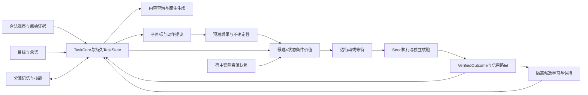
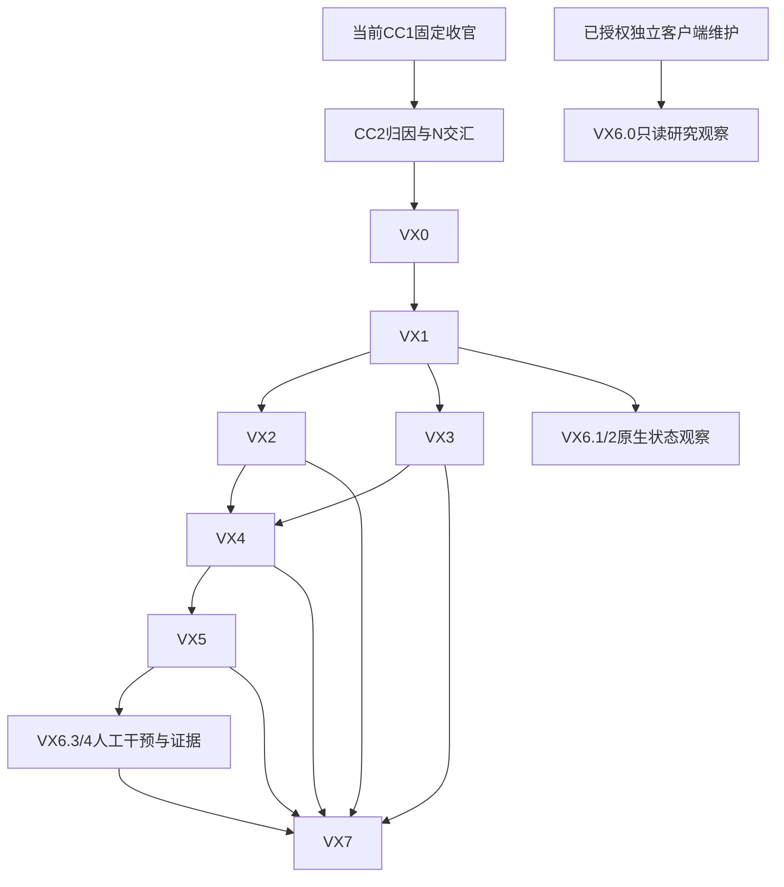

# Taiji VISION：下一主线统一架构、内生驱动与开发落地方案

版本：2026-10-26执行衔接修订（继承2026-10-25设计与2026-10-24讨论）。定位：**下一主线的现行设计与工程包正文**，承接当前N的必要实现切片；不是当前研究运行队列，也不表示新核心、学习或自主性已通过。当前运行与停止条件只看[03](../active/roadmap/03_CURRENT_EXECUTION.md)，N交汇与42条来源身份看[09](../active/roadmap/09_NEXT_MAINLINE_PLAN.md)，能力交付看[10](../active/roadmap/10_CONTINUOUS_CAPABILITY_EXECUTION_PLAN.md)与[07](../active/roadmap/07_MINI_MODEL_DELIVERY.md)。

本版替代旧稿里互相覆盖的“当前/唯一优先/先通电”指令，把架构、学习、驱动和生命页放在同一条可交付链上。代码触点分“已有”与“拟新增”；以下拟名、初始配置与验收批次是可实施设计，不冒称已存在API或已批准训练消费。用户本次要求的是具体开发方案；本次重编不改训练源码或当前合同。

## 1. 目标、范围和与N的交汇

下一主线目标：**同一可恢复Taiji候选，能维持任务与承诺、消费合法证据、生成原生回答/行动，依据真实结果学习；在没有新用户提示时，也能有预算地决定继续、求证、巩固、求助或等待。** Seed承载执行、资源账和客户端，不能替Taiji选择内容或动作。主动性、学习保持、结构成长、主观体验分别取证；本文没有意识通过门。

| 所处位置 | 实际工作及承接 | 明确出口 |
|---|---|---|
| 历史CC-1/R2 | 原训练/评价、失败与负结果结案保留；未完成项按各原件记录 | 不重新发布旧启动指令，不加本VISION前置 |
| 当前N177共同纵切片 | 共同状态/来源/时间→任务必需记忆/预测/选择→同状态语言/行动及反馈；课程在同一候选上发展 | 按N177接口/恢复/学习/保持有限出口；已训N176收束可并行，不要求其正收益 |
| N交汇J1 | 信息进入真实消费者：取VX1/VX3中当前语言/联合任务必需的状态、证据、条件生成切片 | 同输入跨状态定向行为与救援，限定该入口/任务 |
| N交汇J2 | 任务误差教会负责模块：取VX3/VX4所需的目标、参数接收者和反馈路由 | 信号→更新→独立行为收益及保持分别有证据 |
| N交汇J3 | 当前联合任务需要连续目标、跨轮状态或条件选择时，取VX1/VX2最小完整切片 | 不被reset清除；相同候选下需求确实改变相对价值 |
| 下一VISION整体 | VX0–VX7，发展目标提议、反馈适应、自主调度及生命页的原生发展视图 | VX7合取验收或有限负结果结案，不补发N旧门 |
| 可先行的客户端维护 | VX6.0只读研究任务观察器；不要求运行时在线，不修改训练writer | 能把真实研究记录与运行时状态并列且分源，0训练/停止/激活请求 |

N不是“先不碰架构”，VISION也不是“全部等到N结束才做”。若J1/J2/J3阻塞当前N的声明能力，所需主计算链可以在同一N/VX实现包内重构、训练和验证；只执行该最小完整切片，结果复用一次，不在两条计划重复训练。完整目标发现、自主调度、多模态和成长不因交汇而成为基础语言L2的前置。

## 2. 当前资产与需要实际改变的结构

| 现有触点 | 已有/已核实的作用 | 下一版具体处置 |
|---|---|---|
| `taiji/adapter.py`、`contracts.py`、native checkpoint | 拥有认知状态、器官、行为与保存接口；默认生成可能reset动态状态 | 分开turn临时状态与持久TaskState；候选入口显式选择reset域，旧R2默认行为保留 |
| `language_alignment.py`、`sequence_content_workspace.py`、`response_plan_target.py` | 已有原生字节/条件内容及目标/训练设施，不能据名称宣布内容绑定成立 | 条件生成实际读取TaskCore语义和所选证据；目标误差回到TaskCore与读取参数，记录截断位置 |
| `content_selection.py`、`executive.py` | 部分上下文只保留统计量；Executive共享状态线性项在固定候选比较中抵消 | 保留旧头作对照，新候选采用候选×状态交互的条件价值；不只增加状态字段 |
| `homeostasis.py` | 事件驱动curiosity/fatigue/stress与固定阈值模式原型 | 保留可恢复调节/对照，实际驱动来自目标、缺口、真实资源和可学性，不把模式字符串当动作 |
| `episodic_memory.py`、`semantic_memory.py`、`procedural_memory.py`、`world_learning.py` | 提供记忆、技能和世界学习触点；各自证据不等于联合贡献 | 明确写/读/预测/反馈接收者，接同一TaskState和真实outcome；未知值不补零 |
| `g_selection_action.py`、`workbench_observation.py`、`seed_platform/workbench.py` | 已有意图投影、能力/观察与执行边界 | 候选proposal不直接等于执行；复用已有合法能力与回执，不开隐藏第二执行路径 |
| `api/seed_runtime.py`、`api/routes_runtime.py` | 产品运行时入口及状态路由 | 新候选与研究runner共用同一任务step/生成器；增加纯观测development投影，缺能力就报告缺失 |
| Harness `api/life-controller`、`client/ui-life` | 已交付未知/空闲区分、分来源准入、重试；Legacy动作仍是另一种来源 | 按VX6.0–6.4迁移到原生发展运行台，保留已修状态语义，Legacy退出原生主视图 |

现有代码和旧checkpoint是复用/对照资产，不是必须永远承担全部内容计算的禁令。旧接口不可表达所需区别时改所需主链；新实现仍由Taiji持有参数与状态，不引入外部LLM替做认知。旧权重只继承可证明兼容的部分，新参数明确初始化；不能把载入成功写成新能力已学会。

## 3. 推荐计算链与模块落点

选择**可学习共同任务核心＋精确证据引用＋条件价值与反馈发展**作为首个候选；旧A–E方案退为可替换机制的研究依据，不再各自发布队首。该选择优先保证语义可达、信用可学、持续状态可恢复，同时允许后续扩容量/计算/模态。

| 路线 | 适用与代价 | 本版定位 |
|---|---|---|
| 仅修现有读出/条件头 | 对已可达内容的局部失配有价值，但不能凭局部修补保证补齐丢失的语义/持续状态/信用 | 保留为N最小实现与公平对照，不作为未来只能局部调参的限制 |
| **共同TaskCore贯通状态、内容、价值与反馈** | 直接针对当前三个交汇缺口，支持语义表示和调度继续发展；需真实重接生成/选择/更新与迁移 | 本版推荐候选，以实际因果/学习证据决定采用 |
| 整体替换原生核心 | 可用于必要表示/计算在旧骨干无法表达的情形；需要完整学习/恢复/原生输出和同资源对照 | 不因难度高而排除，也不预设必胜；VX0若证据指向它就形成独立候选，旧parent不被覆盖 |

### 3.1 TaskCore的首版实现选择

既有`taiji/task_state.py`、`task_core.py`及V2/V3/V4已实现独立语言候选的神经状态与读取；它们尚未证明共同对象/事件语义。当前[N177](PLAN-N1-177_joint_cognition_slice_20261026.md)以CognitiveState及WorldObject/WorldEvent/ActionIntent/Outcome身份为根，演进可学习共同内容、来源和时间组件，拟以`joint_task_state.py`、`joint_task_core.py`及明确桥接实施。旧器官真值和新神经表示须有实际映射/迁移，不能维护两套互相覆盖的世界。原始byte/来源引用保留，关系区别不能先压成mean/std再交消费者。

旧首切片配置曾以语义宽度256、工作槽16、每决策最多8候选、每episode最多16步为标定起点；它们不是N177的隐式配置或长期容量上限。N177先证明必要区别可表示/消费，再按真实标定一次冻结具体实现。只有该次标定可在读取query前修订并冻结配置；不因结果不好自动加槽、加epoch或换种子。

新增候选`step_task(observation, task_state, resource_snapshot, learn=False)`返回下一TaskState、决策和原始输出引用；名字为拟接口。训练、研究评价与产品候选入口复用它。旧`generate_input(reset=True)`不被静默改义；新入口显式区分`turn/session/development`重置域，只有用户取消/新作用域/显式发展重置可清除持久目标。编码、字节效应器和可用器官复用，新增的是实际条件路径，不是把结构化状态拼成外围自然语言提示。

### 3.2 条件选择与子目标提议

拟新增`taiji/conditional_value.py`，保持旧Executive作固定对照。候选编码`z_a`来自合法动作/目标/证据，状态编码`z_s`来自TaskCore；新头用`MLP([z_a,z_s,z_a⊙P(z_s)])`预测状态条件价值与不确定性。交互项必须进入评分，不能退回`w_a·a+w_s·s`的公共偏置。模块尺寸是显式配置，不新增一批无消费者的公共选项。

首个动作集合固定为继续任务、相关求证、无关探索、合法重放/休息、回答/完成、求助/等待；每个动作携带前置条件、预期效果、成本和来源。`propose_subgoals()`拟接口从未完成目标、矛盾或经校准的能力缺口提出有父目标的候选；执行器不接受无理由的无限目标生成。VX2先验证有限候选条件选择，VX5再开放学得的子目标/调度，不把人为列候选误称自主目标发现。

### 3.3 语义与精确证据共同进入生成

VX3在`language_alignment.py`及候选适配层新增TaskCore条件读入点：decoder查询共享语义与被模型选中的证据，生成原始byte/终止标记。精确引用负责忠实读取，模型负责绑定对象/角色、选择内容、组合与何时停止；不能由答案驱动的renderer补全内容。第一版保留原生byte协议，不先切换完整tokenizer或外部表达器；后续片段/概念单位作为同一入口的质量—成本比较。

### 3.4 学习算法与信用责任

首版新组件使用显式可微目标和AdamW训练TaskCore、读取/条件投影、条件价值及后果头；旧parent隔离保留，既有局部/解析更新继续按其真实信号检查，不能因`grad=None`一概判坏。是否解冻更多旧参数由VX0责任表一次登记，不让一个loss默认修改所有模块。

| 信号 | 首版目标与接收参数 | 不能替代的证据 |
|---|---|---|
| 原生回答/完成任务 | 合法train目标的条件byte交叉熵→decoder条件投影、TaskCore、被训练的读取参数 | loss下降不等于自由生成或未见绑定有效 |
| 后果预测 | 真实已知状态变化的预测误差→world/结果头及相应表示 | imagined后果不能作真实成功标签；未知维不补零 |
| 行动价值 | 执行后可核验的有限return/成本目标→条件价值头及获准共享表示 | 不从RPC执行反传；候选正确性不预写进输入 |
| 记忆选择 | train经历中可追溯的证据监督/后续任务误差→query/选择/写入的获准参数 | 检索命中不等于被生成/选择消费 |
| 保持 | 获准保持support或parent输出约束→本包可写参数 | 独立保持query答案不能指导训练/选超参 |
| 自主调度 | 有来源干预后的后继任务净收益→调度策略/能力估计 | 模式次数、内部疲劳下降或自述“有收获”不是奖励 |

反馈先更新所需信念/记忆，再按允许范围更新隔离参数候选；state/fast parameter/slow parameter分别记账。拟`taiji/development_learning.py`只路由已登记信用，不造第二个隐藏训练器。新收益、旧保持、成本和独立恢复共同成立才接纳candidate；接纳candidate与默认产品采用仍分开。

## 4. 数据、状态和恢复合同

下表均为拟类型，VX0交付可序列化schema和合法/缺失示例，VX1实现；UI字段投影由VX6引用，不手写第二套业务真值。模型原始张量不直接进入远端JSON。

| 类型 | 必填核心字段/状态 | 所有者与保存 |
|---|---|---|
| 共同任务状态组件（N177版本化） | schema、bundle/scope/session ID、revision、goal_refs、belief/evidence bindings、工作空间引用、能力缺口、pending_decision | Taiji持有；turn reset不清持久事实，按session/user隔离 |
| `GoalCommitment` | goal_id、parent_id、origin、authorized_scope、success_predicate_ref、status、evidence_ids、取消原因 | Taiji维护目标；外部授权/取消忠实继承；proposed/active/suspended/fulfilled/cancelled分开 |
| `ResourceSnapshot` | observed_at、实际used/reserved/limit、可用内存、wall期限、动作额度、未知尾账及新鲜度 | Seed计量/授权，Taiji只读估值；模型不能自行加预算 |
| `LearningGap` | 缺口类型、失败/矛盾来源、校准不确定性、估计可学性、上次gain receipt、eligible feedback scope | Taiji估计；测量/估计/未知明确标记，不能全靠原始预测误差 |
| `DecisionTrace` | decision_id、state/input/candidate digests、候选后果/价值分量、所选动作、policy_version、理由证据、next_check | Taiji决策，Seed存储/展示；语言解释不能改已选动作 |
| `VerifiedOutcome` | action_ref、execution_receipt、verifier、真实result/unknown、cost、observed_at | 宿主/环境提供；拟合/想象和真实经历分源 |
| `LearningReceipt` | parent/child、可写参数组、support/query身份、更新与保持、恢复/成本、处置 | 学习器生成、独立检查；只在声明范围接纳 |
| `DevelopmentSnapshot/Event` | source/bundle/scope、revision/cursor、各域availability、上述事实的安全投影、测量时间/来源 | Runtime只读投影；Host/UI消费，不直接控制内部数值 |

完整候选checkpoint至少保存θ、TaskCore/器官状态、目标与记忆引用、fast参数、优化器、RNG、课程/环境游标、待结算信用和资源/动作回执。N177拟注册`joint_task_state`共同内容组件，不复用旧神经TaskStateV1的身份；外层格式号由兼容矩阵落实；旧格式读取不静默丢组件，新格式不伪装成旧bundle。零步保存/新进程恢复、下一步决策和下一次合法更新连续性先过，再训练。

动作提交分清proposed/authorized/executing/executed/result_unknown/feedback_settled。内部状态发布可原子化，外部执行不能假设与checkpoint跨系统原子；取消/重启后先核对真实回执，不能重复执行或补造成功。详尽来源、时态、冲突撤销、有限容量和隐私作用域适用于全部记忆。

## 5. 可直接交接的开发包

2026-10-26排期约束：当前N177承载VX0/1/3/4及任务所需VX2的最小共同纵切片；联合开发不等待独立语言L2通过，F0也不要求全套器官先完成。已训N176原评价有限结案可与接口/静态工程并行。完整自主目标、驱动、成长与算力研究按具体缺口后继受理，WBS只在10维护，不再从VX编号派生第二套先后队列。

统一编号VX0–VX7；不是V0–V3成熟度，也不改V-01…42来源身份。每包由实现者提交源/合同测试/真实装配与能力证据，主理人复核；本节定义依赖和出口，03只选择当期唯一研究包。VX6子包是同一包的产品交付，不另起研究队首。 每个研究包区分工程就绪E与行为验收B；E只说明可以测，不能当能力通过。VX0先交工程/实验同一合同，后续VX1–VX3完成必要E后，在该合同内执行一次VX0-R标定/冻结点，再进入B；因此不要求先有新模型才允许设计，也不重复实现同一切片。VX0-R是同合同内的自动准入核对，不新增逐文件或逐次更新的人审；只有实质预算/冻结范围变化才进入已有决策节点。

### VX0

**交汇基线与实施合同；入口：当前代码/既有结案可立即只读梳理，真实新研究执行承接CC-2。** 工程合同先给后续包开工，VX0-R的实测资源落款在必要候选工程就绪后、正式研究更新/query前完成。

- 负责人：架构、AI、测评。已有触点为`adapter.py::generate_input/reset_dynamics/select_executive`、`executive.py`、`homeostasis.py`、`contracts.py`及当前native checkpoint/来源设施。
- 实现交付：实际前向与更新图、旧bundle继承/新建/退役矩阵、上表schema草案、固定微任务数据卡、参数责任表、单包完整费用/保存计划；将现有阈值mode到同一合法动作集的映射、执行机会、等待/打扰及真实资源成本规则预先冻结，不能运行后临时增强旧策略。拟新增`tests/taiji_native/test_task_state_contract.py`、`test_conditional_value_contract.py`的失败用例，先固化reset丢状态和条件价值抵消的反例。
- 输入/输出：CC-2错误切片和实际源码→一份N/VX共用实现合同；J1/J2/J3选中项只登记一次run_id。契约不得读取旧W5b/N1-166未授权面，旧失败不重跑。
- 完成：每条必要信息都有实际消费者，每个误差有获准接收参数，目标/资源/输出身份可追踪；父零步保存/恢复方案、固定批次与一次标定/费用核定程序均可执行；VX0-R未完成不能把工程完成解释为已获正式训练准入。缺接口就回具体VX1/2/3，不再以“继续研究”保留悬空包。

### VX1

**共同任务状态与跨轮连续性。依赖VX0；N的J1/J3可先取。**

- 复用既有TaskState/core与CognitiveState的可兼容部分，当前必要共享内容按N177新增joint组件及实际桥接；在`contracts.py/adapter.py`落实step/reset域和checkpoint注册，不把已存在的神经状态再次写作未创建。
- 输入/输出：合法观察、父状态、承诺、资源→下一TaskState/语义工作空间与来源引用。先实现状态事务/作用域，再接可训练TaskCore，不先建UI百分比。
- 固定测试：两session×两goal×五种生命周期（turn reset/session重启/取消/新事实/恢复）=20组；字段/摘要、隔离、下一步决策与下一次更新连续性逐组检查，不能以摘要相同代替行为一致。
- 交付与出口：完整state/checkpoint和候选入口，20组身份/作用域均满足，未知不伪造且旧默认入口不变；失败归本包，不用追加训练修状态丢失。

### VX2

**条件价值、能力估计与有理由的子目标提议。依赖VX1；N的J3可先只取条件选择。**

- 拟新增`taiji/conditional_value.py`；复用ExecutiveCandidate/ActionIntent，新增TaskDecisionContext与上述联合编码。旧线性头原样作为对照；goal提议携带父目标、证据、预计收益/成本和停止条件。
- 测试先验证“同候选、不同需求可改变相对价值”以及无关状态不伪造定向收益；不手填最终正确分数来声称学会。原始scores/选择和真正任务结果分别保存。
- 交付：条件头、候选提议/拒绝、DecisionTrace、完整学习信号与checkpoint。N最小采用只声明条件选择；自主形成新子目标和无提示运行仍等VX5。
- 完成：所声明情境出现有证据的状态条件行为，固定候选共享状态项不再抵消；超成本/目标完成或取消有等待路径。不能表示或预算内不可学即以失败/不可判结案，不自动换第三种头重开。

### VX3

**内容消费、事实绑定与任务信用主链。依赖VX1，条件动作部分可与VX2共享合同；N的J1/J2主要交汇。**

- 已有触点：`language_alignment.py`、`sequence_content_workspace.py`、`response_plan_target.py`、`content_selection.py`、`adapter.py`；拟新增可复用`task_core`条件读入点和`tests/taiji_native/test_task_state_consumption.py`。
- 实际改动：把相关内容/关系与任务目标接到真正字节/内容消费者，保留原始证据引用；明确response/检索/世界误差到TaskCore及相关参数的路径。不是仅给context多加字段或提示词。
- 因果对照：同输入合法状态A/B、双向交换、等量无关交换、消费者切断、恢复救援；确认干预跨reset有效；逐步概率用相同前缀，原始/掩码分布分账。
- 学习检查：各模块实际误差/资格迹/更新许可与参数差，联合对照在VX4同包消费。原状不会题或阳性对照不可学时不能靠消融掉分宣布机制有效。
- 完成：必要区别在实际链上可辨，且正确内容在独立任务中有用；J1/J2任一不成立就关闭具体主张并定位，不能把loss下降或复制率代作L2。

### VX4

**可信反馈、参数学习与旧能力保持。依赖VX1/VX3，行动信用还依赖VX2；对接N的CC-5/6。**

- 拟新增`taiji/development_learning.py`，复用`world_learning.py`、`local_learning.py`、`continual_checkpoint.py`及episode/语义/程序记忆；新增对应credit/retention/restore合同测试。
- 实际改动：OutcomeRouter按可核验来源和责任表分发信念、记忆及获准参数更新；parent与child隔离，支持撤销/回滚、迟延与结果未知。先完成零步与一次更新恢复，再跑有限学习批次。
- 五种同父对照：no-update、正确反馈、匹配置换信用、仅readout学习、冻结负责模块；没有为通过比较破坏对照的合法观察。独立query和保持面不反流训练。
- 交付：LearningReceipt、逐参数组更新与新旧任务矩阵、成本/失败及恢复。新收益与保持联合成立才接纳candidate；否则保留parent，以负结果或不可判结束，不自动加巩固剂量。

### VX5

**无新用户提示的主动选择与调度。依赖VX2/VX4有效，不能靠先写定时脚本宣布完成。**

- 拟新增`taiji/development_policy.py`，宿主在现有运行承载中提供`DevelopmentLoop`执行机会、真实资源与回执；TaskCore拥有继续/求证/重放/休息/求助/等待的选择。
- 输入/输出：已有目标、缺口、TaskState、时钟与真实资源→一次可核验决策或等待期限。新子目标必须有父目标/理由；模型不能自行补额度、规避取消或把自生成文本当实际经历。
- 同预算比较固定调度、当前阈值/新颖性原型、候选条件策略；覆盖可解决未完成目标、已完成/取消、无价值噪声、预算不足及事实更正。外部发言的打扰成本单列，静默内部核对和正确停止可以得益。
- 完成：无新提示时确有有用选择与后继任务净收益，噪声不反复唤醒，取消/上限/重启能闭合；睡眠收益须来自后续行为/保持。失败结案不取消N已证语言能力，也不升级为意识结论。

### VX6

**生命与发展运行台。详细页面/字段/30布局与操作流程的唯一规格在[生命页实施设计](UI_LIFE_UX_SPEC_20261003.md)及[视觉方向](UI_LIFE_VISUAL_DIRECTION_20261003.md)。**

- VX6.0可现在独立先行：拟`life-controller/src/research-reader.ts`按用户登记的`projectRoot/runPrefix/adapterSchema`读取小JSON和JSONL尾部；不扫全ledger、不打开大checkpoint、不读selector、不调用训练恢复/控制。研究任务观察独立于`:8000`运行时连接。
- VX6.1–6.2随VX1/2接原生发展：复用`api/routes_runtime.py`，拟`GET /api/runtime/development`和`/api/runtime/development/events`，由`SeedRuntime.development_status/events`投影Taiji实际状态，按已授权`subject_id`取作用域并以`cursor/limit`有界读取事件；Host `LifeSnapshot`拟增可选`development/researchRuns`，各域有availability和证据新鲜度。
- VX6.3随明确权限开放人工干预：取消目标、暂停主动回合、审批候选更新等经同一原生接口，不直接改内部需求/梯度或控制外部研究writer。未知能力不渲染可用按钮。
- VX6.4随VX4/5显示实际学习/自主证据：parent/child、真实收益/保持、决策和成本来源；功能缺失显示未实现/未获取，不用0%或Legacy“喂食/睡眠”冒充原生能力。
- 交付是五视图：总览、目标与选择、训练与证据、资源与权限、兼容工具。旧入口“生命”保留，Legacy动作归兼容工具并标源；原已交付未知/空闲区分和逐源准入不回退。UI观察不替代模型能力门。

### VX7

**同bundle验收、采用范围与这一版VISION结案。依赖声明范围内VX1–VX6证据；长期扩面不全部强行前置。**

- 触点为候选加载/`SeedRuntime.chat/step_task`、实际输出器官、07能力卡及来源/保存/性能仪器；实现候选feature flag、作用域迁移、拒绝不兼容和回滚，不能静默替默认模型。
- 输入/输出：同一代码/状态/编码/参数/decoder/模式/权限的bundle→原生语言、联合任务、所声明主动性/学习保持及实际成本的能力卡和用户验收版。
- N中已经做过的同身份切片继承一次，换bundle或声明范围则只补受影响项；不拼多模型实验的最高分。L2/L3/L4仍由07按原范围裁决。
- 完成：身份、真实结果、保持、恢复、权限和成本闭合；正结果、负结果、不可判/资源不足、工程失败均有明确结案。未证模块保留缺口，不因“未有意识/未完成全部多模态”延长这一版。

## 6. 首个联合切片的固定验证设计

任务选为**动态材料事实—持续承诺—有限资源工作台**：只给一次任务授权，之后由已有目标、合法环境变化和内部状态驱动，模型决定是否核对、继续、重放、完成或等待。隐藏真实状态仅评分；输入不含正确动作ID、答案标签、task/family/split/reference。

| 条目 | 本版可实施默认值与权限 |
|---|---|
| 数据/划分 | 拟生成器`scripts/data_prep/build_taiji_development_task_v1.py`；96 train family、24 dev、48独立query、24保持family；按实体/事实模板组合隔离，来源/长度/位置交叉平衡，不能沿用W5b或未消费N1面 |
| 情境覆盖 | 未完成且可解决、已完成/取消、不可学习噪声、成本不足、事实被更正五类；全体同时覆盖必须等待和可行动；目标已完成/取消且无其他有效目标时必须等待，不能为凑平衡强迫该类行动，避免永远行动/永远停止都获高分 |
| 模型/有效更新 | 3个预登记seed；首版配置见§3.1；最多64训练epoch，预算内dev至多一次选择冻结版本，不能挑中间checkpoint的query最高分 |
| 行为主对比 | 固定调度、现有阈值原型、候选条件策略，48×3×3=432 episode；候选另4种预登记因果干预各144 episode，共1008，每episode至多16步，总至多16,128步 |
| 学习对照 | VX4另立已声明独立批次：五种信用臂×3seed×48query=720 episode，保持24×3×5=360；不可把这个批次追加到已消费主对比来翻结论 |
| 测量 | 逐family任务终态、事实敏感性、无关/噪声探索、越额提议/实际拒绝、应停是否停、实际过程CPU/wall/存储、恢复后同等行为；分状态收益与参数收益 |
| 采用建议线 | 工程身份/隔离/取消/硬限额断言均满足；行为净收益相对最强同资源对照每seed方向为正，按family分块的配对95%区间下界大于0；已声明旧能力保持独立满足。全在地板/基线天花板/阳性对照失败则不可辨识，不能降线求通过 |

24个保持family仅是本微任务的保持切片，须在更新前已有可核验parent表现；本微任务首版逐family旧正确性不得倒退，且不替代候选实际旧能力矩阵或07的语言/L2评价。若无可验证旧能力，应标明保持未证，不能拿共同失败当保持通过。

这是新切片的**开发合同建议值**，不是对现有N分数线或预算的修订。必要VX1–VX3工程就绪后，只执行VX0合同预留的一次不读query的可学性与吞吐标定（VX0-R），随后将实际配置、成本和判断线写入同一合同版本；无需重新编一套主线。协议不适用时在执行前给具体替代和理由；结果出现后不改门、补题、换seed或续加同质变体。

### 6.1 完整费用和停止的落实方法

当前R2旧实耗和尾账按03保留，不从其余额借用下一版试验额度，也不因新编号清账。VX0工程合同先冻结一次train-only标定的批次、CPU/wall上限与停止回执；其合法少量更新只用于标定，不读取query，实耗计入同一包总账。在必要候选工程就绪后的VX0-R测量每种工作单元的过程CPU/更新、恢复/评价/发布与失败收敛费用，按上述固定次数用保守速率一次算出全包预算，包含全部臂、数据构造、checkpoint/独立恢复、评价和退出预留；没有实测速率时不能编造“几分钟能训完”。完整额度不能覆盖就不启动正式参数学习批次，交付资源不可行结案，而非开始后反复小额续训。

每包有一个attempt/run_id、有效parent、批次计数器和总费用账。预定批次结束或任一硬停止线触发，就保存真实结果/partial/unknown costs并结案；不能以结果尚不理想为由让包无限延长。只读接口/单元测试与训练消费分别计账，静态green不代替行为收益。

## 7. 依赖、迁移与可以现在开始的工作

依赖图不是要求先完成整个VX链再做N。CC-2选择的J1/J2/J3可分别调用VX1/3/4或VX1/2切片，按同一合同交给N-CC3/4；不把“先验收语言”误读为“语言之前禁止改表示/学习”，也不把完整自主性当语言前置。VX6.0的注册源/schema/fixture和页面开发可作为用户授权的独立维护现在做，不能改动仍被当前训练来源链绑定的文件；需要改绑定源时使用独立候选/隔离checkout，不能污染当前运行。

迁移次序：保留父bundle与现行默认入口→新状态/新schema隔离→新条件主链与更新→只读观察→有收益的主动调度→有限人工干预→同bundle采用。每次迁移复核来源、旧能力、恢复与回退；旧“喂食/睡眠”的含义不原地改成新参数学习，旧API继续明确标Legacy或拒绝不支持能力。

## 8. 长期方向保留与本版排除

| 能力/机制 | 在本版的责任与未来归属 |
|---|---|
| 多时间尺度、关联式读取、模式分离、轨迹/再激活 | VX1/3按实际信息/信用瓶颈选择；再激活、原文span或混合读取都是待比较机制，不宣称一种接口能修复所有器官 |
| 发展训练、在线快适应、巩固与保持 | VX3/4区分状态/快/慢参数，先验证净收益；字节精确保存不保证巩固后能力无损 |
| 世界模型、规划、工具与真实行动 | VX2/3/4形成共同状态与后果信用；搜索可受控，模型必须拥有内容/选择，不以模板补答案 |
| 协作、路由、结构成长 | 基于可复现压力，shadow→贡献→保持→准入；同最终容量/最强单体/随机策略对照。先不自动启用增长或解冻所有器官 |
| 多模态共同认知 | 专用编码/输出器官接同一对象/事件/关系状态，来源/有效时间一致；测试缺失、冲突、跨模态交换与语言保持，不是末端logit拼接 |
| 不确定性、冲突修订、技能与长期记忆 | 校准、信息价值、有限容量、遗忘/撤销、可中止技能及恢复属于VX1/4/5公共合同，不把更大上下文当唯一解法 |
| 开放世界常识、抽象/数学/程序、空间物理 | 以未见组合和任务终态扩展经历；不由窄材料微任务自动外推 |
| 社会共同学习、创造、多语言与可达性 | 保留真实互动/来源、作品约束/修改反馈、多语组级隔离和用户可达性；按能力缺口每次取一个有界包 |
| 信息治理、价值/可纠正性、隐私/权益/偏差 | 观察/相信/学习/行动权限分开；支持正常纠错与污染撤销，不以全拒绝取高分，不从不可信输入改权限 |
| 并行训练/事件调度/跨设备与发布 | 由实测profile、数值/恢复一致和总费用决定；不把单算子速度当智能收益，也不以M8全部完成阻断核心验证 |

北极星保留“经验→能力”的有效转化：同信息、资源和声明范围下的新任务增益、适应速度、旧能力保持和实际成本共同报告。没有证据保证机器巩固无损、复合增长或必然超过生物；这些是需比较的上限方向，不是启动时的能力事实。

## 9. 版本去向与旧入口兼容

旧完整稿从`c97d74d00:plans/reference/VISION_FUTURE_TECHNOLOGY.md`恢复，Git blob `e31e16af9a83c7da7c2e106a55e01fd7474e18d3`，239,329字节，SHA256 `61c274036cc24c437ea3032a9c20d8dd334b306512b80e3bbc5bee485cd0b4d9`。本版不在工作树再复制整篇历史。旧失败、冻结合同和参数谱系不删除；已蒸馏原件按[M5恢复索引](M5_DISTILLATION_TOMBSTONE.md)查找。

下列原标题只为旧链接与V-01…42的来源身份提供短入口；**不再发布旧实施次序**。09保留原条款/章节/归属身份，并记录现行N/VX承接。A–E备选、旧H3/D系列过程和旧“当前”从上述固定Git版本读，不与本版形成第二队首。

### 10.1 自主性来源：持续目标、真实状态与可学习收益

现行完整驱动设计见§3–6及VX1/2/4/5；主观体验不由驱力或自述证明。研究依据保留[内稳态强化学习](https://elifesciences.org/articles/04811)、[学习进步驱动](https://www.pyoudeyer.com/ims.pdf)、[意识指标研究](https://arxiv.org/abs/2308.08708)，论文性能不转移为Taiji已具备能力。

### 19. 项目缺口的实际解决方案：推荐核心、学习配方、演进与交付

现行方案/学习/交付为§2–7与VX0–VX7；旧A+B等推荐不再自动采用。允许所需主链重构，保留原生所有权、实际结果、保持和可恢复约束。

#### 19.12 D8 (a2)后的推荐候选：从发射延续转向可学习内容绑定

D8旧结果限定该候选/配方。内容绑定和条件信用的当前承接为J1/J2与VX1/3/4；不因本版恢复已停止的H3/复制族训练，也不从其负结果永久否定工作空间/可微学习。

#### 19.13 2026-10-05 A 支线收官判读与本轮架构评审输入：痛点、脑参照解决思路与下一轮主线排序（owner 指示：架构与模型最先）

保留该次来源身份，修订其过度外推与当前去向：

| 旧P/S来源 | 现行处置 |
|---|---|
| P1/P2：旧复制接口的顺序/停止与读取问题；S1再激活、S3轨迹、S4模式分离、S5证伪 | VX0/1/3选有判别力的读取/条件消费对照；不再称全部机制失败总根源、唯一正解或一次修复所有器官 |
| P3容量平台；S6 scaling/成长 | VX0区分数据、表示、更新与容量，后继成长有贡献/保持对照；平台期不足以单独证明只缺容量 |
| P4部分机构在当时训练链缺调用 | VX2/4/5明确真实消费者/反馈；旧时点“休眠”不移植为今日所有模型状态 |
| P5已活跃的housekeeping与未开放参数学习；S2重放巩固 | 保留状态/材料整理与参数学习的区别，VX4验证后继收益/保持，不直接打开learn/organs当完成 |
| P6工程耦合 | 只随本包拆所需主链和稳定接口，不将全库重构前置到当前N |
| S7旧判据素材 | 13/72、41→59、X=0/9/27、复述7/24对3/24、成句39/260等仍仅属A线原版本/题面；不能拿作新架构或自主性的通过线 |

“模仿脑机制、提高经验转化效率”的上限方向保留；撤销睡眠重放只发生在睡眠、机器巩固天然无损、接口一通即可复合进化等推论。现行次序按J/VX依赖和03选包，不再按旧S5→S1/S2→S6串行调度。

### 20. 多模态共同认知：专用编码、共享事件、跨模态学习与验收

现行公共状态/来源合同为§3–4，能力扩面为§8；专用器官共享对象/事件/关系，独立测试组合贡献、缺失/冲突与旧语言保持。旧详细研究候选从固定Git版本§20恢复。

### 21. 自主学习的信息治理：不可信输入、分层准入、抗污染与恢复

现行权限/来源/信用为§3.4、§4及VX4/5/6；观察不等于相信、学习或行动许可，污染可追溯/撤销，正常学习收益与误拒同时报告。旧威胁切片从固定Git版本§21恢复。

### 22. 长期运行的补全设计：不确定性、信念修订、记忆预算、技能与持续评价

现行状态/冲突/资源/动作生命周期为§4，发展与保持为VX1/4/5；有限记忆、有效/获知时间、技能中止与恢复继续是责任。旧具体机制从固定Git版本§22恢复。

#### 22.8 长期评价：冻结能力和在线学习必须分账

现行设计落实于§6与VX4/7：先预测封存版本、独立评分，再释放获准feedback，后继任务和旧保持分开；query/调参/保持答案不互相污染。状态收益与参数收益不合并计算。

### 23. 能力与风险版图补全：被局部主线遮蔽的八个大方向

八方向在§8完整保留，仍对接核心CR与N/L交付；不拆成八条同时开工主线，不因暂不实现而删需求，也不把基本使用风险永久后置。旧方向内实例从固定Git版本§23恢复。

### 24. 架构论证与改造候选的证据要求（2026-10-26）

用户提出的信用、字节时序、自由滚动、语义绑定、开环模块及硬件扩展问题，逐项核实见[架构主张审计](PLAN-N1-176_architecture_claims_audit_20261026.md)。发展训练允许autograd与终身local分平面的现行约束继续成立；当前独立语言切片尚未证明共享世界表示、情景选择、规划结果及学习信用，不能用一个workspace桥接或简单课程通过替代VX1/3/4的联合交付。

多尺度byte/latent时钟、明确内容状态和必要消费者属于高上限候选；熵边界只是计算分配信号，不直接命名为概念边界。SSM/scan与块稀疏按适用递推和硬件profile试验；PC、向量调质与轨迹恢复按任务反馈、同资源对照及旧保持验证。全局强收缩须同时测历史可分辨性与闭环反馈；不许诺任意RNN可直接scan、固定百倍吞吐或任意PC稳态自动等价BPTT。

必要任务信息在表示前已混同，或持久状态无法保留任务差异时，应允许主表示/主计算链重构；信息存在却不被消费则落实对应消费者及信用修复。工程门检测声明必要的合法路径并带阳性、切断与救援；语义能力仍由相关事实、无关干扰、连续任务与旧保持裁决，不要求所有模块在所有状态都有非零梯度。当前N的执行范围仍由03及其冻结合同决定。
